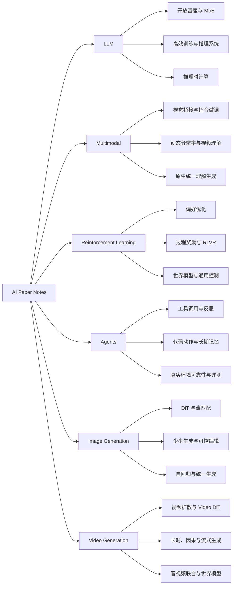

# ai-paper-notes

> 面向深入研究与工程实践的 AI 论文精读知识库
>
> **LLM · Multimodal · Reinforcement Learning · Agents · Image Generation · Video Generation**


## 项目简介

本项目系统记录 **2023 年以来大模型、多模态、强化学习、Agent、图像生成与视频生成** 领域的经典及前沿论文。

这里不追求“收集所有热门论文”，而是围绕每条技术主线回答三个问题：

1. **它解决了什么问题？**
2. **它为什么有效，关键设计是什么？**
3. **它留下了什么局限，后续工作如何继续演进？**

笔记重点关注核心公式、训练方法、数据工程、系统设计、实验结论、能力边界与复现价值，逐步形成可长期维护的阅读路线图。

- **时间范围**：2023-01 至 2026-11，持续更新
- **筛选口径**：范式创新、持续研究价值、工程复现价值
- **重点标记**：★ 表示对应方向的优先精读论文
- **时间边界**：少量 2022 年预印本、2023 年正式发表的奠基工作会明确标注后纳入
- **前沿声明**：2026 年新工作仅作为前沿观察，不提前定义为“经典”

## 知识地图



## 推荐阅读方式

不建议按年份或模型版本顺序通读。更推荐沿每条主线学习：

> **问题背景 → 核心方法 → 数学或系统原理 → 实验结论 → 方法局限 → 后续演进**

可以根据目标选择不同路径：

| 目标 | 推荐路径 |
|---|---|
| 快速建立知识框架 | 每个方向先读 ★ 论文，再沿研读顺序补齐前后置工作 |
| 大模型工程与推理部署 | LLaMA → GQA → FlashAttention-2 → PagedAttention → DeepSeek-V2/V3 |
| 多模态模型训练 | BLIP-2 → LLaVA → Qwen-VL → Qwen2.5-VL → Emu3/Janus-Pro |
| 推理模型与后训练 | DPO → Let's Verify Step by Step → GRPO → DeepSeek-R1 → DAPO → RLVR 边界分析 |
| Agent 工程落地 | ReAct → CodeAct → SWE-agent → MemGPT → WebArena → OSWorld |
| 图像生成 | DiT → Flow Matching → Rectified Flow → Consistency Models → SD3 |
| 视频生成 | Video LDM → SVD → CogVideoX → Diffusion Forcing → CausVid/Self Forcing |

---

## 一、Large Language Models

**主线：开放基座 → 高效注意力与推理系统 → MoE 与训练系统协同 → 推理时计算**

| 层级 | 论文 | 年份 / 出处 | 核心贡献与推荐理由 |
|---|---|---|---|
| 经典 | ★ [LLaMA: Open and Efficient Foundation Language Models](https://arxiv.org/abs/2302.13971) | 2023, arXiv | 确立开放基座的重要复现基线。重点关注 RMSNorm、SwiGLU、RoPE 与数据配比。 |
| 经典 | [GQA: Training Generalized Multi-Query Transformer Models from Multi-Head Checkpoints](https://arxiv.org/abs/2305.13245) | EMNLP 2023 | 在 MHA 与 MQA 之间折中，通过分组共享 K/V 头降低 KV cache，是理解现代推理成本的基础。 |
| 经典 / 工程 | [FlashAttention-2](https://arxiv.org/abs/2307.08691) | ICLR 2024 | 从 GPU 内存层级与 work partition 优化精确注意力，解释 FLOPs 相近但实际速度不同的原因。 |
| 工程 | ★ [Efficient Memory Management for Large Language Model Serving with PagedAttention](https://arxiv.org/abs/2309.06180) | SOSP 2023 | 将分页内存管理引入 KV cache，是理解 continuous batching、前缀缓存与生产级推理服务的核心。 |
| 工程 | [DeepSeek-V2](https://arxiv.org/abs/2405.04434) | 2024, arXiv | MLA 低秩压缩 KV cache；DeepSeekMoE 使用细粒度专家与共享专家，是阅读 V3 的架构前置。 |
| 工程 | ★ [DeepSeek-V3 Technical Report](https://arxiv.org/abs/2412.19437) | 2024, arXiv | MLA+MoE、无辅助损失负载均衡、多 token 预测、FP8 训练与系统协同的代表性技术报告。 |
| 工程 | [The Llama 3 Herd of Models](https://arxiv.org/abs/2407.21783) | 2024, arXiv | 覆盖预训练、后训练、安全与多语言能力，适合与 DeepSeek 的 MoE 路线进行对照。 |
| 工程 | [Qwen3 Technical Report](https://arxiv.org/abs/2505.09388) | 2025, arXiv | 覆盖 dense/MoE，统一 thinking/non-thinking 模式并引入 thinking budget，体现按需分配推理计算的趋势。 |
| 前沿 | [Mamba: Linear-Time Sequence Modeling with Selective State Spaces](https://arxiv.org/abs/2312.00752) | COLM 2024 | 选择性 SSM、硬件感知并行扫描与线性序列复杂度，为审视 Transformer 归纳偏置提供不同路线。 |
| 前沿 | ★ [s1: Simple Test-Time Scaling](https://arxiv.org/abs/2501.19393) | 2025, arXiv | 用精选推理轨迹 SFT 与 budget forcing 控制思考长度，便于拆解数据、基座和推理预算三个变量。 |

**研读顺序**

`LLaMA → GQA → FlashAttention-2 → PagedAttention → DeepSeek-V2 → DeepSeek-V3 → Llama 3 / Qwen3 → Mamba → s1`

**补充选读**：[Position Interpolation](https://arxiv.org/abs/2306.15595) · [Large Language Monkeys](https://arxiv.org/abs/2407.21787) · [Scaling Data-Constrained Language Models](https://jmlr.org/papers/volume26/24-1000/24-1000.pdf)

---

## 二、Multimodal Learning

**主线：视觉桥接 → 视觉指令微调 → 动态分辨率与长视频理解 → 原生统一理解生成**

| 层级 | 论文 | 年份 / 出处 | 核心贡献与推荐理由 |
|---|---|---|---|
| 经典 | ★ [BLIP-2](https://proceedings.mlr.press/v202/li23q.html) | ICML 2023 | 冻结视觉编码器与 LLM，以 Q-Former 两阶段桥接模态，是理解轻量模态对齐成本结构的起点。 |
| 经典 | [InstructBLIP](https://arxiv.org/abs/2305.06500) | NeurIPS 2023 | 指令感知 Q-Former 与系统化视觉指令数据，可与 LLaVA 的简化桥接路线对照。 |
| 经典 | ★ [Visual Instruction Tuning（LLaVA）](https://arxiv.org/abs/2304.08485) | NeurIPS 2023 | CLIP+投影层+LLM，以合成视觉指令数据训练，奠定开源 VLM 的主流训练范式。 |
| 经典 / 工程 | [Qwen-VL](https://arxiv.org/abs/2308.12966) | 2023, arXiv | 将多语言、OCR 与视觉定位纳入统一训练，不只关注图文聊天能力。 |
| 工程 | [InternVL 2.5](https://arxiv.org/abs/2412.05271) | 2024, arXiv | 系统讨论视觉编码器、LLM、数据与 test-time scaling，适合作为强 VLM 的横向对照。 |
| 工程 | ★ [Qwen2.5-VL Technical Report](https://arxiv.org/abs/2502.13923) | 2025, arXiv | 动态分辨率 ViT、时间编码、文档解析、精确定位与长视频理解的综合工程形态。 |
| 前沿 | [Chameleon](https://arxiv.org/abs/2405.09818) | 2024, arXiv | 混合模态 early-fusion，在单一 token 序列中交错理解和生成。 |
| 前沿 | ★ [Emu3: Next-Token Prediction is All You Need](https://arxiv.org/abs/2409.18869) | 2024, arXiv | 将文本、图像和视频统一离散 token 化，仅以 next-token prediction 处理感知与生成。 |
| 前沿 | [Janus-Pro](https://arxiv.org/abs/2501.17811) | 2025, arXiv | 解耦视觉理解与生成编码，缓解两类任务对视觉粒度和表示的冲突。 |
| 前沿 | [Unveiling Encoder-Free Vision-Language Models（EVE）](https://arxiv.org/abs/2406.11832) | NeurIPS 2024 | 探索去掉独立视觉编码器的纯 decoder-only VLM，并给出透明训练配方。 |

**研读顺序**

`BLIP-2 → LLaVA → InstructBLIP → Qwen-VL → Qwen2.5-VL / InternVL 2.5 → Chameleon → Emu3 → Janus-Pro → EVE`

**评测与音频补充**：[MMMU](https://arxiv.org/abs/2311.16502) · [MathVista](https://arxiv.org/abs/2310.02255) · [AnyGPT](https://arxiv.org/abs/2402.12226)

---

## 三、Reinforcement Learning

**主线：偏好优化 → 过程奖励 → GRPO → RLVR → 工程稳定化 → 能力边界反思**

| 层级 | 论文 | 年份 / 出处 | 核心贡献与推荐理由 |
|---|---|---|---|
| 经典 | ★ [Direct Preference Optimization](https://arxiv.org/abs/2305.18290) | NeurIPS 2023 | 将奖励模型+PPO 转化为单阶段离线偏好分类目标。重点理解它与在线 RL 的本质差别。 |
| 经典 | [Let's Verify Step by Step](https://arxiv.org/abs/2305.20050) | 2023, arXiv | 系统比较结果监督与过程监督，是 PRM、步级信用分配与搜索式推理的基础文献。 |
| 经典 | ★ [DeepSeekMath](https://arxiv.org/abs/2402.03300) | 2024, arXiv | 提出 GRPO：组内采样、相对奖励构造优势，省去独立 value critic。 |
| 经典 / 反思 | [Helping or Herding? Reward Model Ensembles Mitigate but do not Eliminate Reward Hacking](https://openreview.net/forum?id=5u1GpUKKTG) | COLM 2024 | 说明奖励模型欠指定、过优化及集成的局限，建立奖励被优化与攻击的风险意识。 |
| 工程 | ★ [DeepSeek-R1](https://arxiv.org/abs/2501.12948) | 2025, arXiv / Nature | R1-Zero 展示纯 RLVR，R1 采用冷启动、分阶段 RL 与蒸馏，是可验证奖励+长 CoT 的代表。 |
| 工程 | [DAPO](https://arxiv.org/abs/2503.14476) | NeurIPS 2025 | Clip-Higher、Dynamic Sampling、Token-Level Loss 与 Overlong Reward Shaping，适合复现工程细节。 |
| 工程 | [Rewarding Progress: Scaling Automated Process Verifiers for LLM Reasoning](https://arxiv.org/abs/2410.08146) | ICLR 2025 | 将过程奖励重新定义为步级优势，连接 PRM 与 RL 中的 advantage。 |
| 前沿 / 反思 | ★ [Does Reinforcement Learning Really Incentivize Reasoning Capacity in LLMs Beyond the Base Model?](https://arxiv.org/abs/2504.13837) | NeurIPS 2025 | 大 pass@k 实验提示 RLVR 可能更多是在提高基座已有路径的命中概率，而非扩展能力支持集。 |
| 通用 RL | [Mastering Diverse Control Tasks through World Models](https://www.nature.com/articles/s41586-025-08744-2) | Nature 2025 | DreamerV3：世界模型、想象轨迹与 actor-critic，以固定超参覆盖多类控制任务。 |
| 通用 RL | [TD-MPC2](https://arxiv.org/abs/2310.16828) | ICLR 2024 | 结合潜空间世界模型、TD 价值学习与模型预测控制，适合与 DreamerV3 对照。 |

**研读顺序**

`DPO → Let's Verify Step by Step → DeepSeekMath / GRPO → Reward Hacking → DeepSeek-R1 → DAPO → PAV → RLVR 能力边界`

通用 RL 再读：`DreamerV3 → TD-MPC2`。

---

## 四、Agents

**主线：工具调用 → 反思与技能积累 → 代码动作 → 记忆管理 → 真实环境可靠性与评测**

| 层级 | 论文 | 年份 / 出处 | 核心贡献与推荐理由 |
|---|---|---|---|
| 经典 | ★ [ReAct](https://openreview.net/forum?id=WE_vluYUL-X) | ICLR 2023 | 建立 Thought–Action–Observation 闭环，是现代 Agent 轨迹组织的起点。 |
| 经典 | [Toolformer](https://arxiv.org/abs/2302.04761) | NeurIPS 2023 | 通过自监督数据让模型学习何时、如何调用 API；与主要改变推理轨迹的 ReAct 形成对照。 |
| 经典 | [Reflexion](https://arxiv.org/abs/2303.11366) | NeurIPS 2023 | 将环境反馈转成语言反思并写入情景记忆，不更新权重也能迭代修正。 |
| 经典 | [Generative Agents](https://dl.acm.org/doi/10.1145/3586183.3606763) | UIST 2023 | 记忆流、反思、检索与分层规划的组合蓝本；结论主要来自沙盒社会模拟。 |
| 经典 / 系统 | [Voyager](https://arxiv.org/abs/2305.16291) | TMLR 2024 | 自动课程、执行反馈与可复用代码技能库，是开放世界 Agent 经验沉淀的代表。 |
| 工程 | [AutoGen](https://arxiv.org/abs/2308.08155) | COLM 2024 | 多智能体对话编排、人在环与工具接入；框架能力不等于多智能体必然更优。 |
| 工程 | ★ [Executable Code Actions Elicit Better LLM Agents（CodeAct）](https://arxiv.org/abs/2402.01030) | ICML 2024 | 用可执行 Python 统一动作空间，与固定 JSON API 路线形成重要对照。 |
| 工程 | ★ [SWE-agent](https://arxiv.org/abs/2405.15793) | NeurIPS 2024 | 提出 Agent-Computer Interface，说明终端、编辑器与工具接口设计本身就是 Agent 能力的一部分。 |
| 工程 / 记忆 | [MemGPT](https://arxiv.org/abs/2310.08560) | 2023, arXiv | 将上下文视作受限主存，通过函数调用管理内外部记忆，是长期记忆工程化的重要参照。 |
| 评测 | [AgentBench](https://arxiv.org/abs/2308.03688) | ICLR 2024 | 早期多环境 Agent 评测框架，适合建立能力维度与失败归因视角。 |
| 评测 | [WebArena](https://arxiv.org/abs/2307.13854) | ICLR 2024 | 自托管真实网站、长程任务与执行式评价，是 Web Agent 的关键基准。 |
| 评测 | ★ [OSWorld](https://arxiv.org/abs/2404.07972) | NeurIPS 2024 | 真实操作系统、多应用、多模态任务，推动评测走向完整 computer-use 工作流。 |

**研读顺序**

`ReAct → Toolformer → Reflexion → Generative Agents / Voyager → AutoGen → CodeAct / SWE-agent → MemGPT → AgentBench → WebArena → OSWorld`

**补充选读**：[Tree of Thoughts](https://arxiv.org/abs/2305.10601) · [GAIA](https://arxiv.org/abs/2311.12983)

---

## 五、Image Generation

**主线：DiT → Flow Matching / Rectified Flow → 少步蒸馏 → 可控生成与编辑 → 自回归与统一生成**

| 层级 | 论文 | 年份 / 出处 | 核心贡献与推荐理由 |
|---|---|---|---|
| 经典 | ★ [Scalable Diffusion Models with Transformers（DiT）](https://arxiv.org/abs/2212.09748) | ICCV 2023 | 在潜空间用 Transformer 替代 U-Net，并验证扩散模型随深度、宽度与 token 数扩展的规律。 |
| 经典 | ★ [Flow Matching for Generative Modeling](https://arxiv.org/abs/2210.02747) | ICLR 2023 | 以向量场回归训练连续归一化流，提供统一理解扩散路径和 OT 路径的框架。 |
| 经典 | [Flow Straight and Fast: Learning to Generate and Transfer Data with Rectified Flow](https://arxiv.org/abs/2209.03003) | ICLR 2023 | 学习近似直线的数据—噪声 ODE 路径，以 reflow 拉直轨迹，降低少步采样误差。 |
| 经典 | ★ [Consistency Models](https://arxiv.org/abs/2303.01469) | ICML 2023 | 学习同一扩散轨迹上任意时间点到同一干净样本的一致性映射，是一步/少步生成的理论母题。 |
| 经典 | ★ [ControlNet](https://arxiv.org/abs/2302.05543) | ICCV 2023 | 冻结主干，以可训练副本和 zero convolution 注入姿态、深度、边缘等空间控制。 |
| 经典 / 编辑 | [InstructPix2Pix](https://arxiv.org/abs/2211.09800) | CVPR 2023 | 用合成指令—图像对训练端到端指令编辑器，无需逐样本反演。 |
| 工程 | [SDXL](https://openreview.net/forum?id=di52zR8xgf) | ICLR 2024 | 双文本编码器、更大的 U-Net、多宽高比条件与 refiner，代表 U-Net 潜扩散的成熟工程形态。 |
| 工程 | [PixArt-α](https://openreview.net/forum?id=eAKmQPe3m1) | ICLR 2024 | 将 DiT 高效改造成 T2I 模型，训练分阶段、VLM 稠密字幕与数据工程尤其值得阅读。 |
| 工程 / 少步 | [Latent Consistency Models](https://arxiv.org/abs/2310.04378) | 2023, arXiv | 将一致性蒸馏带入潜空间高分辨率生成，LCM-LoRA 使少步加速成为通用工程组件。 |
| 工程 | ★ [Scaling Rectified Flow Transformers for High-Resolution Image Synthesis（SD3）](https://proceedings.mlr.press/v235/esser24a.html) | ICML 2024 | 改进 RF 时间步采样并提出双流 MM-DiT，是 Rectified Flow+Transformer 的系统集成范本。 |
| 前沿 / AR | [VAR](https://arxiv.org/abs/2404.02905) · [MAR](https://arxiv.org/abs/2406.11838) | NeurIPS 2024 | VAR 采用 next-scale 预测；MAR 用逐 token 扩散损失摆脱 VQ，在连续潜空间进行自回归。 |
| 前沿 / 统一 | [Transfusion](https://openreview.net/forum?id=SI2hI0frk6) | ICLR 2025 | 在单 Transformer 中结合文本 next-token 损失与图像扩散损失，探索统一生成架构。 |

**研读顺序**

`DiT → Flow Matching → Rectified Flow → Consistency Models → ControlNet / InstructPix2Pix → SDXL / PixArt-α → LCM → SD3 → VAR / MAR → Transfusion`

**补充选读**：[IP-Adapter](https://arxiv.org/abs/2308.06721) · [Adversarial Diffusion Distillation](https://arxiv.org/abs/2311.17042) · [BAGEL](https://arxiv.org/abs/2505.14683)

---

## 六、Video Generation

**主线：图像模型时序化 → Video DiT 与流匹配 → 长时因果生成 → 音视频联合 → 世界模型**

| 层级 | 论文 | 年份 / 出处 | 核心贡献与推荐理由 |
|---|---|---|---|
| 经典 | ★ [Align Your Latents（Video LDM）](https://openaccess.thecvf.com/content/CVPR2023/html/Blattmann_Align_Your_Latents_High-Resolution_Video_Synthesis_With_Latent_Diffusion_Models_CVPR_2023_paper.html) | CVPR 2023 | 在图像 LDM 中注入时间维并做时序对齐，确立“图像生成器+时序层”的视频扩散路线。 |
| 经典 | [AnimateDiff](https://arxiv.org/abs/2307.04725) | ICLR 2024 | 将运动模块与个性化外观模型解耦，训练一次即可插拔到同基座 T2I 模型。 |
| 经典 / 工程 | [Stable Video Diffusion](https://arxiv.org/abs/2311.15127) | 2023, arXiv | 系统拆解图像预训练、视频预训练、高质量视频微调与数据策展，是开源视频工程基线。 |
| 经典 / AR | [VideoPoet](https://proceedings.mlr.press/v235/kondratyuk24a.html) | ICML 2024 | decoder-only 自回归统一文本、图像、视频和音频，为视频生成提供扩散之外的对照路线。 |
| 前沿基础 | ★ [Diffusion Forcing](https://arxiv.org/abs/2407.01392) | NeurIPS 2024 | 不同 token 可具有不同噪声级别，连接 next-token prediction 与全序列扩散，是长时流式生成的重要节点。 |
| 工程 | [Pyramidal Flow Matching for Efficient Video Generative Modeling](https://arxiv.org/abs/2410.05954) | ICLR 2025 | 将金字塔分辨率调度、流匹配和统一 DiT 结合，减少全分辨率阶段的计算。 |
| 工程 | [CogVideoX](https://arxiv.org/abs/2408.06072) | ICLR 2025 | 3D VAE、expert Transformer 与 expert adaptive LayerNorm，是开源视频 DiT 的重要系统样本。 |
| 工程 | [HunyuanVideo](https://arxiv.org/abs/2412.03603) · [Wan](https://arxiv.org/abs/2503.20314) | 2024 / 2025, arXiv | 适合对照时空 VAE、数据策展、渐进训练、模型规模、分辨率与部署取舍。 |
| 工程 / 媒体统一 | [Movie Gen](https://arxiv.org/abs/2410.13720) | 2024, arXiv | 覆盖视频、个性化、编辑、视频转音频和文本转音频，是大型媒体基础模型的综合报告。 |
| 前沿 / 流式 | ★ [CausVid](https://arxiv.org/abs/2412.07772) · [Self Forcing](https://arxiv.org/abs/2506.08009) | CVPR / NeurIPS 2025 | 前者蒸馏因果学生并做少步 DMD；后者以自生成历史训练，直接缓解 exposure bias。 |
| 前沿 / 音频 | [MMAudio](https://arxiv.org/abs/2412.15322) | CVPR 2025 | 联合视频、音频、文本训练，通过条件同步模块实现帧级音视频对齐。 |
| 前沿 / 世界模型 | [Genie](https://arxiv.org/abs/2402.15391) · [Cosmos](https://arxiv.org/abs/2501.03575) | ICML 2024 / 2025 | Genie 学习隐动作与交互环境；Cosmos 将世界基座、视频 tokenizer、数据与后训练平台化。 |

**研读顺序**

`Video LDM → AnimateDiff → SVD → VideoPoet → Pyramidal Flow / CogVideoX → HunyuanVideo / Wan → Diffusion Forcing → CausVid / Self Forcing → Movie Gen / MMAudio → Genie / Cosmos`

> **关于 Sora**：公开材料主要是官方技术介绍与演示，并非完整研究论文，因此不与上述论文并列作为方法证据。

---

## 四个数学锚点

### 1. DPO：离线偏好分类，不做在线 rollout

$$
\mathcal{L}_{\mathrm{DPO}}
=-\mathbb{E}\log\sigma\left(
\beta\left[
\log\frac{\pi_\theta(y_w\mid x)}{\pi_{\mathrm{ref}}(y_w\mid x)}
-\log\frac{\pi_\theta(y_l\mid x)}{\pi_{\mathrm{ref}}(y_l\mid x)}
\right]\right)
$$

### 2. GRPO：组内相对优势，省去独立 critic

$$
A_i=\frac{r_i-\operatorname{mean}(r_{1:G})}
{\operatorname{std}(r_{1:G})+\epsilon}
$$

### 3. Rectified Flow：学习直线路径的速度场

$$
x_t=(1-t)x_0+t\epsilon,\qquad
v_t^\star(x_t)=\epsilon-x_0
$$

### 4. Consistency Model：同一轨迹上的端点一致性

$$
f_\theta(x_t,t)=f_\theta(x_s,s)
$$

其中，$(x_t,t)$ 与 $(x_s,s)$ 位于同一条概率流 ODE 轨迹。

---

## 2026 前沿方向与成熟度

> 下表区分“已经落地的工程趋势”与“仍在探索的研究方向”。成熟度描述的是当前证据与落地状态，不代表对未来效果的保证。

| 方向 | 当前状态 | 关键进展与尚未解决的问题 |
|---|---|---|
| RLVR 与推理时预算 | **已落地，集中于可验证域** | 数学、代码较成熟；开放写作、事实性和难验证奖励仍是瓶颈。 |
| MoE、混合/稀疏注意力与系统协同 | **持续工程化** | 架构、训练、RL 环境和服务系统共同设计，不宜只比较总参数量。 |
| 动态分辨率、文档与长视频理解 | **已落地** | 竞争点扩展到 OCR、定位、时间对齐、结构化抽取与 Agent 视觉感知。 |
| 图像少步生成与可控编辑 | **已落地** | 从“能否生成”转向少步质量、主体一致性、精确编辑与组合控制。 |
| 统一 / 原生多模态 | **早期落地，架构仍探索** | 生成质量、模态干扰、表示冲突与统一评测仍待解决。 |
| 实时、长时、因果视频 | **早期落地** | 少步与流式生成已可运行；分钟级一致性、历史压缩和误差累积仍未解决。 |
| 音视频联合生成 | **早期落地至持续探索** | 视频转音频较实用；同步对白、音效、音乐和长期语义一致性仍缺统一方案。 |
| Agentic RL | **早期落地，生产成本较高** | 核心瓶颈是多轮信用分配、环境保真度、rollout 成本与仿真到真实的差距。 |
| 长期记忆与上下文工程 | **RAG/摘要已落地，自主记忆仍探索** | 矛盾事实更新、遗忘、溯源、权限与隐私仍是难点。 |
| Agent 长程可靠性 | **评测活跃，尚无统一生产标准** | 从 pass@1 扩展到一致性、鲁棒性、可预测性、安全性、恢复能力与成本。 |
| 世界模型与交互式仿真 | **仍处探索期** | 视频可生成不等于物理世界可模拟；动作可控、因果一致、实时闭环与长程误差是核心问题。 |
| 自我改进、开放域奖励与安全 | **部分落地，持续自举仍探索** | 主要风险是验证器偏差、奖励黑客、数据同质化与自我评估循环。 |

### 趋势判断

1. **统一多模态、视频世界模型和 VLA 可能复用更多架构组件**，但专用生成模型、专用 VLM 与专用控制器仍会长期存在。
2. **Agent 的上线门槛将从任务成功率扩展到可靠性、成本和安全违规率**，尤其是在真实操作系统与高权限工具场景。
3. **混合线性/稀疏注意力与自适应推理时计算可能共同优化**，但目前不足以证明它们会全面替代标准 dense attention 或长显式思维链。

---

## 仓库结构

```text
ai-paper-notes/
├── llm/
├── multimodal/
├── reinforcement-learning/
├── agents/
├── image-generation/
├── video-generation/
├── reading-roadmap.md
└── README.md
```

## 单篇论文笔记模板

```markdown
# 论文标题

- 原文：
- 代码 / 项目：
- 作者与机构：
- 发表信息：
- 一句话总结：
- 前置阅读：

## 1. 研究背景与核心问题
## 2. 核心方法与设计动机
## 3. 数学原理与完整推导
## 4. 数据、训练与系统实现
## 5. 实验设置与关键结论
## 6. 消融实验与失败案例
## 7. 方法局限与适用边界
## 8. 与其他论文的演进关系
## 9. 复现记录与工程踩坑
## 10. 个人思考与后续问题
```

## 收录与更新原则

- 优先链接论文官方页面、arXiv、OpenReview 或正式会议页面。
- 区分预印本年份与正式发表年份，不将二者混用。
- 产品博客、技术演示和完整研究论文分开标注。
- 不仅记录“有效”，也记录失败条件、能力边界与负面结果。
- 对“经典”“首次”“SOTA”等判断保持克制，不用短期热度替代长期价值。
- 新论文先进入前沿观察，经过时间、复现与后续工作检验后再调整层级。

---

如果这个项目对你有帮助，欢迎 **Star**，也欢迎一起完善论文笔记与阅读路线。

