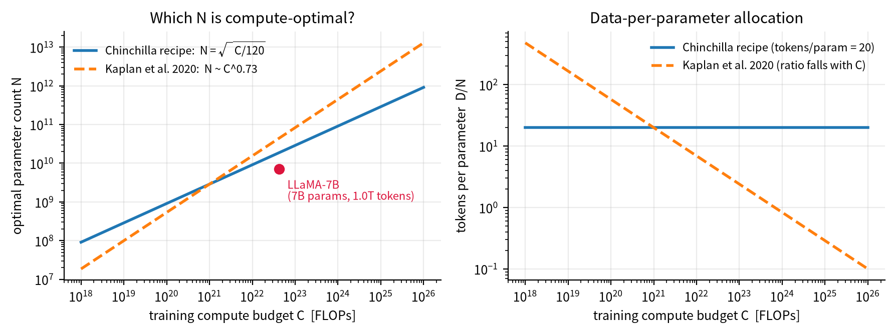
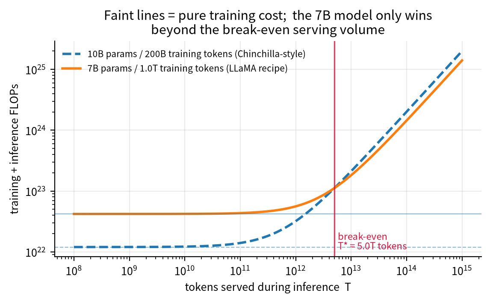

# LLaMA: Open and Efficient Foundation Language Models

- **原文**：[arXiv:2302.13971v1](https://arxiv.org/abs/2302.13971)（cs.CL，2023-02-27），PDF 27 页；本仓库同目录 `2302.13971v1.pdf` / `2302.13971v1_中英对照.md`
- **代码 / 项目**：权重与推理代码 <https://github.com/facebookresearch/llama>（**训练代码未公开**）；社区实现：`llama.cpp`、HF `transformers` 的 `LlamaForCausalLM`、Meta 后续 `llama-recipes`
- **作者与机构**：Hugo Touvron\*, Thibaut Lavril\*, Gautier Izacard\*, Xavier Martinet, Marie-Anne Lachaux, Timothée Lacroix, Baptiste Rozière, Naman Goyal, Eric Hambro, Faisal Azhar, Aurelien Rodriguez, Armand Joulin, Edouard Grave\*, Guillaume Lample\*（\* 同等贡献）— **Meta AI / FAIR**
- **发表信息**：arXiv preprint v1，2023 年 2 月；未经同行评审；LLaMA-1 权重以**非商业研究许可**发布
- **一句话总结**：只用公开数据、把数据量堆到"参数量的 100~150 倍"（7B 训 1T token），换来一个**推理便宜、可在单卡跑**的模型家族——13B 在多数基准上超过 175B 的 GPT-3，65B 与 Chinchilla-70B / PaLM-540B 打平。
- **前置阅读**：Transformer（Vaswani 2017）→ GPT-3（Brown 2020）→ Kaplan 缩放定律（2020）→ **Chinchilla**（Hoffmann 2022，本文的直接对手）→ PaLM（Chowdhery 2022）；组件级：RMSNorm（Zhang & Sennrich 2019）、SwiGLU（Shazeer 2020）、**RoPE**（Su 2021）、SentencePiece/BPE、CCNet（Wenzek 2020）、memory-efficient attention（Rabe & Staats 2021 / FlashAttention, Dao 2022）

---

## 1. 研究背景与核心问题

2020–2022 年的主线是"越大越好"：GPT-3（175B）、Gopher（280B）、PaLM（540B）都在验证"参数量 ↑ ⇒ 能力 ↑"。Kaplan et al. (2020) 把这条经验做成幂律：给定算力 $`C`$，最优参数量 $`N \propto C^{0.73}`$，数据量 $`D \propto C^{0.27}`$——**算力增长时优先加参数、数据几乎不加**。

Hoffmann et al. (2022)（Chinchilla）用更严谨的实验推翻了这条：在**固定训练算力**下，最优配置是 $`N`$ 与 $`D`$ 近似等比例增长，约 **20 token / 参数**。按此重训，70B 的 Chinchilla 全面超过 280B 的 Gopher。

LLaMA 在这条裂缝上提了三个问题：

1. **"训练算力最优"是不是选错了目标函数？** 真实部署关心的是**推理成本**。给定目标质量，应选"推理最快"的模型，而不是"训练最省"的模型。
2. **不用私有大语料，只靠公开数据（CommonCrawl/Wikipedia/GitHub/ArXiv/StackExchange），能不能做到 SOTA？** 之前只有 OPT / GPT-NeoX / BLOOM / GLM 开源，但都没打平 PaLM-62B 或 Chinchilla。
3. **能不能让最强模型跑在一张 GPU 上？** 这决定了研究社区能否真的用起来。

一句话：**本文把"缩放定律"的目标从"训练算力最优"改写成"推理预算最优"，并用"超配数据"作为实现手段。**

---

## 2. 核心方法与设计动机

### 2.1 数据：只取公开、且可开源的部分

| 子集 | 采样比例 | 1.4T 训练时的 epoch | 磁盘 | 处理要点 |
|---|---|---|---|---|
| English CommonCrawl | 67.0% | 1.10 | 3.3 TB | CCNet 流程：行级去重 → fastText 语种分类去非英文 → n-gram LM 过滤低质 → **"像维基引用页"分类器**再筛一遍 |
| C4 | 15.0% | 1.06 | 783 GB | 与 CCNet 的差别主要在质量过滤：C4 更依赖启发式（有无标点、词句数） |
| Github | 4.5% | 0.64 | 328 GB | 只要 Apache/BSD/MIT；按行长度与字母数字占比滤低质；正则去 boilerplate；文件级精确去重 |
| Wikipedia | 4.5% | 2.45 | 83 GB | 20 种语言（拉丁/西里尔字母），去超链接与注释 |
| Gutenberg + Books3 | 4.5% | 2.23 | 85 GB | 书级去重，剔除内容重叠 > 90% 的书 |
| ArXiv | 2.5% | 1.06 | 92 GB | 只留第一节之后正文（去摘要前内容与参考文献）、去 `.tex` 注释、**就地展开用户自定义宏** |
| StackExchange | 2.0% | 1.03 | 78 GB | 28 个最大站点，去 HTML 标签，答案按票数排序 |

设计动机很清楚：**数据来源全部可审计、可开源**，代价是必须自己补"质量筛"（所以他强调 Wikipedia 与 Books 各跑 ~2 epoch，而其他只跑 1 epoch——稀缺的高质数据要重复利用）。

分词：SentencePiece BPE，**所有数字拆成单个 digit**，未知 UTF-8 字符回退到 byte。（这条设计后来被反复吐槽：拆位让算术更"逐位"，也让 token 效率下降。）

### 2.2 架构：相对原始 Transformer 只改三处

| 改动 | 来自 | 做法 | 动机 |
|---|---|---|---|
| **Pre-normalization** | GPT-3 | 每子层**输入**做 RMSNorm，残差直通 | 深层训练稳定，省掉 LayerNorm 的均值中心化 |
| **SwiGLU** | PaLM / Shazeer 2020 | 用 $`\mathrm{Swish}(xW_1)\odot xW_3`$ 替换 ReLU 单路 | 门控带来更好的 loss-算力比；为保持参数量，隐藏维用 $`\tfrac{2}{3}\cdot 4d`$ |
| **RoPE** | GPT-Neo / Su 2021 | 去掉绝对位置 embedding，每层 Q/K 做旋转 | 相对位置信息进入注意力分数，且无需学位置表 |

其余刻意保持"朴素"：**没有** GQA/MQA、没有 ALiBi、没有并行注意力（parallel attn+FFN）、没有 MoE、没有 multi-query。LLaMA-1 是 MHA（$`n_{kv}=n_{head}`$），这也是后来 Llama-2 34B/70B 才换 GQA 的原因。

规模与超参（Table 2，注意 7B 与 13B 用 $`3\times10^{-4}`$，33B/65B 用 $`1.5\times10^{-4}`$；batch 全部 4M token）：

| 模型 | d | heads | layers | lr | batch | tokens |
|---|---|---|---|---|---|---|
| 6.7B | 4096 | 32 | 32 | 3.0e-4 | 4M | 1.0T |
| 13.0B | 5120 | 40 | 40 | 3.0e-4 | 4M | 1.0T |
| 32.5B | 6656 | 52 | 60 | 1.5e-4 | 4M | 1.4T |
| 65.2B | 8192 | 64 | 80 | 1.5e-4 | 4M | 1.4T |

### 2.3 训练系统：把"能跑完"当成工程目标

- **memory-efficient causal attention**（xformers）：不物化注意力权重、不计算被因果掩码的分数 → 显存从 $`O(n^2)`$ 降到 $`O(n)`$，同时少做无用 FLOPs。
- **激活重计算 + 手写 backward**：只保留代价高的激活（线性层输出），对 Transformer 层手写反向而非依赖 autograd，换来"想重算哪里就重算哪里"的自由度。
- **模型并行 + 序列并行**（Korthikanti 2022）：把 LayerNorm/Dropout 的激活沿 seq 维切开，才敢开 checkpointing。
- **通信与计算重叠**：all-reduce 尽量压在激活计算后面。

---

## 3. 数学原理与完整推导

### 3.1 参数量公式：12 d² 的来历（可用来校验 Table 2）

对一个**无 bias、MHA、SwiGLU-FFN** 的 decoder 层，参数量为：

```math
\underbrace{4d^2}_{\text{attn: } W_Q,W_K,W_V,W_O}
\;+\;
\underbrace{3\cdot d\cdot \tfrac{8}{3}d}_{\text{SwiGLU: } W_1,W_3,W_2}
\;=\;4d^2+8d^2=12d^2
```

其中 SwiGLU 隐藏维取 $`\tfrac{2}{3}\cdot4d=\tfrac{8}{3}d`$，于是三门矩阵合计 $`8d^2`$，与标准 FFN（$`W_1,W_2`$ 各 $`4d^2`$）**参数量相等**——这是 Shazeer 给的经验规则，目的是"同参数预算下比较门控的收益"。

总参数（词表 $`V`$，嵌入与输出层不共享）：

```math
P \;=\; 12\,d^2 L \;+\; 2Vd
```

代入 Table 2（$`V=32000`$，论文未明写词表大小，此为 SentencePiece BPE 实现的通行取值）：

| 模型 | $`12d^2L`$ | $`2Vd`$ | 合计 | 论文值 |
|---|---|---|---|---|
| 7B | $`12\cdot4096^2\cdot32=6.44`$B | $`0.262`$B | **6.70B** | 6.7B ✓ |
| 13B | $`12\cdot5120^2\cdot40=12.59`$B | $`0.328`$B | **12.92B** | 13.0B ✓ |
| 33B | $`12\cdot6656^2\cdot60=31.91`$B | $`0.426`$B | **32.34B** | 32.5B ✓ |
| 65B | $`12\cdot8192^2\cdot80=64.42`$B | $`0.524`$B | **64.95B** | 65.2B ✓ |

四项都能对上（33B/65B 差 0.2–0.3B，来自 head_dim 与 FFN 维取整）。**这个校验很实用：自己实现时算出来的参数量若与此表差 10% 以上，多半是 FFN 维或 embedding 共享搞错了。**

### 3.2 训练算力：$`C\approx 6ND`$ 的推导

一个 token 的前向 FLOPs ≈ $`2P`$（每个参数一次乘加 = 2 FLOPs）。反向 ≈ 前向的 2 倍（对输入求导 + 对权重求导各一遍），因此单 token ≈ $`6P`$，训练 $`D`$ 个 token：

```math
C \;\approx\; 6\,N\,D
```

例：LLaMA-65B、$`D=1.4\times10^{12}`$ → $`C = 6\times6.5\times10^{10}\times1.4\times10^{12}\approx 5.5\times10^{23}`$ FLOPs。

**用它核对论文的"21 天"**：总 FLOPs /（GPU 数 × 单卡有效算力）。A100-80G bf16 峰值 312 TFLOPS：

```math
\text{MFU}=\frac{380\ \text{tok/s}\times 6\times6.5\times10^{10}\ \text{FLOP/tok}}{312\times10^{12}}
\approx 47\%
```

```math
\frac{1.4\times10^{12}}{380\times2048}=1.80\times10^{6}\,\text{s}\approx 20.8\ \text{天}
```

与论文"约 21 天"吻合 → **"380 token/s/GPU"与"2048 卡 21 天"是自洽的，MFU ≈ 47%（大模型训练里的正常水平）。**

### 3.3 缩放定律与"数据/参数配比"的反转

Chinchilla 的经验风险模型（可直接当拟合式读）：

```math
L(N,D) \;=\; E \;+\; \frac{A}{N^{\alpha}} \;+\; \frac{B}{D^{\beta}},
\qquad \alpha\approx0.34,\ \beta\approx0.28
```

约束 $`C=6ND`$，求 $`\min_{N,D} L`$，用拉格朗日乘子：

```math
\mathcal{L}=E+\frac{A}{N^\alpha}+\frac{B}{D^\beta}+\lambda\,(6ND-C)
```

对 $`N`$、$`D`$ 求偏导并令其为 0：

```math
-\frac{\alpha A}{N^{\alpha+1}}+\lambda\,6D=0,\qquad
-\frac{\beta B}{D^{\beta+1}}+\lambda\,6N=0
```

两式相除消去 $`\lambda`$：

```math
\frac{\alpha A\,D^{\beta+1}}{\beta B\,N^{\alpha+1}}=\frac{D}{N}
\;\Longrightarrow\;
D^{\beta}\;\propto\;N^{\alpha}
\;\Longrightarrow\;
D \;\propto\; N^{\alpha/\beta}
```

代回 $`C=6ND`$ 得**计算最优配置**：

```math
N_{opt}\;\propto\;C^{\frac{\beta}{\alpha+\beta}},\qquad
D_{opt}\;\propto\;C^{\frac{\alpha}{\alpha+\beta}}
```

- 用 Chinchilla 的 $`\alpha,\beta`$：指数约 $`0.45`$ 与 $`0.55`$，且 $`D_{opt}/N_{opt}\approx 20`$（**20 token/参数**由此而来）。
- 用 Kaplan 的指数（$`0.73/0.27`$）：$`D`$ 随算力**几乎不涨**，$`D/N`$ 随 $`C`$ 递减 —— 这就是"越大越好"的数学形态。

把两条配方画在一起，差距一目了然：



*图注：按两篇论文公开的指数重绘，非实测。左：同一算力预算下"该选多大模型"；右：token/参数配比随算力如何变化——Chinchilla 是水平线（≈20），Kaplan 是衰减曲线。红点是 LLaMA-7B 的实际选择（7B 参数 / 1.0T token ≈ 150 token/参数），已远超 Chinchilla 的"最优点"。*

**LLaMA 的偏离是刻意的**：它不在 $`L(N,D)`$ 上最优点，而在"推理预算"下最优点。

### 3.4 把"推理预算"写进目标函数（本文的核心论证）

单次训练成本 $`6ND`$，服务 $`T`$ 个 token 的推理成本 $`2NT`$（不计 KV cache 的注意力项，只算权重矩阵乘加），总成本：

```math
\mathrm{Cost}(N,D,T)\;=\;6ND\;+\;2NT
```

固定训练算力 $`C=6ND`$（即 $`D=C/6N`$）时，**训练项是常数**，总成本随 $`N`$ **单调上升**：在同等训练算力下，模型越大，推理越贵。

真正的比较发生在"**达到同一质量水平**"的两个候选之间。取论文给的具体例子：

- A：10B 参数 / 200B token（Chinchilla 式配比）
- B：7B 参数 / 1T token（LLaMA 式配比，$`D/N\approx143`$）

```math
C_A=6\cdot10^{10}\cdot2\times10^{11}=1.2\times10^{22},\qquad
C_B=6\cdot7\times10^{9}\cdot10^{12}=4.2\times10^{22}
```

总成本相等（盈亏点）处：

```math
C_A+2N_AT=C_B+2N_BT
\;\Longrightarrow\;
T^{*}=\frac{C_B-C_A}{2(N_A-N_B)}=\frac{3.0\times10^{22}}{6\times10^{9}}=5.0\times10^{12}
```

即 **服务量超过 5T token 后，7B/1T 方案的总算力反超更省**——而 7B 的单 token 推理成本本身就低 30%（$`14`$ vs $`20`$ GFLOPs/token），延迟、显存、单价全面占优。



*图注：按上式重绘。横线是纯训练成本（$`6ND`$），曲线含服务 $`T`$ 个 token 的推理成本；两者在 $`T^*=5.0`$T 处相交。前提假设是"两个方案质量可比"——这正是论文的实证主张，而不是数学结论。*

若只看单模型内部（同一模型训练更久是否值得），阈值更简单：$`6ND`$ 与 $`2NT`$ 相等时 $`T=3D`$。对 7B/1T，即"只要服务超过 3T token，训练这 1T token 的算力就算赚回来了"。

### 3.5 RMSNorm

```math
\mathrm{RMSNorm}(x)=\frac{x}{\sqrt{\frac{1}{d}\sum_{i=1}^{d}x_i^2+\epsilon}}\odot g,\qquad g\in\mathbb{R}^{d}
```

与 LayerNorm 的差别：**不减均值、不加 bias**。少一次跨维求和（均值）与一次广播减，kernel 更快；论文的动机是"提升训练稳定性"，工程动机是"省通信与算力"（序列并行时尤其明显）。注意 $`\epsilon`$ 通常取 $`10^{-6}`$ 量级，bf16 下要小心 $`x`$ 极小时的放大。

### 3.6 SwiGLU

```math
\mathrm{Swish}(z)=z\cdot\sigma(\beta z)\ (\beta=1\ \text{即 SiLU}),\qquad
\mathrm{FFN}_{\mathrm{SwiGLU}}(x)=\big(\mathrm{Swish}(xW_1)\odot xW_3\big)W_2
```

$`W_1,W_3\in\mathbb{R}^{d\times\frac{8}{3}d}`$，$`W_2\in\mathbb{R}^{\frac{8}{3}d\times d}`$。取 $`\tfrac{8}{3}d`$ 而非 $`4d`$，是为了让三门结构的总参数（$`8d^2`$）与标准两门 FFN（$`8d^2`$）持平——**"同等参数预算下的公平替换"**。若照搬 $`4d`$，参数会多 50%，对比就失真了。

> 论文正文在此处被 PDF 抽取截断（"We use a dimension of"），补全内容为 $`\tfrac{2}{3}\cdot4d`$；这也是几乎所有复现实现（如 `transformers` 的 `intermediate_size`）采用的口径。

### 3.7 RoPE：为什么"乘一个旋转矩阵"就编码了相对位置

把 Q/K 的每两维当作复平面上一个数 $`z=x+iy`$，位置 $`m`$ 处施加旋转：

```math
R_m=\begin{pmatrix}\cos m\theta & -\sin m\theta\\ \sin m\theta & \cos m\theta\end{pmatrix}
```

对 $`d`$ 维向量按 $`d/2`$ 个二维平面做**块对角**旋转，第 $`i`$ 对频率取

```math
\theta_i=10000^{-\frac{2i}{d}},\qquad i=0,\dots,\tfrac{d}{2}-1
```

关键性质（本文没证，但用到了）：内积只依赖**相对位置** $`m-n`$：

```math
\langle R_m q,\;R_n k\rangle
=\mathrm{Re}\!\Big(\sum_i (q_i e^{im\theta_i})\overline{(k_i e^{in\theta_i})}\Big)
=\mathrm{Re}\!\Big(\sum_i q_i \bar k_i\, e^{i(m-n)\theta_i}\Big)
```

因为 $`R_m^{\top}R_n=R_{n-m}`$（旋转矩阵是正交群元素，$`R_m^\top=R_{-m}`$），所以 $`q^\top R_m^\top R_n k=q^\top R_{n-m}k`$。**好处**：无参数、无位置表、可外推到训练时没见过的长度（但注意，$`d`$ 固定后高频/低频配对固定，外推能力有限，Llama-3 才把 base 提到 500k）。

### 3.8 注意力复杂度与"省掉的那一半"

因果注意力每个 head：$`QK^\top`$ 为 $`O(n^2d)`$，softmax 与 $`AV`$ 为 $`O(n^2d)`$，故每层 $`O(n^2d)`$ FLOPs。朴素实现的**显存**是 $`O(n^2)`$（存 $`n\times n`$ 权重），xformers 的实现不物化 $`n\times n`$ 权重矩阵、按块流式累加（Rabe & Staats 2021 的算法），反向时重算而不是读缓存 → 显存降到 $`O(nd)`$；同时跳过被掩码的上三角，省约一半 FLOPs。

### 3.9 优化器与调度

AdamW（解耦权重衰减，衰减不进入梯度矩）：

```math
m_t=\beta_1 m_{t-1}+(1-\beta_1)g_t,\quad
v_t=\beta_2 v_{t-1}+(1-\beta_2)g_t^2,
```

```math
\theta_t=\theta_{t-1}-\eta_t\Big(\frac{\hat m_t}{\sqrt{\hat v_t}+\epsilon}\Big)-\eta_t\,\lambda\,\theta_{t-1},\qquad \hat m_t=\frac{m_t}{1-\beta_1^t},\ \hat v_t=\frac{v_t}{1-\beta_2^t}
```

论文取值：$`\beta_1=0.9,\ \beta_2=0.95,\ \lambda=0.1`$，梯度裁剪 1.0，2000 步 warmup，余弦衰减到峰值的 10%：

```math
\eta_t=\eta_{\min}+\tfrac{1}{2}(\eta_{\max}-\eta_{\min})\Big(1+\cos\frac{\pi t}{T}\Big),\qquad \eta_{\min}=0.1\,\eta_{\max}
```

注意 $`\beta_2=0.95`$ 而非 0.999 —— 大 batch（4M token）下二阶矩需要更快跟上分布变化。

### 3.10 碳排公式（可用 Table 15 反算校验）

```math
\mathrm{Wh}=\text{GPU-h}\times\text{GPU 功耗}\times\text{PUE},\qquad \mathrm{tCO_2eq}=\mathrm{MWh}\times0.385
```

校验 LLaMA-65B：$`1{,}022{,}362\ \text{GPU-h}\times400\,\mathrm{W}\times1.1=449.8\ \mathrm{MWh}`$，$`449.8\times0.385=173.2\ \mathrm{tCO_2eq}`$——与表中 449 MWh / 173 一致。7B：$`82{,}432\times400\times1.1=36.3`$ MWh → $`14.0`$ tCO₂eq，亦一致。**（这组数是我按公式重算的，与原文表 15 完全对齐。）**

### 3.11 pass@k 的无偏估计

Chen et al. (2021) 的估计式（HumanEval 用它）：

```math
\mathrm{pass@}k=\mathbb{E}_{\text{problems}}\left[1-\frac{\binom{n-c}{k}}{\binom{n}{k}}\right]
```

$`n`$ 为每题采样数、$`c`$ 为通过数。LLaMA 报的 pass@100 就是这么算的（$`n\ge k`$）。

---

## 4. 数据、训练与系统实现

**数据规模账**：分词后合计约 1.4T token；磁盘合计约 4.7 TB；除 Wikipedia（2.45 ep）与 Books（2.23 ep）外基本单轮。到 1T token 的 7B/13B 用的是同一套比例。

**吞吐账**（可直接换算自检）：

```math
\text{tokens/s (全网)} = 380\times2048 = 778{,}240
\;\Longrightarrow\;
\frac{1.4\times10^{12}}{778{,}240}\approx20.8\ \text{天}
```

**显存账**（复现时最常踩的坑）：

```math
\text{权重 bf16}=2N\ \text{B},\quad
\text{AdamW 状态 fp32}=8N\ \text{B},\quad
\text{梯度 bf16}=2N\ \text{B}
\;\Longrightarrow\;
\text{静态}\approx12N\ \text{B}
```

- 7B：$`12\times7=84`$ GB → 单张 80G **放不下**；65B：$`780`$ GB → 至少 10 张 80G 仅放静态状态。
- 论文用 2048 卡，显然必须 ZeRO/FSDP + 张量并行；论文正文只提"模型并行 + 序列并行"，细节在 Korthikanti 的论文里。

**实现要点清单**（论文提到 / 未提到但复现必需）：

| 项 | 论文 | 复现时要补 |
|---|---|---|
| 精度 | 未明写 | bf16 训练 + fp32 softmax/归一化统计；loss scaling 一般不需要 |
| 注意力 | xformers 因果注意力 | FlashAttention-2 / SDPA 均可，注意 `is_causal` 与 mask 语义 |
| 重计算 | 手写 backward | `torch.utils.checkpoint`（`use_reentrant=False`）或自定义 autograd.Function |
| 并行 | 模型 + 序列并行 | FSDP/ZeRO-3 + TP；序列并行需要对 LayerNorm 做 all-gather |
| batch 4M | 直接说 4M token | 单卡放不下 → 梯度累积：$`4\text{M}/(\text{seq}\times\text{dp})`$ 步 |
| 词表 | 32k BPE，数字拆位 | 与 Llama-2/3 的 32k/128k 词表**不兼容**，换词表=换模型 |

---

## 5. 实验设置与关键结论

评测协议：20 个基准，zero-shot 与 few-shot（1–64 shot）。多选题按"字符数归一化似然"选，OpenBookQA/BoolQ 按 $`P(\text{comp}|\text{ctx})/P(\text{comp}|\text{"Answer:"})`$ 归一化——**这个归一化口径很关键，换口径会平移 1–3 个点**。

结论表（只看抵消噪声后的"硬结论"）：

| 维度 | 结果 | 该记住的一句话 |
|---|---|---|
| 常识推理（8 项） | 65B 除 BoolQ 外全胜 Chinchilla-70B；除 BoolQ/WinoGrande 外胜 PaLM-540B | 13B 已超 GPT-3（小 10×） |
| 闭卷 QA（NQ / TriviaQA） | NQ 64-shot 39.9（GPT-3 29.9）；TriviaQA 64-shot 73.0 | 13B 与 GPT-3/Chinchilla "可比"，单卡 V100 可跑 |
| 阅读理解（RACE） | 65B 67.9/51.6 ≈ PaLM-540B（68.1/49.1） | 13B 比 GPT-3 高几个点 |
| 数学（MATH/GSM8k） | 65B：50.9 / 69.7(+maj) vs Minerva-62B：52.4 / 68.5(+maj) | **未在数学数据上微调**；不加投票略低于 Minerva，加多数投票后反超 |
| 代码（HumanEval/MBPP） | 65B pass@1 23.7 / 36.8（pass@100 79.3） | 13B+ 全面超 LaMDA-137B |
| MMLU（5-shot） | 65B 63.4，LLaMA-I 68.9 | **唯一明显落后的地方**，原因见 §6 |
| 训练动态 | 多数基准随困惑度稳步升 | SIQA 方差大、WinoGrande 与困惑度不相关 → 别拿它们当"进度条" |

---

## 6. 消融实验与失败案例

**先说清楚：这篇论文几乎没有系统消融**（没有"去掉 RoPE 会掉多少点"这种表），这是它作为 v1 preprint 的短板。能当消融读的有：

1. **数据混合**：加入 C4（与 CCNet 同源但过滤方式不同）带来了提升 → 说明"预处理多样性"本身有价值；C4 靠启发式、CCNet 靠分类器，两者互补。
2. **高质量子集重复**：Wikipedia/Books 跑 ~2.2–2.5 epoch，其余 1 epoch → 稀缺高质数据值得重复。
3. **"书籍数据不足"的对照**：作者自己解释 MMLU 落后 Chinchilla/PaLM 的原因——预训练里书籍+论文合计仅 177 GB，而对手用了多达 2 TB 书籍。这条是**用对照组解释失败**的典型写法。
4. **规模与毒性的关系**：RealToxicityPrompts 上毒性随规模上升（7B 0.106 → 65B 0.128，respectful 0.081 → 0.141）；但 Chinchilla vs Gopher 反而无差异 → 作者推断"毒性-规模"关系只在同族内成立。**这是一个自我否证的观察**，值得记。
5. **偏差探针**：WinoGender 的 gotcha 集上 65B 错误更多（"his/him/he" 55.8 → 63.3 掉点明显）→ 模型在用"职业的多数性别"做共指，而不是读句子。
6. **真实性**：TruthfulQA 65B 仅 0.57（truthful），作者直说"正确率仍低，模型很可能幻觉"。

**失败案例（附录 C/D 里现成的"事故现场"，很值得逐条看）**：

- **扮演终端时凭空造输出**：把 `pwd` 答成 `/home/human`，还编出 `file.txt` 的权限位，并追问"Is this helpful?" → 典型的"格式模仿 + 事实编造"。
- **国际象棋多轮**：先说意大利与苏格兰开局"前两步相同"，用户指出"最后两个似乎一样"后，模型承认"二者很像"但没有抓住关键——**两者的分歧点在白方第 3 步**（意大利 3.Bc4、苏格兰 3.d4）；它给出的 "3.Qf3" 是错着。典型的"顺着用户话往下滑"（sycophancy）。
- **正则表达式**：给的 `re.findall` 里出现 `$.??$` 这种非法量词 → 语法层就错的代码，但被包在漂亮代码块里。
- **"猫不存在"理论**：按提示确实编出了"跨维度寄生生物 + 信息素控制人类"的完整伪科学叙事 → 说明"遵循指令写荒诞内容"与"编造可信事实"共用同一套生成机制。

---

## 7. 方法局限与适用边界

| 局限 | 具体表现 / 证据 |
|---|---|
| **推理仍不便宜** | 65B bf16 权重 130 GB，需多卡；7B 单卡可行但质量有限 |
| **许可限制** | LLaMA-1 权重为**非商业研究许可**，不能直接商用（这点在 Llama-2 才改） |
| **数据合规** | CommonCrawl/GitHub 的版权与许可证过滤依赖启发式，法律风险未解 |
| **英语中心** | 非英语只有 Wikipedia 20 语言的 4.5% 占比；中文能力基本靠"顺带" |
| **评测污染** | 训练语料含大量网络文本，基准泄漏风险无法完全排除（论文未讨论） |
| **长上下文未验证** | 训练长度 2048，超出即外推；RoPE 外推在 2023 年已被证明会退化 |
| **幻觉与毒性** | 见 §6；且**随规模变差**，不是"变大就安全" |
| **算术弱** | 数字拆位 tokenizer + 无工具调用 → GSM8k 50.9，靠 maj1@k 才 69.7 |

**适用边界**：作为**研究基座 / 领域微调起点 / 蒸馏教师**最合适；不适合直接当商用 API 后端（许可+成本），也不适合当"事实查询器"（闭卷 QA 的 exact match 仍靠记忆）。

---

## 8. 与其他论文的演进关系

```text
GPT-3 (175B, 2020) ──┐
Kaplan scaling (2020) ──> "加参数优先"  ──┐
                                          ├─> Chinchilla (2022): 20 tok/param, 计算最优
PaLM (540B, 2022) ────────────────────────┘        │
                                                  ▼
                            LLaMA (2023-02): 推理最优 + 纯公开数据 + 开源权重
                                                  │
        ┌─────────────────────────┬───────────────┼───────────────────────┐
        ▼                         ▼               ▼                       ▼
  Llama-2 (2023-07)        Code Llama (2023-08)  Mistral-7B (2023-09)   Llama-3 (2024-04)
  2T tokens, 4096 ctx,     code 500B tokens,     GQA + SWA,            15T tokens, 128k vocab,
  GQA (34B/70B), 商用许可   16k ctx, rope scaling  滑动窗口 4096           GQA 全系, 8k ctx, rope 500k
```

几条"演进主线"值得单独记住：

1. **配比继续右移**：Chinchilla 20 tok/param（计算最优）→ LLaMA 143（推理最优）→ Llama-3 8B/15T ≈ **1875 tok/param**。这说明"Chinchilla 最优"在推理主导的场景下**早已过时**，而 LLaMA 正是这条曲线的起点。
2. **注意力结构**：MHA（LLaMA-1）→ GQA（Llama-2 34B/70B、Llama-3 全系、Mistral），本质是**推理侧的 KV cache 成本**问题——与本文"为推理优化"的动机一脉相承。
3. **位置编码**：RoPE base 10000（本文）→ 500k（Llama-3）+ 长上下文继续预训练，是"RoPE 外推能力有限"这一已知缺陷的工程解。
4. **词表**：32k（本文，数字拆位）→ 128k（Llama-3，数字按 3 位分组）——**算术能力的锅最后由 tokenizer 背了**。
5. **争议**：Chinchilla 的最优性后来被 Besiroglu et al. (2024) 质疑（其拟合所用的点与口径有误），但"数据被严重欠配"这一结论未被推翻。

---

## 9. 复现记录与工程踩坑

> 说明：本节区分 **【本仓库已核对】** 与 **【待验证/工程经验】**，避免把推断写成实测。

**【本仓库已核对】**

1. **参数量公式与 Table 2 逐项对账**（§3.1）：$`12d^2L+2Vd`$ 四项误差 ≤ 0.3B，说明 FFN 取 $`\tfrac{8}{3}d`$、MHA 无 bias 的口径正确。
2. **碳排公式反算 Table 15**（§3.10）：65B 449 MWh / 173 t，7B 36 MWh / 14 t，与原文一致 → 公式中 PUE=1.1、400W、0.385 kg/kWh 三个常数无歧义。
3. **吞吐自洽性**：380 tok/s/GPU × 2048 卡 → 20.8 天 ≈ 论文 21 天；反推 MFU ≈ 47%。
4. **PDF 抽取**：用 MinerU（basic 档，本地版面模型+OCR）把 27 页抽成 markdown，附录 A–D 与 85 条参考文献完整；**已知缺陷**：密排表格的单元格会被粘成 `76.578.183.185.3`，需按位数回读原表。

**【工程踩坑清单（单卡 / 小集群复现时最容易卡住的点）】**

| # | 坑 | 现象 | 处理 |
|---|---|---|---|
| 1 | **静态显存 12N B** | 7B 单卡 80G 直接 OOM | 先算 $`12N`$ 再选卡；7B 需 ZeRO-2/3；单卡消费级 32G 只能跑 1.3B 级 |
| 2 | **batch 4M 无法直给** | 想一次 forward 4M token | 梯度累积：`accum = 4e6/(micro_bs × seq_len × dp)`，注意 lr 与 accum 的耦合 |
| 3 | **RoPE base 写错** | 短测正常、长序列崩 | LLaMA-1 用 10000；别照抄 Llama-3 的 500000 |
| 4 | **位置 id 在 packing 后错位** | 多文档拼一条样本，注意力跨文档 | 用 `position_ids` 按文档重置 + block-diagonal mask，或干脆不做 packing |
| 5 | **loss 只该算回答 token** | 微调时 SFT loss 被 prompt 稀释 | labels 里 prompt 段置 -100；pretrain 阶段则全算 |
| 6 | **bf16 下的 softmax/归一化** | 偶发 NaN、loss 尖峰 | softmax 与 RMSNorm 统计用 fp32；梯度裁剪 1.0；warmup 别省（2000 步） |
| 7 | **checkpointing 与 RNG** | 开重计算后 loss 不复现 | `use_reentrant=False` + 保存/恢复 RNG state；dropout=0 时影响小但仍需检查 |
| 8 | **FSDP + TP 的切分维度** | all-gather 后显存反而涨 | 序列并行切开 LayerNorm 激活；先 FSDP 再叠 TP，逐层验证峰值 |
| 9 | **词表不兼容** | 直接用 Llama-2 权重套本文 tokenizer | 32k（数字拆位）≠ 32k（Llama-2）≠ 128k（Llama-3），三者互不通用 |
| 10 | **数字拆位导致算术弱** | GSM8k 上"会写步骤但算错" | 想要算术能力：换 tokenizer 或加工具调用，别指望堆数据解决 |
| 11 | **吞吐估算失真** | 以为 8×A100 就能一周训完 7B | 用 $`6ND/(\text{卡数}\times\text{峰值}\times\text{MFU})`$ 反算，MFU 按 35–45% 估 |
| 12 | **数据侧没做"维基引用页"分类** | loss 掉得慢、benchmark 不涨 | CCNet 的三段过滤里，第三段（reference-like 分类）最容易被省，省了质量差距很明显 |

---

## 10. 个人思考与后续问题

**三点判断**

1. **这篇论文真正的贡献是"目标函数换掉了"，不是"模型更好"。** 把 scaling law 从 $`\min L`$ s.t. $`C`$ 改成 $`\min \text{Cost}`$ s.t. quality，后面的 Llama-2/3、Mistral、Qwen 全都沿着"多喂数据、控推理成本"走。模型结构三件套（RMSNorm/SwiGLU/RoPE）只是把既有改良拼在一起，没有新东西。
2. **LLaMA-1 是"工程诚实"的样本**：明确写清失败的 MMLU、明确说毒性随规模上升、明确说 TruthfulQA 正确率低。相比之下很多同期技术报告只挑赢的指标。
3. **它的护城河其实是数据管线**，而论文对 CCNet 第三段（reference-like 分类器）只给了两句话——**这是最不可复现的部分**，也是"复现出来总差几个点"的最可能原因。

**待验证 / 想追的问题**

1. **"20 tok/param 已过时"的边界在哪？** LLaMA 用 143、Llama-3 用 ~1875。给定推理量 $`T`$，最优 $`D/N`$ 是否有闭式解？（提示：把 §3.4 的成本式与 $`L(N,D)`$ 联立求 $`T`$ 的函数，可试着推出 $`D/N \propto T^{\gamma}`$）
2. **数字拆位 tokenizer 的代价能否量化？** 同一模型、同数据，只换 tokenizer（拆位 vs 3 位分组），GSM8k 会差多少？这是我当前 `ai-from-scratch` 里最想做的对照实验。
3. **RoPE 外推的真实上限**：$`d=4096`$ 下训练 2048，直接跑到 4096/8192，困惑度上升的拐点在哪？NTK-aware / YaRN 能补多少？
4. **"书籍数据 ×2 TB"到底贡献多大？** 论文只用 MMLU 差距做了定性解释，缺少"补足书籍后 MMLU 涨多少"的对照——这是个便宜且干净的实验。
5. **毒性随规模上升是数据问题还是能力问题？** 若是"更强地模仿网络语域"，那 DPO/RLHF 阶段应能显著压下去；若是"更强的模式覆盖"，则压不住。
6. **单卡可跑的 7B 与 13B 之间，是否存在"推理预算最优"的第三个点？** 比如 10B/1.4T——论文只给了 7/13/33/65 四个离散点，最优点可能落在中间。

**给自己的下一步**：在 `ai-from-scratch` 的 Llama3.1 实现上，先做 (2) 的 tokenizer 对照（同参数量、同 token 预算，只换分词），再做 (1) 的小规模验证（固定 $`C`$，扫 $`D/N \in \{20, 50, 150, 400\}`$，记录 loss 与服务成本），用实测数据回填这两张图。
