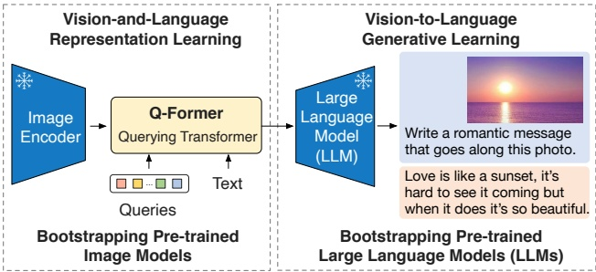
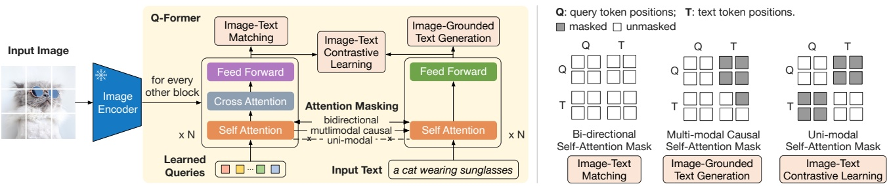
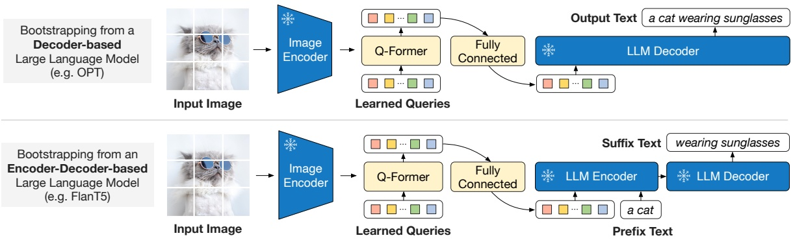
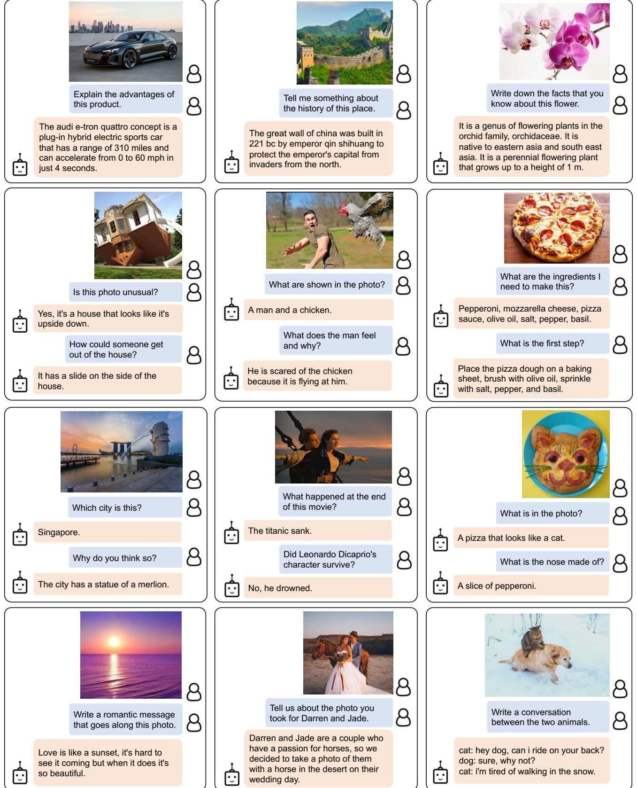
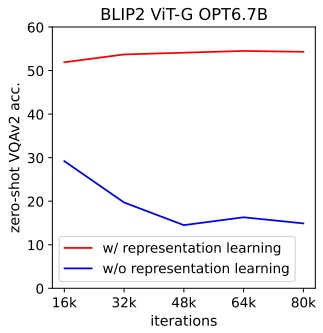
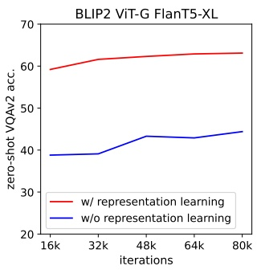
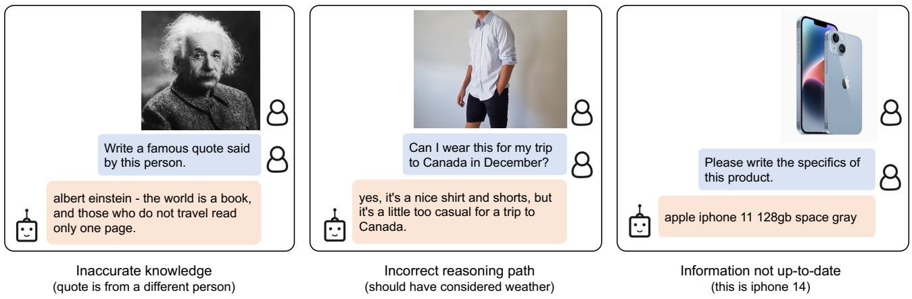
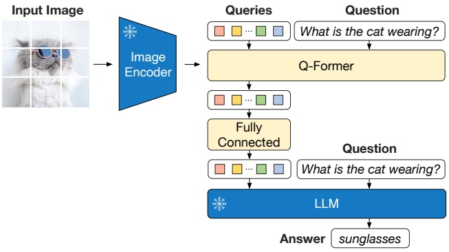

# 说明（阅读前请先看这一段）

本文档是 **BLIP-2**（arXiv:2301.12597v3，Salesforce Research）的中英对照阅读版。英文为你上传的原始 markdown 内容，**图片链接、表格、HTML 表格与脚注全部原样保留，未删改任何链接**；每个英文段落之后紧跟以 `>` 引用的中文译文。

- **逐段翻译范围**：摘要、第 1–6 节正文、图/表标题（caption）。
- **图 4 的问答样例**：原文把 20 余条"提示 + 模型回答"打散排在图片前后，这部分是**模型生成的英文输出**，逐条翻译会丢失"看模型原样输出"的意义，故保留英文，只给一条中文提要（见图 4 标题下方）。
- **表格**：Table 1–6 保留原表（部分表头被 OCR 断词、单元格数字粘连，如 `V Open-sourced?`、`VQ val`、`Av2test-dev`，阅读时按原表对齐）。
- **参考文献**：属书目信息，按学术惯例保留英文原文，不翻译。
- **图片**：`images/` 目录共 17 张图，随文件保留；把 `images/` 与本文件放在同一目录即可正常显示。

# BLIP-2：用冻结的图像编码器与大语言模型引导语言-图像预训练

原文 *BLIP-2: Bootstrapping Language-Image Pre-training with Frozen Image Encoders and Large Language Models*（arXiv:2301.12597v3，Salesforce Research）

**Junnan Li Dongxu Li Silvio Savarese Steven Hoi**

**Salesforce Research**

[https://github.com/salesforce/LAVIS/tree/main/projects/blip2](https://github.com/salesforce/LAVIS/tree/main/projects/blip2)

## 摘要 / Abstract

The cost of vision-and-language pre-training has become increasingly prohibitive due to end-to-end training of large-scale models. This paper proposes BLIP-2, a generic and efficient pre-training strategy that bootstraps vision-language pre-training from off-the-shelf frozen pre-trained image encoders and frozen large language models. BLIP-2 bridges the modality gap with a lightweight Querying Transformer, which is pre-trained in two stages. The first stage bootstraps vision-language representation learning from a frozen image encoder. The second stage bootstraps vision-to-language generative learning from a frozen language model. BLIP-2 achieves state-of-the-art performance on various visionlanguage tasks, despite having significantly fewer trainable parameters than existing methods. For example, our model outperforms Flamingo80B by 8.7% on zero-shot VQAv2 with 54x fewer trainable parameters. We also demonstrate the model’s emerging capabilities of zero-shot image-to-text generation that can follow natural language instructions.

> 视觉-语言预训练的成本正变得越来越难以承受，因为它需要对大规模模型做端到端训练。本文提出 BLIP-2：一种通用而高效的预训练策略，它从**现成可用的、冻结的预训练图像编码器与冻结的大语言模型**出发，引导（bootstrap）视觉-语言预训练。BLIP-2 用一个轻量的 Querying Transformer 弥合模态鸿沟，该模块分两个阶段预训练：第一阶段从冻结图像编码器引导视觉-语言**表征学习**；第二阶段从冻结语言模型引导**视觉到语言的生成式学习**。BLIP-2 在多种视觉-语言任务上取得最先进性能，而可训练参数却显著少于现有方法。例如，在零样本 VQAv2 上，我们的模型比 Flamingo-80B 高 8.7%，可训练参数却少 54 倍。我们还展示了该模型在零样本图到文生成上的涌现能力——它能够遵循自然语言指令。

## 1. 引言 / Introduction

Vision-language pre-training (VLP) research has witnessed a rapid advancement in the past few years, where pre-trained models with increasingly larger scale have been developed to continuously push the state-of-the-art on various downstream tasks (Radford et al., 2021; Li et al., 2021; 2022; Wang et al., 2022a; Alayrac et al., 2022; Wang et al., 2022b). However, most state-of-the-art vision-language models incur a high computation cost during pre-training, due to end-to-end training using large-scale models and datasets.

> 视觉-语言预训练（VLP）研究在过去几年快速推进，模型规模不断扩大，持续刷新各类下游任务的最优成绩（Radford et al., 2021; Li et al., 2021; 2022; Wang et al., 2022a; Alayrac et al., 2022; Wang et al., 2022b）。然而，多数最先进的视觉-语言模型在预训练阶段都付出高昂算力代价，原因是用大规模模型与大规模数据集做端到端训练。

Vision-language research sits at the intersection between vision and language, therefore it is naturally expected that vision-language models can harvest from the readilyavailable unimodal models from the vision and natural language communities. In this paper, we propose a generic and compute-efficient VLP method by bootstrapping from offthe-shelf pre-trained vision models and language models. Pre-trained vision models offer high-quality visual representation. Pre-trained language models, in particular large language models (LLMs), offer strong language generation and zero-shot transfer abilities. To reduce computation cost and counteract the issue of catastrophic forgetting, the unimodal pre-trained models remain frozen during the pre-training.

> 视觉-语言研究处在视觉与语言的交叉点上，因此人们自然会期望视觉-语言模型能够“取用”视觉社区与自然语言社区中现成的单模态模型。本文提出一种通用且计算高效的 VLP 方法：**从现成的预训练视觉模型与语言模型出发做引导式训练**。预训练视觉模型提供高质量的视觉表征；预训练语言模型（尤其是大语言模型 LLM）提供强大的语言生成与零样本迁移能力。为降低算力开销并抑制灾难性遗忘，这些单模态预训练模型在整个预训练过程中**保持冻结**。

Figure 1. Overview of BLIP-2’s framework. We pre-train a lightweight Querying Transformer following a two-stage strategy to bridge the modality gap. The first stage bootstraps visionlanguage representation learning from a frozen image encoder. The second stage bootstraps vision-to-language generative learning from a frozen LLM, which enables zero-shot instructed image-to-text generation (see Figure 4 for more examples).

> 图 1：BLIP-2 框架总览。我们以两阶段策略预训练一个轻量的 Querying Transformer 来弥合模态鸿沟：第一阶段从冻结图像编码器引导视觉-语言表征学习；第二阶段从冻结 LLM 引导视觉到语言的生成式学习，从而使模型具备零样本、可听懂指令的图到文生成能力（更多示例见图 4）。

In order to leverage pre-trained unimodal models for VLP, it is key to facilitate cross-modal alignment. However, since LLMs have not seen images during their unimodal pre-training, freezing them makes vision-language alignment in particular challenging. In this regard, existing methods (e.g. Frozen (Tsimpoukelli et al., 2021), Flamingo (Alayrac et al., 2022)) resort to an image-to-text generation loss, which we show is insufficient to bridge the modality gap.

> 要把预训练单模态模型用于 VLP，关键在于促成跨模态对齐。然而 LLM 在其单模态预训练中从未见过图像，因此把它冻结会让视觉-语言对齐格外困难。为此，现有方法（如 Frozen（Tsimpoukelli et al., 2021）、Flamingo（Alayrac et al., 2022））依赖“图到文生成损失”，而我们证明：**仅靠生成损失不足以弥合模态鸿沟**。

To achieve effective vision-language alignment with frozen unimodal models, we propose a Querying Transformer (Q-Former) pre-trained with a new two-stage pre-training strategy. As shown in Figure 1, Q-Former is a lightweight transformer which employs a set of learnable query vectors to extract visual features from the frozen image encoder. It acts as an information bottleneck between the frozen image encoder and the frozen LLM, where it feeds the most useful visual feature for the LLM to output the desired text. In the first pre-training stage, we perform vision-language representation learning which enforces the Q-Former to learn visual representation most relevant to the text. In the second pre-training stage, we perform vision-to-language generative learning by connecting the output of the Q-Former to a frozen LLM, and trains the Q-Former such that its output visual representation can be interpreted by the LLM.

> 为了在单模态模型冻结的前提下实现有效的视觉-语言对齐，我们提出 **Querying Transformer（Q-Former）**，并用一套新的两阶段预训练策略训练它。如图 1 所示，Q-Former 是一个轻量 Transformer，它用一组可学习的查询向量（query）从冻结图像编码器中抽取视觉特征。它充当冻结图像编码器与冻结 LLM 之间的**信息瓶颈**：只把对 LLM 最有用的视觉特征喂过去，让 LLM 输出期望的文本。第一阶段做视觉-语言表征学习，迫使 Q-Former 学到与文本最相关的视觉表征；第二阶段做视觉到语言的生成式学习，把 Q-Former 的输出接到冻结 LLM 上，训练 Q-Former 使它的输出表征能被 LLM “读懂”。

We name our VLP framework as BLIP-2: Bootstrapping Language-Image Pre-training with frozen unimodal models. The key advantages of BLIP-2 include:

> 我们把该 VLP 框架命名为 **BLIP-2**：Bootstrapping Language-Image Pre-training with frozen unimodal models（用冻结单模态模型引导语言-图像预训练）。其主要优势包括：

• BLIP-2 effectively leverages both frozen pre-trained image models and language models. We bridge the modality gap using a Q-Former pre-trained in two-stages: representation learning stage and generative learning stage. BLIP-2 achieves state-of-the-art performance on various vision-language tasks including visual question answering, image captioning, and image-text retrieval.

> • **BLIP-2 同时有效利用了冻结的预训练图像模型与语言模型。** 我们用两阶段预训练的 Q-Former 弥合模态鸿沟：表征学习阶段与生成学习阶段。BLIP-2 在视觉问答、图像描述、图文检索等多种视觉-语言任务上取得最先进性能。

• Powered by LLMs (e.g. OPT (Zhang et al., 2022), FlanT5 (Chung et al., 2022)), BLIP-2 can be prompted to perform zero-shot image-to-text generation that follows natural language instructions, which enables emerging capabilities such as visual knowledge reasoning, visual conversation, etc. (see Figure 4 for examples).

> • **以 LLM 为引擎（如 OPT（Zhang et al., 2022）、FlanT5（Chung et al., 2022）），BLIP-2 可被提示（prompt）执行遵循自然语言指令的零样本图到文生成**，由此涌现出视觉知识推理、视觉对话等能力（示例见图 4）。

Due to the use of frozen unimodal models and a lightweight Q-Former, BLIP-2 is more compute-efficient than exisiting state-of-the-arts. For example, BLIP-2 outperforms Flamingo (Alayrac et al., 2022) by 8.7% on zero-shot VQAv2, while using 54× fewer trainable parameters. Furthermore, our results show that BLIP-2 is a generic method that can harvest more advanced unimodal models for better VLP performance.

> 由于使用冻结的单模态模型与轻量 Q-Former，BLIP-2 比现有最优方法更省算力。例如在零样本 VQAv2 上，BLIP-2 比 Flamingo（Alayrac et al., 2022）高 8.7%，可训练参数却少 54 倍。此外结果表明，BLIP-2 是一种通用方法：换上更强的单模态模型，就能获得更好的 VLP 性能。

## 2. 相关工作 / Related Work

### 2.1. 端到端视觉-语言预训练 / End-to-end Vision-Language Pre-training

Vision-language pre-training aims to learn multimodal foundation models with improved performance on various visionand-language tasks. Depending on the downstream task, different model architectures have been proposed, including the dual-encoder architecture (Radford et al., 2021; Jia et al., 2021), the fusion-encoder architecture (Tan & Bansal, 2019; Li et al., 2021), the encoder-decoder architecture (Cho et al., 2021; Wang et al., 2021b; Chen et al., 2022b), and more recently, the unified transformer architecture (Li et al., 2022; Wang et al., 2022b). Various pre-training objectives have also been proposed over the years, and have progressively converged to a few time-tested ones: image-text contrastive learning (Radford et al., 2021; Yao et al., 2022; Li et al., 2021; 2022), image-text matching (Li et al., 2021; 2022; Wang et al., 2021a), and (masked) language modeling (Li et al., 2021; 2022; Yu et al., 2022; Wang et al., 2022b).

> 视觉-语言预训练旨在学到在多模态任务上表现更好的基础模型。针对不同下游任务，研究者提出了多种架构：双塔编码器（Radford et al., 2021; Jia et al., 2021）、融合编码器（Tan & Bansal, 2019; Li et al., 2021）、编码器-解码器（Cho et al., 2021; Wang et al., 2021b; Chen et al., 2022b），以及近期的统一 Transformer（Li et al., 2022; Wang et al., 2022b）。预训练目标也历经多年演化，逐渐收敛到几个被反复验证的：图像-文本对比学习（Radford et al., 2021; Yao et al., 2022; Li et al., 2021; 2022）、图像-文本匹配（Li et al., 2021; 2022; Wang et al., 2021a）以及（掩码）语言建模（Li et al., 2021; 2022; Yu et al., 2022; Wang et al., 2022b）。

Most VLP methods perform end-to-end pre-training using large-scale image-text pair datasets. As the model size keeps increasing, the pre-training can incur an extremely high computation cost. Moreover, it is inflexible for end-to-end pre-trained models to leverage readily-available unimodal pre-trained models, such as LLMs (Brown et al., 2020; Zhang et al., 2022; Chung et al., 2022).

> 多数 VLP 方法用大规模图文对数据做端到端预训练。随着模型变大，预训练算力开销会极高。而且端到端预训练模型很难灵活地“借用”现成的单模态预训练模型，例如 LLM（Brown et al., 2020; Zhang et al., 2022; Chung et al., 2022）。

### 2.2. 模块化视觉-语言预训练 / Modular Vision-Language Pre-training

More similar to us are methods that leverage off-the-shelf pre-trained models and keep them frozen during VLP. Some methods freeze the image encoder, including the early work which adopts a frozen object detector to extract visual features (Chen et al., 2020; Li et al., 2020; Zhang et al., 2021), and the recent LiT (Zhai et al., 2022) which uses a frozen pre-trained image encoder for CLIP (Radford et al., 2021) pre-training. Some methods freeze the language model to use the knowledge from LLMs for vision-to-language generation tasks (Tsimpoukelli et al., 2021; Alayrac et al., 2022; Chen et al., 2022a; Manas et al. ˜ , 2023; Tiong et al., 2022; Guo et al., 2022). The key challenge in using a frozen LLM is to align visual features to the text space. To achieve this, Frozen (Tsimpoukelli et al., 2021) finetunes an image encoder whose outputs are directly used as soft prompts for the LLM. Flamingo (Alayrac et al., 2022) inserts new cross-attention layers into the LLM to inject visual features, and pre-trains the new layers on billions of image-text pairs. Both methods adopt the language modeling loss, where the language model generates texts conditioned on the image.

> 与本文更接近的，是利用现成预训练模型并在 VLP 期间冻结它们的方法。一类冻结**图像编码器**：早期工作用冻结的目标检测器抽取视觉特征（Chen et al., 2020; Li et al., 2020; Zhang et al., 2021），近期的 LiT（Zhai et al., 2022）则在 CLIP（Radford et al., 2021）预训练中使用冻结的图像编码器。另一类冻结**语言模型**，以便把 LLM 的知识用于视觉到语言的生成任务（Tsimpoukelli et al., 2021; Alayrac et al., 2022; Chen et al., 2022a; Manas et al., 2023; Tiong et al., 2022; Guo et al., 2022）。使用冻结 LLM 的核心难题是**把视觉特征对齐到文本空间**。Frozen（Tsimpoukelli et al., 2021）的做法是微调图像编码器，让它的输出直接当作 LLM 的软提示（soft prompt）；Flamingo（Alayrac et al., 2022）则往 LLM 里插入新的交叉注意力层来注入视觉特征，并在数十亿图文对上预训练这些新层。两者都采用语言建模损失，即让语言模型在图像条件下生成文本。

Different from existing methods, BLIP-2 can effectively and efficiently leverage both frozen image encoders and frozen LLMs for various vision-language tasks, achieving stronger performance at a lower computation cost.

> 与现有方法不同，BLIP-2 能同时、且高效地利用**冻结图像编码器与冻结 LLM** 完成多种视觉-语言任务，以更低算力取得更强性能。

## 3. 方法 / Method

We propose BLIP-2, a new vision-language pre-training method that bootstraps from frozen pre-trained unimodal models. In order to bridge the modality gap, we propose a Querying Transformer (Q-Former) pre-trained in two stages: (1) vision-language representation learning stage with a frozen image encoder and (2) vision-to-language generative learning stage with a frozen LLM. This section first introduces the model architecture of Q-Former, and then delineates the two-stage pre-training procedures.

> 我们提出 BLIP-2，一种从冻结预训练单模态模型出发引导训练的视觉-语言预训练新方法。为弥合模态鸿沟，我们提出 Q-Former，并分两阶段预训练：(1) 配合冻结图像编码器的视觉-语言表征学习阶段；(2) 配合冻结 LLM 的视觉到语言生成式学习阶段。本节先介绍 Q-Former 的架构，再说明两阶段预训练流程。

### 3.1. 模型架构 / Model Architecture

We propose Q-Former as the trainable module to bridge the gap between a frozen image encoder and a frozen LLM. It extracts a fixed number of output features from the image encoder, independent of input image resolution. As shown in Figure 2, Q-Former consists of two transformer submodules that share the same self-attention layers: (1) an image transformer that interacts with the frozen image encoder for visual feature extraction, (2) a text transformer that can function as both a text encoder and a text decoder. We create a set number of learnable query embeddings as input to the image transformer. The queries interact with each other through self-attention layers, and interact with frozen image features through cross-attention layers (inserted every other transformer block). The queries can additionally interact with the text through the same self-attention layers. Depending on the pre-training task, we apply different self-attention masks to control query-text interaction. We initialize Q-Former with the pre-trained weights of BERTbase (Devlin et al., 2019), whereas the cross-attention layers are randomly initialized. In total, Q-Former contains 188M parameters. Note that the queries are considered as model parameters.

> 我们提出 Q-Former 作为可训练模块，用以连接冻结图像编码器与冻结 LLM。它从图像编码器中抽取**固定数量**的输出特征，与输入图像分辨率无关。如图 2 所示，Q-Former 由两个共享同一套自注意力层的 Transformer 子模块组成：(1) 图像 Transformer，与冻结图像编码器交互以抽取视觉特征；(2) 文本 Transformer，既可作文本编码器，也可作文本解码器。我们创建固定数量的**可学习查询嵌入（query embeddings）**作为图像 Transformer 的输入。查询之间通过自注意力互交互，并通过交叉注意力层（每隔一个 Transformer 块插入一个）与冻结的图像特征交互；查询还可以通过同一套自注意力层与文本交互。视预训练任务不同，我们施加不同的自注意力掩码来控制查询与文本的交互方式。Q-Former 用 BERTbase（Devlin et al., 2019）的预训练权重初始化，交叉注意力层则随机初始化。Q-Former 总计 **188M 参数**（注意：查询本身也算模型参数）。

Figure 2. (Left) Model architecture of Q-Former and BLIP-2’s first-stage vision-language representation learning objectives. We jointly optimize three objectives which enforce the queries (a set of learnable embeddings) to extract visual representation most relevant to the text. (Right) The self-attention masking strategy for each objective to control query-text interaction.

> 图 2：（左）Q-Former 的模型架构与 BLIP-2 第一阶段的视觉-语言表征学习目标。我们联合优化三个目标，迫使查询（一组可学习嵌入）抽取与文本最相关的视觉表征。（右）各目标所用的自注意力掩码策略，用于控制查询与文本的交互。

In our experiments, we use 32 queries where each query has a dimension of 768 (same as the hidden dimension of the Q-Former). We use Z to denote the output query representation. The size of Z (32 × 768) is much smaller than the size of frozen image features (e.g. 257 × 1024 for ViT-L/14). This bottleneck architecture works together with our pre-training objectives into forcing the queries to extract visual information that is most relevant to the text.

> 实验中我们使用 **32 个查询**，每个查询维度 768（与 Q-Former 的隐藏维一致）。用 $Z$ 表示输出的查询表征，其尺寸（$32\times768$）远小于冻结图像特征的尺寸（如 ViT-L/14 的 $257\times1024$）。这个瓶颈式架构与预训练目标配合，迫使查询只抽取与文本最相关的视觉信息。

### 3.2. 从冻结图像编码器引导视觉-语言表征学习 / Bootstrap Vision-Language Representation Learning

In the representation learning stage, we connect Q-Former to a frozen image encoder and perform pre-training using image-text pairs. We aim to train the Q-Former such that the queries can learn to extract visual representation that is most informative of the text. Inspired by BLIP (Li et al., 2022), we jointly optimize three pre-training objectives that share the same input format and model parameters. Each objective employs a different attention masking strategy between queries and text to control their interaction (see Figure 2).

> 在表征学习阶段，我们把 Q-Former 接到冻结图像编码器上，用图文对做预训练。目标是让查询学会抽取“对文本最有信息量”的视觉表征。受 BLIP（Li et al., 2022）启发，我们联合优化三个预训练目标，它们共享同一套输入格式与模型参数，但各用不同的查询-文本注意力掩码来控制交互（见图 2）。

**Image-Text Contrastive Learning** (ITC) learns to align image representation and text representation such that their mutual information is maximized. It achieves so by contrasting the image-text similarity of a positive pair against those of negative pairs. We align the output query representation Z from the image transformer with the text representation t from the text transformer, where t is the output embedding of the [CLS] token. Since Z contains multiple output embeddings (one from each query), we first compute the pairwise similarity between each query output and t, and then select the highest one as the image-text similarity. To avoid information leak, we employ a unimodal self-attention mask, where the queries and text are not allowed to see each other. Due to the use of a frozen image encoder, we can fit more samples per GPU compared to end-to-end methods. Therefore, we use in-batch negatives instead of the momentum queue in BLIP.

> **图像-文本对比学习（ITC）** 让图像表征与文本表征对齐，使二者的互信息最大化——做法是把正样本对的图文相似度与负样本对作对比。我们把图像 Transformer 输出的查询表征 $Z$ 与文本 Transformer 输出的文本表征 $t$（即 [CLS] token 的输出嵌入）对齐。由于 $Z$ 含多个输出嵌入（每个查询一个），我们先算每个查询输出与 $t$ 的两两相似度，再取最大值作为图文相似度。为避免信息泄漏，这里使用**单模态自注意力掩码**：查询与文本彼此不可见。得益于冻结图像编码器，单卡能容纳更多样本，因此我们用 in-batch 负样本，而不必像 BLIP 那样维护动量队列。

**Image-grounded Text Generation** (ITG) loss trains the Q-Former to generate texts, given input images as the condition. Since the architecture of Q-Former does not allow direct interactions between the frozen image encoder and the text tokens, the information required for generating the text must be first extracted by the queries, and then passed to the text tokens via self-attention layers. Therefore, the queries are forced to extract visual features that capture all the information about the text. We employ a multimodal causal self-attention mask to control query-text interaction, similar to the one used in UniLM (Dong et al., 2019). The queries can attend to each other but not the text tokens. Each text token can attend to all queries and its previous text tokens. We also replace the [CLS] token with a new [DEC] token as the first text token to signal the decoding task.

> **图像引导的文本生成（ITG）** 损失训练 Q-Former 在给定输入图像的条件下去生成文本。由于 Q-Former 的架构不允许冻结图像编码器与文本 token 直接交互，生成文本所需的信息**必须先由查询抽取出来，再经自注意力层传给文本 token**——这就迫使查询去抓取“覆盖文本全部信息”的视觉特征。我们用多模态因果自注意力掩码控制查询-文本交互，与 UniLM（Dong et al., 2019）类似：查询之间可互相可见但看不到文本；每个文本 token 可看到全部查询及其之前的文本 token。我们另把 [CLS] 换成新的 [DEC] token 作为首个文本 token，以标识解码任务。

**Image-Text Matching** (ITM) aims to learn fine-grained alignment between image and text representation. It is a binary classification task where the model is asked to pre-dict whether an image-text pair is positive (matched) or negative (unmatched). We use a bi-directional self-attention mask where all queries and texts can attend to each other. The output query embeddings Z thus capture multimodal information. We feed each output query embedding into a two-class linear classifier to obtain a logit, and average the logits across all queries as the output matching score. We adopt the hard negative mining strategy from Li et al. (2021; 2022) to create informative negative pairs.

> **图像-文本匹配（ITM）** 学习图像与文本表征之间的细粒度对齐。这是一个二分类任务：模型需预测图文对是正例（匹配）还是负例（不匹配）。这里使用双向自注意力掩码，查询与文本彼此全可见，因此输出的查询嵌入 $Z$ 携带多模态信息。我们把每个查询输出喂入一个二分类线性层得到 logit，再对所有查询的 logit 取平均作为匹配分数。负例采用 Li et al. (2021; 2022) 的**难负例挖掘**策略，以构造更有信息量的负样本对。

Figure 3. BLIP-2’s second-stage vision-to-language generative pre-training, which bootstraps from frozen large language models (LLMs). (Top) Bootstrapping a decoder-based LLM (e.g. OPT). (Bottom) Bootstrapping an encoder-decoder-based LLM (e.g. FlanT5). The fully-connected layer adapts from the output dimension of the Q-Former to the input dimension of the chosen LLM.

> 图 3：BLIP-2 第二阶段的视觉到语言生成式预训练，从冻结的大语言模型（LLM）引导。（上）引导基于解码器的 LLM（如 OPT）。（下）引导基于编码器-解码器的 LLM（如 FlanT5）。全连接层负责把 Q-Former 的输出维度映射到所选 LLM 的输入维度。

### 3.3. 从冻结 LLM 引导视觉到语言的生成式学习 / Bootstrap Vision-to-Language Generative Learning

In the generative pre-training stage, we connect Q-Former (with the frozen image encoder attached) to a frozen LLM to harvest the LLM’s generative language capability. As shown in Figure 3, we use a fully-connected (FC) layer to linearly project the output query embeddings Z into the same dimension as the text embedding of the LLM. The projected query embeddings are then prepended to the input text embeddings. They function as soft visual prompts that condition the LLM on visual representation extracted by the Q-Former. Since the Q-Former has been pre-trained to extract language-informative visual representation, it effectively functions as an information bottleneck that feeds the most useful information to the LLM while removing irrelevant visual information. This reduces the burden of the LLM to learn vision-language alignment, thus mitigating the catastrophic forgetting problem.

> 在生成式预训练阶段，我们把 Q-Former（连同已挂载的冻结图像编码器）接到冻结 LLM 上，以借用 LLM 的生成能力。如图 3 所示，用一个全连接（FC）层把查询输出嵌入 $Z$ 线性投影到与 LLM 文本嵌入相同的维度，再把这些投影后的查询嵌入**拼到输入文本嵌入之前**。它们充当软视觉提示（soft visual prompt），以 Q-Former 抽取的视觉表征为 LLM 提供条件。由于 Q-Former 已被训练成“抽取对语言有信息量的视觉表征”，它实际上起到信息瓶颈的作用：把最有用的信息喂给 LLM，同时滤掉无关的视觉信息。这减轻了 LLM 学习视觉-语言对齐的负担，从而缓解灾难性遗忘。

We experiment with two types of LLMs: decoder-based LLMs and encoder-decoder-based LLMs. For decoderbased LLMs, we pre-train with the language modeling loss, where the frozen LLM is tasked to generate the text conditioned on the visual representation from Q-Former. For encoder-decoder-based LLMs, we pre-train with the prefix language modeling loss, where we split a text into two parts. The prefix text is concatenated with the visual representation as input to the LLM’s encoder. The suffix text is used as the generation target for the LLM’s decoder.

> 我们试验两类 LLM：基于解码器的与基于编码器-解码器的。对解码器类 LLM，用语言建模损失预训练：冻结 LLM 在 Q-Former 给出的视觉表征条件下生成文本。对编码器-解码器类 LLM，用**前缀语言建模损失**：把文本切成两段，前缀文本与视觉表征拼接后送入 LLM 编码器，后缀文本作为解码器的生成目标。

### 3.4. 模型预训练 / Model Pre-training

**Pre-training data.** We use the same pre-training dataset as BLIP with 129M images in total, including COCO (Lin et al., 2014), Visual Genome (Krishna et al., 2017), CC3M (Sharma et al., 2018), CC12M (Changpinyo et al., 2021), SBU (Ordonez et al., 2011), and 115M images from the LAION400M dataset (Schuhmann et al., 2021). We adopt the CapFilt method (Li et al., 2022) to create synthetic captions for the web images. Specifically, we generate 10 captions using the $\mathrm{BLIP}_{\mathrm{large}}$ captioning model, and rank the synthetic captions along with the original web caption based on the image-text similarity produced by a CLIP ViT-L/14 model. We keep top-two captions per image as training data and randomly sample one at each pre-training step.

> **预训练数据。** 使用与 BLIP 相同的预训练数据集，共 1.29 亿张图像，包括 COCO（Lin et al., 2014）、Visual Genome（Krishna et al., 2017）、CC3M（Sharma et al., 2018）、CC12M（Changpinyo et al., 2021）、SBU（Ordonez et al., 2011），以及 LAION400M（Schuhmann et al., 2021）中的 1.15 亿张。我们用 CapFilt 方法（Li et al., 2022）为网络图像生成合成描述：先用 $\mathrm{BLIP}_{\mathrm{large}}$ 描述模型生成 10 条候选，再连同原始网络描述一起，按 CLIP ViT-L/14 给出的图文相似度排序，每张图保留前两条作为训练数据，在每一步预训练时随机取一条。

**Pre-trained image encoder and LLM.** For the frozen image encoder, we explore two state-of-the-art pre-trained vision transformer models: (1) ViT-L/14 from CLIP (Radford et al., 2021) and (2) ViT-g/14 from EVA-CLIP (Fang et al., 2022). We remove the last layer of the ViT and uses the second last layer’s output features, which leads to slightly better performance. For the frozen language model, we explore the unsupervised-trained OPT model family (Zhang et al., 2022) for decoder-based LLMs, and the instruction-trained FlanT5 model family (Chung et al., 2022) for encoder-decoder-based LLMs.

> **预训练图像编码器与 LLM。** 冻结图像编码器方面，我们试了两种最先进的预训练 ViT：(1) CLIP（Radford et al., 2021）的 ViT-L/14；(2) EVA-CLIP（Fang et al., 2022）的 ViT-g/14。我们**去掉 ViT 的最后一层、使用倒数第二层的输出特征**，效果略好。冻结语言模型方面，解码器类用无监督训练的 OPT 系列（Zhang et al., 2022），编码器-解码器类用指令训练的 FlanT5 系列（Chung et al., 2022）。

**Pre-training settings.** We pre-train for 250k steps in the first stage and 80k steps in the second stage. We use a batch size of 2320/1680 for ViT-L/ViT-g in the first stage and a batch size of 1920/1520 for OPT/FlanT5 in the second stage. During pre-training, we convert the frozen ViTs’ and LLMs’ parameters into FP16, except for FlanT5 where we use BFloat16. We found no performance degradation compared to using 32-bit models. Due to the use of frozen models, our pre-training is more computational friendly than existing large-scale VLP methods. For example, using a single 16-A100(40G) machine, our largest model with ViT-g and FlanT5-XXL requires less than 6 days for the first stage and less than 3 days for the second stage.

> **预训练设置。** 第一阶段训练 250k 步，第二阶段 80k 步。第一阶段批大小：ViT-L 用 2320、ViT-g 用 1680；第二阶段：OPT 用 1920、FlanT5 用 1520。预训练时把冻结 ViT 与 LLM 的参数转为 FP16（FlanT5 用 BFloat16），与 32 位模型相比未见性能下降。由于模型是冻结的，我们的预训练比现有大规模 VLP 方法更省算力：例如在单台 16×A100(40G) 机器上，我们最大的模型（ViT-g + FlanT5-XXL）第一阶段不到 6 天、第二阶段不到 3 天。

The same set of pre-training hyper-parameters are used for all models. We use the AdamW (Loshchilov & Hutter, 2017) optimizer with $\beta_{1} = 0.9, \beta_{1} = 0.98$ , and a weight decay of 0.05. We use a cosine learning rate decay with a peak learning rate of 1e-4 and a linear warmup of 2k steps. The minimum learning rate at the second stage is 5e-5. We use images of size 224×224, augmented with random resized cropping and horizontal flipping.

> 所有模型使用同一套预训练超参数：AdamW（Loshchilov & Hutter, 2017），$\beta_1=0.9$、$\beta_2=0.98$（原文此处两个 $\beta$ 下标均写作 1，按 AdamW 常规应为 $\beta_1,\beta_2$，此处按通行取值理解），权重衰减 0.05；余弦学习率衰减，峰值 $1\mathrm{e}{-4}$，线性预热 2k 步，第二阶段最小学习率 $5\mathrm{e}{-5}$。图像尺寸 224×224，做随机缩放裁剪与水平翻转增强。

Explain the advantages of this product.

The audi e-tron quattro concept is a plug-in hybrid electric sports car that has a range of 310 miles and can accelerate from 0 to 60 mph in just 4 seconds.

Is this photo unusual?

Yes, it's a house that looks like it's upside down.

How could someone get out of the house?

It has a slide on the side of the house.

Which city is this?

Singapore.

Why do you think so?

Love is like a sunset, it's hard to see it coming but when it does it's so beautiful.

Tell me something about the history of this place.

The city has a statue of a merlion.

Write a romantic message that goes along this photo.

He is scared of the chicken because it is flying at him.

What are shown in the photo?

The great wall of china was built in 221 bc by emperor qin shihuang to protect the emperor's capital from invaders from the north.

A man and a chicken.

What does the man feel and why?

What happened at the end of this movie?

What is the first step?

Pepperoni, mozzarella cheese, pizza sauce, olive oil, salt, pepper, basil.

Write down the facts that you know about this flower.

What are the ingredients I need to make this?

Did Leonardo Dicaprio's character survive?

Tell us about the photo you took for Darren and Jade.

It is a genus of flowering plants in the orchid family, orchidaceae. It is native to eastern asia and south east asia. It is a perennial flowering plant that grows up to a height of 1 m.

Darren and Jade are a couple who have a passion for horses, so we decided to take a photo of them with a horse in the desert on their wedding day.

The titanic sank.

Place the pizza dough on a baking sheet, brush with olive oil, sprinkle with salt, pepper, and basil.

No, he drowned.

What is in the photo?

A pizza that looks like a cat.

What is the nose made of?

A slice of pepperoni.

Write a conversation between the two animals.

cat: hey dog, can i ride on your back? dog: sure, why not? cat: i'm tired of walking in the snow.

Figure 4. Selected examples of instructed zero-shot image-to-text generation using a BLIP-2 model w/ ViT-g and FlanT5XXL, where it shows a wide range of capabilities including visual conversation, visual knowledge reasoning, visual commensense reasoning, storytelling, personalized image-to-text generation, etc.

> 图 4：使用 BLIP-2（ViT-g + FlanT5XXL）做指令引导零样本图到文生成的若干示例，展示了相当宽泛的能力：视觉对话、视觉知识推理、视觉常识推理、讲故事、个性化图到文生成等。

> 说明：图 4 在原文中以“逐条问答”的形式排版（上方一段英文即为一条提示与模型的回答，共 20 余条，位置被 OCR 打散在图片前后）。这部分是**模型生成的英文样例**，逐条译成中文会失去“看模型英文输出”的意义，故保留英文原文，只给一条提要：这些问答覆盖了“解释产品卖点”“这张照片为什么反常（房子倒置）”“怎么从屋里出来（靠侧面的滑梯）”“这是哪座城市（新加坡，理由是有鱼尾狮）”“给这张照片写一句浪漫文案”“这个人为什么害怕（鸡飞过来）”“长城建于公元前 221 年由秦始皇修筑”“这部电影结尾发生了什么”“做披萨需要哪些配料（pepperoni/mozzarella/pizza sauce/olive oil/salt/pepper/basil）”“莱昂纳多演的角色活下来了吗（溺水身亡）”“这朵花的科普（兰科某属，原产东南亚）”“为 Darren 与 Jade 写拍摄说明（夫妇爱马）”“把披萨面团放烤盘、刷橄榄油、撒盐与胡椒”等。

BLIP-2: Bootstrapping Language-Image Pre-training with Frozen Image Encoders and Large Language Models

| Models | #Trainable Params | V Open-sourced? | isual Question Answerin VQAv2 (test-dev) VQA acc. | g Image C NoCa CIDEr | aptioning ps (val) SPICE | Image-Te FlicTR@1 | xt Retrieval kr (test) IR@1 |
| --- | --- | --- | --- | --- | --- | --- | --- |
| BLIP (Li et al., 2022) | 583M | ✓ | - | 113.2 | 14.8 | 96.7 | 86.7 |
| SimVLM (Wang et al., 2021b) | 1.4B | ✗ | - | 112.2 | - | - | - |
| BEIT-3 (Wang et al., 2022b) | 1.9B | ✗ | - | - | - | 94.9 | 81.5 |
| Flamingo (Alayrac et al., 2022) | 10.2B | ✗ | 56.3 | - | - | - | - |
| BLIP-2 | 188M | ✓ | 65.0 | 121.6 | 15.8 | 97.6 | 89.7 |

Table 1. Overview of BLIP-2 results on various zero-shot vision-language tasks. Compared with previous state-of-the-art models. BLIP-2 achieves the highest zero-shot performance while requiring the least number of trainable parameters during vision-language pre-training.

> 表 1：BLIP-2 在多种零样本视觉-语言任务上的结果总览，并与以往最优模型对比。BLIP-2 取得最高零样本性能，同时视觉-语言预训练所需可训练参数最少。

| Models | #Trainable Params | #Total Params | VQ val | Av2test-dev | OK-VQA test | GQA test-dev |
| --- | --- | --- | --- | --- | --- | --- |
| VL-T5no-vqa | 224M | 269M | 13.5 | - | 5.8 | 6.3 |
| FewVLM (Jin et al., 2022) | 740M | 785M | 47.7 | - | 16.5 | 29.3 |
| Frozen (Tsimpoukelli et al., 2021) | 40M | 7.1B | 29.6 | - | 5.9 | - |
| VLKD (Dai et al., 2022) | 406M | 832M | 42.6 | 44.5 | 13.3 | - |
| Flamingo3B (Alayrac et al., 2022) | 1.4B | 3.2B | - | 49.2 | 41.2 | - |
| Flamingo9B (Alayrac et al., 2022) | 1.8B | 9.3B | - | 51.8 | 44.7 | - |
| Flamingo80B (Alayrac et al., 2022) | 10.2B | 80B | - | 56.3 | 50.6 | - |
| BLIP-2 ViT-L OPT2.7B | 104M | 3.1B | 50.1 | 49.7 | 30.2 | 33.9 |
| BLIP-2 ViT-g OPT2.7B | 107M | 3.8B | 53.5 | 52.3 | 31.7 | 34.6 |
| BLIP-2 ViT-g OPT6.7B | 108M | 7.8B | 54.3 | 52.6 | 36.4 | 36.4 |
| BLIP-2 ViT-L FlanT5XL | 103M | 3.4B | 62.6 | 62.3 | 39.4 | 44.4 |
| BLIP-2 ViT-g FlanT5XL | 107M | 4.1B | 63.1 | 63.0 | 40.7 | 44.2 |
| BLIP-2 ViT-g FlanT5XXL | 108M | 12.1B | 65.2 | 65.0 | 45.9 | 44.7 |

Table 2. Comparison with state-of-the-art methods on zero-shot visual question answering.

> 表 2：与最先进方法在零样本视觉问答上的对比。

## 4. 实验 / Experiment

Table 1 provides an overview of the performance of BLIP-2 on various zero-shot vision-language tasks. Compared to previous state-of-the-art models, BLIP-2 achieves improved performance while requiring substantially fewer number of trainable parameters during vision-language pre-training.

> 表 1 总览了 BLIP-2 在多种零样本视觉-语言任务上的表现。与以往最优模型相比，BLIP-2 在性能提升的同时，视觉-语言预训练所需的可训练参数大幅减少。

### 4.1. 指令引导的零样本图到文生成 / Instructed Zero-shot Image-to-Text Generation

BLIP-2 effectively enables a LLM to understand images while preserving its capability in following text prompts, which allows us to control image-to-text generation with instructions. We simply append the text prompt after the visual prompt as input to the LLM. Figure 4 shows examples to demonstrate a wide range of zero-shot image-to-text capabilities including visual knowledge reasoning, visual commensense reasoning, visual conversation, personalized image-to-text generation, etc.

> BLIP-2 让 LLM 既能看懂图像，又保留其遵循文本提示的能力，因此我们可以用指令控制图到文生成：只需把文本提示接在视觉提示之后作为 LLM 输入。图 4 展示了零样本图到文的广泛能力，包括视觉知识推理、视觉常识推理、视觉对话、个性化图到文生成等。

**Zero-shot VQA**. We perform quantitative evaluation on the zero-shot visual question answering task. For OPT models, we use the prompt “Question: {} Answer:”. For FlanT5 models, we use the prompt “Question: {} Short answer:”. During generation, we use beam search with a beam width of 5. We also set the length-penalty to -1 which encourages shorter answers that align better with human annotation.

> **零样本 VQA。** 我们在零样本视觉问答任务上做定量评估。OPT 系列使用的提示是“Question: {} Answer:”；FlanT5 系列用“Question: {} Short answer:”。生成时使用束宽为 5 的束搜索，并把长度惩罚设为 −1，以鼓励更短、更贴近人工标注的答案。

As shown in Table 2. BLIP-2 achieves state-of-the-art result on the VQAv2 (Goyal et al., 2017) and GQA (Hudson & Manning, 2019) datasets. It outperforms Flamingo80B by 8.7% on VQAv2, despite having 54x fewer trainable parameters. On the OK-VQA (Marino et al., 2019) dataset, BLIP-2 comes secondary to Flamingo80B. We hypothesis that this is because OK-VQA focuses more on open-world knowledge than visual understanding, and the 70B Chinchilla (Hoffmann et al., 2022) language model from Flamingo80B possesses more knowledge than the 11B FlanT5XXL.

> 如表 2 所示，BLIP-2 在 VQAv2（Goyal et al., 2017）与 GQA（Hudson & Manning, 2019）上取得最先进结果：在 VQAv2 上比 Flamingo-80B 高 8.7%，可训练参数少 54 倍。在 OK-VQA（Marino et al., 2019）上 BLIP-2 仅次于 Flamingo-80B。我们推测原因是：OK-VQA 更偏重开放世界知识而非视觉理解，而 Flamingo-80B 背后的 70B Chinchilla（Hoffmann et al., 2022）比 11B 的 FlanT5XXL 掌握更多知识。

We make a promising observation from Table 2: **a stronger image encoder or a stronger LLM both lead to better performance.** This observation is supported by several facts: (1) ViT-g outperforms ViT-L for both OPT and FlanT5. (2) Within the same LLM family, larger models outperform smaller ones. (3) FlanT5, an instruction-tuned LLM, outperforms the unsupervised-trained OPT on VQA. This observation validates BLIP-2 as a **generic vision-language pre-training method** that can efficiently harvest the rapid advances in vision and natural language communities.

> 从表 2 可以得出一个很有希望的观察：**更强的图像编码器或更强的 LLM 都会带来更好的性能。** 支持证据有三：(1) 无论配 OPT 还是 FlanT5，ViT-g 都优于 ViT-L；(2) 同一 LLM 家族内，更大的模型更好；(3) 经指令微调的 FlanT5 在 VQA 上优于无监督训练的 OPT。这说明 BLIP-2 是一种**通用的视觉-语言预训练方法**，能够高效地“收割”视觉与自然语言两个社区的快速进展。

#### 表征学习的作用 / Effect of Vision-Language Representation Learning

The first-stage representation learning pre-trains the Q-Former to learn visual features relevant to the text, which reduces the burden of the LLM to learn vision-language alignment. Without the representation learning stage, Q-

BLIP-2: Bootstrapping Language-Image Pre-training with Frozen Image Encoders and Large Language Models

| Models | #Trainable Params | in-do C | N main S | oCaps Z near-d C | ero-sh omain S | ot (valida out-do C | tion set main S | )over C | all S | COCO KarpB@4 | Fine-tuned athy test C |
| --- | --- | --- | --- | --- | --- | --- | --- | --- | --- | --- | --- |
| OSCAR (Li et al., 2020) | 345M | - | - | - | - | - | - | 80.9 | 11.3 | 37.4 | 127.8 |
| VinVL (Zhang et al., 2021) | 345M | 103.1 | 14.2 | 96.1 | 13.8 | 88.3 | 12.1 | 95.5 | 13.5 | 38.2 | 129.3 |
| BLIP (Li et al., 2022) | 446M | 114.9 | 15.2 | 112.1 | 14.9 | 115.3 | 14.4 | 113.2 | 14.8 | 40.4 | 136.7 |
| OFA (Wang et al., 2022a) | 930M | - | - | - | - | - | - | - | - | 43.9 | 145.3 |
| Flamingo (Alayrac et al., 2022) | 10.6B | - | - | - | - | - | - | - | - | - | 138.1 |
| SimVLM (Wang et al., 2021b) | ∼1.4B | 113.7 | - | 110.9 | - | 115.2 | - | 112.2 | - | 40.6 | 143.3 |
| BLIP-2 ViT-g OPT2.7B | 1.1B | 123.0 | 15.8 | 117.8 | 15.4 | 123.4 | 15.1 | 119.7 | 15.4 | 43.7 | 145.8 |
| BLIP-2 ViT-g OPT6.7B | 1.1B | 123.7 | 15.8 | 119.2 | 15.3 | 124.4 | 14.8 | 121.0 | 15.3 | 43.5 | 145.2 |
| BLIP-2 ViT-g FlanT5XL | 1.1B | 123.7 | 16.3 | 120.2 | 15.9 | 124.8 | 15.1 | 121.6 | 15.8 | 42.4 | 144.5 |

Table 3. Comparison with state-of-the-art image captioning methods on NoCaps and COCO Caption. All methods optimize the cross-entropy loss during finetuning. C: CIDEr, S: SPICE, B@4: BLEU@4.

> 表 3：与最先进的图像描述方法在 NoCaps 与 COCO Caption 上的对比。所有方法在微调时都优化交叉熵损失。C：CIDEr，S：SPICE，B@4：BLEU@4。

Figure 5. Effect of vision-language representation learning on vision-to-language generative learning. Without representation learning, the Q-Former fails the bridge the modality gap, leading to significantly lower performance on zero-shot VQA.

> 图 5：视觉-语言表征学习对视觉到语言生成式学习的影响。没有表征学习时，Q-Former 无法弥合模态鸿沟，零样本 VQA 性能显著下降。

Former relies solely on the vision-to-language generative learning to bridge the modality gap, which is similar to the Perceiver Resampler in Flamingo. Figure 5 shows the effect of representation learning on generative learning. Without representation learning, both types of LLMs give substantially lower performance on zero-shot VQA. In particular, OPT suffers from catastrophic forgetting where performance drastically degrades as training proceeds.

> 第一阶段的表征学习先训练 Q-Former 去学与文本相关的视觉特征，从而减轻 LLM 学习视觉-语言对齐的负担。若去掉表征学习阶段，Q-Former 就只能靠视觉到语言的生成式学习来弥合模态鸿沟——这与 Flamingo 里的 Perceiver Resampler 类似。图 5 展示了表征学习对生成式学习的影响：没有表征学习时，两类 LLM 的零样本 VQA 性能都显著更低；尤其 OPT 会出现灾难性遗忘，随训练推进性能急剧下降。

### 4.2. 图像描述 / Image Captioning

We finetune BLIP-2 models for the image captioning task, which asks the model to generate a text description for the image’s visual content. We use the prompt “a photo of” as an initial input to the LLM and trains the model to generate the caption with the language modeling loss. We keep the LLM frozen during finetuning, and updates the parameters of the Q-Former together with the image encoder. We experiment with ViT-g and various LLMs. Detailed hyperparameters can be found in the appendix. We perform finetuning on COCO, and evaluate on both COCO test set and zero-shot transfer to NoCaps (Agrawal et al., 2019) validation set.

> 我们在图像描述任务上微调 BLIP-2：要求模型为图像的视觉内容生成一段文字描述。做法是把“a photo of”作为初始输入给 LLM，并用语言建模损失训练模型生成描述。微调时**LLM 保持冻结**，更新 Q-Former 与图像编码器的参数。我们试了 ViT-g 与多种 LLM 的组合（超参见附录），在 COCO 上微调，并在 COCO 测试集与零样本迁移的 NoCaps（Agrawal et al., 2019）验证集上评估。

The results are shown in Table 3. BLIP-2 achieves stateof-the-art performance with significant improvement on NoCaps over existing methods, demonstrating strong generalization ability to out-domain images.

> 结果见表 3。BLIP-2 取得最先进性能，在 NoCaps 上相对现有方法提升显著，说明它对域外图像有很强的泛化能力。

<table><tr><td rowspan="2">Models</td><td rowspan="2">#Trainable Params</td><td colspan="2">VQAv2</td></tr><tr><td>test-dev</td><td>test-std</td></tr><tr><td colspan="4">Open-ended generation models</td></tr><tr><td>ALBEF (Li et al., 2021)</td><td>314M</td><td>75.84</td><td>76.04</td></tr><tr><td>BLIP (Li et al., 2022)</td><td>385M</td><td>78.25</td><td>78.32</td></tr><tr><td>OFA (Wang et al., 2022a)</td><td>930M</td><td>82.00</td><td>82.00</td></tr><tr><td>Flamingo80B (Alayrac et al., 2022)</td><td>10.6B</td><td>82.00</td><td>82.10</td></tr><tr><td>BLIP-2 ViT-g FlanT5XL</td><td>1.2B</td><td>81.55</td><td>81.66</td></tr><tr><td>BLIP-2 ViT-g OPT $_{2.7B}$ </td><td>1.2B</td><td>81.59</td><td>81.74</td></tr><tr><td>BLIP-2 ViT-g OPT $_{6.7B}$ </td><td>1.2B</td><td>82.19</td><td>82.30</td></tr><tr><td colspan="4">Closed-ended classification models</td></tr><tr><td>VinVL</td><td>345M</td><td>76.52</td><td>76.60</td></tr><tr><td>SimVLM (Wang et al., 2021b)</td><td>~1.4B</td><td>80.03</td><td>80.34</td></tr><tr><td>CoCa (Yu et al., 2022)</td><td>2.1B</td><td>82.30</td><td>82.30</td></tr><tr><td>BEIT-3 (Wang et al., 2022b)</td><td>1.9B</td><td>84.19</td><td>84.03</td></tr></table>

Table 4. Comparison with state-of-the-art models fine-tuned for visual question answering.

> 表 4：与为视觉问答微调过的最先进模型对比。

### 4.3. 视觉问答 / Visual Question Answering

Given annotated VQA data, we finetune the parameters of the Q-Former and the image encoder while keeping the LLM frozen. We finetune with the open-ended answer generation loss, where the LLM receives Q-Former’s output and the question as input, and is asked to generate the answer. In order to extract image features that are more relevant to the question, we additionally condition Q-Former on the question. Specifically, the question tokens are given as input to the Q-Former and interact with the queries via the self-attention layers, which can guide the Q-Former’s cross-attention layers to focus on more informative image regions.

> 给定带标注的 VQA 数据，我们微调 Q-Former 与图像编码器的参数，**LLM 保持冻结**。微调用开放式答案生成损失：LLM 接收 Q-Former 的输出与问题作为输入，被要求生成答案。为了让抽取的图像特征更贴合问题，我们额外把问题作为 Q-Former 的条件：问题 token 送入 Q-Former，通过自注意力层与查询交互，从而引导 Q-Former 的交叉注意力层聚焦到更有信息量的图像区域。

Following BLIP, our VQA data includes the training and validation splits from VQAv2, as well as training samples from Visual Genome. Table 4 demonstrates the state-of-the-art results of BLIP-2 among open-ended generation models.

> 沿用 BLIP 的做法，我们的 VQA 数据包含 VQAv2 的训练与验证划分，以及 Visual Genome 的训练样本。表 4 显示 BLIP-2 在开放式生成模型中达到最先进水平。

BLIP-2: Bootstrapping Language-Image Pre-training with Frozen Image Encoders and Large Language Models

<table><tr><td rowspan="3">Model</td><td rowspan="3">#Trainable Params</td><td colspan="6">Flickr30K Zero-shot (1K test set)</td><td colspan="6">COCO Fine-tuned (5K test set)</td></tr><tr><td colspan="3">Image → Text</td><td colspan="3">Text → Image</td><td colspan="3">Image → Text</td><td colspan="3">Text → Image</td></tr><tr><td>R@1</td><td>R@5</td><td>R@10</td><td>R@1</td><td>R@5</td><td>R@10</td><td>R@1</td><td>R@5</td><td>R@10</td><td>R@1</td><td>R@5</td><td>R@10</td></tr><tr><td colspan="14">Dual-encoder models</td></tr><tr><td>CLIP (Radford et al., 2021)</td><td>428M</td><td>88.0</td><td>98.7</td><td>99.4</td><td>68.7</td><td>90.6</td><td>95.2</td><td>-</td><td>-</td><td>-</td><td>-</td><td>-</td><td>-</td></tr><tr><td>ALIGN (Jia et al., 2021)</td><td>820M</td><td>88.6</td><td>98.7</td><td>99.7</td><td>75.7</td><td>93.8</td><td>96.8</td><td>77.0</td><td>93.5</td><td>96.9</td><td>59.9</td><td>83.3</td><td>89.8</td></tr><tr><td>FILIP (Yao et al., 2022)</td><td>417M</td><td>89.8</td><td>99.2</td><td>99.8</td><td>75.0</td><td>93.4</td><td>96.3</td><td>78.9</td><td>94.4</td><td>97.4</td><td>61.2</td><td>84.3</td><td>90.6</td></tr><tr><td>Florence (Yuan et al., 2021)</td><td>893M</td><td>90.9</td><td>99.1</td><td>-</td><td>76.7</td><td>93.6</td><td>-</td><td>81.8</td><td>95.2</td><td>-</td><td>63.2</td><td>85.7</td><td>-</td></tr><tr><td>BEIT-3(Wang et al., 2022b)</td><td>1.9B</td><td>94.9</td><td>99.9</td><td>100.0</td><td>81.5</td><td>95.6</td><td>97.8</td><td>84.8</td><td>96.5</td><td>98.3</td><td>67.2</td><td>87.7</td><td>92.8</td></tr><tr><td colspan="14">Fusion-encoder models</td></tr><tr><td>UNITER (Chen et al., 2020)</td><td>303M</td><td>83.6</td><td>95.7</td><td>97.7</td><td>68.7</td><td>89.2</td><td>93.9</td><td>65.7</td><td>88.6</td><td>93.8</td><td>52.9</td><td>79.9</td><td>88.0</td></tr><tr><td>OSCAR (Li et al., 2020)</td><td>345M</td><td>-</td><td>-</td><td>-</td><td>-</td><td>-</td><td>-</td><td>70.0</td><td>91.1</td><td>95.5</td><td>54.0</td><td>80.8</td><td>88.5</td></tr><tr><td>VinVL (Zhang et al., 2021)</td><td>345M</td><td>-</td><td>-</td><td>-</td><td>-</td><td>-</td><td>-</td><td>75.4</td><td>92.9</td><td>96.2</td><td>58.8</td><td>83.5</td><td>90.3</td></tr><tr><td colspan="14">Dual encoder + Fusion encoder reranking</td></tr><tr><td>ALBEF (Li et al., 2021)</td><td>233M</td><td>94.1</td><td>99.5</td><td>99.7</td><td>82.8</td><td>96.3</td><td>98.1</td><td>77.6</td><td>94.3</td><td>97.2</td><td>60.7</td><td>84.3</td><td>90.5</td></tr><tr><td>BLIP (Li et al., 2022)</td><td>446M</td><td>96.7</td><td>100.0</td><td>100.0</td><td>86.7</td><td>97.3</td><td>98.7</td><td>82.4</td><td>95.4</td><td>97.9</td><td>65.1</td><td>86.3</td><td>91.8</td></tr><tr><td>BLIP-2 ViT-L</td><td>474M</td><td>96.9</td><td>100.0</td><td>100.0</td><td>88.6</td><td>97.6</td><td>98.9</td><td>83.5</td><td>96.0</td><td>98.0</td><td>66.3</td><td>86.5</td><td>91.8</td></tr><tr><td>BLIP-2 ViT-g</td><td>1.2B</td><td>97.6</td><td>100.0</td><td>100.0</td><td>89.7</td><td>98.1</td><td>98.9</td><td>85.4</td><td>97.0</td><td>98.5</td><td>68.3</td><td>87.7</td><td>92.6</td></tr></table>

Table 5. Comparison with state-of-the-art image-text retrieval methods, finetuned on COCO and zero-shot transferred to Flickr30K.

> 表 5：与最先进的图文检索方法对比（在 COCO 上微调，并零样本迁移到 Flickr30K）。

<table><tbody><tr><td>COCO finetuning</td><td colspan="2">Image → Text</td><td colspan="2">Text → Image</td></tr><tr><td>objectives</td><td>R@1</td><td>R@5</td><td>R@1</td><td>R@5</td></tr><tr><td>ITC + ITM</td><td>84.5</td><td>96.2</td><td>67.2</td><td>87.1</td></tr><tr><td>ITC + ITM + ITG</td><td>85.4</td><td>97.0</td><td>68.3</td><td>87.7</td></tr></tbody></table>

Table 6. The image-grounded text generation (ITG) loss improves image-text retrieval performance by enforcing the queries to extract language-relevant visual features.

> 表 6：图像引导的文本生成（ITG）损失通过迫使查询抽取与语言相关的视觉特征，提升了图文检索性能。

### 4.4. 图文检索 / Image-Text Retrieval

Since image-text retrieval does not involve language generation, we directly finetune the first-stage-pretrained model w/o LLM. Specifically, we finetune the image encoder together with Q-Former on COCO using the same objectives (i.e. ITC, ITM, and ITG) as pre-training. We then evaluate the model for both image-to-text retrieval and text-to-image retrieval on COCO and Flickr30K (Plummer et al., 2015) datasets. During inference, we follow Li et al. (2021; 2022) which first select k = 128 candidates based on the imagetext feature similarity, followed by a re-ranking based on pairwise ITM scores. We experiment with both ViT-L and ViT-g as the image encoder. Detailed hyperparameters can be found in the appendix.

> 由于图文检索不涉及语言生成，我们直接微调**第一阶段预训练模型（不带 LLM）**：在 COCO 上，用与预训练相同的目标（ITC、ITM、ITG）联合微调图像编码器与 Q-Former，然后在 COCO 与 Flickr30K（Plummer et al., 2015）上评估图到文与文到图两个方向的检索。推理时沿用 Li et al. (2021; 2022)：先按图文特征相似度选 $k=128$ 个候选，再按两两 ITM 分数重排序。图像编码器试了 ViT-L 与 ViT-g（超参见附录）。

The results are shown in Table 5. BLIP-2 achieves stateof-the-art performance with significant improvement over existing methods on zero-shot image-text retrieval.

> 结果见表 5。BLIP-2 在零样本图文检索上达到最先进性能，相对现有方法提升显著。

The ITC and ITM losses are essential for image-text retrieval as they directly learn image-text similarity. In Table 6, we show that the ITG (image-grounded text generation) loss is also beneficial for image-text retrieval. This result supports our intuition in designing the representation learning objectives: the ITG loss enforces the queries to extract visual features most relevant to the text, thus improving visionlanguage alignment.

> ITC 与 ITM 损失对图文检索不可或缺，因为它们直接学习图文相似度。表 6 进一步表明，ITG（图像引导文本生成）损失对图文检索也有帮助——这印证了我们设计表征学习目标时的直觉：ITG 迫使查询抽取与文本最相关的视觉特征，从而改善视觉-语言对齐。

## 5. 局限 / Limitation

Recent LLMs can perform in-context learning given fewshot examples. However, our experiments with BLIP-2 do not observe an improved VQA performance when providing the LLM with in-context VQA examples. We attribute the lack of in-context learning capability to our pre-training dataset, which only contains a single image-text pair per sample. The LLMs cannot learn from it the correlation among multiple image-text pairs in a single sequence. The same observation is also reported in the Flamingo paper, which uses a close-sourced interleaved image and text dataset (M3W) with multiple image-text pairs per sequence. We aim to create a similar dataset in future work.

> 近期 LLM 具备基于少样本示例的上下文学习（in-context learning）能力。但在 BLIP-2 的实验中，给 LLM 提供上下文 VQA 示例并未带来性能提升。我们把这一点归因于预训练数据：每个样本只含**单个**图文对，LLM 无法从中学到“一条序列里多个图文对之间的关联”。Flamingo 论文也有相同观察，而它使用了每序列含多个图文对的闭源交错图文数据集（M3W）。我们计划在未来工作中构造类似数据集。

BLIP-2’s image-to-text generation could have unsatisfactory results due to various reasons including inaccurate knowledge from the LLM, activating the incorrect reasoning path, or not having up-to-date information about new image content (see Figure 7). Furthermore, due to the use of frozen models, BLIP-2 inherits the risks of LLMs, such as outputting offensive language, propagating social bias, or leaking private information. Remediation approaches include using instructions to guide model’s generation or training on a filtered dataset with harmful content removed.

> BLIP-2 的图到文生成可能因多种原因效果不佳：LLM 提供不准确的知识、激活了错误的推理路径，或者对新图像内容没有最新信息（见图 7）。此外，由于使用了冻结模型，BLIP-2 继承了 LLM 的风险，例如输出冒犯性语言、传播社会偏见或泄漏隐私信息。缓解手段包括：用指令引导模型生成，或在已过滤掉有害内容的数据集上训练。

## 6. 结论 / Conclusion

We propose BLIP-2, a generic and compute-efficient method for vision-language pre-training that leverages frozen pre-trained image encoders and LLMs. BLIP-2 achieves stateof-the-art performance on various vision-language tasks while having a small amount of trainable parameters during pre-training. BLIP-2 also demonstrates emerging capabilities in zero-shot instructed image-to-text generation. We consider BLIP-2 as an important step towards building a multimodal conversational AI agent.

> 我们提出 BLIP-2：一种通用且计算高效的视觉-语言预训练方法，利用冻结的预训练图像编码器与 LLM。BLIP-2 在多种视觉-语言任务上达到最先进性能，而预训练阶段的可训练参数很少；同时展示了零样本、指令引导图到文生成的涌现能力。我们认为 BLIP-2 是迈向构建多模态对话 AI 智能体的重要一步。

## 参考文献 / References

> 以下为参考文献列表（英文原文，未翻译）。

Agrawal, H., Anderson, P., Desai, K., Wang, Y., Chen, X., Jain, R., Johnson, M., Batra, D., Parikh, D., and Lee, S. nocaps: novel object captioning at scale. In ICCV, pp. 8947–8956, 2019.

Alayrac, J., Donahue, J., Luc, P., Miech, A., Barr, I., Hasson, Y., Lenc, K., Mensch, A., Millican, K., Reynolds, M., Ring, R., Rutherford, E., Cabi, S., Han, T., Gong, Z., Samangooei, S., Monteiro, M., Menick, J., Borgeaud, S., Brock, A., Nematzadeh, A., Sharifzadeh, S., Binkowski, M., Barreira, R., Vinyals, O., Zisserman, A., and Simonyan, K. Flamingo: a visual language model for fewshot learning. arXiv preprint arXiv:2204.14198, 2022.

Brown, T. B., Mann, B., Ryder, N., Subbiah, M., Kaplan, J., Dhariwal, P., Neelakantan, A., Shyam, P., Sastry, G., Askell, A., Agarwal, S., Herbert-Voss, A., Krueger, G., Henighan, T., Child, R., Ramesh, A., Ziegler, D. M., Wu, J., Winter, C., Hesse, C., Chen, M., Sigler, E., Litwin, M., Gray, S., Chess, B., Clark, J., Berner, C., McCandlish, S., Radford, A., Sutskever, I., and Amodei, D. Language models are few-shot learners. In Larochelle, H., Ranzato, M., Hadsell, R., Balcan, M., and Lin, H. (eds.), NeurIPS, 2020.

Changpinyo, S., Sharma, P., Ding, N., and Soricut, R. Conceptual 12M: Pushing web-scale image-text pre-training to recognize long-tail visual concepts. In CVPR, 2021.

Chen, J., Guo, H., Yi, K., Li, B., and Elhoseiny, M. Visualgpt: Data-efficient adaptation of pretrained language models for image captioning. In CVPR, pp. 18009–18019, 2022a.

Chen, X., Wang, X., Changpinyo, S., Piergiovanni, A. J., Padlewski, P., Salz, D., Goodman, S., Grycner, A., Mustafa, B., Beyer, L., Kolesnikov, A., Puigcerver, J., Ding, N., Rong, K., Akbari, H., Mishra, G., Xue, L., Thapliyal, A., Bradbury, J., Kuo, W., Seyedhosseini, M., Jia, C., Ayan, B. K., Riquelme, C., Steiner, A., Angelova, A., Zhai, X., Houlsby, N., and Soricut, R. Pali: A jointly-scaled multilingual language-image model. arXiv preprint arXiv:2209.06794, 2022b.

Chen, Y., Li, L., Yu, L., Kholy, A. E., Ahmed, F., Gan, Z., Cheng, Y., and Liu, J. UNITER: universal image-text representation learning. In ECCV, volume 12375, pp. 104–120, 2020.

Cho, J., Lei, J., Tan, H., and Bansal, M. Unifying visionand-language tasks via text generation. arXiv preprint arXiv:2102.02779, 2021.

Chung, H. W., Hou, L., Longpre, S., Zoph, B., Tay, Y., Fedus, W., Li, E., Wang, X., Dehghani, M., Brahma, S., Webson, A., Gu, S. S., Dai, Z., Suzgun, M., Chen, X., Chowdhery, A., Narang, S., Mishra, G., Yu, A., Zhao, V. Y., Huang, Y., Dai, A. M., Yu, H., Petrov, S., Chi, E. H., Dean, J., Devlin, J., Roberts, A., Zhou, D., Le, Q. V., and Wei, J. Scaling instruction-finetuned language models. arXiv preprint arXiv:2210.11416, 2022.

Dai, W., Hou, L., Shang, L., Jiang, X., Liu, Q., and Fung, P. Enabling multimodal generation on CLIP via visionlanguage knowledge distillation. In Muresan, S., Nakov, P., and Villavicencio, A. (eds.), ACL Findings, pp. 2383–2395, 2022.

Devlin, J., Chang, M., Lee, K., and Toutanova, K. BERT: pre-training of deep bidirectional transformers for language understanding. In Burstein, J., Doran, C., and Solorio, T. (eds.), NAACL, pp. 4171–4186, 2019.

Dong, L., Yang, N., Wang, W., Wei, F., Liu, X., Wang, Y., Gao, J., Zhou, M., and Hon, H. Unified language model pre-training for natural language understanding and generation. In Wallach, H. M., Larochelle, H., Beygelzimer, A., d’Alche-Buc, F., Fox, E. B., and Garnett, R. (eds.), ´ NeurIPS, pp. 13042–13054, 2019.

Fang, Y., Wang, W., Xie, B., Sun, Q., Wu, L., Wang, X., Huang, T., Wang, X., and Cao, Y. Eva: Exploring the limits of masked visual representation learning at scale. arXiv preprint arXiv:2211.07636, 2022.

Goyal, Y., Khot, T., Summers-Stay, D., Batra, D., and Parikh, D. Making the V in VQA matter: Elevating the role of image understanding in visual question answering. In CVPR, pp. 6325–6334, 2017.

Guo, J., Li, J., Li, D., Tiong, A. M. H., Li, B., Tao, D., and Hoi, S. C. H. From images to textual prompts: Zero-shot VQA with frozen large language models. In CVPR, 2022.

Hoffmann, J., Borgeaud, S., Mensch, A., Buchatskaya, E., Cai, T., Rutherford, E., Casas, D. d. L., Hendricks, L. A., Welbl, J., Clark, A., Hennigan, T., Noland, E., Millican, K., Driessche, G. v. d., Damoc, B., Guy, A., Osindero, S., Simonyan, K., Elsen, E., Rae, J. W., Vinyals, O., and Sifre, L. Training compute-optimal large language models. arXiv preprint arXiv:2203.15556, 2022.

Hudson, D. A. and Manning, C. D. GQA: A new dataset for real-world visual reasoning and compositional question answering. In CVPR, pp. 6700–6709, 2019.

Jia, C., Yang, Y., Xia, Y., Chen, Y.-T., Parekh, Z., Pham, H., Le, Q. V., Sung, Y., Li, Z., and Duerig, T. Scaling up visual and vision-language representation learning with noisy text supervision. arXiv preprint arXiv:2102.05918, 2021.

Jin, W., Cheng, Y., Shen, Y., Chen, W., and Ren, X. A good prompt is worth millions of parameters: Low-resource prompt-based learning for vision-language models. In Muresan, S., Nakov, P., and Villavicencio, A. (eds.), ACL, pp. 2763–2775, 2022.

Krishna, R., Zhu, Y., Groth, O., Johnson, J., Hata, K., Kravitz, J., Chen, S., Kalantidis, Y., Li, L., Shamma, D. A., Bernstein, M. S., and Fei-Fei, L. Visual genome: Connecting language and vision using crowdsourced dense image annotations. IJCV, 123(1):32–73, 2017.

Li, J., Selvaraju, R. R., Gotmare, A. D., Joty, S., Xiong, C., and Hoi, S. Align before fuse: Vision and language representation learning with momentum distillation. In NeurIPS, 2021.

Li, J., Li, D., Xiong, C., and Hoi, S. C. H. BLIP: bootstrapping language-image pre-training for unified visionlanguage understanding and generation. In ICML, pp. 12888–12900, 2022.

Li, X., Yin, X., Li, C., Zhang, P., Hu, X., Zhang, L., Wang, L., Hu, H., Dong, L., Wei, F., Choi, Y., and Gao, J. Oscar: Object-semantics aligned pre-training for vision-language tasks. In ECCV, pp. 121–137, 2020.

Lin, T., Maire, M., Belongie, S. J., Hays, J., Perona, P., Ramanan, D., Dollar, P., and Zitnick, C. L. Microsoft ´ COCO: common objects in context. In Fleet, D. J., Pajdla, T., Schiele, B., and Tuytelaars, T. (eds.), ECCV, volume 8693, pp. 740–755, 2014.

Loshchilov, I. and Hutter, F. Decoupled weight decay regularization. arXiv preprint arXiv:1711.05101, 2017.

Manas, O., Rodr ˜ ´ıguez, P., Ahmadi, S., Nematzadeh, A., Goyal, Y., and Agrawal, A. MAPL: parameter-efficient adaptation of unimodal pre-trained models for visionlanguage few-shot prompting. In EACL, 2023.

Marino, K., Rastegari, M., Farhadi, A., and Mottaghi, R. Okvqa: A visual question answering benchmark requiring external knowledge. In CVPR, 2019.

Ordonez, V., Kulkarni, G., and Berg, T. L. Im2text: Describing images using 1 million captioned photographs. In Shawe-Taylor, J., Zemel, R. S., Bartlett, P. L., Pereira, F. C. N., and Weinberger, K. Q. (eds.), NIPS, pp. 1143–1151, 2011.

Plummer, B. A., Wang, L., Cervantes, C. M., Caicedo, J. C., Hockenmaier, J., and Lazebnik, S. Flickr30k entities: Collecting region-to-phrase correspondences for richer image-to-sentence models. In ICCV, pp. 2641–2649, 2015.

Radford, A., Kim, J. W., Hallacy, C., Ramesh, A., Goh, G., Agarwal, S., Sastry, G., Askell, A., Mishkin, P., Clark, J., et al. Learning transferable visual models from natural language supervision. arXiv preprint arXiv:2103.00020, 2021.

Schuhmann, C., Vencu, R., Beaumont, R., Kaczmarczyk, R., Mullis, C., Katta, A., Coombes, T., Jitsev, J., and Komatsuzaki, A. Laion-400m: Open dataset of clipfiltered 400 million image-text pairs. arXiv preprint arXiv:2111.02114, 2021.

Sharma, P., Ding, N., Goodman, S., and Soricut, R. Conceptual captions: A cleaned, hypernymed, image alt-text dataset for automatic image captioning. In Gurevych, I. and Miyao, Y. (eds.), ACL, pp. 2556–2565, 2018.

Tan, H. and Bansal, M. LXMERT: learning cross-modality encoder representations from transformers. In Inui, K., Jiang, J., Ng, V., and Wan, X. (eds.), EMNLP, pp. 5099–5110, 2019.

Tiong, A. M. H., Li, J., Li, B., Savarese, S., and Hoi, S. C. H. Plug-and-play VQA: zero-shot VQA by conjoining large pretrained models with zero training. In EMNLP Findings, 2022.

Tsimpoukelli, M., Menick, J., Cabi, S., Eslami, S. M. A., Vinyals, O., and Hill, F. Multimodal few-shot learning with frozen language models. In Ranzato, M., Beygelzimer, A., Dauphin, Y. N., Liang, P., and Vaughan, J. W. (eds.), NeurIPS, pp. 200–212, 2021.

Wang, P., Yang, A., Men, R., Lin, J., Bai, S., Li, Z., Ma, J., Zhou, C., Zhou, J., and Yang, H. OFA: unifying architectures, tasks, and modalities through a simple sequence-to-sequence learning framework. In Chaudhuri, K., Jegelka, S., Song, L., Szepesvari, C., Niu, G., and Sabato, S. (eds.), ´ ICML, pp. 23318–23340, 2022a.

Wang, W., Bao, H., Dong, L., and Wei, F. Vlmo: Unified vision-language pre-training with mixture-of-modalityexperts. arXiv preprint arXiv:2111.02358, 2021a.

Wang, W., Bao, H., Dong, L., Bjorck, J., Peng, Z., Liu, Q., Aggarwal, K., Mohammed, O. K., Singhal, S., Som, S., and Wei, F. Image as a foreign language: Beit pretraining for all vision and vision-language tasks. arXiv preprint arXiv:2208.10442, 2022b.

Wang, Z., Yu, J., Yu, A. W., Dai, Z., Tsvetkov, Y., and Cao, Y. Simvlm: Simple visual language model pretraining with weak supervision. arXiv preprint arXiv:2108.10904, 2021b.

Yao, L., Huang, R., Hou, L., Lu, G., Niu, M., Xu, H., Liang, X., Li, Z., Jiang, X., and Xu, C. FILIP: fine-grained interactive language-image pre-training. In ICLR, 2022.

Yu, J., Wang, Z., Vasudevan, V., Yeung, L., Seyedhosseini, M., and Wu, Y. Coca: Contrastive captioners are imagetext foundation models. arXiv preprint arXiv:2205.01917, 2022.

Yuan, L., Chen, D., Chen, Y., Codella, N., Dai, X., Gao, J., Hu, H., Huang, X., Li, B., Li, C., Liu, C., Liu, M., Liu, Z., Lu, Y., Shi, Y., Wang, L., Wang, J., Xiao, B., Xiao, Z., Yang, J., Zeng, M., Zhou, L., and Zhang, P. Florence: A new foundation model for computer vision. arXiv preprint arXiv:2111.11432, 2021.

Zhai, X., Wang, X., Mustafa, B., Steiner, A., Keysers, D., Kolesnikov, A., and Beyer, L. Lit: Zero-shot transfer with locked-image text tuning. In CVPR, pp. 18102–18112, 2022.

Zhang, P., Li, X., Hu, X., Yang, J., Zhang, L., Wang, L., Choi, Y., and Gao, J. Vinvl: Making visual representations matter in vision-language models. arXiv preprint arXiv:2101.00529, 2021.

Zhang, S., Roller, S., Goyal, N., Artetxe, M., Chen, M., Chen, S., Dewan, C., Diab, M. T., Li, X., Lin, X. V., Mihaylov, T., Ott, M., Shleifer, S., Shuster, K., Simig, D., Koura, P. S., Sridhar, A., Wang, T., and Zettlemoyer, L. OPT: open pre-trained transformer language models. arXiv preprint arXiv:2205.01068, 2022.

| LLM | FlanT5XL OPT2.7B OPT6.7B |
| --- | --- |
| Fine-tuning epochs | 5 |
| Warmup steps | 1000 |
| Learning rate | 1e-5 |
| Batch size | 256 |
| AdamW β | (0.9,0.999) |
| Weight decay | 0.05 |
| Drop path | 0 |
| Image resolution | 364 |
| Prompt | "a photo of" |
| Inference beam size | 5 |
| Layer-wise learning rate decay for ViT | 1 1 0.95 |

Table 7. Hyperparameters for fine-tuning BLIP-2 with ViT-g on COCO captioning.

> 表 7：在 COCO 图像描述任务上用 ViT-g 微调 BLIP-2 的超参数。

| LLM | FlanT5XL OPT2.7B OPT6.7B |
| --- | --- |
| Fine-tuning epochs | 5 |
| Warmup steps | 1000 |
| Learning rate | 1e-5 |
| Batch size | 128 |
| AdamW β | (0.9,0.999) |
| Weight decay | 0.05 |
| Drop path | 0 |
| Image resolution | 490 |
| Prompt | "Question: {} Answer:" |
| Inference beam size | 5 |
| Layer-wise learning rate decay for ViT | 0.95 0.95 0.9 |

Table 8. Hyperparameters for fine-tuning BLIP-2 with ViT-g on VQA.

> 表 8：在 VQA 任务上用 ViT-g 微调 BLIP-2 的超参数。

<table><tr><td>Image Encoder</td><td>ViT-L/14</td><td>ViT-g/14</td></tr><tr><td>Fine-tuning epochs</td><td colspan="2">5</td></tr><tr><td>Warmup steps</td><td colspan="2">1000</td></tr><tr><td>Learning rate</td><td>5e-6</td><td>1e-5</td></tr><tr><td>Batch size</td><td colspan="2">224</td></tr><tr><td>AdamW β</td><td>(0.9,0.98)</td><td>(0.9,0.999)</td></tr><tr><td>Weight decay</td><td colspan="2">0.05</td></tr><tr><td>Drop path</td><td colspan="2">0</td></tr><tr><td>Image resolution</td><td colspan="2">364</td></tr><tr><td>Layer-wise learning rate decay for ViT</td><td>1</td><td>0.95</td></tr></table>

Table 9. Hyperparameters for fine-tuning BLIP-2 on COCO image-text retrieval.

> 表 9：在 COCO 图文检索任务上微调 BLIP-2 的超参数。

Figure 6. Incorrect output examples for instructed zero-shot image-to-text generation using a BLIP-2 model w/ ViT-g and FlanT5XXL.

> 图 6：使用 BLIP-2（ViT-g + FlanT5XXL）做指令引导零样本图到文生成时的**错误输出**示例（对应正文 §5 提到的知识不准、推理路径错误、缺少最新信息等三类失败）。

Figure 7. Model architecture for VQA finetuning, where the LLM receives Q-Former’s output and the question as input, then predicts answers. We also provide the question as a condition to Q-Former, such that the extracted image features are more relevant to the question.

> 图 7：用于 VQA 微调的模型架构。LLM 接收 Q-Former 的输出与问题作为输入，然后预测答案；我们同时把问题作为 Q-Former 的条件，使抽取的图像特征与问题更相关。
