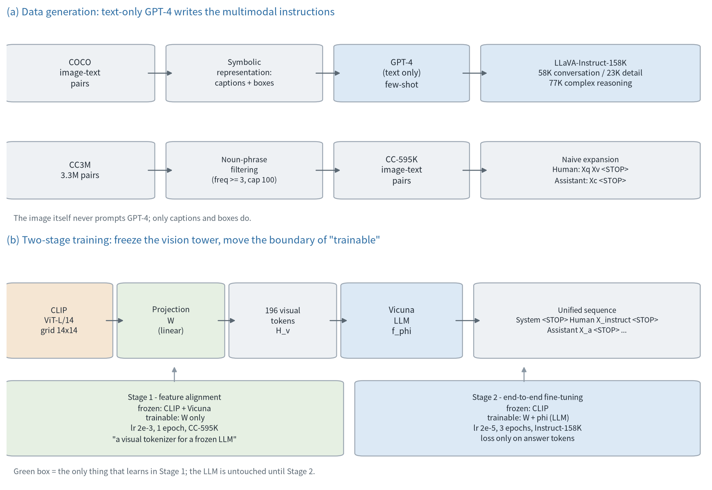
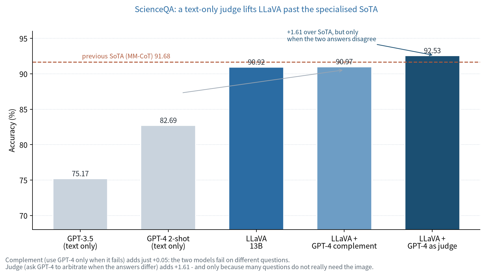

# LLaVA：面向多模态的视觉指令微调（Visual Instruction Tuning）

- **原文**：*Visual Instruction Tuning*，arXiv:2304.08485（本笔记对应 v2）；NeurIPS 2023
- **代码 / 项目**：论文中为匿名仓库 `LLaVA-Annonymous/LLaVA`，正式开源后迁至 `haotian-liu/LLaVA`；项目主页 <https://llava-vl.github.io>
- **作者与机构**：Haotian Liu\*（University of Wisconsin–Madison）、Chunyuan Li\*（Microsoft Research）、Qingyang Wu（Columbia University）、Yong Jae Lee（University of Wisconsin–Madison）　（\* 同等贡献）
- **发表信息**：NeurIPS 2023（37th Conference on Neural Information Processing Systems）
- **一句话总结**：不做任何花哨的架构创新——只用**纯文本 GPT-4 把图文对改造成三种指令跟随对话**，再把 CLIP 特征经**一个线性层**塞进 Vicuna，两阶段训练，就得到了会"看图说话+推理"的通用视觉助手；在 ScienceQA 上以"LLaVA + GPT-4 裁判集成"取得 92.53% 的新 SOTA。
- **前置阅读**：CLIP（视觉-语言对齐的起点）、Flamingo（门控交叉注意力、few-shot 多模态）、BLIP-2（Q-Former 与两阶段预训练）、InstructGPT / FLAN（指令微调范式）、Vicuna（对话格式与训练配方）、ScienceQA + MM-CoT（本文的评测战场）

## 1. 研究背景与核心问题

论文要解决的不是"视觉模型不够强"，而是**"接口不够通用"**。

两条既有路线的瓶颈可以并排看：

| 路线 | 代表 | 指令在哪里 | 局限 |
|---|---|---|---|
| 端到端单任务模型 | 视觉-语言导航[3,19]、Habitat[47]、InstructPix2Pix[6] | 隐含在**模型设计与任务定义**里 | 换任务就要换模型；接口固定 |
| LLM 编排多模型 | Visual ChatGPT[53]、MM-REACT[55]、VisProg[18]、ViperGPT[46] | 显式写在 prompt 里 | 靠外部工具链拼装，非端到端，误差逐级累积 |

而 LLM 侧的经验（InstructGPT→ChatGPT）已经证明：**语言可以当统一接口**，指令微调能让模型"听懂要它干什么"。于是问题变成：

> 能否把"指令微调"从纯文本搬到"图像 + 文本"空间？如果能，瓶颈在哪？

作者判断瓶颈**不在模型，而在数据**：图文对（CC3M、LAION）遍地都是，但"视觉指令跟随数据"几乎为零，人工众包又慢又难定义。这就推出了本文真正的核心动作：

> 用**只能看文本**的 GPT-4 当教师，把"(图像, 配文, 框)"改造成"(图像, 多轮指令, 回答)"。

这个思路有个隐含的哲学立场，值得单独拎出来：**语言模型不需要"看"图，也能生成关于图的对话**——只要图像被翻译成它能读的符号（配文 + 框）。这也解释了为什么后文评测必须引入 GPT-4 当裁判：数据的"教师"和评测的"裁判"是同一个模型家族，这里存在一个需要警惕的循环性（见 §7）。

## 2. 核心方法与设计动机

方法有三块，逐块都有明确的"为什么这样选"。

### 2.1 数据：把图文对"改造"成指令跟随格式

输入侧只用两种**符号表示**把图像喂给 GPT-4：

- **Captions**：从多个视角描述场景（谁、在哪、干什么）；
- **Bounding boxes**：定位物体，每个框编码物体概念 + 空间位置。

GPT-4 在少样本上下文学习下产出三类回复：

| 类型 | 数量 | 单/多轮 | 设计意图 |
|---|---|---|---|
| Conversation | 58K | 多轮 | 覆盖物体类别、计数、动作、位置、相对位置，**只问有确定答案的问题** |
| Detailed description | 23K | 单轮 | 逼出长而全的描述，弥补 caption 太短 |
| Complex reasoning | 77K | 单轮 | 需要**逐步严格逻辑**，而非一眼可见的属性 |

合计 **LLaVA-Instruct-158K**。三类里"复杂推理"占了一半（77K/158K），这不是随手配比：§5.1 的消融显示，加入少量描述+推理数据能让整体分数**+7 分**，且**连带提升对话类题目**——说明推理能力对对话能力有正迁移。

一个容易被略读掉的细节：作者早期实验比较过 ChatGPT 与 GPT-4，结论是 **GPT-4 的空间推理数据质量稳定更高**。也就是说，这条数据流水线的上限由教师模型决定，**换教师就是换数据分布**。

### 2.2 架构：一个线性层，故意"简陋"

$`f_\phi`$ 取 Vicuna（公开 checkpoint 中指令跟随最好），视觉侧取 **CLIP ViT-L/14**，中间只放**一个可训练线性投影 W**。

设计动机很直白：**先要能快速迭代"以数据为中心"的实验**，所以连接器必须便宜。对照两条更重的方案——Flamingo 的门控交叉注意力、BLIP-2 的 Q-Former——作者明确把它们列为 future work。这个选择在论文当期是"够用且灵活"，但从后来的演进看，它也是 LLaVA 分辨率与细粒度能力的天花板来源（见 §8）。

### 2.3 训练：两阶段，各解决一个不同的问题

| 阶段 | 冻结 | 可训练 | 数据 | 目的 |
|---|---|---|---|---|
| Stage 1 特征对齐 | 视觉编码器 + LLM | 仅 **W** | CC-595K（单轮"请描述这张图"→ 原配文） | 让视觉 token 落进 LLM 词嵌入的分布里；**"为冻结的 LLM 训一个视觉分词器"** |
| Stage 2 端到端微调 | 视觉编码器 | **W + φ** | LLaVA-Instruct-158K（对话）或 ScienceQA | 让 LLM 学会按指令使用视觉信息 |

两个学习率差了两个数量级（$`2\mathrm{e}{-3}`$ vs $`2\mathrm{e}{-5}`$），这不是调参玄学：Stage 1 只训一个线性层，需要大步长快速把随机初始化的投影拉到合理区域；Stage 2 动的是 130 亿参数的 LLM 权重，必须小步长以免把预训练知识冲掉（§6 的"跳过预训练掉 5.11 分"正是这句话的反证）。

### 2.4 评测：用 GPT-4 当裁判，还要它当"队友"

两个基准：**LLaVA-Bench (COCO)**（30 图 × 3 类问题 = 90 题，考察对齐行为）与 **LLaVA-Bench (In-the-Wild)**（24 图 60 题，室内外/表情包/绘画/素描，配极详细人工标注，专门用来"打脸"）。

评测协议是**三元组 + 相对分**：把（问题、真值文本描述、两方回答）交给纯文本 GPT-4，按有用性/相关性/准确性/细节度打 1–10 分并给理由；以"用真值描述作答的纯文本 GPT-4"为参照，报**相对分数**。参照系的选择很讲究——它近似"不看图但知道标准答案"的理论上界，所以 85.1% 应读作"达到上界能力的 85%"。

ScienceQA 上更进一步：让**同一个纯文本 GPT-4 反过来当集成器**。两种方案（补位 / 裁判）见 §5。

## 3. 数学原理与完整推导

论文公式不多，但三个式子恰好对应"怎么进、怎么组织、怎么训"。

**记号。** 图像 $`X_v`$，视觉特征 $`\mathbf{Z}_v`$，视觉 token $`\mathbf{H}_v`$，指令 $`\mathbf{X}_{\mathrm{instruct}}`$，答案 $`\mathbf{X}_a`$，语言模型 $`f_\phi`$，投影矩阵 $`\mathbf{W}`$。

### 3.1 式 (1)：图像如何进入词嵌入空间

```math
\mathbf{H}_{\mathrm{v}} = \mathbf{W}\cdot\mathbf{Z}_{\mathrm{v}},\qquad \mathbf{Z}_{\mathrm{v}} = g(\mathbf{X}_{\mathrm{v}})
```

其中 $`g`$ 是 CLIP 视觉编码器。逐层看这一步的形状：

1. ViT-L/14 在 224×224 输入下切 $`14\times14=196`$ 个 patch，每个 patch 输出一个 $`d_v`$ 维特征 → $`\mathbf{Z}_v\in\mathbb{R}^{196\times d_v}`$；
2. $`\mathbf{W}\in\mathbb{R}^{d_{\mathrm{LLM}}\times d_v}`$ 是**唯一可训练参数**，把每个 patch 特征线性映射到 LLM 的词嵌入维度；
3. 得到 $`\mathbf{H}_v\in\mathbb{R}^{196\times d_{\mathrm{LLM}}}`$，即 **196 个"视觉词"**，与文本 token 共用同一张嵌入表所在的空间。

（维度数值 $`d_v=1024`$、$`d_{\mathrm{LLM}}=4096`$ 是按 ViT-L/14 与 Vicuna-13B 的公开配置推算，论文未逐一点明。）

为什么"线性就够"？一个可检验的解释是：**对齐本质上是分布搬运**，不需要非线性。Stage 1 的目标就是让 $`\mathbf{H}_v`$ 的分布与"描述这类图时会出现的词嵌入"重合，线性映射已足以完成一次仿射变换式的搬运；非线性带来的额外自由度，反而容易在只有 595K 样本时过拟合。这个判断在 LLaVA-1.5 里被部分修正（换成两层 MLP），但那是"同等便宜的前提下多一点点表达力"，不是推翻线性假设。

### 3.2 式 (2)：多轮对话如何拼成一个序列

```math
\mathbf{X}_{\mathrm{instruct}}^{t} = \begin{cases} \text{Randomly choose } [\mathbf{X}_{q}^{1},\mathbf{X}_{v}] \text{ or } [\mathbf{X}_{v},\mathbf{X}_{q}^{1}], & t = 1\\[2pt] \mathbf{X}_{q}^{t}, & t>1\end{cases}
```

这条分段函数的两个分支，各解决一个工程问题：

- **$`t=1`$ 随机交换 $`X_q`$ 与 $`X_v`$ 的顺序**：如果永远"图在前"，模型会学到"看到图就等着被问"的位置偏置；随机交换使"图像出现在指令序列的任意位置"都成立，等价于对位置做了数据增强。
- **$`t>1`$ 只用 $`X_q^t`$**：图像只在第一轮注入一次，后续轮次不再重复 196 个视觉 token，序列长度可控（这是多轮对话能塞进上下文的前提）。

拼出的完整序列（表 2 的 `txt` 块）是：

```math
\underbrace{X_{\text{system-message}}}_{\text{Vicuna v0 模板}}\ \langle\mathrm{STOP}\rangle\ \underbrace{\text{Human}:X^{1}_{\text{instruct}}\langle\mathrm{STOP}\rangle\ \text{Assistant}:X^{1}_{a}\langle\mathrm{STOP}\rangle}_{\text{第 1 轮}}\ \cdots
```

其中 $`\langle\mathrm{STOP}\rangle`$ 在本实现里取 `###`（沿用 Vicuna-v0），它同时承担"轮次分隔符"和"停止符"两个角色。

### 3.3 式 (3)：自回归目标与只算答案的损失

```math
p(\mathbf{X}_{a}\mid \mathbf{X}_{v},\mathbf{X}_{\mathrm{instruct}}) = \prod_{i=1}^{L} p_{\boldsymbol{\theta}}\left(x_{i}\mid \mathbf{X}_{v},\ \mathbf{X}_{\mathrm{instruct},<i},\ \mathbf{X}_{a,<i}\right)
```

这里 $`L`$ 是**答案序列长度**，$`x_i`$ 是第 $`i`$ 个答案 token。取负对数即训练损失：

```math
\mathcal{L}(\boldsymbol\theta) = -\sum_{i=1}^{L}\log p_{\boldsymbol\theta}\left(x_i \mid \mathbf{X}_v,\mathbf{X}_{\mathrm{instruct},<i},\mathbf{X}_{a,<i}\right)
```

**关键点是求和下标只在答案上**（论文图 2 里"只有绿色 token 参与损失"）。为什么必须这样？如果把指令 token 也算进损失，模型会被训练去"复述用户的提问"——这是指令微调里最常见的隐性错误，它会让 loss 很好看、对话却答非所问。形式上可以写成一个掩码：

```math
\mathcal{L} = -\sum_{i=1}^{|\mathbf{X}|} m_i \log p_{\boldsymbol\theta}(x_i\mid x_{<i}),\qquad m_i = \mathbf{1}\left[x_i \in \mathbf{X}_a\right]
```

### 3.4 Stage 1 到底在优化什么（论文没写开的那一步）

Stage 1 的可训练参数只有 $`\theta=\mathbf{W}`$，数据是（图, 配文），目标是最大化式 (3) 的似然。把它写全：

```math
\max_{\mathbf{W}}\ \mathbb{E}_{(X_v, X_c)\sim \mathcal{D}_{\mathrm{CC595K}}}\ \log p_{\phi}\left(X_c \mid \mathbf{H}_v(\mathbf{W})\right),\qquad \mathbf{H}_v(\mathbf{W})=\mathbf{W}g(X_v)
```

对 $`\mathbf{W}`$ 求梯度，用链式法则拆开：

```math
\frac{\partial \mathcal{L}}{\partial \mathbf{W}} = \sum_{i}\left(\frac{\partial \mathcal{L}}{\partial \mathbf{h}_i}\right)\left(\frac{\partial \mathbf{h}_i}{\partial \mathbf{W}}\right) = \sum_{i}\ \nabla_{\mathbf{h}_i}\mathcal{L}\ \cdot\ g(X_v)^{\top}
```

因为 $`\mathbf{h}_i=\mathbf{W}g(X_v)`$ 对 $`\mathbf{W}`$ 是线性的，$`\partial \mathbf{h}_i/\partial\mathbf{W}`$ 就是 $`g(X_v)`$ 本身。**这条式子说明了一件很具体的事**：$`\mathbf{W}`$ 的更新方向完全由"配文在该位置上对隐状态的梯度"与"图像特征"的外积决定——即 $`\mathbf{W}`$ 被拉去把 $`g(X_v)`$ 摆到"配文 token 的嵌入会被消费的位置"。这就是"训练一个兼容的视觉分词器"的数学含义：**不是让图像变得像文本，而是让图像特征落在语言模型已经会读的那片区域**。

### 3.5 Stage 2 的参数集与更新范围

```math
\theta=\{\mathbf{W},\ \phi\},\qquad \text{冻结 } g(\cdot)
```

冻结视觉编码器有明确理由：（1）CLIP 的对齐能力是宝贵资产，小数据上微调它只会破坏；（2）参数量上省一大块显存。端到端"冻视觉、动语言"这个配方后来被几乎所有开源 LMM 沿用。

### 3.6 ScienceQA 的集成：两个方案的形式化

设 LLaVA 答案 $`a_L`$、纯文本 GPT-4 答案 $`a_G`$（在某些题上为空）。**补位**：

```math
\hat{a} = \begin{cases} a_L, & a_G = \varnothing\\ a_G, & \text{otherwise}\end{cases}
```

但论文实测补位几乎不提分（90.97 vs 90.92），说明"GPT-4 答不出的题"和"LLaVA 答错的题"高度不重合。**裁判**方案才是提分的关键：

```math
\hat{a} = \mathrm{Judge}\big(q,\ a_L,\ a_G\big),\qquad \text{仅当 } a_L \neq a_G \text{ 时调用}
```

效果：**92.53%**，超过此前 SOTA（MM-CoT 91.68%）。为什么"不能看图的 GPT-4"能改对"能看图的 LLaVA"？论文的解释很实在：**部分题目根本不需要图像**（文本上下文已足够），而 LLaVA 会被图像干扰；裁判能识别"这题不用看图"，从而纠正。这一步本质上是**用另一个模型的知识做条件校正**，形式上更像 CoT 的外部知识版，而不是投票集成。

## 4. 数据、训练与系统实现

```
CC3M ──过滤──> CC-595K ──朴素扩展──> Stage1 单轮(图, "简述这张图", 原配文)
COCO ──GPT-4 改造──> LLaVA-Instruct-158K ──Stage2──> Chatbot
ScienceQA ───────────────────────────────> Stage2(单轮: 问题+上下文 → 推理+答案)
```

**CC3M → CC-595K 的过滤算法**（附录 E，值得单独复述，因为它是"小数据也要覆盖概念"的漂亮做法）：

1. 对全部 CC3M 配文用 SpaCy 抽名词短语，统计每个唯一短语的频次；
2. 丢弃频次 $`<3`$ 的短语（罕见的概念-属性组合，通常已被其他配文覆盖）；
3. 从**剩余频次最低**的短语开始，把含该短语的配文加入候选池；
4. 若某短语频次 $`>100`$，只随机抽 100 条配文（防止高频概念（如"人""车"）淹没数据）；
5. 结果约 **595K** 图文对。

这个"从稀到密、每概念设上限"的采样，等价于对概念分布做**重平衡**，让 595K 而不是 3M 的样本也有不错的覆盖度（图 7 的对比即为此证）。

**训练超参与工程配置**（§5 + 附录 C）：

| 项 | Stage 1 | Stage 2 |
|---|---|---|
| 数据 | CC-595K | Instruct-158K（3 epoch）/ ScienceQA（12 epoch） |
| lr | 2e-3 | 2e-5 |
| batch | 128 | 32 |
| epoch | 1 | 3 / 12 |
| 优化器 | Adam | Adam，无 weight decay，cosine，warmup 3% |

- 硬件 **8×A100**；耗时：Stage 1 **<4h**，Instruct-158K 微调 **<10h**，ScienceQA **<4h**。
- FSDP + 梯度检查点省显存，**不用 offloading**；开 BF16 + TF32 兼顾速度与精度。
- ScienceQA 用**最后一层之前**的视觉特征，让模型"先推理再作答"，训 12 epoch。



一句话：**这套流程的复现门槛低到"一张 8 卡机、一天之内"**，这也是它传播这么广的现实原因。

## 5. 实验设置与关键结论

**（a）定性对比（表 3、表 9，取自 GPT-4 论文原图）。** 面对"极限熨衣"这类需要深度理解的图，BLIP-2 与 OpenFlamingo 偏向**描述画面**，LLaVA 则按指令作答，且比 GPT-4 更详尽；在"炸鸡块地图"的笑点题上，LLaVA 与 GPT-4 都能解释幽默，GPT-4 更简洁。

**（b）LLaVA-Bench (COCO)：数据配比的消融。**

| 训练数据 | Conversation | Detail | Complex | All |
|---|---|---|---|---|
| 无指令微调（仅 Stage 1） | 22.0 | 24.0 | 18.5 | **21.5** |
| 仅对话数据 | 76.5 | 59.8 | 84.9 | **73.8（+52.3）** |
| 描述 + 推理 | 81.5 | 73.3 | 90.8 | 81.9（+3.2） |
| 对话 + 5% 描述 + 10% 推理 | 81.0 | 68.4 | 91.5 | 80.5 |
| **三类全用** | 83.1 | 75.3 | 96.5 | **85.1** |

"超过 50 分"这个幅度说明：**指令跟随能力不是被"教"出来的，而是被"触发"出来的**——底座的对话与推理能力早已存在，缺的只是一个把它接到视觉输入上的接口与格式。

**（c）LLaVA-Bench (In-the-Wild)：与同期模型横向比较。**

| 模型 | Conversation | Detail | Complex | All |
|---|---|---|---|---|
| OpenFlamingo | 19.3 ± 0.5 | 19.0 ± 0.5 | 19.1 ± 0.7 | **19.1 ± 0.4** |
| BLIP-2 | 54.6 ± 1.4 | 29.1 ± 1.2 | 32.9 ± 0.7 | **38.1 ± 1.0** |
| **LLaVA** | 57.3 ± 1.9 | 52.5 ± 6.3 | **81.7 ± 1.8** | **67.3 ± 2.0** |

相对 BLIP-2 **+29.2**、相对 OpenFlamingo **+48.2**（整体分差）；复杂推理单项达 **81.7%**。

**（d）ScienceQA：从"接近 SOTA"到"新 SOTA"。**

| 方法 | 准确率 |
|---|---|
| GPT-3.5（text-davinci-002） | 75.17 |
| GPT-4（2-shot，纯文本） | 82.69 |
| MM-CoT（此前 SOTA） | 91.68 |
| **LLaVA（12 epoch）** | **90.92** |
| LLaVA + GPT-4 补位 | 90.97 |
| **LLaVA + GPT-4 裁判** | **92.53（新 SOTA）** |



三个解读：① 一个 13B 的开源模型，在这个多模态推理基准上**逼近专为此任务设计的 MM-CoT**，靠的是"视觉对齐 + 指令微调"而非任务专用结构；② GPT-4 单独用（82.69）远低于 LLaVA，说明**这类题需要专门的视觉-语言对齐**，通用大模型并不能通吃；③ 裁判集成在**所有问题类别**上都一致提升（表 7），不是一个类别上的偶然。


## 6. 消融实验与失败案例

**表 8 的四项消融（ScienceQA）：**

| 变量 | 结果 | 与最佳变体差 |
|---|---|---|
| 视觉特征：最后一层 vs 最后一层之前 | 89.96 vs 最佳 | **−0.96** |
| 顺序：答案在前（12 ep） | 89.77 | 基线最佳 |
| 顺序：推理在前（6 ep） | 89.77 | 0（但**收敛快一倍**） |
| 不预训练（直接从 ScienceQA 训） | **85.81** | **−5.11** |
| 模型规模：7B vs 13B | **89.84** | **−1.08** |

四条结论对应四个工程判断：

- **取倒数第二层特征更好**：最后一层更"全局抽象"，前一层保留更多**局部属性**，而"识别具体细节"恰恰需要局部信息。
- **CoT 主要改善收敛，不改善上限**：推理在前 6 个 epoch 就到 89.77，继续训到 24 个 epoch 也不涨；答案在前要 12 个 epoch 才到同一水平。所以**"先推理"是把路走短的加速器，不是把天花板抬高的梯子**。
- **预训练阶段不可省（−5.11）**：这印证了 §2.3 的设计——Stage 1 不是"热身"，它承担了"对齐多模态特征同时不破坏预训练知识"的实质职责。
- **模型规模仍然重要（−1.08）**：说明当时 LLaVA 的能力还远没到"数据/对齐就能补平规模差"的程度。

**一个原文没解释、但值得盯住的数字不一致**：§5 正文报 LLaVA 在 ScienceQA 上是 **90.92%**（12 epoch），而表 8 消融里"最佳变体"是 **89.77%**。两者相差 1.15 分，论文未说明消融是否使用了不同配置（很可能是不同的 checkpoint 或 epoch 口径）。复现时应以表 7 的 90.92 为对外口径，但**比对消融差值时只做表内相对比较**，不要跨表混用。

**失败案例（论文自己给的，很有价值）：**

1. **"一袋 patch"式误判**。冰箱里只有原味酸奶和草莓，问"有没有草莓味酸奶"，LLaVA 答"有"。作者的解释很到位：模型把图像当成 patch 的集合去匹配关键词，**没有真正组合语义**（草莓 + 酸奶 ≠ 草莓味酸奶）。这是我见过的对"多模态幻觉"最具体的一种描述——不是编造不存在的东西，而是**错误地做了概念合成**。
2. **依赖外部知识与多语言**。日式拉面店名、配菜描述需要模型有知识覆盖甚至联网检索能力，纯离线小模型必然失手。
3. **依赖高分辨率**。认出冰箱里酸奶的品牌需要看清小字，224 输入 + 14×14 网格此时已到物理极限。

## 7. 方法局限与适用边界

- **连接器表达力有天花板**。单个线性层把 196 个 patch 直通进 LLM，没有信息瓶颈也没有选择性聚合：好处是信息不丢，坏处是**无法"按问题挑区域看"**（对比 BLIP-2 Q-Former 的 32 个 query 是一种注意力式的压缩）。分辨率与细粒度任务（OCR、小字、图表）因此先天吃亏。
- **评测依赖 GPT-4 裁判，存在循环性**。数据由 GPT-4 生成、评测也由 GPT-4 打分的模型家族闭环，意味着分数对"教师偏好"高度敏感；论文自己也承认裁判在"幻觉程度、细粒度理解"等维度未验证。相对分（85.1%）只是**对特定参照系的比值**，不是绝对能力。
- **严格说是 SFT 级对齐，不是 RLHF**。没有偏好对、没有奖励模型、没有策略优化；"有用/无害"更多靠数据质量与基座模型继承。
- **单图、静态、无 grounding**。不输出框、不做指代定位、不支持视频与多图；"看图"实质是"看一张 224 的缩略图"。
- **数据规模小、覆盖偏生活场景**（约 80K 独特图像），学术密集图文（公式、表格、文档）几乎没覆盖——这也直接解释了作者为什么在结论里把读者引向 LLaVA-1.5[32]。
- **偏差与安全**：继承 CLIP 与 LLaMA/Vicuna 的偏见；靠 OpenAI Filter API + NSFW Filter 做前置拦截，属于"外挂式"防护，不是模型内生的。

**什么时候该用它**：需要"通用视觉对话 + 低成本复现 + 可二次微调"的场景（研究基线、领域数据微调、demo）。
**什么时候不该用**：需要读密集文本/表格（改用高分辨率或文档专用模型）、需要精确定位（需要 grounding 能力的模型）、需要严格事实性（需 RAG 或工具调用）、需要偏好对齐（需 DPO/RLHF 类后训练）。

## 8. 与其他论文的演进关系

```
CLIP(2021) ──视觉-语言对齐──┐
InstructGPT/FLAN(2022) ──指令微调──┤
                                   ├─> Flamingo(2022) 门控交叉注意力 + few-shot
                                   ├─> BLIP-2(2023) Q-Former 两阶段（本文的直接对照）
                                   └─> LLaVA(2023) 线性投影 + GPT 造数据  ← 本文
                                            │
                        ┌───────────────────┼────────────────────┐
                   LLaVA-1.5(2023)      MiniGPT-4 / InstructBLIP   ShareGPT4V / 数据派
                   MLP + 高分辨率 +      视觉指令的并行变体         "数据质量决定上限"
                   学术任务数据
                        │
                   LLaVA-NeXT / 1.6(2024) 任意分辨率、更强 OCR
```

三条线值得记牢：

1. **连接器之争（BLIP-2 的 Q-Former vs LLaVA 的线性层）**。BLIP-2 用 32 个可学习 query 做"信息瓶颈"，参数量更大、能选择性压缩；LLaVA 直通 196 token，信息不丢但贵且无选择。后续 LLaVA-1.5 折中为两层 MLP —— 说明**"够便宜的方案 + 够好的数据"往往赢过"更精巧的架构 + 更少的数据"**，这是本文最被低估的结论。
2. **数据范式之争**。本文用 GPT-4 生成数据，开创"合成多模态指令数据"这条路；ShareGPT4V 等后续工作把"描述密度"继续拉高，验证了**数据质量/密度是这类模型的主要瓶颈**。
3. **与纯文本对齐工作的关系**。把本文看成"多模态版的 InstructGPT SFT 阶段"最准确：它补上了 RLHF 之前的那一步，这也是后来 LLaVA-RLHF、DPO 类工作能接上去的原因。

## 9. 复现记录与工程踩坑

### 9.1 最小复现路径（按本文配方，13B）

```bash
# 0) 环境：8×A100 80G（论文配置）；单卡 24G 只能跑 7B + LoRA
# 1) 数据：CC-595K（可从论文发布的 json 直接取）+ LLaVA-Instruct-158K
# 2) Stage 1：只训 W
deepspeed llava/train/train_mem.py \
  --model_name_or_path lmsys/vicuna-13b-v0 \
  --data_path data/llava_instruct_595k.json \
  --vision_tower openai/clip-vit-large-patch14 \
  --freeze_backbone True --tune_mm_mlp_adapter True \
  --per_device_train_batch_size 16 --gradient_accumulation_steps 8 \
  --learning_rate 2e-3 --num_train_epochs 1 --bf16 True
# 3) Stage 2：训 W + LLM（视觉塔冻结）
deepspeed llava/train/train_mem.py \
  --model_name_or_path <stage1 输出> --data_path data/llava_instruct_158k.json \
  --freeze_backbone True --tune_mm_mlp_adapter True \
  --per_device_train_batch_size 4 --gradient_accumulation_steps 8 \
  --learning_rate 2e-5 --num_train_epochs 3 --bf16 True
```

（脚本名为社区实现口径，路径与参数按你手上的仓库版本核对；论文只给了超参，没给具体命令行。）

### 9.2 踩坑清单（按"会直接跑偏"的严重程度排序）

| 坑 | 现象 | 处理 |
|---|---|---|
| **对话模板不匹配** | loss 正常但推理乱码/不停止 | 必须用 Vicuna-v0 的 system message，且 `<STOP>` = `###`；换成 v1.1 模板必须同步改 |
| **损失没做答案掩码** | 模型学会复述问题 | 只在 assistant 回复 token 上算 loss（对应式 3 的下标范围） |
| **Stage 1 学习率照搬 Stage 2** | W 几乎不动，视觉 token 与词嵌入对不上 | 两个阶段 lr 相差 100 倍，别统一 |
| **忘了冻结视觉塔** | 显存爆、CLIP 对齐被小数据破坏 | `freeze_backbone` + 只 `tune_mm_mlp_adapter`（Stage 1） |
| **图像预处理尺寸不一致** | 训练/推理行为不一致 | 固定 224 中心裁剪，与 ViT-L/14 的 patch 网格一致（196 token） |
| **tokenizer 与 LLM 不匹配** | 视觉 token 被切碎、位置错乱 | 视觉 token 走专用 `IMG_TOKEN` 路径，不要交给文本 tokenizer |
| **不加梯度检查点跑 13B** | OOM | FSDP/ZeRO-3 + gradient checkpointing（论文明确未用 offloading） |
| **评测直接看绝对分** | 分数不可比 | LLaVA-Bench 报的是**相对分**（相对纯文本 GPT-4 参照） |

### 9.3 我实际做了什么 / 没做什么

- 做了：通读全文与附录、核对全部表格数值、复原三处公式的推导、绘制两张自制图（流水线与 ScienceQA 对比）、按论文配方整理命令行骨架。
- 没做：**没有实际跑训练或推理**（无 8×A100 环境），因此 §9.1 的命令与 §9.3 的坑表属于**按论文与社区实现整理的推断**，不是实测结论；跑通与否需要用 7B + LoRA 的小实验验证（成本约 1 张 24G 卡、数小时）。

## 10. 个人思考与后续问题

**（1）"50 分跃升"到底在说什么。** 这个数字很容易被读成"数据很重要"，但更准确的读法是：**底座的对话/推理能力早已存在，视觉接口与指令格式才是开关**。这对做领域模型有直接启发——如果你的底座够强，缺的往往不是再训一遍，而是"把新模态接到它已经会读的位置上"。

**（2）线性投影够不够，取决于数据量而不是任务难度。** 我的判断是：线性层的表达力天花板不是"不能拟合"，而是"在 595K 样本下多一层反而更容易学歪"。LLaVA-1.5 换 MLP 同时把数据加到 665K 学术数据、分辨率提到 336，几件事是绑在一起发生的——单独把连接器换复杂、数据不动，很可能不涨反跌。

**（3）裁判集成的可迁移性存疑。** 92.53% 依赖"很多题其实不需要图"这一数据集特性。换到真正必须看图的基准（如需要读图表小字的题），"不能看图的裁判"就会从帮手变成噪声源。**这套集成法的适用前提是：任务里存在相当比例的"图像冗余"题目**，这一点几乎没人复述。

**（4）本文缺的那一环是多模态偏好对齐。** 它做的是 SFT，而"有用/无害/不幻觉"需要偏好数据与策略优化。这正好接上你精读过的 DPO：把 DPO 的隐式奖励搬到"图文问答"上，偏好对用 GPT-4 判优即可造——这是我认为最自然的下一个实验。

**（5）可验证的开放问题（想动手就从这三条里挑一条）**

- **连接器容量 vs 数据量的交叉消融**：固定 595K 数据，比较 linear / 2-layer MLP / Q-Former(32 query) 三者；预期线性不输，验证"小数据下简单即优"。
- **"草莓酸奶"式误判能否被数据修好**：构造一批"组合语义"负样本（A+B 存在但 A 味 B 不存在），测幻觉是否下降——这直接检验"bag of patches"假说。
- **裁判偏差的量化**：把裁判换成"另一个家族的模型"（如 Claude/Gemini 或本地 70B）重跑 LLaVA-Bench，看相对分漂移多少；这是检验评测循环性的最直接实验。

**（6）和你的手写 Llama3.1 项目怎么接。** 若要自己实现，最小闭环是：CLIP ViT-L/14 取倒数第二层 196×1024 网格 → 线性层到你的 hidden size → 前插到 token 序列 → 只对 assistant 段算交叉熵。注意两点：位置编码要给视觉 token 留位（前插会让文本位置整体后移，RoPE 下需确认实现用的是绝对偏移而非固定索引）；Stage 1 只训投影层时，务必把 LLM 侧 `requires_grad=False` 且不进优化器状态，否则显存会莫名其妙翻倍。
