# 视觉指令微调 / Visual Instruction Tuning

**Haotian Liu**<sup>1∗</sup>**, Chunyuan Li**<sup>2∗</sup>**, Qingyang Wu**<sup>3</sup>**, Yong Jae Lee**<sup>1 1</sup>University of Wisconsin–Madison <sup>2</sup>Microsoft Research <sup>3</sup>Columbia University [https://llava-vl.github.io](https://llava-vl.github.io)

## 摘要 / Abstract

Instruction tuning large language models (LLMs) using machine-generated instruction-following data has been shown to improve zero-shot capabilities on new tasks, but the idea is less explored in the multimodal field. We present the first attempt to use language-only GPT-4 to generate multimodal language-image instruction-following data. By instruction tuning on such generated data, we introduce LLaVA: Large Language and Vision Assistant, an end-to-end trained large multimodal model that connects a vision encoder and an LLM for generalpurpose visual and language understanding. To facilitate future research on visual instruction following, we construct two evaluation benchmarks with diverse and challenging application-oriented tasks. Our experiments show that LLaVA demonstrates impressive multimodal chat abilities, sometimes exhibiting the behaviors of multimodal GPT-4 on unseen images/instructions, and yields a 85.1% relative score compared with GPT-4 on a synthetic multimodal instruction-following dataset. When fine-tuned on Science QA, the synergy of LLaVA and GPT-4 achieves a new state-of-the-art accuracy of 92.53%. We make GPT-4 generated visual instruction tuning data, our model, and code publicly available.

> 用**机器生成的指令跟随数据**对大规模语言模型（LLM）做指令微调，已被证明能提升模型在新任务上的零样本能力，但这个思路在多模态领域探索甚少。我们给出**第一个尝试**：用纯文本的 GPT-4 生成多模态的“语言-图像”指令跟随数据。在这样的生成数据上做指令微调，我们得到 **LLaVA：Large Language and Vision Assistant（大型语言与视觉助手）**——一个端到端训练的大型多模态模型，把视觉编码器与 LLM 连接起来，用于通用的视觉与语言理解。为推动后续的视觉指令跟随研究，我们构建了两个评测基准，包含多样且有挑战性的应用型任务。实验表明 LLaVA 具备令人印象深刻的多模态对话能力，在未见过的图像/指令上有时表现出类似多模态 GPT-4 的行为，并在一个合成的多模态指令跟随数据集上取得相对 GPT-4 **85.1%** 的相对分数。在 Science QA 上微调时，LLaVA 与 GPT-4 协同取得 **92.53%** 的新 SOTA 准确率。我们公开 GPT-4 生成的视觉指令微调数据、模型与代码。

## 1 引言 / Introduction

Humans interact with the world through many channels such as vision and language, as each individual channel has a unique advantage in representing and communicating certain concepts, and thus facilitates a better understanding of the world. One of the core aspirations in artificial intelligence is to develop a general-purpose assistant that can effectively follow multi-modal vision-and-language instructions, aligned with human intent to complete various real-world tasks in the wild [4, 27, 26].

> 人类通过视觉、语言等多个通道与世界交互——每个通道在表征与传达特定概念上各有独特优势，从而有助于更全面地理解世界。人工智能的核心诉求之一，是造出一个**通用助手**：能有效遵循多模态的视觉-语言指令，与人类意图对齐，完成各种真实世界任务[4, 27, 26]。

To this end, the community has witnessed an emergent interest in developing language-augmented foundation vision models [27, 16], with strong capabilities in open-world visual understanding such as classification [40, 21, 57, 54, 39], detection [29, 62, 33], segmentation [25, 63, 58] and captioning [50, 28], as well as visual generation and editing [42, 43, 56, 15, 44, 30]. We refer readers to the Computer Vision in the Wild reading list for a more up-to-date literature compilation [12]. In this line of work, each task is solved independently by one single large vision model, with the task instruction implicitly considered in the model design. Further, language is only utilized to describe the image content. While this allows language to play an important role in mapping visual signals to language semantics—a common channel for human communication, it leads to models that usually have a fixed interface with limited interactivity and adaptability to the user’s instructions.

> 为此，学界对“**语言增强的基础视觉模型**”[27, 16] 兴趣骤增：这类模型在开放世界的视觉理解上能力很强，覆盖分类[40, 21, 57, 54, 39]、检测[29, 62, 33]、分割[25, 63, 58]、描述生成[50, 28]，以及视觉生成与编辑[42, 43, 56, 15, 44, 30]。更完整的文献清单见 Computer Vision in the Wild 阅读列表[12]。在这一路线中，**每个任务都由一个独立的大型视觉模型单独解决**，任务指令被隐含地写进模型设计里；而且语言只被用来描述图像内容。这让语言在“把视觉信号映射到语言语义（人类交流的通用通道）”上发挥了重要作用，但也导致模型接口固定、交互性有限、难以适应使用者的指令。

Large language models (LLM), on the other hand, have shown that language can play a wider role: a universal interface for a general-purpose assistant, where various task instructions can be explicitly represented in language and guide the end-to-end trained neural assistant to switch to the task of interest to solve it. For example, the recent success of ChatGPT [35] and GPT-4 [36] have demonstrated the power of aligned LLMs in following human instructions, and have stimulated tremendous interest in developing open-source LLMs. Among them, LLaMA [49] is an open-source LLM that matches the performance of GPT-3. Alpaca [48], Vicuna [9], GPT-4-LLM [38] utilize various machine-generated high-quality instruction-following samples to improve the LLM’s alignment ability, reporting impressive performance compared with proprietary LLMs. Importantly, this line of work is text-only.

> 大语言模型（LLM）则展示了语言可以扮演更广的角色：作为**通用助手的统一接口**——各种任务指令都能用语言显式表达，引导端到端训练的神经助手切换到目标任务上去解决它。例如 ChatGPT[35] 与 GPT-4[36] 的成功，展示了经对齐的 LLM 在遵循人类指令上的威力，也激起了对开源 LLM 的巨大兴趣。其中 LLaMA[49] 是性能可与 GPT-3 比肩的开源 LLM；Alpaca[48]、Vicuna[9]、GPT-4-LLM[38] 用各种机器生成的高质量指令跟随样本来提升 LLM 的对齐能力，报告了与闭源 LLM 相比相当亮眼的表现。重要的是：**这条线都只做文本**。

<small><span class="docvortex-page-footnote" data-block-type="page_footnote" style="color:#6b7280">37th Conference on Neural Information Processing Systems (NeurIPS 2023).</span></small>

In this paper, we present visual instruction-tuning, the first attempt to extend instruction-tuning to the language-image multimodal space, to pave the way towards building a general-purpose visual assistant. In particular, our paper makes the following contributions:

> 本文提出**视觉指令微调（visual instruction-tuning）**，即首次把指令微调扩展到“语言-图像”多模态空间，为构建通用视觉助手铺路。具体而言，本文有以下贡献：

• Multimodal instruction-following data. One key challenge is the lack of vision-language instruction-following data. We present a data reformation perspective and pipeline to convert image-text pairs into an appropriate instruction-following format, using ChatGPT/GPT-4.

> • **多模态指令跟随数据。** 一个关键难点是缺少视觉-语言指令跟随数据。我们给出一种**数据改造**的视角与流程，用 ChatGPT/GPT-4 把图文对转换成合适的指令跟随格式。

• Large multimodal models. We develop a large multimodal model (LMM), by connecting the open-set visual encoder of CLIP [40] with the language decoder Vicuna [9], and fine-tuning end-to-end on our generated instructional vision-language data. Our empirical study validates the effectiveness of using generated data for LMM instruction-tuning, and suggests practical tips for building a general-purpose instruction-following visual agent. When ensembled with GPT-4, our approach achieves SoTA on the Science QA [34] multimodal reasoning dataset.

> • **大型多模态模型。** 我们把 CLIP[40] 的开放集视觉编码器与语言解码器 Vicuna[9] 连接，端到端在我们的指令视觉-语言数据上微调，得到大型多模态模型（LMM）。实证研究验证了“用生成数据做 LMM 指令微调”的有效性，并给出构建通用指令跟随视觉助手的实用建议。与 GPT-4 集成后，我们的方法在 Science QA[34] 多模态推理数据集上达到 SOTA。

• Multimodal instruction-following benchmark. We present LLaVA-Bench with two challenging benchmarks, with a diverse selection of paired images, instructions and detailed annotations.

> • **多模态指令跟随基准。** 我们提出 LLaVA-Bench，含两个有挑战性的基准，配有精心挑选的图像、指令与详细标注。

• Open-source. We release the following assets to the public: the generated multimodal instruction data, the codebase, the model checkpoints, and a visual chat demo.

> • **开源。** 我们向公众发布：生成的多模态指令数据、代码库、模型 checkpoint，以及一个视觉对话 demo。

## 2 相关工作 / Related Work

**Multimodal Instruction-following Agents.** In computer vision, existing works that build instructionfollowing agents can be broadly categorized into two classes: (i) End-to-end trained models, which are separately explored for each specific research topic. For example, the vision-language navigation task [3, 19] and Habitat [47] require the embodied AI agent to follow natural language instructions and take a sequence of actions to complete goals in visual environments. In the image editing domain, given an input image and a written instruction that tells the agent what to do, InstructPix2Pix [6] edits images by following the human instructions. (ii) A system that coordinates various models via LangChain [1] / LLMs [35], such as Visual ChatGPT [53], X-GPT [63], MM-REACT [55], VisProg [18], and ViperGPT [46]. While sharing the same goal in building instruction-following agents, we focus on developing an end-to-end trained language-vision multimodal model for multiple tasks.

> **多模态指令跟随智能体。** 在计算机视觉中，构建指令跟随智能体的既有工作大致可分两类：(i) **端到端训练的模型**，按具体研究主题分别探索。例如视觉-语言导航任务[3, 19] 与 Habitat[47]，要求具身智能体遵循自然语言指令、在视觉环境中执行一系列动作以完成目标；图像编辑领域，给定输入图像与一段“告诉智能体做什么”的文字指令，InstructPix2Pix[6] 按人类指令编辑图像。(ii) **通过 LangChain[1]/LLM[35] 协调多个模型的系统**，如 Visual ChatGPT[53]、X-GPT[63]、MM-REACT[55]、VisProg[18]、ViperGPT[46]。虽然目标同为构建指令跟随智能体，我们聚焦于**为多个任务训练一个端到端的语言-视觉多模态模型**。

**Instruction Tuning.** In the natural language processing (NLP) community, to enable LLMs such as GPT-3 [7], T5 [41], PaLM [10], and OPT [60] to follow natural language instructions and complete real-world tasks, researchers have explored methods for LLM instruction-tuning [37, 52, 51], leading to instruction-tuned counterparts such as InstructGPT [37]/ChatGPT [35], FLAN-T5 [11], FLAN-PaLM [11], and OPT-IML [22], respectively. It turns out that this simple approach can effectively improve the zero- and few-shot generalization abilities of LLMs. It is thus natural to borrow the idea from NLP to computer vision. More broadly, the teacher-student distillation ideas with foundation models have been studied in other topics such as image classification [14]. Flamingo [2] can be viewed as the GPT-3 moment in the multimodal domain, due to its strong performance on zero-shot task transfer and in-context-learning. Other LMMs trained on imagetext pairs include BLIP-2 [28], FROMAGe [24], and KOSMOS-1 [20]. PaLM-E [13] is an LMM for embodied AI. Based on the recent “best” open-source LLM LLaMA, OpenFlamingo [5] and LLaMA-Adapter [59] are open-source efforts that enable LLaMA to use image inputs, paving the way to build open-source multimodal LLMs. While these models present promising task transfer generalization performance, they are not explicitly tuned with vision-language instruction data, and their performance in multimodal tasks usually falls short compared to language-only tasks. In this paper, we aim to fill this gap and study its effectiveness. Finally, note that visual instruction tuning is different from visual prompt tuning [23]: the former aims to improve the model’s instructionfollowing abilities, while the latter aims to improve the parameter-efficiency in model adaptation.

> **指令微调。** 在自然语言处理（NLP）领域，为让 GPT-3[7]、T5[41]、PaLM[10]、OPT[60] 这类 LLM 能遵循自然语言指令、完成真实任务，研究者探索了 LLM 指令微调方法[37, 52, 51]，于是分别得到 InstructGPT[37]/ChatGPT[35]、FLAN-T5[11]、FLAN-PaLM[11]、OPT-IML[22]。事实证明，这个简单办法能有效提升 LLM 的零样本与少样本泛化能力。因此自然想到把它从 NLP 借到计算机视觉。更广义地看，“用基础模型做教师-学生蒸馏”的思路在其他主题上也研究过，如图像分类[14]。Flamingo[2] 可视为多模态领域的“GPT-3 时刻”——它在零样本任务迁移与上下文学习上表现很强。其他在图文对上训练的 LMM 包括 BLIP-2[28]、FROMAGe[24]、KOSMOS-1[20]；PaLM-E[13] 是用于具身 AI 的 LMM。基于近期“最好”的开源 LLM LLaMA，OpenFlamingo[5] 与 LLaMA-Adapter[59] 是让 LLaMA 能接受图像输入的开源尝试，为构建开源多模态 LLM 铺路。这些模型虽展现出不错的任务迁移泛化能力，但**并未用视觉-语言指令数据显式微调**，其多模态任务表现通常不如纯语言任务。本文要填补的正是这个空白，并研究其有效性。最后需注意，视觉指令微调与视觉提示微调（visual prompt tuning）[23] 不同：前者旨在提升模型的指令跟随能力，后者旨在提升模型适配时的参数效率。

## 3 用 GPT 辅助生成视觉指令数据 / GPT-assisted Visual Instruction Data Generation

The community has witnessed a surge in the amount of public multimodal data such as image-text pairs, ranging from CC [8] to LAION [45]. However, when it comes to multimodal instructionfollowing data, the available amount is limited, partially because the process for creating such data is time-consuming and less well-defined when human crowd-scouring is considered. Inspired by the success of recent GPT models in text-annotation tasks [17], we propose to leverage ChatGPT/GPT-4 for multimodal instruction-following data collection, based on the widely existing image-pair data.

> 学界已涌入大量公开多模态数据（如图文对），从 CC[8] 到 LAION[45]。但**多模态指令跟随数据**的可得量有限，部分原因是人工众包创建这类数据既耗时、流程又不够明确。受近期 GPT 模型在文本标注任务上成功的启发[17]，我们提出基于广泛存在的图文对数据，用 ChatGPT/GPT-4 来收集多模态指令跟随数据。

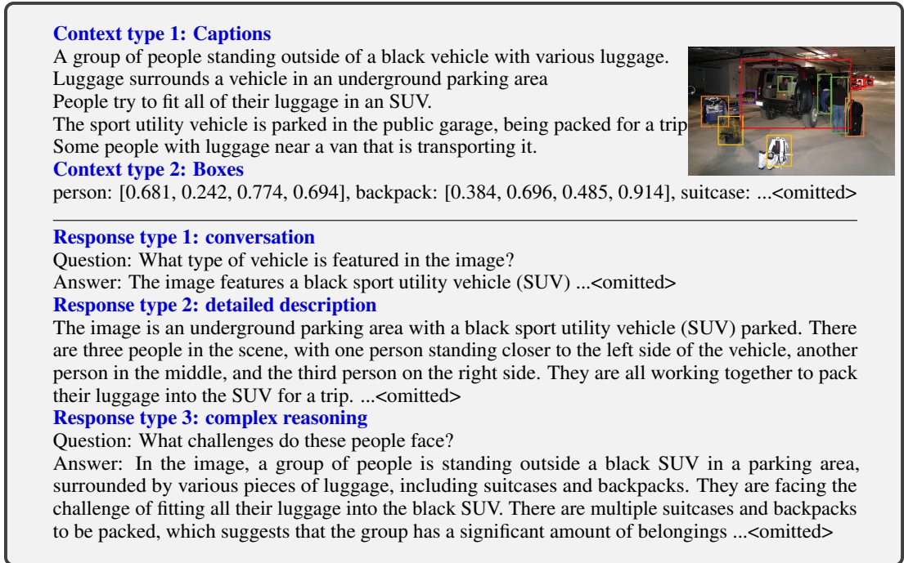

Table 1: One example to illustrate the instruction-following data. The top block shows the contexts such as captions and boxes used to prompt GPT, and the bottom block shows the three types of responses. Note that the visual image is not used to prompt GPT, we only show it here as a reference.

> 表 1：一个说明指令跟随数据的例子。上方块是用于提示 GPT 的上下文（如描述与框），下方块是三类回复。注意**图像本身并未用于提示 GPT**，此处仅作参考展示。

For an image $`X_{v}`$ and its associated caption $`X_{c}`$ , it is natural to create a set of questions $`\mathbf{X}_{\mathrm{q}}`$ with the intent to instruct the assistant to describe the image content. We prompt GPT-4 to curate such a list of questions (see details in Appendix). Therefore, a simple way to expand an image-text pair to its instruction-following version is Human : $`\mathbf{X}_{\mathrm{q}}\mathbf{X}_{\mathrm{v}}`$ &lt;STOP&gt; Assistant : $`\mathbf{X}_{\mathrm{c}}`$ &lt;STOP&gt;. Though cheap to construct, this simple expanded version lacks diversity and in-depth reasoning in both the instructions and responses.

> 对图像 $`X_v`$ 及其配文 $`X_c`$，自然会想到造一组问题 $`\mathbf{X}_q`$，意在让助手描述图像内容。我们提示 GPT-4 整理出这样一份问题清单（细节见附录）。于是把图文对扩展成指令跟随版本的一个简单办法是：Human : $`\mathbf{X}_q\mathbf{X}_v`$ &lt;STOP&gt; Assistant : $`\mathbf{X}_c`$ &lt;STOP&gt;。这种扩展虽构造便宜，但指令与回复都缺乏多样性与深度推理。

To mitigate this issue, we leverage language-only GPT-4 or ChatGPT as the strong teacher (both accept only text as input), to create instruction-following data involving visual content. Specifically, in order to encode an image into its visual features to prompt a text-only GPT, we use two types of symbolic representations: (i) Captions typically describe the visual scene from various perspectives; (ii) Bounding boxes usually localize the objects in the scene, and each box encodes the object concept and its spatial location. One example is shown in the top block of Table 14.

> 为缓解该问题，我们把纯语言的 GPT-4 或 ChatGPT 作为**强教师**（二者都只接受文本输入），由它来创建涉及视觉内容的指令跟随数据。具体地，为了把图像编码成可提示纯文本 GPT 的视觉特征，我们用两类**符号表示**：(i) 描述（caption），通常从多个视角描述视觉场景；(ii) 边界框（bounding box），通常定位场景中的物体，每个框编码了物体概念与其空间位置。一个例子见表 14 上方块。

This symbolic representation allows us to encode the image as an LLM-recognizable sequence. We use COCO images [31] and generate three types of instruction-following data. One example per type is shown in the bottom block of Table 14. For each type, we first manually design a few examples. They are the only human annotations we have during data collection, and are used as seed examples in in-context-learning to query GPT-4.

> 这种符号表示让图像被编码成 **LLM 可识别的序列**。我们用 COCO 图像[31]，生成三类指令跟随数据，每类一个例子见表 14 下方块。对每一类，我们先手工设计少量示例——这是数据收集过程中**唯一的人工标注**，用作上下文学习中的种子示例去查询 GPT-4。

• Conversation. We design a conversation between the assistant and a person asking questions about this photo. The answers are in a tone as if the assistant is seeing the image and answering the question. A diverse set of questions are asked about the visual content of the image, including the object types, counting the objects, object actions, object locations, relative positions between objects. Only questions that have definite answers are considered. Please see Appendix for the detailed prompt.

> • **对话（Conversation）。** 设计一段“助手”与“提问者”围绕这张照片的对话。回答的语气要让助手像是在**看着图像**作答。问题要覆盖图像视觉内容的多个方面：物体类别、物体计数、物体动作、物体位置、物体之间的相对位置。只保留有确定答案的问题。详细提示见附录。

• Detailed description. To include a rich and comprehensive description for an image, we create a list of questions with such an intent. We prompt GPT-4 then curate the list (see detailed prompts and curation process in Appendix). For each image, we randomly sample one question from the list to ask GPT-4 to generate the detailed description.

> • **细节描述（Detailed description）。** 为给出丰富而全面的图像描述，我们造一份具此意图的问题清单，提示 GPT-4 整理该清单（提示与整理过程见附录）。对每张图像，我们从清单中随机抽一个问题去问 GPT-4，令其生成细节描述。

• Complex reasoning. The above two types focus on the visual content itself, based on which we further create in-depth reasoning questions. The answers typically require a step-by-step reasoning process by following rigorous logic.

> • **复杂推理（Complex reasoning）。** 上述两类聚焦视觉内容本身，我们在此基础上进一步构造需要深入推理的问题，其答案通常要求遵循严格逻辑、逐步推理。

We collect 158K unique language-image instruction-following samples in total, including 58K in conversations, 23K in detailed description, and 77k in complex reasoning, respectively. We ablated the use of ChatGPT and GPT-4 in our early experiments, and found that GPT-4 consistently provides higher quality instruction-following data, such as spatial reasoning.

> 我们共收集 **158K** 条独特的语言-图像指令跟随样本：对话 58K、细节描述 23K、复杂推理 77K。早期实验中我们对比过 ChatGPT 与 GPT-4，发现 **GPT-4 稳定地提供更高质量的指令跟随数据**（例如空间推理方面）。

## 4 视觉指令微调 / Visual Instruction Tuning

### 4.1 架构 / Architecture

The primary goal is to effectively leverage the capabilities of both the pre-trained LLM and visual model. The network archtecture is illustrated in Figure 1. We choose Vicuna [9] as our LLM $`f_{\phi}(\cdot)`$ parameterized by $`\phi,`$ as it has the best instruction following capabilities in language tasks among publicly available checkpoints [48, 9, 38].

> 首要目标是有效利用预训练 LLM 与视觉模型双方的能力。网络架构见图 1。我们选 Vicuna[9] 作为 LLM $`f_\phi(\cdot)`$（参数 $`\phi`$），因为它在语言任务的指令跟随能力上，是公开可用 checkpoint 中最好的[48, 9, 38]。

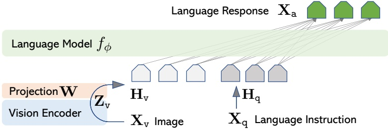

Figure 1: LLaVA network architecture.

> 图 1：LLaVA 的网络架构。

For an input image $`X_{v}`$ , we consider the pre-trained CLIP visual encoder ViT-L/14 [40], which provides the visual feature $`\mathbf{Z}_{\mathrm{v}} = g(\mathbf{X}_{\mathrm{v}})`$ . The grid features before and after the last Transformer layer are considered in our experiments. We consider a simple linear layer to connect image features into the word embedding space. Specifically, we apply a trainable projection matrix W to convert $`Z_{v}`$ into language embedding tokens $`H_{v}`$ , which have the same dimensionality as the word embedding space in the language model:

> 对输入图像 $`X_v`$，我们用预训练的 CLIP 视觉编码器 ViT-L/14[40]，它给出视觉特征 $`\mathbf{Z}_v=g(\mathbf{X}_v)`$。实验中我们考虑最后一个 Transformer 层**之前**与**之后**的网格特征。我们用一个简单的线性层把图像特征接入词嵌入空间：具体地，施加一个可训练的投影矩阵 $`\mathbf{W}`$，把 $`Z_v`$ 转换成语言嵌入 token $`H_v`$，其维度与语言模型的词嵌入空间一致：

```math
\mathbf {H} _ {\mathrm{v}} = \mathbf {W} \cdot \mathbf {Z} _ {\mathrm{v}}, \text {with} \mathbf {Z} _ {\mathrm{v}} = g (\mathbf {X} _ {\mathrm{v}})\qquad(1)
```

Thus, we have a sequence of visual tokens $`H_{v}`$ . Note that our simple projection scheme is lightweight, which allows us to iterate data centric experiments quickly. More sophisticated schemes to connect the image and language representations can also be considered, such as gated cross-attention in Flamingo [2] and Q-former in BLIP-2 [28]. We leave exploring possibly more effective and sophisticated architecture designs for LLaVA as future work.

> 于是我们得到视觉 token 序列 $`H_v`$。注意我们的投影方案**很简单、很轻**，这让我们能快速迭代以数据为中心的实验。也可以考虑更精细的连接方式，比如 Flamingo[2] 的门控交叉注意力、BLIP-2[28] 的 Q-Former；我们把探索更有效、更精巧的架构设计留给未来工作。

### 4.2 训练 / Training

For each image $`\mathbf{X}_{\mathrm{v}}`$ , we generate multi-turn conversation data $`(\mathbf{X}_{\mathfrak{q}}^{1}, \mathbf{X}_{\mathfrak{a}}^{1}, \dots, \mathbf{X}_{\mathfrak{q}}^{T}, \mathbf{X}_{\mathfrak{a}}^{T})`$ , where T is the total number of turns. We organize them as a sequence, by treating all answers as the assistant’s response, and the instruction $`\mathbf{X}_{\mathrm{instruct}}^{t}`$ at the t-th turn as:

> 对每张图像 $`\mathbf{X}_v`$，我们生成多轮对话数据 $`(\mathbf{X}_q^1,\mathbf{X}_a^1,\dots,\mathbf{X}_q^T,\mathbf{X}_a^T)`$，$`T`$ 为总轮数。我们把它们组织成一个序列：所有回答都视为助手的回复，第 $`t`$ 轮的指令 $`\mathbf{X}_{\mathrm{instruct}}^t`$ 定义为：

```math
\mathbf {X} _ {\text {instruct}} ^ {t} = \left\{ \begin{array}{l l} & \text {Randomly choose} [ \mathbf {X} _ {\mathrm{q}} ^ {1}, \mathbf {X} _ {\mathrm{v}} ] \text {or} [ \mathbf {X} _ {\mathrm{v}}, \mathbf {X} _ {\mathrm{q}} ^ {1} ], \text {the first turn} t = 1 \\ & \mathbf {X} _ {\mathrm{q}} ^ {t}, \quad \text {the remaining turns} t > 1 \end{array} \right.\qquad(2)
```

This leads to the unified format for the multimodal instruction-following sequence illustrated in Table 2. We perform instruction-tuning of the LLM on the prediction tokens, using its original auto-regressive training objective.

> 由此得到多模态指令跟随序列的统一格式（见表 2）。我们对 LLM 在**预测 token** 上做指令微调，沿用其原有的自回归训练目标。

Specifically, for a sequence of length L, we compute the probability of the target answers $`\mathbf{X}_{\mathrm{a}}`$ by:

> 具体地，对长度为 $`L`$ 的序列，目标答案 $`\mathbf{X}_a`$ 的概率为：

```math
p (\mathbf {X} _ {\mathrm{a}} | \mathbf {X} _ {\mathrm{v}}, \mathbf {X} _ {\mathrm{instruct}}) = \prod_ {i = 1} ^ {L} p _ {\boldsymbol {\theta}} (x _ {i} | \mathbf {X} _ {\mathrm{v}}, \mathbf {X} _ {\mathrm{instruct}, <   i}, \mathbf {X} _ {\mathrm{a}, <   i}),\qquad(3)
```

```txt
X_system-message <STOP>
Human : X¹_instruct <STOP> Assistant: X¹_a <STOP>
Human : X²_instruct <STOP> Assistant: X²_a <STOP> ...
```

Table 2: The input sequence used to train the model. Only two conversation turns are illustrated here; in practice, the number of turns varies based on the instruction-following data. In our current implementation, we follow Vicuna-v0 [9] to set the system message $`\mathbf{X}_{\text{system-message}}`$ and we set &lt;STOP&gt; = ### . The model is trained to predict the assistant answers and where to stop, and thus only green sequence/tokens are used to compute the loss in the auto-regressive model.

> 表 2：训练模型所用的输入序列。此处只画两轮对话；实践中轮数随指令跟随数据而变。当前实现中，我们沿用 Vicuna-v0[9] 设置系统消息 $`\mathbf{X}_{\text{system-message}}`$，并令 &lt;STOP&gt; = ###。模型被训练去预测助手回答以及在哪里停止，因此**只有绿色序列/token 参与损失计算**。

where θ is the trainable parameters, $`\mathbf{X}_{\mathrm{instruct}, < i}`$ and $`\mathbf{X}_{\mathrm{a}, < i}`$ are the instruction and answer tokens in all turns before the current prediction token $`x_{i}`$ respectively. Please see Table 2 for an illustration of the prediction tokens. For the conditionals in (3), we explicitly add $`X_{v}`$ to emphasize the fact that the image is grounded for all answers, and we omit X<sub>system-message</sub> and all previous &lt;STOP&gt; for better readability. For LLaVA model training, we consider a two-stage instruction-tuning procedure.

> 其中 $`\theta`$ 为可训练参数，$`\mathbf{X}_{\mathrm{instruct},<i}`$ 与 $`\mathbf{X}_{a,<i}`$ 分别是当前预测 token $`x_i`$ 之前、所有轮次里的指令 token 与回答 token。预测 token 的示意见表 2。式 (3) 的条件里我们显式写出 $`X_v`$，以强调**所有回答都以图像为据**；为便于阅读，省略了 $`X_{\text{system-message}}`$ 与所有历史 &lt;STOP&gt;。LLaVA 的训练采用**两阶段指令微调**。

**Stage 1: Pre-training for Feature Alignment.** To strike a balance between concept coverage and training efficiency, we filter CC3M to 595K image-text pairs. Please see Appendix for details of the filtering process. These pairs are converted to the instruction-following data using the naive expansion method describe in Section 3. Each sample can be treated as a single-turn conversation. To construct the input $`\mathbf{X}_{\mathrm{instruct}}`$ in (2), for an image $`\bar{\mathbf{X}}_{\mathrm{v}}`$ a question $`X_{q}`$ is randomly sampled, which is a language instruction to request the assistant to describe the image briefly. The ground-truth prediction answer $`X_{a}`$ is the original caption. In training, we keep both the visual encoder and LLM weights frozen, and maximize the likelihood of (3) with trainable parameters $`\theta = \mathbf{W}`$ (the projection matrix) only. In this way, the image features H<sub>v</sub> can be aligned with the pre-trained LLM word embedding. This stage can be understood as training a compatible visual tokenizer for the frozen LLM.

> **阶段一：特征对齐预训练。** 为在概念覆盖与训练效率之间取得平衡，我们把 CC3M 过滤成 **595K 图文对**（过滤过程见附录）。这些图文对用 §3 的朴素扩展方法转成指令跟随数据，每条样本可视为单轮对话。构造式 (2) 的输入 $`\mathbf{X}_{\mathrm{instruct}}`$ 时，对图像 $`\mathbf{X}_v`$ 随机抽一个问题 $`X_q`$（即要求助手简要描述图像的语言指令），真值答案 $`X_a`$ 就是原始配文。训练中**视觉编码器与 LLM 权重都冻结**，只以可训练参数 $`\theta=\mathbf{W}`$（投影矩阵）最大化式 (3) 的似然。这样图像特征 $`H_v`$ 就能与预训练 LLM 的词嵌入对齐。**这一阶段可以理解为“为冻结的 LLM 训练一个兼容的视觉分词器”。**

**Stage 2: Fine-tuning End-to-End.** We always keep the visual encoder weights frozen, and continue to update both the pre-trained weights of the projection layer and LLM in LLaVA; i.e., the trainable parameters are $`\theta = \{\mathbf{W},\phi\}`$ in (3). We consider two specific use case scenarios:

> **阶段二：端到端微调。** 我们**始终保持视觉编码器权重冻结**，继续更新投影层与 LLM 的预训练权重，即式 (3) 中可训练参数为 $`\theta=\{\mathbf{W},\phi\}`$。我们考虑两个具体使用场景：

• Multimodal Chatbot. We develop a Chatbot by fine-tuning on the 158K language-image instruction-following data in Section 3. Among the three types of responses, conversation is multi-turn while the other two are single-turn. They are uniformly sampled in training.

> • **多模态聊天机器人。** 在 §3 的 158K 语言-图像指令跟随数据上微调，得到 Chatbot。三类回复中，对话是多轮的，另两类是单轮的；训练时它们被**均匀采样**。

• Science QA. We study our method on the ScienceQA benchmark [34], the first large-scale multimodal science question dataset that annotates the answers with detailed lectures and explanations. Each question is provided a context in the form of natural language or an image. The assistant provides the reasoning process in natural language and selects the answer among multiple choices. For training in (2), we organize the data as a single turn conversation, the question & context as $`\mathbf{X}_{\mathrm{instruct}}`$ , and reasoning & answer as $`\mathbf{X}_{\mathrm{a}}`$

> • **Science QA。** 我们在 ScienceQA 基准[34] 上研究该方法——这是首个大规模多模态科学问答数据集，其答案配有详细讲解与解释。每题给出自然语言或图像形式的上下文；助手用自然语言给出推理过程，并在多项选择中选出答案。构造式 (2) 的训练数据时，我们组织成单轮对话：问题与上下文作为 $`\mathbf{X}_{\mathrm{instruct}}`$，推理与答案作为 $`\mathbf{X}_a`$。

## 5 实验 / Experiments

We assess the performance of LLaVA in instruction-following and visual reasoning capabilities with two primary experimental settings: multimodal chatbot and the ScienceQA dataset, respectively. We train all models with 8× A100s, following Vicuna’s hyperparameters [9]. We pre-train our model on the filtered CC-595K subset for 1 epoch with a learning rate of 2e-3 and a batch size of 128, and fine-tune on the proposed LLaVA-Instruct-158K dataset for 3 epochs, with a learning rate of 2e-5 and a batch size of 32. See Appendix for more training details.

> 我们从两个主要实验设定评估 LLaVA 的指令跟随与视觉推理能力：多模态聊天机器人与 ScienceQA 数据集。所有模型都在 **8×A100** 上训练，沿用 Vicuna 的超参[9]。在过滤后的 CC-595K 子集上预训练 1 个 epoch，学习率 $`2\mathrm{e}{-3}`$、批大小 128；再在 LLaVA-Instruct-158K 上微调 3 个 epoch，学习率 $`2\mathrm{e}{-5}`$、批大小 32。更多训练细节见附录。

### 5.1 多模态聊天机器人 / Multimodal Chatbot

We developed a chatbot demo to show the image understanding and conversation abilities of LLaVA, and to study how well LLaVA is able to digest visual inputs and exhibit instruction-following capabilities. We first use the examples in the original GPT-4 paper [36], shown in Table 3 (more examples in Appendix), that require in-depth image understanding. For comparisons, we quote the prompt and response of the multimodal GPT-4 from their paper, and query BLIP-2 and OpenFlamingo model checkpoints to get their response.

> 我们开发了一个 chatbot demo，用来展示 LLaVA 的图像理解与对话能力，并研究它消化视觉输入、展现指令跟随能力的程度。我们先采用 GPT-4 原始论文[36]中的例子（见表 3，更多例子见附录），这些例子要求深入的图像理解。为作对比，我们引用了其论文中多模态 GPT-4 的提示与回复，并查询 BLIP-2 与 OpenFlamingo 的 checkpoint 得到它们的回复。

Visual input example, Extreme Ironing:

> 视觉输入示例：极限熨衣（Extreme Ironing）：

<table><tr><td colspan="2">Visual input example, Extreme Ironing:</td></tr><tr><td></td><td>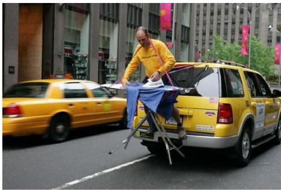</td></tr><tr><td>User</td><td>Source: https://www.barnorama.com/wp-content/uploads/2016/12/03-Confusing-Pictures.jpgWhat is unusual about this image?</td></tr><tr><td>LLaVA</td><td>The unusual aspect of this image is a man ironing clothes on the back of a minivan or van. This is not a typical place to perform this activity, as one would usually iron clothes in a more stationary and safe location, such as a home, using a regular ironing board. The scene depicted in the image is peculiar as it involves a makeshift ironing setup on a vehicle, which can be both unsafe and unconventional. Additionally, it is not clear how the man is able to maintain balance and stability while ironing clothes in such an unstable environment.[Start a new conversation, and clear the history]</td></tr><tr><td>User</td><td>What&#x27;s happening in the scene?</td></tr><tr><td>LLaVA</td><td>The image depicts a man standing on top of a yellow SUV in a busy city street. He is holding a portable ladder, seemingly ironing clothes while standing on the vehicle. Around the scene, there are other cars, a traffic light, and a fire hydrant. Additionally, there are two other people in the vicinity, one close to the man on the car and another further away. The man on the ladder appears to be attracting attention due to his unconventional choice of ironing his clothes on top of a moving car. The city street around him is bustling with activity, adding to the unique nature of the scene.</td></tr><tr><td>User</td><td>What is unusual about this image?</td></tr><tr><td>GPT-4 [36]</td><td>The unusual thing about this image is that a man is ironing clothes on an ironing board attached to the roof of a moving taxi.</td></tr><tr><td>User</td><td>What is unusual about this image?</td></tr><tr><td>BLIP-2</td><td>a man is sitting on the back of a yellow cab</td></tr><tr><td>User</td><td>What is unusual about this image?</td></tr><tr><td>OpenFlamingo</td><td>The man is drying his clothes on the hood of his car.</td></tr></table>

Table 3: Example prompt from GPT-4 paper [36] to compare visual reasoning and chat capabilities. Compared to BLIP-2 [28] and OpenFlamingo [5], LLaVA accurately follows the user’s instructions, instead of simply describing the scene. LLaVA offers a more comprehensive response than GPT-4. Even when merely asked to describe the image, LLaVA identifies atypical aspects of the image.

> 表 3：取自 GPT-4 论文[36]的示例提示，用于比较视觉推理与对话能力。与 BLIP-2[28]、OpenFlamingo[5] 相比，LLaVA 能准确遵循用户指令，而不只是描述场景；其回复比 GPT-4 更全面。即便只要求描述图像，LLaVA 也指出了图像中的非典型之处。

Surprisingly, although LLaVA is trained with a small multimodal instruction-following dataset (∼80K unique images), it demonstrates quite similar reasoning results with multimodal GPT-4 on these examples. Note that while these images are out-of-domain for LLaVA, LLaVA is still able to understand the scenes and follow the question instruction to provide a reasonable response. In contrast, BLIP-2 and OpenFlamingo focus on describing the image, instead of following the user instruction to answer in an appropriate manner.

> 令人惊讶的是，尽管 LLaVA 只用了一个不大的多模态指令跟随数据集（约 8 万张独特图像）训练，它在这些例子上表现出与多模态 GPT-4 相当接近的推理结果。注意这些图像对 LLaVA 属于**域外**，但它仍能理解场景、遵循问题指令给出合理回复。相比之下，BLIP-2 与 OpenFlamingo 更偏向描述图像，而不是按用户指令以合适方式作答。

**Quantitative Evaluation.** To gain a systematic understanding of the performance of LLaVA, we propose a quantitative metric to measure the model’s instruction-following capability on multimodal data. Inspired by [9], we leverage GPT-4 to measure the quality of generated responses. Specifically, we create triplets consisting of image, ground-truth textual descriptions, and question. The candidate models (e.g., LLaVA) predict the answers based on the question and the image. To provide an approximate theoretical upper bound, we create a reference prediction based on the question and the ground-truth textual descriptions, using the text-only GPT-4. After obtaining the responses from both models, we feed the question, visual information (in the format of textual descriptions), and the generated responses from both assistants, to the judge (i.e., text-only GPT-4). It evaluates the helpfulness, relevance, accuracy, and level of detail of the responses from the assistants, and gives an overall score on a scale of 1 to 10, where a higher score indicates better overall performance. It is also asked to provide a comprehensive explanation for the evaluation, for us to better understand the models. We report relative scores w.r.t. the text-only GPT-4 model that uses the textural ground truth description as visual input. We create two benchmarks to evaluate the model’s performance.

> **定量评估。** 为系统了解 LLaVA 的表现，我们提出一个定量指标来度量模型在多模态数据上的指令跟随能力。受[9] 启发，用 GPT-4 评估生成回复的质量。具体做法：构造“图像 + 真值文本描述 + 问题”的三元组；候选模型（如 LLaVA）依据问题与图像预测答案。为给出近似理论**上界**，我们用纯文本 GPT-4 基于问题与真值文本描述生成一个参考预测。得到两侧回复后，把问题、视觉信息（以文本描述形式）与两个助手的回复一起交给**裁判**（即纯文本 GPT-4），由它评估回复的有用性、相关性、准确性与细节程度，并给出 1–10 的整体分数（越高越好），同时要求给出完整解释以便我们理解模型。我们报告相对“以真值文本描述为视觉输入的纯文本 GPT-4”的相对分数。我们构建了两个基准来评估模型表现。

|  | Conversation | Detail description | Complex reasoning | All |
| --- | --- | --- | --- | --- |
| Full data | 83.1 | 75.3 | 96.5 | 85.1 |
| Detail + Complex | 81.5 (-1.6) | 73.3 (-2.0) | 90.8 (-5.7) | 81.9 (-3.2) |
| Conv + 5% Detail + 10% Complex | 81.0 (-2.1) | 68.4 (-7.1) | 91.5 (-5.0) | 80.5 (-4.4) |
| Conversation | 76.5 (-6.6) | 59.8 (-16.2) | 84.9 (-12.4) | 73.8 (-11.3) |
| No Instruction Tuning | 22.0 (-61.1) | 24.0 (-51.3) | 18.5 (-78.0) | 21.5 (-63.6) |

Table 4: Ablation on LLaVA-Bench (COCO) with different training data. We report relative scores w.r.t. a text-only GPT-4 model that uses ground truth image captions and bounding boxes as visual input. We prompt GPT-4 with the answers from our model outputs and the answers by GPT-4 (text-only), and let it compare between both responses and give a rating with an explanation.

> 表 4：在 LLaVA-Bench（COCO）上用不同训练数据做的消融。我们报告相对“以真值图像描述与边界框为视觉输入的纯文本 GPT-4”的相对分数。做法是把模型输出与纯文本 GPT-4 的回答一起提示给 GPT-4，令其比较两者并给出评分与解释。

|  | Conversation | Detail description | Complex reasoning | All |
| --- | --- | --- | --- | --- |
| OpenFlamingo [5] | 19.3 ± 0.5 | 19.0 ± 0.5 | 19.1 ± 0.7 | 19.1 ± 0.4 |
| BLIP-2 [28] | 54.6 ± 1.4 | 29.1 ± 1.2 | 32.9 ± 0.7 | 38.1 ± 1.0 |
| LLaVA | 57.3 ± 1.9 | 52.5 ± 6.3 | 81.7 ± 1.8 | 67.3 ± 2.0 |
| LLaVA† | 58.8 ± 0.6 | 49.2 ± 0.8 | 81.4 ± 0.3 | 66.7 ± 0.3 |

Table 5: Instruction-following capability comparison using relative scores on LLaVA-Bench (In-the-Wild). The results are reported in the format of mean ± std. For the first three rows, we report three inference runs. LLaVA performs significantly better than others. † For a given set of LLaVA decoding sequences, we evaluate by querying GPT-4 three times; GPT-4 gives a consistent evaluation.

> 表 5：在 LLaVA-Bench（In-the-Wild）上用相对分数做指令跟随能力比较。结果以“均值 ± 标准差”形式报告。前三行报告了三次推理运行。LLaVA 显著优于其他方法。† 对 LLaVA 的同一组解码序列，我们查询 GPT-4 三次，其评估保持一致。

**LLaVA-Bench (COCO).** We randomly select 30 images from COCO-Val-2014, and for each image, we generate three types of questions (conversation, detailed description, complex reasoning) using the proposed data generation pipeline in Sec. 3, totaling 90 questions. This benchmark studies the model’s alignment behavior and capabilities with consistent visual inputs. We vary the training datasets to study the effectiveness of different types of instruction-following data, and show the results in Table 4. First, with instruction tuning, the model’s ability of following user instructions improves significantly by over 50 points. Second, adding a small amount of detailed description and complex reasoning questions contributes to a considerable improvement of the model’s overall capability by 7 points. Furthermore, it also improves the model’s performance on conversational questions, suggesting that improvements in reasoning capabilities complement conversational abilities. Finally, we show that having all three types of data yields the best performance at 85.1%.

> **LLaVA-Bench（COCO）。** 我们从 COCO-Val-2014 随机选 30 张图像，对每张用 §3 的数据生成流程生成三类问题（对话、细节描述、复杂推理），共 90 个问题。该基准在**固定视觉输入**下研究模型的对齐行为与能力。我们改变训练数据来研究不同指令跟随数据的有效性，结果见表 4。第一，经指令微调，模型遵循用户指令的能力**提升超过 50 分**。第二，加入少量细节描述与复杂推理问题，可使模型整体能力提升约 **7 分**；而且这也提升了它在对话类问题上的表现，说明**推理能力的提升与对话能力互补**。最后，三类数据全用时表现最好，达 **85.1%**。

**LLaVA-Bench (In-the-Wild).** To evaluate the model’s capability in more challenging tasks and generalizability to novel domains, we collect a diverse set of 24 images with 60 questions in total, including indoor and outdoor scenes, memes, paintings, sketches, etc., and associate each image with a highly-detailed and manually-curated description and a proper selection of questions. We compare LLaVA, BLIP, and OpenFlamingo in Table 5. Thanks to visual instruction tuning, LLaVA achieves significantly better performance compared with BLIP-2 (+29%) and OpenFlamingo (+48%). Compared to the text-only GPT-4 that has access to ground-truth labels, LLaVA achieves an impressive 81.7% performance on complex reasoning questions, with an overall score of 67.3%.

> **LLaVA-Bench（In-the-Wild）。** 为评估模型在更具挑战性任务上的能力与对新领域的泛化，我们收集 24 张多样图像、共 60 个问题，涵盖室内外场景、表情包、绘画、素描等，并为每张图配上极详细的人工撰写描述与精选问题。表 5 比较 LLaVA、BLIP 与 OpenFlamingo。得益于视觉指令微调，LLaVA 明显优于 BLIP-2（**+29%**）与 OpenFlamingo（**+48%**）；相对能访问真值标签的纯文本 GPT-4，LLaVA 在复杂推理问题上达到 **81.7%**，整体分数 **67.3%**。

**Limitations.** This LLaVA-Bench (In-the-Wild) is designed to be challenging and to reveal a model’s weaknesses. We provide two examples with associated captions and questions in Table 6. For the ramen example (left), to correctly answer the name of the restaurant, it requires the model to have a large knowledge coverage and multilingual understanding capability; to correctly describe the side dishes, the model may need to retrieve relevant multimodal information from Internet. For the fridge example (right), perceiving the correct brand of the yogurt requires the model to process high resolution images and possess extensive knowledge coverage. We also observed an interesting failure of LLaVA, as it responds with yes when asked if strawberry-flavored yogurt is present, even though the fridge contains only yogurt and strawberries. This indicates that, at times, LLaVA perceives the image as a “bag of patches”, failing to grasp the complex semantics within the image. We hope LLaVA serves as a solid baseline on the benchmarks, on which our findings can inspire future work in developing more capable LMMs.

> **局限。** LLaVA-Bench（In-the-Wild）被设计得很有挑战性，用以暴露模型弱点。我们在表 6 给出两个例子（配描述与问题）。拉面那例（左），要正确答出店名，模型需要很大的知识覆盖与多语言理解能力；要正确描述配菜，模型可能需要从互联网检索相关多模态信息。冰箱那例（右），要认出酸奶的正确品牌，需要处理高分辨率图像并具备广博知识。我们还观察到一个有意思的失败：当问“是否有草莓味酸奶”时 LLaVA 回答“有”，尽管冰箱里只有原味酸奶和草莓。这说明 **LLaVA 有时把图像当作“一袋 patch”来看待**，未能把握图像内的复杂语义。我们希望 LLaVA 能在这些基准上充当可靠基线，我们的发现能启发后续做出更强的 LMM。

Challenging examples from LLaVA-Bench (In-the-Wild):

> LLaVA-Bench（In-the-Wild）中的挑战性示例：

<table><tr><td rowspan="2"></td><td>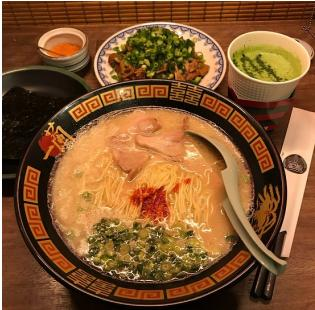</td><td>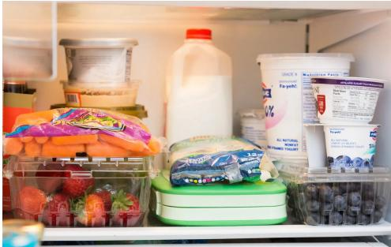</td></tr><tr><td>ICHIRAN Ramen [source]</td><td>Filled fridge [source]</td></tr><tr><td>Annotation</td><td>A close-up photo of a meal at ICHI-RAN. The chashu ramen bowl with a spoon is placed in the center. The ramen is seasoned with chili sauce, chopped scallions, and served with two pieces of chashu. Chopsticks are placed to the right of the bowl, still in their paper wrap, not yet opened. The ramen is also served with nori on the left. On top, from left to right, the following sides are served: a bowl of orange spice (possibly garlic sauce), a plate of smoke-flavored stewed pork with chopped scallions, and a cup of matcha green tea.</td><td>An open refrigerator filled with a variety of food items. In the left part of the compartment, towards the front, there is a plastic box of strawberries with a small bag of baby carrots on top. Towards the back, there is a stack of sauce containers. In the middle part of the compartment, towards the front, there is a green plastic box, and there is an unidentified plastic bag placed on it. Towards the back, there is a carton of milk. In the right part of the compartment, towards the front, there is a box of blueberries with three yogurts stacked on top. The large bottle of yogurt is Fage non-fat yogurt, and one of the smaller cups is Fage blueberry yogurt. The brand and flavor of the other smaller cup are unknown. Towards the back, there is a container with an unknown content.</td></tr><tr><td>Question 1</td><td>What&#x27;s the name of the restaurant?</td><td>What is the brand of the blueberry-flavored yogurt?</td></tr><tr><td>Question 2</td><td>Describe this photo in detail.</td><td>Is there strawberry-flavored yogurt in the fridge?</td></tr></table>

Table 6: Challenging examples from LLaVA-Bench (In-the-Wild), we provide extremely-detailed annotation for each image for an accurate evaluation. Some questions require the model to extract details from high resolution image and to have a broad knowledge coverage.

> 表 6：LLaVA-Bench（In-the-Wild）中的挑战性示例。我们为每张图像提供极其详细的标注，以便准确评估。有些问题要求模型从高分辨率图像中提取细节，并具备广博的知识覆盖。

### 5.2 ScienceQA / ScienceQA

ScienceQA [34] contains 21k multimodal multiple choice questions with rich domain diversity across 3 subjects, 26 topics, 127 categories, and 379 skills. The benchmark dataset is split into training, validation, and test splits with 12726, 4241, and 4241 examples, respectively. We consider two representative methods, including GPT-3.5 model (text-davinci-002) with and without chainof-thought (CoT), LLaMA-Adapter [59], as well as multimodal chain-of-thought (MM-CoT) [61], which is the current SoTA method on this dataset. For more baseline numbers, please see [34].

> ScienceQA[34] 含 21k 道多模态选择题，领域多样性丰富：3 个学科、26 个主题、127 个类别、379 种技能。数据集划分为训练/验证/测试，分别为 12726 / 4241 / 4241 例。我们考虑两个代表性方法：带与不带思维链（CoT）的 GPT-3.5（text-davinci-002）、LLaMA-Adapter[59]，以及当前在该数据集上的 SOTA 方法多模态思维链（MM-CoT）[61]。更多基线数字见[34]。

The results are reported in Table 7. For LLaVA, we use the visual features before the last layer, ask the model to first predict reasons and then the answer, and train it for 12 epochs. It yields 90.92% accuracy, which is quite close to the SoTA 91.68%. To explore the limit of LLMs, we also prompt GPT-4 using 2-shot in-context-learning and achieve 82.69% accuracy, which is a 7.52% absolute gain compared with 75.17% from GPT-3.5. For a substantial number of questions, we note that GPT-4 fails simply because it reports that there is insufficient context such as images or plots. We consider two schemes to combine the outcomes from our model and GPT-4. (i) A GPT-4 complement. Whenever GPT-4 fails to provide answers, we use the prediction from our method. This schemes yields 90.97% accuracy, which is almost the same as applying our method alone. (ii) GPT-4 as the judge. Whenever GPT-4 and LLaVA produce different answers, we prompt GPT-4 again, asking it to provide its own final answer based on the question and two outcomes. The spirit is similar with CoT, but with the external knowledge from the other model. Surprisingly, this scheme is able to provide consistent improvement over all question classes, and achieves a new SoTA accuracy of 92.53%. Interestingly, the text-only GPT-4, which cannot process images, improves the overall performance of the model on questions that have an image as context. This is because some of these questions do not actually require the image context for a correct answer. The GPT-4 judge can identify such cases and correct some of the errors that LLaVA makes. See the example in Appendix. To the best of our knowledge,

> 结果见表 7。对 LLaVA，我们使用**最后一层之前**的视觉特征，让模型先预测推理再预测答案，训练 12 个 epoch，得到 **90.92%** 准确率，与 SOTA 的 91.68% 相当接近。为探索 LLM 的极限，我们还用 2-shot 上下文学习提示 GPT-4，取得 82.69% 准确率，比 GPT-3.5 的 75.17% 高出 7.52 个百分点。我们注意到，对相当多的问题，GPT-4 失败的原因只是它报告“缺少上下文（如图像或图表）”。我们考虑两种把本模型与 GPT-4 结果结合的方式：(i) **GPT-4 补位**：凡是 GPT-4 给不出答案，就用本模型的预测，得到 90.97%，几乎等同于单用本模型；(ii) **GPT-4 作裁判**：凡两者答案不同，就再次提示 GPT-4，令其基于问题与两个结果给出自己的最终答案。其精神类似 CoT，但借助了另一个模型的**外部知识**。令人惊讶的是，这一方式在**所有问题类别**上都带来一致提升，取得 **92.53%** 的新 SOTA。有趣的是，无法处理图像的纯文本 GPT-4 反而提升了模型在“以图像为上下文”的问题上的表现——因为其中有些问题其实不需要图像上下文即可正确作答，GPT-4 裁判能识别这类情况并纠正 LLaVA 的部分错误（示例见附录）。据我们所知，

<table><tr><td rowspan="2">Method</td><td colspan="3">Subject</td><td colspan="3">Context Modality</td><td colspan="2">Grade</td><td rowspan="2">Average</td></tr><tr><td>NAT</td><td>SOC</td><td>LAN</td><td>TXT</td><td>IMG</td><td>NO</td><td>G1-6</td><td>G7-12</td></tr><tr><td colspan="10">Representative &amp; SoTA methods with numbers reported in the literature</td></tr><tr><td>Human [34]</td><td>90.23</td><td>84.97</td><td>87.48</td><td>89.60</td><td>87.50</td><td>88.10</td><td>91.59</td><td>82.42</td><td>88.40</td></tr><tr><td>GPT-3.5 [34]</td><td>74.64</td><td>69.74</td><td>76.00</td><td>74.44</td><td>67.28</td><td>77.42</td><td>76.80</td><td>68.89</td><td>73.97</td></tr><tr><td>GPT-3.5 w/ CoT [34]</td><td>75.44</td><td>70.87</td><td>78.09</td><td>74.68</td><td>67.43</td><td>79.93</td><td>78.23</td><td>69.68</td><td>75.17</td></tr><tr><td>LLaMA-Adapter [59]</td><td>84.37</td><td>88.30</td><td>84.36</td><td>83.72</td><td>80.32</td><td>86.90</td><td>85.83</td><td>84.05</td><td>85.19</td></tr><tr><td>MM-CoT $`_{Base}`$  [61]</td><td>87.52</td><td>77.17</td><td>85.82</td><td>87.88</td><td>82.90</td><td>86.83</td><td>84.65</td><td>85.37</td><td>84.91</td></tr><tr><td>MM-CoT $`_{Large}`$  [61]</td><td>95.91</td><td>82.00</td><td>90.82</td><td>95.26</td><td>88.80</td><td>92.89</td><td>92.44</td><td>90.31</td><td>91.68</td></tr><tr><td colspan="10">Results with our own experiment runs</td></tr><tr><td>GPT-4†</td><td>84.06</td><td>73.45</td><td>87.36</td><td>81.87</td><td>70.75</td><td>90.73</td><td>84.69</td><td>79.10</td><td>82.69</td></tr><tr><td>LLaVA</td><td>90.36</td><td>95.95</td><td>88.00</td><td>89.49</td><td>88.00</td><td>90.66</td><td>90.93</td><td>90.90</td><td>90.92</td></tr><tr><td>LLaVA+GPT-4† (complement)</td><td>90.36</td><td>95.50</td><td>88.55</td><td>89.05</td><td>87.80</td><td>91.08</td><td>92.22</td><td>88.73</td><td>90.97</td></tr><tr><td>LLaVA+GPT-4† (judge)</td><td>91.56</td><td>96.74</td><td>91.09</td><td>90.62</td><td>88.99</td><td>93.52</td><td>92.73</td><td>92.16</td><td>92.53</td></tr></table>

Table 7: Accuracy (%) on Science QA dataset. Question categories: NAT = natural science, SOC = social science, LAN = language science, TXT = text context, IMG = image context, NO = no context, G1-6 = grades 1-6, G7-12 = grades 7-12. †Text-only GPT-4, our eval. Our novel model ensembling with the text-only GPT-4 consistently improves the model’s performance under all categories, setting the new SoTA performance.

> 表 7：Science QA 数据集上的准确率（%）。问题类别：NAT = 自然科学，SOC = 社会科学，LAN = 语言科学，TXT = 文本上下文，IMG = 图像上下文，NO = 无上下文，G1-6 = 1–6 年级，G7-12 = 7–12 年级。† 纯文本 GPT-4，由我们评估。我们与纯文本 GPT-4 的新颖集成方式在所有类别上都一致地提升了模型表现，创下新的 SOTA。

this is the first time that GPT-4 is used for model ensembling. We hope this finding can encourage future research to explore more effective methods to leverage LLMs for model ensembling.

> **这是首次把 GPT-4 用于模型集成**。我们希望这一发现能鼓励后续研究探索更有效的“借助 LLM 做集成”的方法。

**Ablations.** We ablate several design choices on ScienceQA in Table 8. (i) Visual features. We tried using the last layer feature from CLIP vision encoder, which yields 89.96% and is 0.96% lower than the feature before the last layer. We hypothesize that this is because CLIP’s last layer features may focus more on global and abstract image properties compared to the layer before it, which can focus more on localized properties that are useful for under-

> **消融。** 我们在表 8 中对 ScienceQA 上的若干设计选择做消融。(i) **视觉特征**：改用 CLIP 视觉编码器**最后一层**的特征，得到 89.96%，比“最后一层之前”的特征低 0.96%。我们推测原因是：CLIP 最后一层特征更偏全局与抽象的图像属性，而它前一层更关注局部属性，这些局部属性对理解

| Visual features | Before | Last |
| --- | --- | --- |
| Best variant | 90.92 | 89.96 (-0.96) |
| Predict answer first | - | 89.77 (-1.15) |
| Training from scratch | 85.81 (-5.11) | - |
| 7B model size | 89.84 (-1.08) | - |

Table 8: Design choice ablations (%). The difference with the best variant is reported in red text.

> 表 8：设计选择的消融（%）。与最优变体的差值用红色文字标出。

standing specific image details. (ii) Chain-of-thought. To decide the order between the answer and reasoning process in the model prediction, we run both variants and observe that answer-first reports the best number 89.77% accuracy in 12 epochs, while reasoning-first can quickly reach 89.77% accuracy in 6 epochs, but no further improvement with more training. Training the model for 24 epochs does not improve the performance. We conclude that CoT-like reasoning-first strategy can largely improve convergence, but contributes relatively little to the final performance. (iii) Pre-training. We skip pre-training and directly train on Science QA from scratch – performance drops to 85.81% accuracy. The 5.11% absolute degradation indicates the importance of our pre-training stage, in aligning multimodal features while preserving the vast pre-trained knowledge. (iv) Model size. We keep all configurations the same as our best 13B model, and train a 7B model. This yields 89.84% accuracy, which is 1.08% lower than 90.92%, demonstrating the importance of model scale.

> 具体的图像细节更有用。(ii) **思维链**：为确定“答案”与“推理过程”在模型预测中的先后顺序，我们跑了两个变体，观察到“答案在前”在 12 个 epoch 内报告最好的 89.77% 准确率；而“推理在前”能在 6 个 epoch 内快速达到 89.77%，但继续训练不再提升；训练 24 个 epoch 也无提升。结论是：类 CoT 的“推理在前”策略能**大幅改善收敛**，但对最终性能贡献较小。(iii) **预训练**：跳过预训练、直接在 ScienceQA 上从头训练，准确率降到 85.81%，**下降 5.11 个百分点**，说明预训练阶段在“对齐多模态特征的同时保留大量预训练知识”上很重要。(iv) **模型规模**：保持与最优 13B 模型相同配置，训练 7B 模型，得到 89.84%，比 90.92% 低 1.08%，说明模型规模的重要性。

## 6 结论 / Conclusion

This paper demonstrated the effectiveness of visual instruction tuning. We presented an automatic pipeline to create language-image instruction-following data, based on which we train LLaVA, a multimodal model to follow human intent to complete visual tasks. It achieves the new SoTA accuracy when fine-tuned on ScienceQA, and excellent visual chat capabilities when fine-tuned on multimodal chat data. Besides, we present the first benchmark to study multimodal instructionfollowing capability. This paper is an initial step in visual instruction tuning, and mainly focuses on real-life tasks. For more quantitative results of LLaVA on academic benchmarks, please refer to the improved baselines with visual instruction tuning [32]. We hope our work can inspire future research on building more capable multimodal models.

> 本文验证了视觉指令微调的有效性。我们给出一个自动创建“语言-图像”指令跟随数据的流程，并据此训练 LLaVA——一个遵循人类意图完成视觉任务的多模态模型。它在 ScienceQA 上微调取得新的 SOTA 准确率，在多模态对话数据上微调后具备出色的视觉对话能力。此外，我们提出首个用于研究多模态指令跟随能力的基准。本文是视觉指令微调的第一步尝试，主要聚焦真实生活任务；LLaVA 在学术基准上的更多定量结果请参见“视觉指令微调的改进基线”[32]。希望我们的工作能启发后续构建更强的多模态模型。

**Acknowledgements.** We thank Baolin Peng and Pan Lu for valuable discussions on instruction-tuning language models and Science QA, respectively. We thank the LLaMA team for giving us access to their models, and open-source projects, including Alpaca and Vicuna. This work was supported in part by NSF CAREER IIS2150012, and Institute of Information & communications Technology Planning & Evaluation(IITP) grants funded by the Korea government(MSIT) (No. 2022-0-00871, Development of AI Autonomy and Knowledge Enhancement for AI Agent Collaboration) and (No. RS-2022-00187238, Development of Large Korean Language Model Technology for Efficient Pre-training).

> **致谢。** 感谢 Baolin Peng 与 Pan Lu 分别在指令微调语言模型与 Science QA 上的宝贵讨论；感谢 LLaMA 团队让我们使用其模型，感谢 Alpaca、Vicuna 等开源项目。本工作部分受 NSF CAREER IIS2150012 支持，以及韩国政府（MSIT）资助的信息与通信技术规划与评估院（IITP）项目（No. 2022-0-00871，面向 AI 智能体协作的 AI 自主性与知识增强开发）与（No. RS-2022-00187238，用于高效预训练的大型韩语语言模型技术开发）。

## 参考文献 / References

<sub>参考文献条目按原文保留，不作翻译。</sub>

[1] Langchain. [https://github.com/hwchase17/langchain](https://github.com/hwchase17/langchain), 2022. 2

[2] Jean-Baptiste Alayrac, Jeff Donahue, Pauline Luc, Antoine Miech, Iain Barr, Yana Hasson, Karel Lenc, Arthur Mensch, Katie Millican, Malcolm Reynolds, et al. Flamingo: a visual language model for few-shot learning. arXiv preprint arXiv:2204.14198, 2022. 2, 4

[3] Peter Anderson, Qi Wu, Damien Teney, Jake Bruce, Mark Johnson, Niko Sünderhauf, Ian Reid, Stephen Gould, and Anton Van Den Hengel. Vision-and-language navigation: Interpreting visually-grounded navigation instructions in real environments. In Proceedings of the IEEE conference on computer vision and pattern recognition, 2018. 2

[4] Amanda Askell, Yuntao Bai, Anna Chen, Dawn Drain, Deep Ganguli, Tom Henighan, Andy Jones, Nicholas Joseph, Ben Mann, Nova DasSarma, et al. A general language assistant as a laboratory for alignment. arXiv preprint arXiv:2112.00861, 2021. 1

[5] Anas Awadalla, Irena Gao, Joshua Gardner, Jack Hessel, Yusuf Hanafy, Wanrong Zhu, Kalyani Marathe, Yonatan Bitton, Samir Gadre, Jenia Jitsev, Simon Kornblith, Pang Wei Koh, Gabriel Ilharco, Mitchell Wortsman, and Ludwig Schmidt. Openflamingo, March 2023. 2, 6, 7

[6] Tim Brooks, Aleksander Holynski, and Alexei A Efros. Instruct pix2pix: Learning to follow image editing instructions. arXiv preprint arXiv:2211.09800, 2022. 2

[7] Tom Brown, Benjamin Mann, Nick Ryder, Melanie Subbiah, Jared D Kaplan, Prafulla Dhariwal, Arvind Neelakantan, Pranav Shyam, Girish Sastry, Amanda Askell, et al. Language models are few-shot learners. Advances in neural information processing systems, 33:1877–1901, 2020. 2

[8] Soravit Changpinyo, Piyush Sharma, Nan Ding, and Radu Soricut. Conceptual 12m: Pushing web-scale image-text pre-training to recognize long-tail visual concepts. In CVPR, 2021. 2

[9] Wei-Lin Chiang, Zhuohan Li, Zi Lin, Ying Sheng, Zhanghao Wu, Hao Zhang, Lianmin Zheng, Siyuan Zhuang, Yonghao Zhuang, Joseph E. Gonzalez, Ion Stoica, and Eric P. Xing. Vicuna: An open-source chatbot impressing gpt-4 with 90%\* chatgpt quality, March 2023. 1, 2, 4, 5, 6

[10] Aakanksha Chowdhery, Sharan Narang, Jacob Devlin, Maarten Bosma, Gaurav Mishra, Adam Roberts, Paul Barham, Hyung Won Chung, Charles Sutton, Sebastian Gehrmann, et al. Palm: Scaling language modeling with pathways. arXiv preprint arXiv:2204.02311, 2022. 2

[11] Hyung Won Chung, Le Hou, Shayne Longpre, Barret Zoph, Yi Tay, William Fedus, Eric Li, Xuezhi Wang, Mostafa Dehghani, Siddhartha Brahma, et al. Scaling instruction-finetuned language models. arXiv preprint arXiv:2210.11416, 2022. 2

[12] CVinW. Computer vision in the wild. [https://github.com/Computer-Vision-in-the-Wild/CVinW\_Readings](https://github.com/Computer-Vision-in-the-Wild/CVinW_Readings), 2022. 1

[13] Danny Driess, Fei Xia, Mehdi SM Sajjadi, Corey Lynch, Aakanksha Chowdhery, Brian Ichter, Ayzaan Wahid, Jonathan Tompson, Quan Vuong, Tianhe Yu, et al. PaLM-E: An embodied multimodal language model. arXiv preprint arXiv:2303.03378, 2023. 2

[14] Fartash Faghri, Hadi Pouransari, Sachin Mehta, Mehrdad Farajtabar, Ali Farhadi, Mohammad Rastegari, and Oncel Tuzel. Reinforce data, multiply impact: Improved model accuracy and robustness with dataset reinforcement. arXiv preprint arXiv:2303.08983, 2023. 2

[15] Oran Gafni, Adam Polyak, Oron Ashual, Shelly Sheynin, Devi Parikh, and Yaniv Taigman. Make-a-scene: Scene-based text-to-image generation with human priors. ArXiv, abs/2203.13131, 2022. 1

[16] Zhe Gan, Linjie Li, Chunyuan Li, Lijuan Wang, Zicheng Liu, Jianfeng Gao, et al. Visionlanguage pre-training: Basics, recent advances, and future trends. Foundations and Trends® in Computer Graphics and Vision, 2022. 1

[17] Fabrizio Gilardi, Meysam Alizadeh, and Maël Kubli. Chatgpt outperforms crowd-workers for text-annotation tasks. arXiv preprint arXiv:2303.15056, 2023. 3

[18] Tanmay Gupta and Aniruddha Kembhavi. Visual programming: Compositional visual reasoning without training. arXiv preprint arXiv:2211.11559, 2022. 2

[19] Weituo Hao, Chunyuan Li, Xiujun Li, Lawrence Carin, and Jianfeng Gao. Towards learning a generic agent for vision-and-language navigation via pre-training. In CVPR, 2020. 2

[20] Shaohan Huang, Li Dong, Wenhui Wang, Yaru Hao, Saksham Singhal, Shuming Ma, Tengchao Lv, Lei Cui, Owais Khan Mohammed, Qiang Liu, et al. Language is not all you need: Aligning perception with language models. arXiv preprint arXiv:2302.14045, 2023. 2

[21] Gabriel Ilharco, Mitchell Wortsman, Ross Wightman, Cade Gordon, Nicholas Carlini, Rohan Taori, Achal Dave, Vaishaal Shankar, Hongseok Namkoong, John Miller, Hannaneh Hajishirzi, Ali Farhadi, and Ludwig Schmidt. Openclip. July 2021. If you use this software, please cite it as below. 1

[22] Srinivasan Iyer, Xi Victoria Lin, Ramakanth Pasunuru, Todor Mihaylov, Dániel Simig, Ping Yu, Kurt Shuster, Tianlu Wang, Qing Liu, Punit Singh Koura, et al. Opt-iml: Scaling language model instruction meta learning through the lens of generalization. arXiv preprint arXiv:2212.12017, 2022. 2

[23] Menglin Jia, Luming Tang, Bor-Chun Chen, Claire Cardie, Serge Belongie, Bharath Hariharan, and Ser-Nam Lim. Visual prompt tuning. In ECCV, 2022. 2

[24] Jing Yu Koh, Ruslan Salakhutdinov, and Daniel Fried. Grounding language models to images for multimodal generation. arXiv preprint arXiv:2301.13823, 2023. 2

[25] Boyi Li, Kilian Q Weinberger, Serge Belongie, Vladlen Koltun, and René Ranftl. Languagedriven semantic segmentation. ICLR, 2022. 1

[26] Chunyuan Li, Zhe Gan, Zhengyuan Yang, Jianwei Yang, Linjie Li, Lijuan Wang, and Jianfeng Gao. Multimodal foundation models: From specialists to general-purpose assistants. arXiv preprint arXiv:2309.10020, 2023. 1

[27] Chunyuan Li, Haotian Liu, Liunian Harold Li, Pengchuan Zhang, Jyoti Aneja, Jianwei Yang, Ping Jin, Houdong Hu, Zicheng Liu, Yong Jae Lee, and Jianfeng Gao. ELEVATER: A benchmark and toolkit for evaluating language-augmented visual models. In NeurIPS Track on Datasets and Benchmarks, 2022. 1

[28] Junnan Li, Dongxu Li, Silvio Savarese, and Steven Hoi. Blip-2: Bootstrapping languageimage pre-training with frozen image encoders and large language models. arXiv preprint arXiv:2301.12597, 2023. 1, 2, 4, 6, 7

[29] Liunian Harold Li, Pengchuan Zhang, Haotian Zhang, Jianwei Yang, Chunyuan Li, Yiwu Zhong, Lijuan Wang, Lu Yuan, Lei Zhang, Jenq-Neng Hwang, et al. Grounded language-image pre-training. In CVPR, 2022. 1

[30] Yuheng Li, Haotian Liu, Qingyang Wu, Fangzhou Mu, Jianwei Yang, Jianfeng Gao, Chunyuan Li, and Yong Jae Lee. Gligen: Open-set grounded text-to-image generation. arXiv preprint arXiv:2301.07093, 2023. 1

[31] Tsung-Yi Lin, Michael Maire, Serge Belongie, James Hays, Pietro Perona, Deva Ramanan, Piotr Dollár, and C Lawrence Zitnick. Microsoft COCO: Common objects in context. In ECCV, 2014. 3

[32] Haotian Liu, Chunyuan Li, Yuheng Li, and Yong Jae Lee. Improved baselines with visual instruction tuning, 2023. 9, 14

[33] Shilong Liu, Zhaoyang Zeng, Tianhe Ren, Feng Li, Hao Zhang, Jie Yang, Chunyuan Li, Jianwei Yang, Hang Su, Jun Zhu, et al. Grounding dino: Marrying dino with grounded pre-training for open-set object detection. arXiv preprint arXiv:2303.05499, 2023. 1

[34] Pan Lu, Swaroop Mishra, Tanglin Xia, Liang Qiu, Kai-Wei Chang, Song-Chun Zhu, Oyvind Tafjord, Peter Clark, and Ashwin Kalyan. Learn to explain: Multimodal reasoning via thought chains for science question answering. Advances in Neural Information Processing Systems, 2022. 2, 5, 8, 9

[35] OpenAI. ChatGPT. [https://openai.com/blog/chatgpt/](https://openai.com/blog/chatgpt/), 2023. 1, 2

[36] OpenAI. Gpt-4 technical report, 2023. 1, 5, 6, 15

[37] Long Ouyang, Jeffrey Wu, Xu Jiang, Diogo Almeida, Carroll Wainwright, Pamela Mishkin, Chong Zhang, Sandhini Agarwal, Katarina Slama, Alex Ray, et al. Training language models to follow instructions with human feedback. Advances in Neural Information Processing Systems, 35:27730–27744, 2022. 2

[38] Baolin Peng, Chunyuan Li, Pengcheng He, Michel Galley, and Jianfeng Gao. Instruction tuning with GPT-4. arXiv preprint arXiv:2304.03277, 2023. 1, 4

[39] Hieu Pham, Zihang Dai, Golnaz Ghiasi, Kenji Kawaguchi, Hanxiao Liu, Adams Wei Yu, Jiahui Yu, Yi-Ting Chen, Minh-Thang Luong, Yonghui Wu, et al. Combined scaling for open-vocabulary image classification. arXiv preprint arXiv: 2111.10050, 2021. 1

[40] Alec Radford, Jong Wook Kim, Chris Hallacy, Aditya Ramesh, Gabriel Goh, Sandhini Agarwal, Girish Sastry, Amanda Askell, Pamela Mishkin, Jack Clark, et al. Learning transferable visual models from natural language supervision. arXiv preprint arXiv:2103.00020, 2021. 1, 2, 4

[41] Colin Raffel, Noam Shazeer, Adam Roberts, Katherine Lee, Sharan Narang, Michael Matena, Yanqi Zhou, Wei Li, and Peter J Liu. Exploring the limits of transfer learning with a unified text-to-text transformer. The Journal of Machine Learning Research, 2020. 2

[42] Aditya Ramesh, Prafulla Dhariwal, Alex Nichol, Casey Chu, and Mark Chen. Hierarchical text-conditional image generation with clip latents. ArXiv, abs/2204.06125, 2022. 1

[43] Robin Rombach, A. Blattmann, Dominik Lorenz, Patrick Esser, and Björn Ommer. Highresolution image synthesis with latent diffusion models. CVPR, pages 10674–10685, 2022. 1

[44] Chitwan Saharia, William Chan, Saurabh Saxena, Lala Li, Jay Whang, Emily L. Denton, Seyed Kamyar Seyed Ghasemipour, Burcu Karagol Ayan, Seyedeh Sara Mahdavi, Raphael Gontijo Lopes, Tim Salimans, Jonathan Ho, David J. Fleet, and Mohammad Norouzi. Photorealistic text-to-image diffusion models with deep language understanding. ArXiv, abs/2205.11487, 2022. 1

[45] Christoph Schuhmann, Romain Beaumont, Richard Vencu, Cade Gordon, Ross Wightman, Mehdi Cherti, Theo Coombes, Aarush Katta, Clayton Mullis, Mitchell Wortsman, et al. Laion-5b: An open large-scale dataset for training next generation image-text models. arXiv preprint arXiv:2210.08402, 2022. 2

[46] Dídac Surís, Sachit Menon, and Carl Vondrick. Vipergpt: Visual inference via python execution for reasoning. arXiv preprint arXiv:2303.08128, 2023. 2

[47] Andrew Szot, Alex Clegg, Eric Undersander, Erik Wijmans, Yili Zhao, John Turner, Noah Maestre, Mustafa Mukadam, Devendra Chaplot, Oleksandr Maksymets, Aaron Gokaslan, Vladimir Vondrus, Sameer Dharur, Franziska Meier, Wojciech Galuba, Angel Chang, Zsolt Kira, Vladlen Koltun, Jitendra Malik, Manolis Savva, and Dhruv Batra. Habitat 2.0: Training home assistants to rearrange their habitat. In Advances in Neural Information Processing Systems (NeurIPS), 2021. 2

[48] Rohan Taori, Ishaan Gulrajani, Tianyi Zhang, Yann Dubois, Xuechen Li, Carlos Guestrin, Percy Liang, and Tatsunori B. Hashimoto. Stanford alpaca: An instruction-following llama model. [https://github.com/tatsu-lab/stanford\_alpaca](https://github.com/tatsu-lab/stanford_alpaca), 2023. 1, 4

[49] Hugo Touvron, Thibaut Lavril, Gautier Izacard, Xavier Martinet, Marie-Anne Lachaux, Timothée Lacroix, Baptiste Rozière, Naman Goyal, Eric Hambro, Faisal Azhar, et al. Llama: Open and efficient foundation language models. arXiv preprint arXiv:2302.13971, 2023. 1

[50] Jianfeng Wang, Zhengyuan Yang, Xiaowei Hu, Linjie Li, Kevin Lin, Zhe Gan, Zicheng Liu, Ce Liu, and Lijuan Wang. Git: A generative image-to-text transformer for vision and language. arXiv preprint arXiv:2205.14100, 2022. 1

[51] Yizhong Wang, Yeganeh Kordi, Swaroop Mishra, Alisa Liu, Noah A Smith, Daniel Khashabi, and Hannaneh Hajishirzi. Self-instruct: Aligning language model with self generated instructions. arXiv preprint arXiv:2212.10560, 2022. 2

[52] Yizhong Wang, Swaroop Mishra, Pegah Alipoormolabashi, Yeganeh Kordi, Amirreza Mirzaei, Anjana Arunkumar, Arjun Ashok, Arut Selvan Dhanasekaran, Atharva Naik, David Stap, et al. Benchmarking generalization via in-context instructions on 1,600+ language tasks. arXiv preprint arXiv:2204.07705, 2022. 2

[53] Chenfei Wu, Shengming Yin, Weizhen Qi, Xiaodong Wang, Zecheng Tang, and Nan Duan. Visual chatgpt: Talking, drawing and editing with visual foundation models. arXiv preprint arXiv:2303.04671, 2023. 2

[54] Jianwei Yang, Chunyuan Li, Pengchuan Zhang, Bin Xiao, Lu Yuan, Ce Liu, and Jianfeng Gao. Unified contrastive learning in image-text-label space. CVPR, 2022. 1

[55] Zhengyuan Yang, Linjie Li, Jianfeng Wang, Kevin Lin, Ehsan Azarnasab, Faisal Ahmed, Zicheng Liu, Ce Liu, Michael Zeng, and Lijuan Wang. Mm-react: Prompting chatgpt for multimodal reasoning and action. arXiv preprint arXiv:2303.11381, 2023. 2

[56] Jiahui Yu, Yuanzhong Xu, Jing Yu Koh, Thang Luong, Gunjan Baid, Zirui Wang, Vijay Vasudevan, Alexander Ku, Yinfei Yang, Burcu Karagol Ayan, Benton C. Hutchinson, Wei Han, Zarana Parekh, Xin Li, Han Zhang, Jason Baldridge, and Yonghui Wu. Scaling autoregressive models for content-rich text-to-image generation. ArXiv, abs/2206.10789, 2022. 1

[57] Lu Yuan, Dongdong Chen, Yi-Ling Chen, Noel Codella, Xiyang Dai, Jianfeng Gao, Houdong Hu, Xuedong Huang, Boxin Li, Chunyuan Li, et al. Florence: A new foundation model for computer vision. arXiv preprint arXiv:2111.11432, 2021. 1

[58] Hao Zhang, Feng Li, Xueyan Zou, Shilong Liu, Chunyuan Li, Jianfeng Gao, Jianwei Yang, and Lei Zhang. A simple framework for open-vocabulary segmentation and detection. arXiv preprint arXiv:2303.08131, 2023. 1

[59] Renrui Zhang, Jiaming Han, Aojun Zhou, Xiangfei Hu, Shilin Yan, Pan Lu, Hongsheng Li, Peng Gao, and Yu Qiao. Llama-adapter: Efficient fine-tuning of language models with zero-init attention. arXiv preprint arXiv:2303.16199, 2023. 2, 8, 9

[60] Susan Zhang, Stephen Roller, Naman Goyal, Mikel Artetxe, Moya Chen, Shuohui Chen, Christopher Dewan, Mona Diab, Xian Li, Xi Victoria Lin, et al. OPT: Open pre-trained transformer language models. arXiv preprint arXiv:2205.01068, 2022. 2

[61] Zhuosheng Zhang, Aston Zhang, Mu Li, Hai Zhao, George Karypis, and Alex Smola. Multi-modal chain-of-thought reasoning in language models. arXiv preprint arXiv:2302.00923, 2023. 8, 9

[62] Yiwu Zhong, Jianwei Yang, Pengchuan Zhang, Chunyuan Li, Noel Codella, Liunian Harold Li, Luowei Zhou, Xiyang Dai, Lu Yuan, Yin Li, et al. Regionclip: Region-based language-image pretraining. In Proceedings of the IEEE/CVF Conference on Computer Vision and Pattern Recognition, pages 16793–16803, 2022. 1

[63] Xueyan Zou, Zi-Yi Dou, Jianwei Yang, Zhe Gan, Linjie Li, Chunyuan Li, Xiyang Dai, Harkirat Behl, Jianfeng Wang, Lu Yuan, et al. Generalized decoding for pixel, image, and language. arXiv preprint arXiv:2212.11270, 2022. 1, 2

## A 更广泛的影响 / Broader Impact

The broader impact of LLaVA, a general-purpose visual assistant, has potential benefits and risks associated with its deployment and release. Some considerations are unique to LLaVA due to its visual nature, while others share similarities with existing instruction-following LLMs (e.g., Alpaca, Vicuna, etc.). As LLaVA is built upon LLaMA, Vicuna, and CLIP, it inherits some of the issues associated with LLMs and vision encoders. In the following, we outline both the risks and mitigation strategies in place for the release of this model.

> 作为一个通用视觉助手，LLaVA 的广泛影响既有潜在收益也有风险，涉及它的部署与发布。有些考量因其**视觉属性**而独属于 LLaVA，另一些则与现有的指令跟随 LLM（如 Alpaca、Vicuna 等）类似。由于 LLaVA 建于 LLaMA、Vicuna 与 CLIP 之上，它继承了 LLM 与视觉编码器的部分问题。下面我们列出风险以及在发布本模型时采取的缓解策略。

**Malicious input.** To minimize potential misuse and harmful consequences, we employ two pre-cautionary measures for LLaVA: (1) OpenAI Filter API for user input text to prevent harmful or inappropriate text instructions from being processed by the model, and (2) NSFW Filter for uploaded user images to detect and block Not Safe For Work (NSFW) content or any other potentially harmful image inputs.

> **恶意输入。** 为尽量减少潜在滥用与有害后果，我们为 LLaVA 采取两项预防措施：(1) 对用户输入文本调用 OpenAI Filter API，阻止有害或不合适的文本指令被模型处理；(2) 对用户上传图像使用 NSFW Filter，检测并拦截不适宜工作场所（NSFW）内容或其他潜在有害图像输入。

**Hallucination.** Similar to LLMs, LLaVA might generate outputs that aren’t grounded in facts or input data. This raises concerns about inferences made, especially in critical applications (e.g., medical).

> **幻觉。** 与 LLM 类似，LLaVA 可能生成不以事实或输入数据为依据的输出，这会引发对其推断的担忧，尤其在医疗等关键应用中。

**Biases.** Bias can be transferred from the base models to LLaVA, both from the vision encoder (CLIP) and the language decoder (LLaMA/Vicuna). This may lead to biased outcomes or unfair representations of diverse content.

> **偏见。** 偏见会从基座模型传递到 LLaVA——既来自视觉编码器（CLIP），也来自语言解码器（LLaMA/Vicuna）。这可能导致有偏结果，或对多样内容的不公平表征。

**Energy consumption.** Though energy consumption is not a primary concern for LLaVA due to a smaller pretraining dataset (see details in Sec. C), it may become a concern when scaling up the pretraining dataset or increasing the model size, e.g., to a larger LLaMA version like the 65B model.

> **能耗。** 由于预训练数据集较小（见 §C），能耗并非 LLaVA 的主要关切；但当扩大预训练数据或增大模型规模（例如换用 65B 的 LLaMA）时，它可能成为问题。

**Evaluation complexities.** Assessing the performance of LLaVA is challenging as it involves both language and visual tasks. Our evaluation benchmark covers several aspects, including accuracy, concept coverage, reasoning ability, and creativity. However, additional aspects need consideration, such as the degree of visual content hallucination and fine-grained understanding of visual content. While text-only GPT-4 based multimodal evaluation is consistent and accurate in our study, its robustness in different situations and capability to evaluate other unexplored aspects are subjects for future work.

> **评估的复杂性。** 评估 LLaVA 很有挑战，因为它同时涉及语言与视觉任务。我们的评测基准覆盖准确率、概念覆盖、推理能力与创造力等方面；但还需考虑其他方面，例如视觉内容幻觉程度、对视觉内容的细粒度理解。基于纯文本 GPT-4 的多模态评估在我们的研究中一致且准确，但其在不同情境下的稳健性、以及对其他未探索方面的评估能力，仍待未来研究。

Despite these risks, we believe that the benefits of releasing LLaVA to the research community outweigh the potential harm. It allows for ongoing investigation and improvement of the model and engages the community in developing better mitigation strategies to address these concerns. Moreover, the release of LLaVA can spur the development of new applications and research directions, ultimately contributing to the progress and responsible deployment of foundation models in vision-language tasks.

> 尽管存在这些风险，我们相信向研究社区发布 LLaVA 的收益大于潜在危害：它能让模型被持续研究与改进，也让社区参与开发更好的缓解策略；此外，LLaVA 的发布可催生新应用与研究方向，最终推动视觉-语言任务中基础模型的进步与负责任部署。

## B 更多结果 / More Results

We present more qualitative results of LLaVA to analyze its emergent behaviors and observed weaknesses. For more quantitative results of LLaVA on academic benchmarks, please refer to the improved baselines with visual instruction tuning [32]. In Table 9, LLaVA demonstrates a similar behavior as GPT-4 in another example from its paper. Similar to the GPT-4 live demo by OpenAI, LLaVA is capable of generating the HTML/JS/CSS code for an interactive joke website based on a simplified user input sketch in Fig. 2, despite a minor error. As shown in Fig. 3, LLaVA can follow user’s instructions in a conversational style and provide detailed responses or creative writings. Furthermore, LLaVA is able to relate the visual content to the textual knowledge from the pretrained LLM, as demonstrated in Fig. 4 and Fig. 5.

> 我们给出 LLaVA 更多定性结果，用于分析其涌现行为与观察到的弱点。LLaVA 在学术基准上的更多定量结果请见“视觉指令微调的改进基线”[32]。表 9 中，LLaVA 在该论文的另一个例子上表现出与 GPT-4 类似的行为。与 OpenAI 的 GPT-4 现场演示类似，LLaVA 能依据图 2 中简化的用户草图，生成用于一个互动笑话网站的 HTML/JS/CSS 代码，尽管有一处小错误。如图 3 所示，LLaVA 能以对话风格遵循用户指令，给出详细回复或创意写作。此外，LLaVA 还能把视觉内容与预训练 LLM 中的文本知识联系起来，如图 4、图 5 所示。

One interesting emergent behavior of LLaVA is that it is able to understand visual contents that are not covered in the training. For example, in Fig. 6, it is able to recognize Elon Musk both in a headshot and in a humorous meme where he is dressed as a doge, even though Elon Musk never appears in the training data for either the visual feature alignment or visual instruction tuning stages of

> LLaVA 一个有趣的涌现行为是：它能理解**训练中未覆盖**的视觉内容。例如图 6 中，它能认出马斯克（Elon Musk）——既认出一张头像，也认出一个把他打扮成 doge 的幽默表情包；而马斯克从未出现在 LLaVA 视觉特征对齐或视觉指令微调任一阶段的训练数据中。

LLaVA. LLaVA also demonstrates impressive OCR (optical character recognition) ability in Table 9 and Fig. 2, which is rarely covered in our training data.

> LLaVA 在表 9 与图 2 中还展现出令人印象深刻的 **OCR（光学字符识别）** 能力，而这在我们的训练数据里几乎未曾覆盖。

We hope these additional results and observations showcase the potential of LLaVA in various application areas. In future work, it is important to investigate these emergent behaviors more thoroughly and to understand the underlying mechanisms that enable LLaVA to demonstrate such generalization abilities. This will pave the way towards building better LMMs, including enhancing robustness, reducing biases, and improving the alignment and the scope of the learned vision-language representations.

> 我们希望这些额外结果与观察能展示 LLaVA 在各应用领域的潜力。未来工作中，重要的是更系统地研究这些涌现行为，并理解使 LLaVA 具备此类泛化能力的底层机制——这将为构建更好的 LMM（提升稳健性、减少偏见、改善视觉-语言表征的对齐与覆盖范围）铺路。

<table><tr><td colspan="2">Visual input example, Chicken Nugget Map:</td></tr><tr><td rowspan="2"></td><td>Sometimes I just look at pictures of the earth from space and I marvel at how beautiful it all is.</td></tr><tr><td>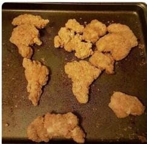</td></tr><tr><td>UserLLaVA</td><td>Can you explain this meme in detail?The meme in the image is a creative and humorous take on food, with a focus on chicken nuggets, as the center of the universe. The meme begins with the phrase &quot;Sometimes I just look at pictures of the Earth from space and I marvel at how beautiful it all is...&quot; The main image features a tray of cooked chicken nuggets, with the chicken pieces positioned to resemble the continents and islands on a world map. The meme playfully suggests that the chicken nuggets represent the Earth, and the various locations depicted in the photo are actually chicken nugget versions of different places. The punchline of the meme appears in smaller text at the bottom, reading &quot;I mean, it&#x27;s not the real Earth, but how beautiful it is all is.&quot; This lighthearted and entertaining meme combines food and humor, using the image of chicken nuggets to create a funny and imaginative representation of the world.</td></tr><tr><td>UserGPT-4 [36]</td><td>Can you explain this meme?This meme is a joke that combines two unrelated things: pictures of the earth from space and chicken nuggets. The text of the meme suggests that the image below is a beautiful picture of the earth from space. However, the image is actually of chicken nuggets arranged to vaguely resemble a map of the world. The humor in this meme comes from the unexpected juxtaposition of the text and the image. The text sets up an expectation of a majestic image of the earth, but the image is actually something mundane and silly.</td></tr><tr><td>UserBLIP-2</td><td>Can you explain this meme in detail?sometimes i just look at pictures of the earth from space and marvel how beautiful it is</td></tr><tr><td>UserOpenFlamingo</td><td>Can you explain this meme in detail?It&#x27;s a picture of a chicken nugget on the International Space Station.</td></tr></table>

Table 9: Example prompt comparing LLaVA, GPT-4, BLIP-2, and OpenFlamingo’s visual reasoning capabilities in understanding the humor. BLIP-2 and OpenFlamingo fail to follow the user’s instructions. LLaVA and GPT-4 both explain the meme and its humor, while GPT-4 produces a more concise answer.

> 表 9：比较 LLaVA、GPT-4、BLIP-2 与 OpenFlamingo 在理解幽默方面视觉推理能力的示例提示。BLIP-2 与 OpenFlamingo 未能遵循用户指令；LLaVA 与 GPT-4 都解释了该表情包及其笑点，而 GPT-4 的回答更简洁。

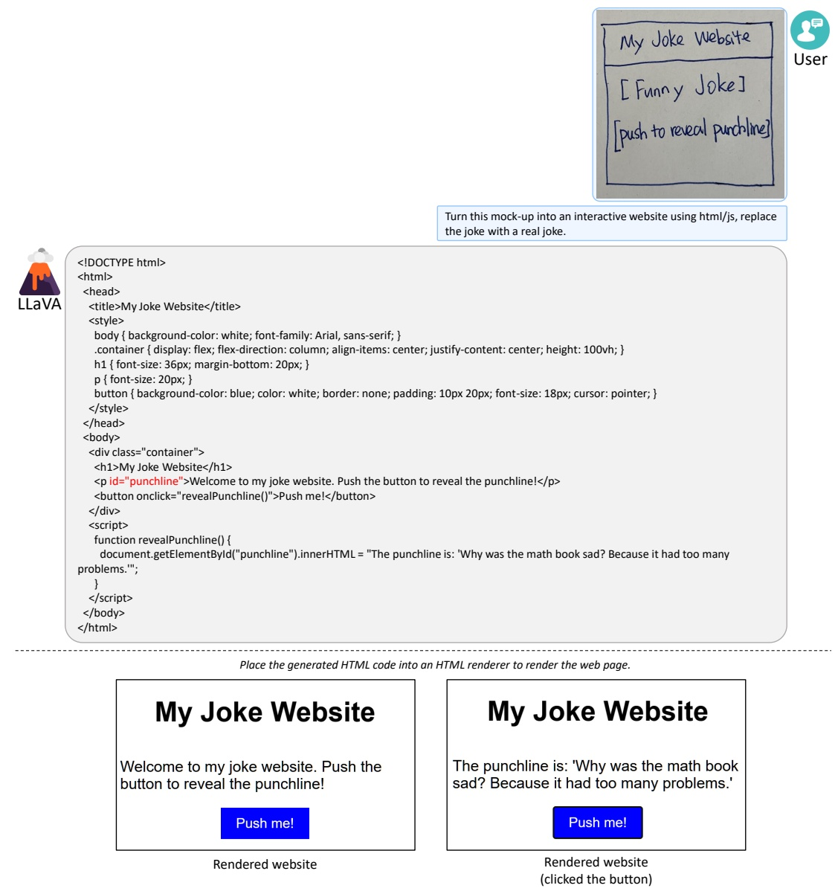

Figure 2: LLaVA generates HTML/JS code for an interactive website based on user sketch inputs. The interactive interface works after fixing a minor error (in red) in the generated output. There is room for improvement in LLaVA’s output, such as splitting the joke and punchline into two rows, and only revealing the punchline upon button click, to better reflect the user’s intent.

> 图 2：LLaVA 依据用户草图输入生成互动网站的 HTML/JS 代码。修正生成输出中的一处小错误（红色标注）后，交互界面即可工作。LLaVA 的输出仍有改进空间，例如把笑点与铺垫分成两行、仅在点击按钮时揭示笑点，以更好地体现用户意图。

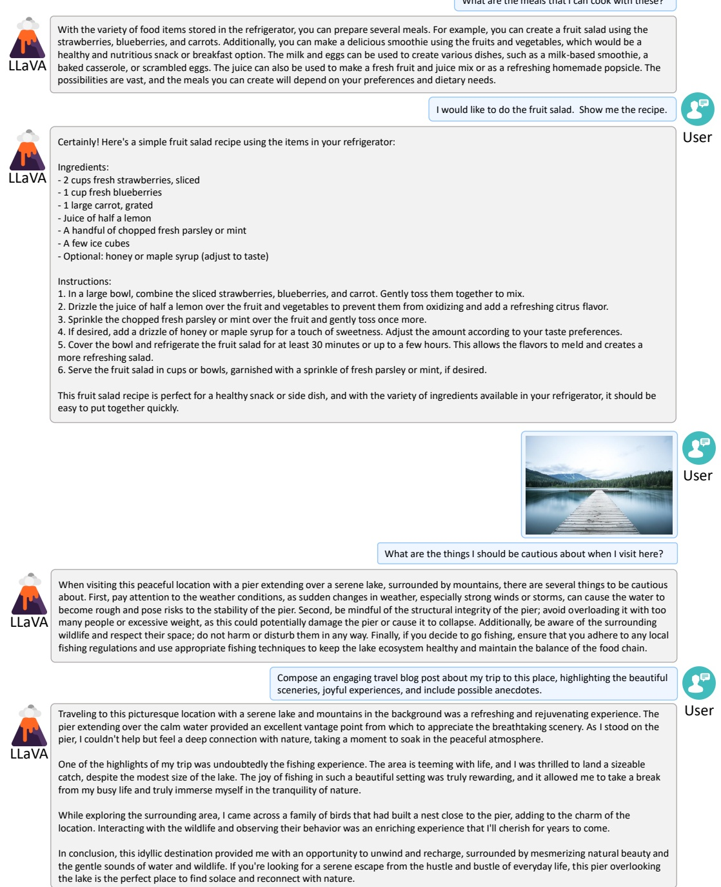

Figure 3: LLaVA is capable of recognizing the visual content following the user’s intent, without directly prompting for visual recognition. It also provides a detailed response when prompted with a follow-up request, and the generated response is closely related to the provided visual content.

> 图 3：LLaVA 能按用户意图识别视觉内容，而无需直接提示它做视觉识别；在追问时它还给出详细回复，且回复与所给视觉内容紧密相关。

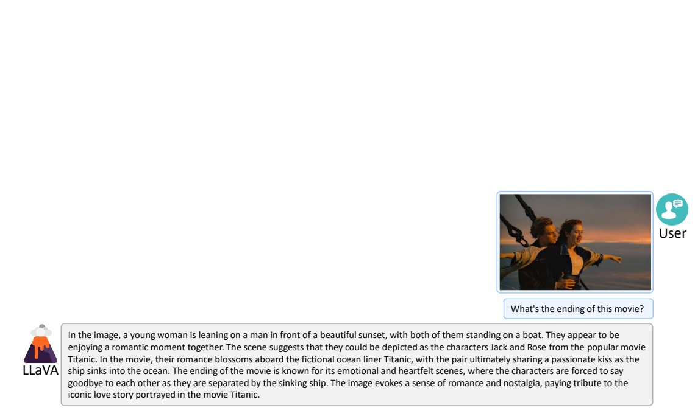

Figure 4: LLaVA relates the movie scenes to the textual knowledge from the pretrained LLM.

> 图 4：LLaVA 把电影场景与预训练 LLM 中的文本知识联系起来。

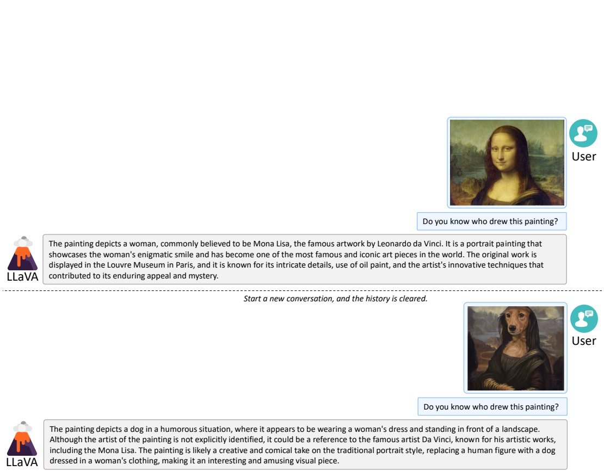

Figure 5: LLaVA recognizes the famous art work, Mona Lisa, by Leonardo da Vinci. When we start a new conversation, it also explains the humourous artwork created on the web, mimicking the Mona Lisa.

> 图 5：LLaVA 认出达·芬奇的著名作品《蒙娜丽莎》；开启新一轮对话时，它还能解释网上那幅模仿《蒙娜丽莎》的幽默作品。

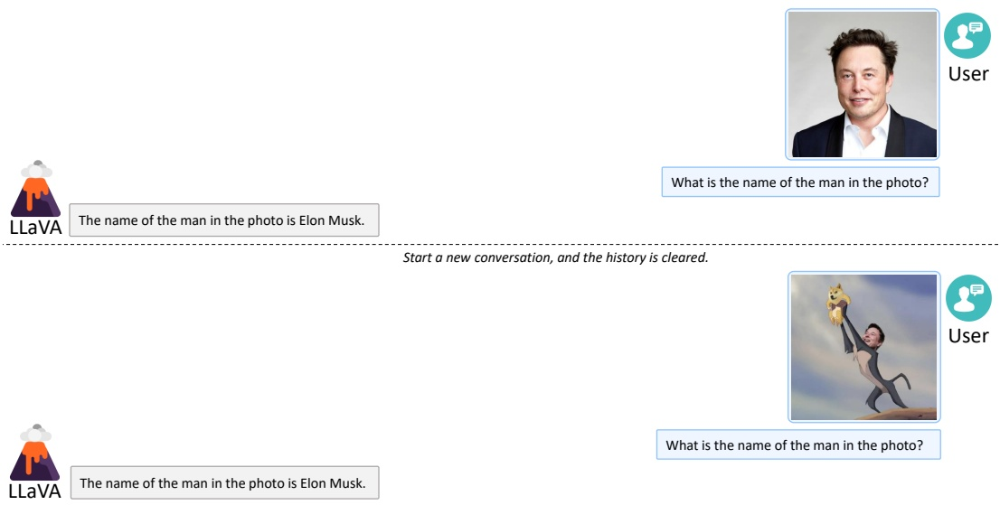

Figure 6: An interesting emergent behavior of LLaVA is its ability to recognize Elon Musk both in a headshot and in a humorous meme where he is dressed as a doge. This implies that the pre-trained CLIP vision encoder may have seen images of Elon Musk. However, it is still surprising because Elon Musk never appears in the training data for either the visual feature alignment or visual instruction tuning stages of LLaVA, which indicates that the base language model generalizes to unseen visual concepts.

> 图 6：LLaVA 一个有趣的涌现行为是能认出马斯克——既包括一张头像，也包括一个把他扮成 doge 的幽默表情包。这意味着预训练的 CLIP 视觉编码器可能见过马斯克的图像；但仍令人惊讶，因为马斯克从未出现在 LLaVA 视觉特征对齐或视觉指令微调阶段的训练数据中，说明**基座语言模型能泛化到未见过的视觉概念**。

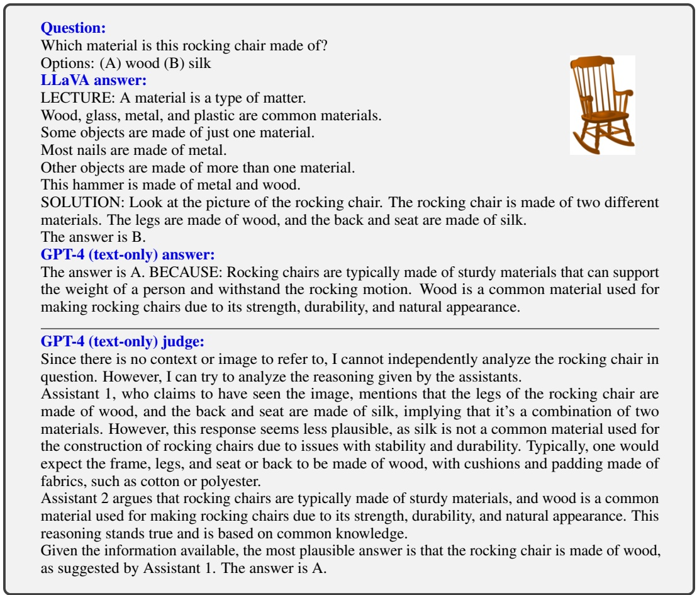

Table 10: One example on how the text-only GPT-4 acts as a judge to ensemble the predictions from LLaVA and a text-only GPT-4, and gives a correct final answer.

> 表 10：纯文本 GPT-4 作为裁判、把 LLaVA 与纯文本 GPT-4 的预测集成并给出正确答案的一个示例。

## C 训练细节 / Training Details

We pre-train our model on the filtered CC-595K subset for 1 epoch with a learning rate of 2e-3 and a batch size of 128, and fine-tune on the proposed LLaVA-Instruct-158K dataset for 3 epochs, with a learning rate of 2e-5 and a batch size of 32. Following Vicuna, we use the Adam optimizer with no weight decay and a cosine learning rate with a warmup ratio of 3%. During finetuning, FSDP (Full Shard Data Parallel) and gradient checkpointing is used to save GPU memory, and offloading is not used. BF16 and TF32 are enabled to achieve a balance between speed and precision.

> 我们在过滤后的 CC-595K 子集上以学习率 $`2\mathrm{e}{-3}`$、批大小 128 预训练 1 个 epoch；再在 LLaVA-Instruct-158K 上以学习率 $`2\mathrm{e}{-5}`$、批大小 32 微调 3 个 epoch。沿用 Vicuna，使用无权重衰减的 Adam 优化器与余弦学习率调度（预热比例 3%）。微调时用 FSDP（完全分片数据并行）与梯度检查点节省显存，未使用 offloading。启用 BF16 与 TF32，以在速度与精度间取得平衡。

We train all models with 8× A100s. Pretraining on CC-595K completes within 4 hours. Finetuning on Instruct-158K completes within 10 hours. Finetuning on ScienceQA completes within 4 hours.

> 所有模型都在 **8×A100** 上训练：CC-595K 预训练 4 小时内完成；Instruct-158K 微调 10 小时内完成；ScienceQA 微调 4 小时内完成。

## D 资源 / Assets

Our source code, generated instruction-tuning data, proposed benchmark are uploaded to the anonymized GitHub repository: [LLaVA-Annonymous/LLaVA](https://github.com/LLaVA-Annonymous/LLaVA).

> 我们的源码、生成的指令微调数据与所提基准已上传至匿名 GitHub 仓库：[LLaVA-Annonymous/LLaVA](https://github.com/LLaVA-Annonymous/LLaVA)。

1. Source Code: [link](https://github.com/LLaVA-Annonymous/LLaVA)

> 1. 源码：[link](https://github.com/LLaVA-Annonymous/LLaVA)

2. README: [link](https://github.com/LLaVA-Annonymous/LLaVA)

> 2. README：[link](https://github.com/LLaVA-Annonymous/LLaVA)

3. Instructions to launch the demo: [link](https://github.com/LLaVA-Annonymous/LLaVA#web-ui)

> 3. demo 启动说明：[link](https://github.com/LLaVA-Annonymous/LLaVA)

4. All prompts and few shot examples for querying GPT-4: [link](https://github.com/LLaVA-Annonymous/LLaVA/tree/master/playground/data/prompts)

> 4. 查询 GPT-4 的全部提示与少样本示例：[link](https://github.com/LLaVA-Annonymous/LLaVA)

5. LLaVA-Instruct-158K: [link](https://github.com/LLaVA-Annonymous/LLaVA/blob/master/playground/data/llava_instruct_150k.json)

> 5. LLaVA-Instruct-158K 数据：[link](https://github.com/LLaVA-Annonymous/LLaVA)

6. LLaVA-Bench: [COCO](https://github.com/LLaVA-Annonymous/LLaVA/blob/master/playground/data/coco2014_val_gpt4_qa_30x3.jsonl), [In-The-Wild](https://github.com/LLaVA-Annonymous/LLaVA/tree/master/playground/data/llava_bench_in_the_wild)

> 6. LLaVA-Bench：[COCO](https://github.com/LLaVA-Annonymous/LLaVA) / [In-the-Wild](https://github.com/LLaVA-Annonymous/LLaVA)

7. Model checkpoints. The size of the model checkpoints after compression is 25GB, which exceeds the 5GB limit of GitHub LFS (Large File Storage). We’ll release the checkpoint to the public, or upon request with reviewers for this submission.

> 7. **模型 checkpoint**。压缩后 checkpoint 大小为 **25GB**，超过 GitHub LFS（大文件存储）的 5GB 上限。我们将向社会公开发布，或按审稿人要求提供。

## E 数据 / Data

**Instructions for brief image description.** The list of instructions used to briefly describe the image content are shown in Table 11. They present the same meaning with natural language variance.

> **简要图像描述的指令集。** 用于**简要**描述图像内容的指令清单见表 11，它们以自然语言的不同说法表达同一含义。

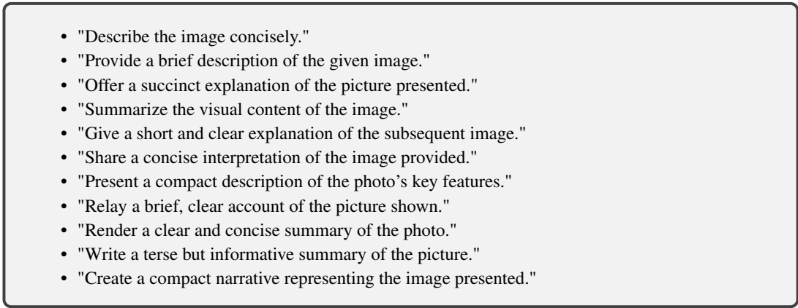

Table 11: The list of instructions for brief image description.

> 表 11：简要图像描述的指令清单。

**Instructions for detailed image description.** The list of instructions used to describe the image content in detail are shown in Table 12. They present the same meaning with natural language variance.

> **细节图像描述的指令集。** 用于**详细**描述图像内容的指令清单见表 12，它们以自然语言的不同说法表达同一含义。

**CC3M.** We extract noun-phrases using Spacy for each caption over the whole CC3M dataset, and count the frequency of each unique noun-phrase. We skip noun-phrases whose frequency is smaller than 3, as they are usually rare combinations concept and attributes that has already been covered

> **CC3M。** 我们对整个 CC3M 数据集中的每条配文用 SpaCy 抽取名词短语，并统计每个唯一名词短语的频次。我们跳过频次小于 3 的名词短语——它们通常是罕见的概念与属性组合，已

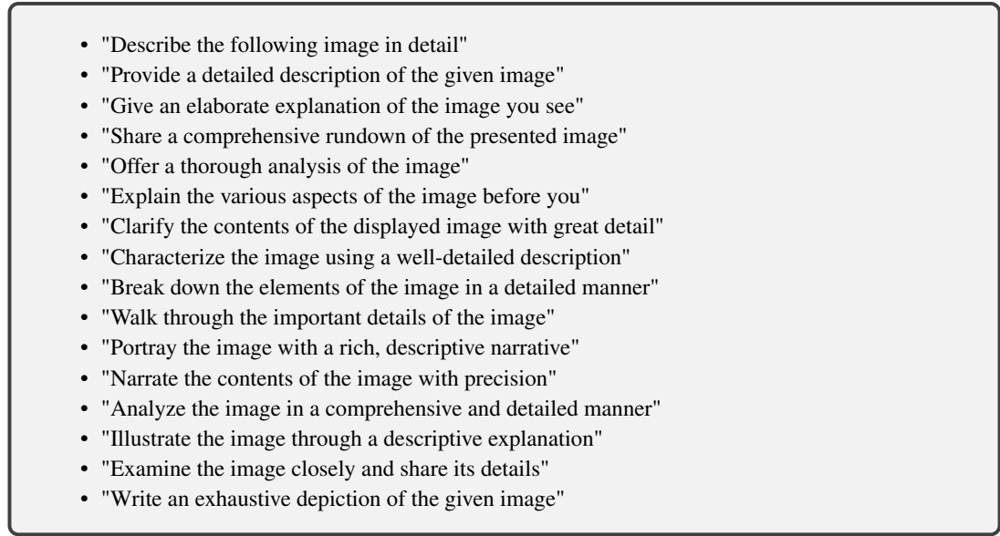

Table 12: The list of instructions for detailed image description.

> 表 12：细节图像描述的指令清单。

by other captions. We then start from the noun-phrases with lowest remaining frequency, add the captions that contain this noun-phrase to the candidate pool. If the frequency of the noun-phrase is larger than 100, we randomly choose a subset of size 100 out of all its captions. This results in around 595K image-text pairs.

> 被其他配文覆盖过。随后我们从**剩余频次最低**的名词短语开始，把包含该名词短语的配文加入候选池；若该短语频次大于 100，则从其全部配文中随机选 100 条。最终得到约 **595K** 图文对。

The comparison of noun-phrase statistics before and after filtering CC3M is shown in Figure 7. The filtered dataset shows a good coverage of concepts whose frequency is higher from 3, but with a smaller number of image-text pairs.

> CC3M 过滤前后的名词短语统计对比见图 7。过滤后的数据集对频次高于 3 的概念覆盖良好，而图文对数量更少。

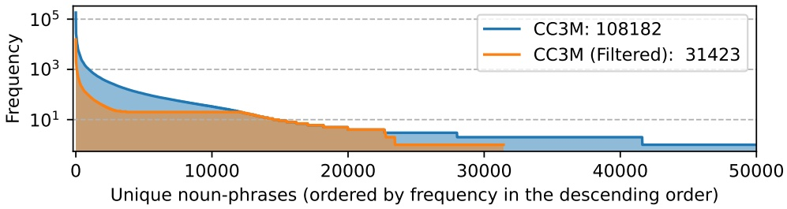

Figure 7: Comparison of noun-phrase statistics before and after filtering CC3M. The total number of unique noun-phrases are reported in the legend.

> 图 7：CC3M 过滤前后名词短语统计的对比。唯一名词短语总数标注在图例中。

## F 提示词 / Prompts

The prompt used to generate image-based conversation from ChatGPT/GPT-4 is shown in Table 13.

> 用于从 ChatGPT/GPT-4 生成**基于图像的对话**的提示见表 13。

<sub>以下提示词原文保留英文（提示词内容翻译会破坏其可直接使用的价值）。</sub>

```txt
messages = [ {"role":"system", "content": f"""You are an AI visual assistant, and you are seeing a single image. What you see are provided with five sentences, describing the same image you are looking at. Answer all questions as you are seeing the image.

Design a conversation between you and a person asking about this photo. The answers should be in a tone that a visual AI assistant is seeing the image and answering the question. Ask diverse questions and give corresponding answers.

Include questions asking about the visual content of the image, including the object types, counting the objects, object actions, object locations, relative positions between objects, etc. Only include questions that have definite answers:
(1) one can see the content in the image that the question asks about and can answer confidently;
(2) one can determine confidently from the image that it is not in the image. Do not ask any question that cannot be answered confidently.

Also include complex questions that are relevant to the content in the image, for example, asking about background knowledge of the objects in the image, asking to discuss about events happening in the image, etc. Again, do not ask about uncertain details. Provide detailed answers when answering complex questions. For example, give detailed examples or reasoning steps to make the content more convincing and well-organized. You can include multiple paragraphs if necessary.""]
]
for sample in fewshot_samples:
  messages.append({"role":"user", "content":sample['context']})
  messages.append({"role":"assistant", "content":sample['response']} )
messages.append({"role":"user", "content":‘\n’.join(query)})
```

Table 13: For each query, we illustrate the prompt construction process for ChatGPT/GPT-4 to collect query[‘response’] from query[‘context’], using few-shot in-context-learning, where examples are from fewshot\_samples, each example including input sample[‘context’] and output sample[‘response’]. Note that messages is the final prompt. In this example, we provide the prompt used to generate the conversation response, please see also see its in-context-learning examples in Table 15 and Table 16 for details. We recommend readers to check out the codebase for the prompts to generated two other types of responses, including detailed decription and complex reasoning.

> 表 13：对每个 query，我们展示从 query[‘context’] 收集 query[‘response’] 时给 ChatGPT/GPT-4 的提示构造过程，采用少样本上下文学习，示例来自 fewshot\_samples（每条含输入 sample[‘context’] 与输出 sample[‘response’]）。注意 `messages` 就是最终提示。本例给出生成**对话**回复所用的提示；其上下文学习示例见表 15 与表 16。另外两类回复（细节描述与复杂推理）的提示，建议读者查看代码库。

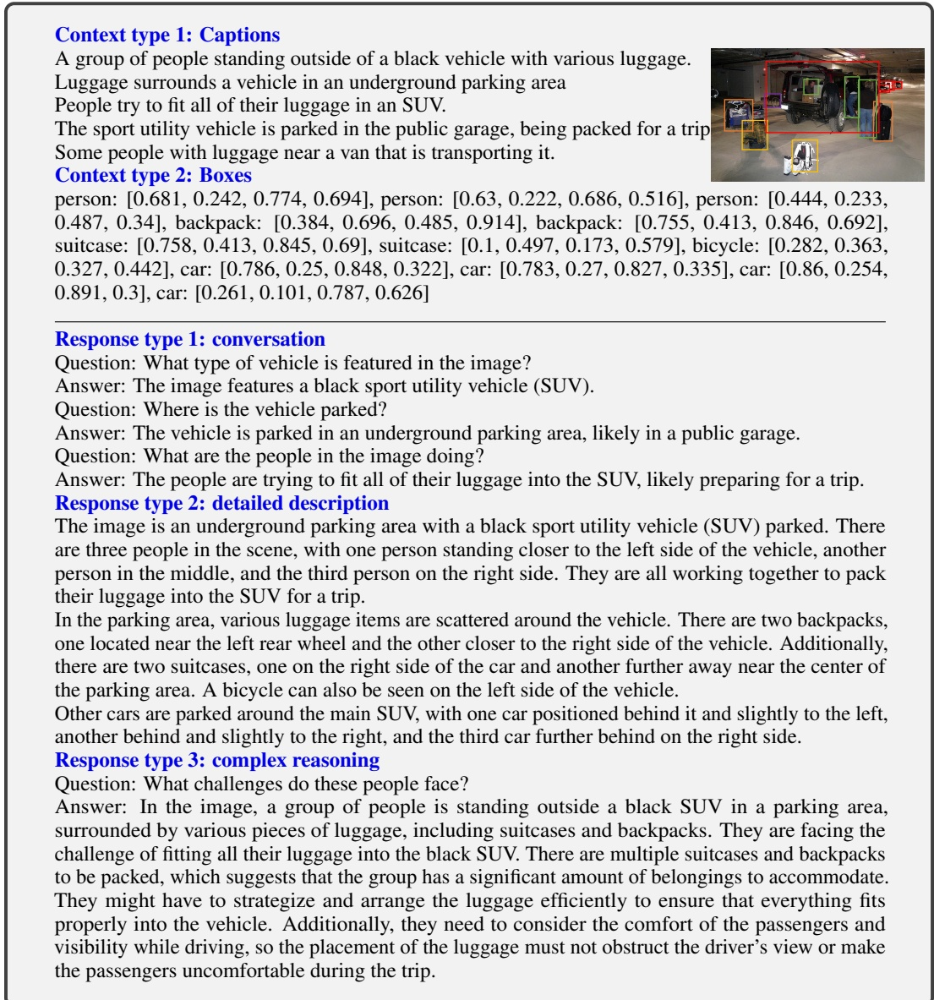

Table 14: One example to illustrate the instruction-following data. The top block shows the contexts such as captions and boxes used to prompt GPT, and the bottom block shows the three types of responses. Note that the visual image is not used to prompt GPT, we only show it here as a reference.

> 表 14：一个说明指令跟随数据的例子。上方块是用于提示 GPT 的上下文（如描述与框），下方块是三类回复。注意图像本身并未用于提示 GPT，此处仅作参考。

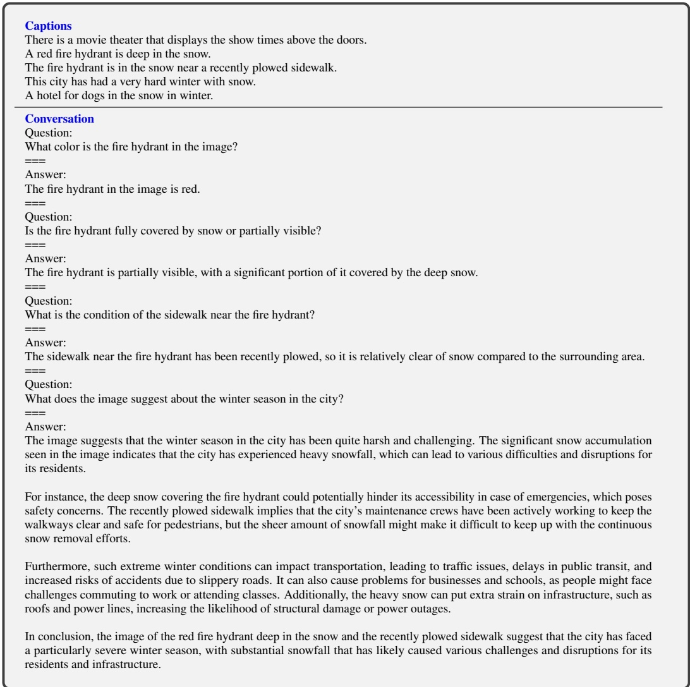

Table 15: One example used in in-context-learning to construct visual conversation data.

> 表 15：用于构造视觉对话数据时进行上下文学习的一个示例。

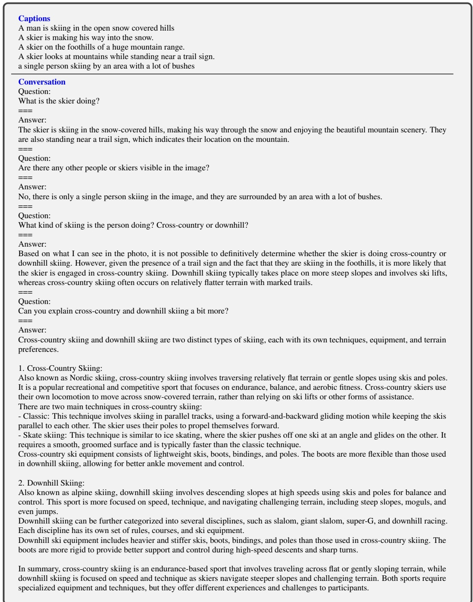

Table 16: One example used in in-context-learning to construct visual conversation data.

> 表 16：用于构造视觉对话数据时进行上下文学习的另一个示例。
