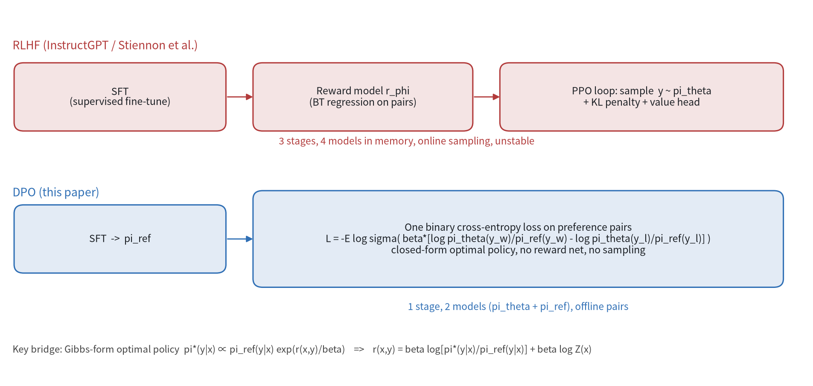
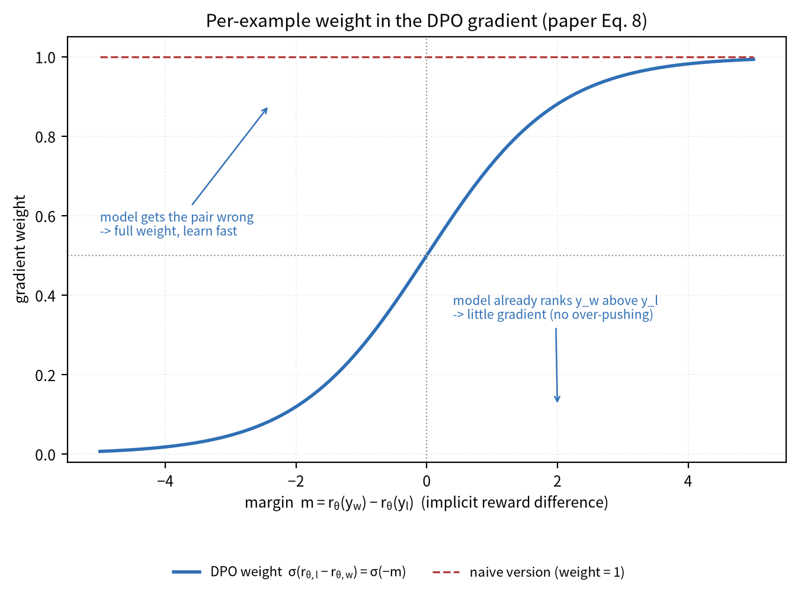

# Direct Preference Optimization: Your Language Model is Secretly a Reward Model

- **原文**：[arXiv:2305.18290](https://arxiv.org/abs/2305.18290)（v3，2024 年修订；本次精读所用即你上传的 `2305.18290v3.md` 抽取稿）
- **代码 / 项目**：论文未单独放仓库；参考实现最早由 Eric Mitchell 放出，后合入 HuggingFace **TRL** 的 `DPOTrainer`（`trl.DPOTrainer`），另有 `eric-mitchell/direct-preference-optimization` 仓库（重点是 `preference_datasets.py` 与 `trainers.py`）
- **作者与机构**：Rafael Rafailov\*†、Archit Sharma\*†、Eric Mitchell\*†、Stefano Ermon†‡、Christopher D. Manning†、Chelsea Finn†（†Stanford University，‡CZ Biohub；\* 表示同等贡献）
- **发表信息**：NeurIPS 2023（arXiv 2305.18290）
- **一句话总结**：把 RLHF 的"先学奖励模型、再用 PPO 在线优化"两阶段，用一个**变量替换**压成单阶段的二分类损失——因为带 KL 约束的奖励最大化，其最优策略必然是 Gibbs 形式 $`\pi^{*}\propto\pi_{\mathrm{ref}}e^{r/\beta}`$，于是奖励可以被**反解成策略的函数**，而 Bradley-Terry 偏好只依赖奖励**差**，配分函数 $`Z(x)`$ 恰好被约掉；最终每个偏好对只需 4 个 logprob，就能直接优化"隐式奖励"。
- **前置阅读**：InstructGPT（Ouyang et al., 2022，RLHF 三阶段工程范本）→ Ziegler et al. (2019)（"从人类偏好微调"的原始配方）→ Bradley-Terry (1952) / Plackett-Luce (1975)（偏好模型）→ PPO（Schulman et al., 2017，actor-critic 与 KL 惩罚）→ 控制即推断（Levine, 2018，§5.2 的 soft value 视角）

---

## 1. 研究背景与核心问题

### 1.1 RLHF 的成本结构：不是一个模型的成本，是四个模型的成本

InstructGPT 那套流程有三个阶段：SFT → 奖励建模 → RL 微调。它的算力与工程复杂度并不在"训练"上，而在这几件事上：

1. **要同时驻留多个模型**：策略 $`\pi_\theta`$、参考策略 $`\pi_{\mathrm{ref}}`$、奖励模型 $`r_\phi`$、价值函数 $`V`$（PPO 的 critic）。哪怕 6B 级模型，这也是四份权重 + 四份优化器状态。
2. **要在训练循环里在线采样**：每个 step 都要 `generate` 出完整序列，再前向算奖励——生成是自回归的，慢且不可并行到底。
3. **要调一堆互相耦合的超参**：KL 系数 $`\beta`$、PPO 的 clip 范围、价值损失系数、GAE 的 $`\lambda`$、学习率、batch 与采样温度……论文自己在 §6.1 就用 target $`\mathrm{KL}\in\{3,6,9,12\}`$ 扫了四档才拿到可比的前沿。
4. **信号是稀疏而间接的**：奖励只在**序列末尾**给一个标量，再靠 critic 把它摊到每个 token 上；critic 本身就是个要学的近似器，误差会传染。

### 1.2 核心问题：这个"带 KL 约束的奖励最大化"能不能不求 RL？

RLHF 的目标（论文式 3）是：

```math
\max_{\pi_\theta}\ \mathbb{E}_{x\sim\mathcal{D},\,y\sim\pi_\theta(y\mid x)}\big[r_\phi(x,y)\big]-\beta\,\mathbb{D}_{\mathrm{KL}}\big[\pi_\theta(y\mid x)\,\|\,\pi_{\mathrm{ref}}(y\mid x)\big]
```

PPO 的做法是"把它当 RL 问题硬解"。DPO 的提问方式完全不同：**这个目标的解是不是有闭式表达？如果有，那我们根本不需要 RL，直接把解代回目标里，得到一个只含策略的损失就行。**

答案是**有**——而且这个闭式解（Gibbs 分布）早在控制即推断、以及 KL-正则化 RL 的文献里就有。DPO 的真正贡献不是"发现闭式解"，而是**发现了它对偏好学习的意义**：

- 闭式解把"奖励"表示成"策略与参考策略的对数比"，所以**奖励不再需要单独一个网络**；
- Bradley-Terry 模型只看奖励**差**，而那个对数比里的配分函数 $`Z(x)`$ 只依赖 $`x`$、**做差时自动消掉**；
- 于是"拟合奖励模型 + 优化策略"两步，等价于"**直接在策略上做二分类**"一步。

一句话：**DPO 不是"更简单的 PPO"，而是"证明了 PPO 那个目标的最优解可以解析写出来，于是把优化问题改写成了监督学习"。**

---

## 2. 核心方法与设计动机

### 2.1 五步链条（先看全景，细节在 §3）

```
①  KL 约束奖励最大化   ──闭式解──►   ②  π*(y|x) ∝ π_ref(y|x) exp(r(x,y)/β)
                                              │  反解
                                              ▼
③  r(x,y) = β log[π*(y|x)/π_ref(y|x)] + β log Z(x)
                                              │  代入 BT，Z 做差消掉
                                              ▼
④  p*(y_w ≻ y_l|x) = σ( β log π*(y_w)/π_ref(y_w) − β log π*(y_l)/π_ref(y_l) )
                                              │  把 π* 换成待训的 π_θ，做 MLE
                                              ▼
⑤  L_DPO = −E log σ( β log[π_θ(y_w|x)/π_ref(y_w|x)] − β log[π_θ(y_l|x)/π_ref(y_l|x)] )
```

我按论文 Fig. 1 与 §4 把这个对比画成一张流程对照图（RLHF 三阶段 vs DPO 单阶段）：



### 2.2 为什么必须是 Bradley-Terry（而不是"回归一个奖励值"）

这是本文最容易被读漏的**技术支点**。假设偏好模型需要绝对奖励（例如"给这对样本的胜率 $`p`$，然后反解 $`r`$"），那 $`Z(x)`$ 就消不掉——你必须估计配分函数，而它是对所有可能回答的求和，**不可算**。BT 的结构 $`p=\sigma(r_w-r_l)`$ 让奖励只以差值出现，而 $`Z(x)`$ 是两个差值里共同的项，**做差即消**。所以：

> **DPO 的可行性完全依赖于"偏好模型只依赖奖励差"这一结构性质。** 换成 Plackett-Luce（排序）仍然成立（附录 A.3 给了推广），因为 PL 也是"分子分母同构"的形式；但换成任何需要绝对奖励标定的模型都会失效。

### 2.3 为什么是"分类"而不是"回归"

偏好数据天然是**成对标签**（$`y_w`$ 好于 $`y_l`$）。把它当二分类，等价于对 BT 模型做**最大似然**，即与"训练奖励模型"用的是同一个统计目标——这一点保证了 DPO 不会比"先学奖励"损失信息，只是把参数化换成了策略本身。同时它也解释了为什么**不需要温度超参之外的额外标定**：BT 的 logit 就是奖励差，$`\beta`$ 只是把"策略对数比"换算成"奖励尺度"的温度。

### 2.4 隐式奖励：训练时它在哪？

训练时没有 $`r_\phi`$。所谓隐式奖励就是

```math
\hat r_\theta(x,y)=\beta\log\frac{\pi_\theta(y\mid x)}{\pi_{\mathrm{ref}}(y\mid x)}
```

它是一个**可以随时算出来的量**（只要你有两个模型的 logprob），这也意味着 DPO 训完之后，你可以把 $`\hat r_\theta`$ 当奖励模型**拿去用**（做 Best-of-N 重排、做拒绝采样、做数据筛选），而不必额外训一个奖励网络。论文标题"your language model is secretly a reward model"说的就是这件事。

### 2.5 工程上的实际收益（数字对账）

一个偏好对在 DPO 里需要算 4 个序列的 logprob：$`\pi_\theta`$ 对 $`y_w`$、$`y_l`$，$`\pi_{\mathrm{ref}}`$ 对 $`y_w`$、$`y_l`$。$`\pi_{\mathrm{ref}}`$ 的两项**可以离线预先算好并缓存**（它不更新），所以每步实际只需对当前策略做 2 次 forward + backward。相比 PPO 的"生成 + 4 模型前向 + critic 反传"，这是数量级的简化——这也是论文能在一个 6B（TL;DR 用 GPT-J 6B）与 2.8B（对话用 Pythia-2.8B）规模上把 RLHF 级实验做完的原因之一（论文未披露具体硬件配置，此处不臆测）。

---

## 3. 数学原理与完整推导

### 3.1 第一步：KL 约束奖励最大化的闭式解（完整推）

从式 3 出发，把 KL 展开（$`x`$ 固定时逐点处理）：

```math
\max_{\pi}\ \mathbb{E}_{x\sim\mathcal{D}}\Big[\underbrace{\sum_{y}\pi(y\mid x)r(x,y)-\beta\sum_{y}\pi(y\mid x)\log\frac{\pi(y\mid x)}{\pi_{\mathrm{ref}}(y\mid x)}}_{\text{每个 } x \text{ 独立}}\Big]\quad \text{s.t.}\ \sum_y \pi(y\mid x)=1
```

对每个 $`x`$ 单独做拉格朗日（乘子 $`\lambda(x)`$）：

```math
\mathcal{J}_x=\sum_y \pi(y\mid x)\Big[r(x,y)-\beta\log\frac{\pi(y\mid x)}{\pi_{\mathrm{ref}}(y\mid x)}\Big]+\lambda(x)\Big(\sum_y\pi(y\mid x)-1\Big)
```

对 $`\pi(y\mid x)`$ 求偏导并置零（注意 $`\frac{\partial}{\partial \pi}\pi\log\pi=\log\pi+1`$）：

```math
r(x,y)-\beta\Big(\log\frac{\pi(y\mid x)}{\pi_{\mathrm{ref}}(y\mid x)}+1\Big)+\lambda(x)=0
```

```math
\Longrightarrow\ \log\pi(y\mid x)=\log\pi_{\mathrm{ref}}(y\mid x)+\frac{r(x,y)}{\beta}+\frac{\lambda(x)}{\beta}-1
```

```math
\Longrightarrow\ \pi^*(y\mid x)=\frac{1}{Z(x)}\,\pi_{\mathrm{ref}}(y\mid x)\exp\!\Big(\frac{1}{\beta}r(x,y)\Big),\qquad Z(x)=\sum_{y}\pi_{\mathrm{ref}}(y\mid x)\exp\!\Big(\frac{1}{\beta}r(x,y)\Big)
```

$`\lambda(x)`$ 被 $`Z(x)`$ 吸收（归一化常数必须让分布求和为 1），这就是论文式 4。**附录 A.1 用的等价写法**（更漂亮）：把 $`r=\beta\log\frac{\pi^*}{\pi_{\mathrm{ref}}}+\beta\log Z`$ 代回目标，逐点得到

```math
\sum_y\pi(y\mid x)\Big[r-\beta\log\frac{\pi}{\pi_{\mathrm{ref}}}\Big]=\beta\log Z(x)-\beta\,\mathrm{KL}\big[\pi(\cdot\mid x)\,\|\,\pi^*(\cdot\mid x)\big]
```

因为 $`\beta\log Z(x)`$ 与 $`\pi`$ 无关，**最大化就等价于把 KL 压到 0**，由 Gibbs 不等式知唯一解是 $`\pi=\pi^*`$。这一步还顺带告诉我们：**最优目标值就是 $`\beta\log Z(x)`$**——这个量后面会作为"soft value"再次出现。

### 3.2 第二步：把奖励反解出来

对式 4 两边取对数再整理：

```math
\log\pi_r(y\mid x)=\log\pi_{\mathrm{ref}}(y\mid x)+\frac{r(x,y)}{\beta}-\log Z(x)
```

```math
\Longrightarrow\ r(x,y)=\beta\log\frac{\pi_r(y\mid x)}{\pi_{\mathrm{ref}}(y\mid x)}+\beta\log Z(x)
```

这就是论文式 5。注意它含一个**未知但只依赖 $`x`$** 的 $`\beta\log Z(x)`$。

### 3.3 第三步：代入 BT，配分函数消失

真奖励 $`r^*`$ 对应最优策略 $`\pi^*`$。BT 模型：

```math
p^*(y_w\succ y_l\mid x)=\sigma\big(r^*(x,y_w)-r^*(x,y_l)\big)
```

把式 5 代入，两项相减时 $`\beta\log Z(x)`$ 完全抵消：

```math
r^*(x,y_w)-r^*(x,y_l)=\beta\log\frac{\pi^*(y_w\mid x)}{\pi_{\mathrm{ref}}(y_w\mid x)}-\beta\log\frac{\pi^*(y_l\mid x)}{\pi_{\mathrm{ref}}(y_l\mid x)}
```

```math
\Longrightarrow\ p^*(y_w\succ y_l\mid x)=\sigma\Big(\beta\log\frac{\pi^*(y_w|x)}{\pi_{\mathrm{ref}}(y_w|x)}-\beta\log\frac{\pi^*(y_l|x)}{\pi_{\mathrm{ref}}(y_l|x)}\Big)
```

**这是全文的枢纽等式**（论文式 6）：人类偏好概率被写成了**两个策略的比值**，一个未知网络都不剩。

### 3.4 第四步：最大似然 → DPO 损失

现在把不可得的 $`\pi^*`$ 换成待训练的 $`\pi_\theta`$，对数据集做负对数似然：

```math
\mathcal{L}_{\mathrm{DPO}}(\pi_\theta;\pi_{\mathrm{ref}})=-\mathbb{E}_{(x,y_w,y_l)\sim\mathcal{D}}\Big[\log\sigma\Big(\beta\log\frac{\pi_\theta(y_w|x)}{\pi_{\mathrm{ref}}(y_w|x)}-\beta\log\frac{\pi_\theta(y_l|x)}{\pi_{\mathrm{ref}}(y_l|x)}\Big)\Big]
```

定义 $`\Delta_\theta(y|x)=\log\pi_\theta(y|x)-\log\pi_{\mathrm{ref}}(y|x)`$（"相对 logprob 增量"），简写为

```math
\mathcal{L}_{\mathrm{DPO}}=-\mathbb{E}\big[\log\sigma\big(\beta(\Delta_\theta(y_w|x)-\Delta_\theta(y_l|x))\big)\big]
```

**它的梯度（论文式 8，逐步推）**：令 $`u=\beta(\Delta_w-\Delta_l)`$，

```math
\nabla_\theta\mathcal{L}_{\mathrm{DPO}}=-\frac{\partial}{\partial u}\log\sigma(u)\cdot\nabla_\theta u=-\big(1-\sigma(u)\big)\cdot\nabla_\theta u
```

利用 $`1-\sigma(u)=\sigma(-u)`$ 与 $`\sigma`$ 的奇对称性：

```math
\sigma(-u)=\sigma\big(\beta(\Delta_l-\Delta_w)\big)=\sigma\big(\hat r_\theta(x,y_l)-\hat r_\theta(x,y_w)\big)
```

```math
\Longrightarrow\ \nabla_\theta\mathcal{L}_{\mathrm{DPO}}=-\beta\,\underbrace{\sigma\big(\hat r_\theta(x,y_l)-\hat r_\theta(x,y_w)\big)}_{w(x,y_w,y_l)}\Big[\nabla_\theta\log\pi_\theta(y_w|x)-\nabla_\theta\log\pi_\theta(y_l|x)\Big]
```

我把它画成曲线，横轴是隐式奖励的差 $`m=\hat r_\theta(y_w)-\hat r_\theta(y_l)`$：



读图能读出三件事，也正好是 DPO 的三条工程直觉：

1. **$`m\to-\infty`$（模型把偏好对排反了）**：权重 $`\sigma(-m)\to 1`$，用满力量去拉开 $`y_w`$ 与 $`y_l`$；
2. **$`m\to+\infty`$（模型已经排对了）**：权重 $`\to 0`$，**自动停止推**。这就是"不会过度优化"的内在机制——**不需要早停，也不需要额外正则**；
3. **朴素版本（权重恒为 1）**：就是论文说的"naive probability-ratio objective"，会一直推下去，导致模型退化（附录表 3 给了 unlikelihood 版的反面教材）。

一个可以手算的例子：设 $`\beta=0.1`$、模型对两者相对 logprob 完全相同（$`\Delta_w=\Delta_l`$），则 $`m=0`$、权重 $`0.5`$，梯度是"标准 SFT 强度的一半"；若模型已经给了 $`y_w`$ 比 $`y_l`$ 高 $`10`$ 个 nat 的相对优势（$`m=0.1\times10=1`$），权重降到 $`\sigma(-1)\approx0.269`$。

### 3.5 第五步：这个"隐式奖励"为什么是唯一确定的

论文 §5 处理的正是"不同奖励函数可以诱导同一策略"这个隐忧——如果不处理，理论上是循环论证：*我们用策略定义奖励，又用奖励的最优策略定义策略*。作者用**等价类**把这件事理清了：

- **定义**：$`r\sim r'`$ 当且仅当 $`r(x,y)-r'(x,y)=f(x)`$（只差一个**只依赖 prompt** 的项）；
- **引理 1**：同类里两个奖励诱导**同一偏好分布**（因为 BT 只看差，$`f(x)`$ 消掉）；
- **引理 2**：同类里两个奖励诱导**同一最优策略**（因为最优策略只通过 $`r`$ 的差进入 $`Z`$ 与指数）；
- **定理 1**：每个等价类里，**恰有一个**奖励函数能被写成 $`\beta\log\frac{\pi}{\pi_{\mathrm{ref}}}`$。

定理的构造很干净：定义投影

```math
f(r;\pi_{\mathrm{ref}},\beta)(x,y)=r(x,y)-\beta\log Z(x)
```

因为 $`\beta\log Z(x)`$ 只是 $`x`$ 的函数，$`f(r)`$ 与 $`r`$ **同类**；而把式 5 代回 $`\pi_r`$ 的定义，立刻得到 $`f(r)(x,y)=\beta\log\frac{\pi_r(y|x)}{\pi_{\mathrm{ref}}(y|x)}`$。命题 1 进一步说明这个代表元唯一（反证：若两个模型给出同一类里的同一个重参数化形式，则 $`\pi\exp(\frac{1}{\beta}f)=\pi'`$，两边对 $`y`$ 求和得 $`\exp(\frac{1}{\beta}f)=1`$，故 $`f\equiv0`$、$`\pi=\pi'`$）。

**含义**：DPO 不是"随便挑一个奖励"，它挑的是**归一化后（去掉只依赖 $`x`$ 的分量）的那个代表元**。所以 $`\hat r_\theta`$ 是良定义的、可用于下游打分。

### 3.6 与 PPO 的关系：那个被丢掉的归一化项

把同一套推导套到 PPO 上，能得到一个很漂亮的解释。PPO 优化式 3，其最优策略为式 4；把 $`r_\phi=\beta\log\frac{\pi^*}{\pi_{\mathrm{ref}}}+\beta\log Z`$ 代回，得到（论文式 13）：

```math
\max_{\pi_\theta}\mathbb{E}\Big[\beta\log\frac{\pi_\theta(y|x)}{\pi_{\mathrm{ref}}(y|x)}\Big]-\beta\log Z(x)\ \Longleftrightarrow\ -\beta\,\mathrm{KL}\big[\pi_\theta\,\|\,\pi^*\big]+\text{const}
```

其中那个 $`\beta\log Z(x)`$ 就是**参考策略的软价值函数**（因为 $`\beta\log\sum_y\pi_{\mathrm{ref}}e^{r/\beta}`$ 正是 soft-max 形式的价值）。结论：**PPO 需要一个 critic 去拟合这个归一化项，DPO 通过重参数化把它消掉了**——这就是 DPO 不需要价值网络、也不需要基线的数学原因，也是 PPO 梯度方差大的根源（缺了它，reward 的绝对尺度会把梯度推到高方差）。

---

## 4. 数据、训练与系统实现

### 4.1 三个任务与数据规模（数字来自附录 C.1）

| 任务 | 提示 $`x`$ 来源 | 偏好从哪来 | SFT / 基座 | 规模 |
|---|---|---|---|---|
| **受控情感生成** | IMDb 影评前缀，长度 2–8 token | 用**情感分类器**当真奖励造偏好对（$`p(\text{pos}\vert y_w)>p(\text{pos}\vert y_l)`$） | `gpt2-large` | 25000 个前缀 × 每前缀 4 个完成 → 每前缀 **6 个偏好对**；SFT 1 epoch；奖励模型 3 epoch |
| **摘要** | Reddit 论坛帖（TL;DR 数据集） | Stiennon 等人收集的人工偏好 | GPT-J 6B SFT（TRLX 框架） | 公开的 TL;DR 偏好集 |
| **单轮对话** | 人类提问（Anthropic HH） | 数据集自带的"二选一"标签 | Pythia-2.8B（无标准 SFT，先用 Preferred-FT 在 $`y_w`$ 上训一个） | 17 万条对话 |

一个细节值得记：**受控情感任务里真奖励是"分类器概率"，所以能算 KL-奖励前沿**；摘要与对话里真奖励不可得，只能算"对基线的胜率"。这就是论文为什么把"前沿曲线"只放在情感任务上——不是不想，是没条件。

### 4.2 训练配置

| 项 | 值 |
|---|---|
| $`\beta`$ | 默认 **0.1**；TL;DR 摘要用 **0.5** |
| batch size | 64 |
| 优化器 | **RMSprop**（不是常见的 AdamW），lr $`1\mathrm{e}{-6}`$ |
| 预热 | 150 步内 0 → $`1\mathrm{e}{-6}`$ 线性 |
| 生成温度（采样） | 0 → 1.0 扫，报告最佳 |

这里有两个"反常识"点，值得单独指出：

1. **RMSprop + lr $`1e{-}6`$**：这与"AdamW + $`1e{-}5`$"的主流配置差别很大。DPO 的梯度尺度被 $`\beta`$ 缩放，且 sigmoid 权重使得梯度天然较小，因此用低学习率 + RMSprop 更稳。**照抄 AdamW 的学习率往往会训崩**（见 §9 的坑表）。
2. **摘要任务把 $`\beta`$ 调到 0.5**：说明 $`\beta`$ 在不同任务上不通用，而论文自己也承认"没有认真调 $`\beta`$"，所以 61% 的胜率可能是**保守估计**。

### 4.3 评估方式与"GPT-4 当裁判"的校准

- 情感任务：**奖励-KL 前沿**（每 100 步评估一次，扫 target KL / $`\beta`$ / $`\alpha`$ / 随机种子，共 22 次运行）。
- 摘要 / 对话：**对基线胜率**，基线分别是测试集人工摘要、数据集里被选中的回答。
- 裁判校准（§6.4）：25 名人类评分者、共 275 + 200 + 125 条判断；结论是**人类与 GPT-4 的一致率（67–86%）与人类彼此之间（65–87%）相当**，据此认为 GPT-4 可以代理人类。
- 提示差异：GPT-4(**S**) 只问"哪个摘要更好"，GPT-4(**C**) 额外要求"更简洁"。论文发现 (S) 版**偏爱更长更啰嗦的摘要**，因此主结果统一用 (C) 版——这是一个很诚实的"评估器偏差"记录，也是复现时最该照抄的一处。

---

## 5. 实验设置与关键结论

### 5.1 情感任务：DPO 的前沿严格优

论文扫了 22 次运行（PPO 用 target KL$\in\{3,6,9,12\}$`；unlikelihood 用 `$\alpha\in\{0.05,0.1,0.5,1\}$` 与 `$\beta\in\{0.05,0.1,1,5\}$；Preferred-FT 用不同种子），结论：

- **在相同 KL 下 DPO 奖励最高**，且在相同奖励下 DPO 的 KL 最低——**前沿严格支配 PPO**；
- 即便 PPO 拿到**真奖励**（PPO-GT），DPO 的前沿仍更好；
- PPO 需要扫保守系数才勉强拼出前沿，DPO 几乎不用调（默认 $`\beta`$）。

这条结论的分量在于：**DPO 与 PPO 优化的是同一个目标**（式 3），所以"前沿更好"不是目标不同带来的，而是**优化质量不同**带来的——直接监督比策略梯度更有效地把参数推向最优点。

### 5.2 摘要（GPT-J 6B, TL;DR）：61% vs 57%

| 方法 | 最佳温度 | 相对人工摘要胜率 |
|---|---|---|
| **DPO** | 0.0 | **≈61%** |
| PPO | 0.0 | ≈57% |
| Best of N | – | 低于 DPO（且算力昂贵） |
| Preferred-FT | – | 相对 SFT 提升不显著 |

另外两点：
- **对温度的稳健性**：PPO 在高温下会退化到基础 GPT-J 的水平，而 DPO 的胜率在各温度下都比较稳（Fig 3 右）；
- **人机正面对比**：DPO（温度 0.25）样本相对 PPO（温度 0）样本被偏好 **58%**——与 GPT-4 给出的胜率基本一致，等于给"GPT-4 当裁判"又加了一道验证。

### 5.3 对话（Pythia-2.8B, Anthropic HH）：唯一超过数据标签的方法

- DPO 是**唯一**在 Anthropic HH 测试集上超过"被选中回答"的方法；
- 与"Best of 128"（算力代理的 PPO 上限）相当或更好；
- 论文还试了一个**公开的、在 HH 上训过 PPO 的模型，却找不到任何提示/温度能超过基础 Pythia-2.8B**。这个反面结果很有信息量：**PPO 复现的门槛高到"别人训好的模型你都调不动"**，而 DPO 用同样基座就拿到了正收益。

### 5.4 分布外泛化（§6.3）：DPO 0.36 / PPO 0.26

在 TL;DR 上训、到 **CNN/DailyMail** 新闻上评（同一提示模板，只把 "forum post" 换成 "news article"）：

| 方法 | Temp 0 | Temp 0.25 |
|---|---|---|
| **DPO** | **0.36** | **0.31** |
| PPO | 0.26 | 0.23 |

DPO 在新分布上**继续领先且幅度不小**（+10 个百分点 @ temp 0），而 PPO 用了额外的无标注 TL;DR 提示、DPO 没用。这是"离线偏好学习也能泛化"的初步证据。

### 5.5 人类研究（Table 2）：58% vs 54% vs 43% vs 17%

| 对比对象（都 vs PPO temp 0） | 人类胜率 | GPT-4(C) 胜率 | GPT-4(S) 胜率 |
|---|---|---|---|
| **DPO (t=0.25)** | **58** | **54** | 47 |
| SFT (t=0.25) | 43 | 32 | 27 |
| PPO-1 (t=1.0) | 17 | 12 | 13 |

一致率：GPT-4(C) 与人类 67–85%，人类彼此 65–87%。**结论：GPT-4 的判断与人类判断的可互换性成立**，且 (C) 版更贴近人类（(S) 版系统性高估 SFT/DPO 里更啰嗦的样本）。

---

## 6. 消融实验与失败案例

DPO 这篇没有传统的"逐模块消融"，但它的"消融"藏在**基线设计与失败案例**里，这部分比消融表更有信息量。

### 6.1 失败案例 1：unlikelihood（把 DPO 拆成两半会怎样）

Unlikelihood 基线只保留"提高 $`y_w`$ 概率、降低 $`y_l`$ 概率"，不要 sigmoid 权重、不要 $`\pi_{\mathrm{ref}}`$：

```math
\mathcal{L}_{\text{unlikelihood}}=-\log p(y_w|x)+\alpha\log p(y_l|x)
```

结果：**在摘要与对话上基本生成无意义文本**（附录表 3 有样例；论文把原因归为"无约束的似然最小化"）。这条负面结果实际证明了 DPO 损失里**两个组件都不能去掉**：

- 去掉 $`\pi_{\mathrm{ref}}`$：失去"偏离基线多少"的度量，模型可以为了压低 $`y_l`$ 而破坏整体语言能力（毕竟最小化 $`\log p`$ 是无下界的）；
- 去掉 sigmoid 权重：等价于 naive probability ratio，会持续推直到退化。

### 6.2 失败案例 2：Best of N 的"算力墙"

Best of 128 是强基线（对话上接近 PPO 上限），但代价是**每个 query 在推理时采 128 个样本**。附录 D.1/图 4 显示它在 N≈64–128 处进入平台期——也就是说这套方法的性能天花板由**采样预算**决定，而 DPO 一次前向就够。这解释了为什么论文反复强调"computationally lightweight"：**不是修辞，是对比基线的主要缺点**。

### 6.3 失败案例 3：PPO 的复现困难（最诚实的一段）

- 公开的 Anthropic HH PPO 模型调不出超过基础模型的设置；
- PPO 对采样温度极敏感（高温退化到基座水平）；
- 论文自己也为 PPO 做了"归一化奖励 + 额外调参"才拿到可比曲线。

**这三点合起来说明：PPO 的 SOTA 有很大一部分来自调参劳动，而不是算法本身的性质。**DPO 的价值有一半是"把这部分劳动省掉"。

### 6.4 疑似失败案例 4：Fig 3 右的轻微下降

训练后期 DPO 的胜率在部分温度上有小幅下降，论文在 §7 把它作为"reward over-optimization 是否也发生在直接偏好优化设定下"的**开放问题**提出，没有定论。我认为这条值得记住：**DPO 的权重 $`\sigma(-m)`$ 只抑制"已经排对的样本"，并不抑制"对偏好数据的过度拟合"**——过拟合的表现会是训集偏好 margin 越来越大，而这个 margin 是 sum-logprob，会被**长度**放大（见 §7）。

---

## 7. 方法局限与适用边界

| 边界 | 具体限制 | 何时会踩到 |
|---|---|---|
| **数据形态** | 必须有**成对**偏好（$`y_w`$ vs $`y_l`$） | 只有"单条好评/差评"的二元反馈（KTO 就是为此而生） |
| **参考模型耦合** | $`\pi_{\mathrm{ref}}`$ 决定损失的口径；$`\pi^{\mathrm{SFT}}`$ 不可得时要用"只学 $`y_w`$"来近似 | 跨模型复用偏好数据（公开 TL;DR 偏好是用别的 SFT 采的，论文明确承认这造成分布偏移） |
| **奖励可分性** | 依赖 BT/PL 的"奖励差"结构 | 需要绝对标定、或多答案排序不满足 PL 假设的任务 |
| **长度偏差** | 损失用 **sum** logprob（不是 length-normalized），偏好数据里长度与质量相关时会学到"更长更好" | 摘要、开放对话里极常见（SimPO 后来专门改这一点） |
| **规模边界** | 只验证到 6B；更大模型上 $`\beta`$ 是否仍 0.1 未知 | 70B+ 场景需要重扫 $`\beta`$ |
| **分布外** | 只有 CNN/DailyMail 一个初步结果 | 安全对齐、跨语言等强迁移场景 |
| **理论前提** | 定理要求 $`\pi_{\mathrm{ref}}(y|x)>0`$ 对所有 $`y`$；且假设偏好数据由 BT 生成 | 实际人类偏好并不严格服从 BT（标注噪声、上下文效应） |
| **奖励过优化** | 未系统研究（§6.4） | 长训练、窄任务分布 |

再补一条论文没写但社区验证过的：**DPO 对"数据里 $`y_w`$ 更长"极其敏感**，因为它把 $`\log\pi`$ 直接相加；长度效应会被 $`\beta`$ 放大到与"质量"同一量级。这也是后续 SimPO/ORPO 都改成长度归一化的原因。

---

## 8. 与其他论文的演进关系

```
Ziegler et al. 2019   从人类偏好微调 LM 的原始配方（RM + PPO）
        │
InstructGPT 2022      把三阶段工程化：SFT / RM / PPO，成为 RLHF 事实标准
        │
Bradley-Terry 1952 + Plackett-Luce 1975   偏好模型（DPO 的"奖励差"支点）
        │
        ▼
   DPO (2305.18290, NeurIPS 2023)   ── 闭式解 + 变量替换 → 单阶段、无需 RL
        │
        ├─► IPO (2310.12036)      用平方损失替 BT，治"过度自信"（对确定性偏好更稳）
        ├─► KTO (2402.01306)      只要二元好/坏标签，不需成对
        ├─► ORPO (2403.07691)     把 SFT 与偏好对齐合成一步，且不要参考模型
        ├─► SimPO (2405.14734)    长度归一化 + 无需参考模型，直接治长度偏差
        └─► cDPO / robust-DPO     对标注噪声做保守化（label smoothing 版 BT）
        │
        ▼
2024–2025 的另一条路：RLVR / GRPO（DeepSeekMath 2402.03300 → R1）
   用"可验证奖励"（答案对不对）+ 组内归一化替代 critic，重新把 RL 拉回舞台
```

三个判断：

1. **DPO 的历史位置是"把 RLHF 的优化问题降维成监督学习"**。它之后的 IPO/KTO/ORPO/SimPO 都在修它的两个软肋（BT 的过度自信、参考模型成本、长度偏差），而不是另起炉灶——说明它的框架（"用策略对数比当隐式奖励"）被广泛接受。
2. **RLVR 的回归不是否定 DPO，而是暴露了 DPO 的适用边界**：当奖励**可验证**（数学、代码），在线采样 + 组内比较能突破离线偏好的上限；当奖励**主观**（有用性、无害性），离线偏好仍然更划算。两者在工程上是互补的（先 DPO 对齐风格，再 RLVR 提能力）。
3. **"参考模型"这个成本项最终被去掉了**（ORPO/SimPO），说明 DPO 原文坚持 $`\pi_{\mathrm{ref}}`$ 更多是**理论完整性**的需要（保证 KL 约束那一项在损失里有对应），而不是性能必需。

---

## 9. 复现记录与工程踩坑

**先交代性质**：

- ✅ **实际做过**：本仓库内对 arXiv v3 全文做了结构化、逐段中英对照（`dpo_paper/2305.18290v3_中英对照.md`），核对全部表格数值；按论文式 8 重绘了梯度权重曲线（`figs/grad_weight.png`，函数 $`\sigma(-m)`$，无实测数据）；按 Fig. 1/§4 重绘流程对照图（`figs/pipeline.png`）；把附录 B 被 PDF 分页打散的代码**重组成可运行版本**（见下）。
- ⚠️ **没有实跑**：没有训练 DPO、也没有跑 TRL。所以下表的坑是**读代码 + 论文 + 社区共识**的推断，不是实测日志。

### 9.1 附录 B 的代码：原文分片 vs 重组后的完整版

论文附录 B 的代码在 PDF 里被分成 5 段（`def` 声明、docstring 后两行、三行计算、loss/reward、`return`），这里给出**连续可运行**版本（逻辑与原文一致，只是补齐了被切断的部分）：

```python
import torch.nn.functional as F

def dpo_loss(pi_logps, ref_logps, yw_idxs, yl_idxs, beta):
    """
    pi_logps:  当前策略的 log-prob  [B]
    ref_logps: 参考策略的 log-prob  [B]
    yw_idxs / yl_idxs: 每对偏好中"被偏好/被拒绝"样本的下标
    每个 (yw_idxs[i], yl_idxs[i]) 代表一个偏好对。
    """
    pi_yw_logps,  pi_yl_logps  = pi_logps[yw_idxs],  pi_logps[yl_idxs]
    ref_yw_logps, ref_yl_logps = ref_logps[yw_idxs], ref_logps[yl_idxs]

    pi_logratios  = pi_yw_logps  - pi_yl_logps
    ref_logratios = ref_yw_logps - ref_yl_logps

    losses  = -F.logsigmoid(beta * (pi_logratios - ref_logratios))
    rewards = beta * (pi_logps - ref_logps).detach()
    return losses, rewards
```

注意 `pi_logps` 是**整条序列**的 logprob（不是逐 token），所以调用方必须自己把 prompt 部分的 logprob **mask 掉**，只累加 completion 部分——这是复现时最容易错的一处（见下表第 1 条）。

### 9.2 最小可跑路径（TRL）

```python
from datasets import load_dataset
from trl import DPOConfig, DPOTrainer

ds = load_dataset("Anthropic/hh-rlhf", split="train[:1%]")   # 字段 chosen / rejected
cfg = DPOConfig(beta=0.1, learning_rate=1e-6, per_device_train_batch_size=4,
                gradient_accumulation_steps=8, max_length=512, max_prompt_length=256,
                bf16=True, logging_steps=10)
trainer = DPOTrainer(model="EleutherAI/pythia-2.8b", ref_model=None,  # ref_model=None 时 TRL 会复制一份并冻结
                     args=cfg, train_dataset=ds)
trainer.train()
```

### 9.3 踩坑清单

| # | 坑 | 具体表现 | 处理 |
|---|---|---|---|
| 1 | **logprob 没 mask prompt** | loss 看起来在降，但模型学到"复读 prompt" | 只对 completion token 求 logprob 之和；用 `labels=-100` 对齐 |
| 2 | **`sum` 还是 `mean`** | 论文用 **sum** logprob；换成 mean 等于隐式改了 $`\beta`$ 的量纲 | 保持 sum，若要长度归一化请显式声明（那是 SimPO 的做法） |
| 3 | **学习率照抄 AdamW 的 1e-5** | 直接训崩（loss 冲高、生成崩坏） | 论文是 **RMSprop + 1e-6**；用 AdamW 时降到 5e-7~1e-6 量级再试 |
| 4 | **$`\pi_{\mathrm{ref}}`$ 跟着更新** | 隐式奖励变成恒 0，loss 卡在 $`\log 2`$ | ref 模型 `eval()` + `torch.no_grad()`，或直接复制一份冻结 |
| 5 | **bf16 下 logprob 精度** | 长序列 logprob 累加误差大，loss 抖动 | 用 `log_softmax` 后 `.float()` 再求和；必要时 fp32 累加 |
| 6 | **padding 侧 / packing** | 左侧 padding 会让 completion 的 position 错位；packing 会让不同样本互相注意 | 左 padding + 严格 attention mask；packing 需 document-level mask |
| 7 | **$`\beta`$ 与任务不匹配** | 摘要类任务 $`\beta=0.1`$ 太"松"，输出发散 | 摘要按论文用 0.5 起步再扫；情感类 0.1 合适 |
| 8 | **数据长度偏置** | DPO 版本的输出越来越长 | 检查 $`y_w`$ 与 $`y_l`$ 长度分布；必要时作长度配对/归一化 |
| 9 | **参考模型与偏好数据不同源** | 公开偏好集是别人的 SFT 采的 → 分布偏移 | 按论文 §4 的兜底：只用 $`y_w`$ 训一个 $`\pi_{\mathrm{ref}}`$ |
| 10 | **评估用 GPT-4(S) 提示** | 误判"更长=更好" | 用 (C) 版提示（论文主结果就是 (C)），并抽样人工校验 |

第 10 条其实还有一层：**论文自己承认 GPT-4 裁判受提示影响**（§7 局限里写了"win rates computed by GPT-4 are impacted by the prompt"），所以任何"复现出 61%"的说法都必须交代用的是哪种提示、什么温度、与哪个基线比。

---

## 10. 个人思考与后续问题

### 10.1 我认为最值得记住的三个洞察

**（1）DPO 的本质是"把奖励函数参数化成策略的对数比"，而不是"用分类损失替代 RL"。**

这个视角能解释很多细节：为什么 $`\beta`$ 是温度（它在"策略对数比"与"奖励尺度"之间换算）；为什么隐式奖励可以拿去打分（它就是那个归一化后的代表元）；为什么 $`\pi_{\mathrm{ref}}`$ 不能随便换（换了等于换了奖励的零点）。一旦这样看，"DPO 是不是 RL"这类争论就变得没意义——它是**RL 目标的解析解**，只是把求解方式改写成了 MLE。

**（2）那个逐样本权重 $`\sigma(-m)`$ 是把"偏好对"变成"自适应课程"的机制。**

模型已经排对的样本权重趋 0，排错的样本权重趋 1。这等价于**自动难例挖掘**，而且不需要额外设计。这一点对我自己的训练很有用：如果我在自己的小模型上跑 DPO，看到 loss 很快掉到接近 0（即 $`m`$ 普遍很大），说明**数据太简单**，应该换更难的偏好对，而不是继续堆步数。

**（3）"sum logprob"这个工程选择，决定了 DPO 一半的坏名声。**

社区里"DPO 让模型变啰嗦"的抱怨，根子上是"奖励 = 对数概率之和"必然随长度单调增长。论文在 6B 规模、有 $`\beta=0.1`$/0.5 的约束下没暴露得那么严重，但换到开放式长文本就非常明显。**这不是实现 bug，是目标函数的结构性偏差。**

### 10.2 和我自己的手写 Llama3.1 项目怎么接

我现在在 `ai-from-scratch` 里手写 Llama3.1 全流程，DPO 是这套代码能吃到的最便宜的对齐方法，具体落点是三件事：

1. **加一个 `sequence_logprob` 接口**：给定 `input_ids` 与 `labels`（prompt 位置为 $`-100`$），返回 completion 的 logprob 之和。我的 forward 已经输出 logits，只需 `log_softmax` + gather，注意用 fp32 累加。
2. **参考模型就是一份冻结副本**：显存 ×2。对我这种小模型（几十 M 到 1B 级）可以接受；再大就要考虑 LoRA + 共享底座（ref 只做前向，甚至可以把 ref 的 logprob 离线算好存盘）。
3. **$`\beta`$ 要按我自己的模型尺度重扫**：论文的 0.1 是在 2.8B–6B、RMSprop、lr 1e-6 下调出来的。我的模型更小、logprob 更"尖"，$`\beta`$ 可能要往 0.01–0.05 走，否则 sigmoid 一开始就饱和（$`|m|`$ 很大 → 权重趋 0 或趋 1 的极端），训不动。

### 10.3 还没解决的问题（留给下一篇）

- **DPO 与 RLVR 的组合比例**：如果我先在偏好数据上 DPO 对齐风格，再用可验证奖励做 GRPO 提能力，两者会不会互相抵消（DPO 的"简洁偏好" vs RLVR 的"长推理链"）？这是我目前最想跑的实验，也是最现实的工程问题。
- **$`\beta`$ 的理论最优值**：论文只给经验值。从 §3.6 的推导看，$`\beta\log Z(x)`$ 是软价值，$`\beta`$ 等于"把奖励尺度换算成 nats"的汇率——理论上应该与**奖励的量纲**（这里由 logprob 决定）绑定，而不是与任务语义绑定。这条如果能推成一个可算的量（比如与 $`|\Delta_\theta|`$ 的分布相关），就能免去扫 $`\beta`$。
- **IPO/SimPO 的取舍**：如果长度偏差是主要问题，直接上 SimPO；如果标注噪声大（人类一致性只有 65–87%），IPO 的平方损失更稳。这两篇值得接着精读对照。

### 10.4 一句话收束

DPO 的力量来自一个"数学上的巧合"：**KL 约束奖励最大化的最优策略是 Gibbs 分布，而偏好模型又只看奖励差**——两件事凑在一起，配分函数被约掉，奖励网络被消掉，剩下一个二分类损失。它把对齐从"调 RL"变成"调数据与 $`\beta`$"，也因此把**对齐的门槛从算力转移到了偏好数据的质量**。
