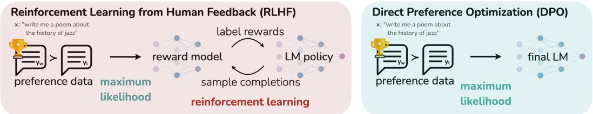
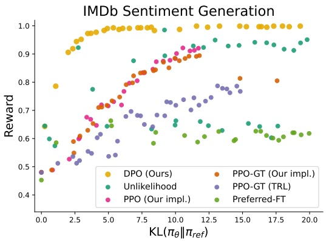
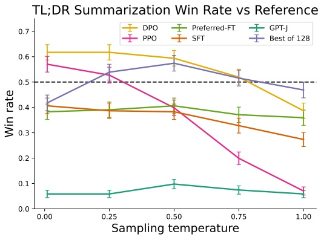
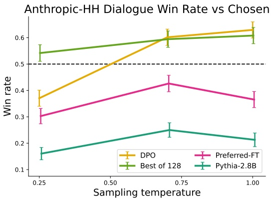
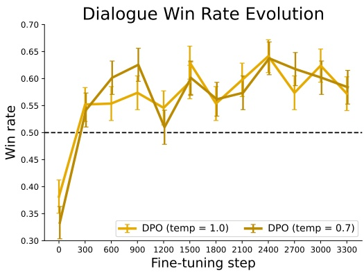
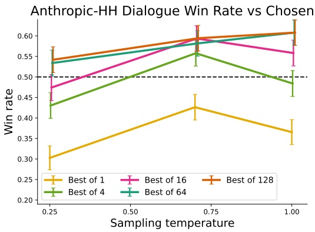
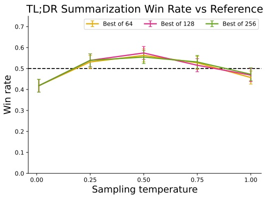

# 说明（阅读前请先看这一段）

本文档是 **DPO**（arXiv:2305.18290v3，Stanford）的中英对照阅读版。英文为你上传的原始 markdown 内容，**图片链接、表格、脚注与代码片段全部原样保留，未删改任何链接**；每个英文段落之后紧跟以 `>` 引用的中文译文。

- **公式已转为 GitHub 数学格式**：块级公式用「三反引号 + math」围栏（见文中 `math` 代码块），行内公式用 GitHub 官方写法 $`...`$（由 `github_markdown` 的转换脚本处理）。原文里公式末尾的 `\tag{N}` 统一改写为 `\qquad(N)`，编号不变、渲染更稳。
- **逐段翻译范围**：摘要、§1–§7 正文、致谢、作者贡献、附录 A.1–A.6 的推导叙述、附录 B/C/D 的说明与图/表标题。
- **未翻译、保留英文的部分**：参考文献列表（书目信息）；附录 B 的 PyTorch 代码（代码块及其上下文被 PDF 分页切断，原文即分片）；附录 C.2 的 GPT-4 提示模板（实验原始输入，保留原文更便于对照复现）；附录 C.3/D.2 的大段样例表格（模型原样输出）。
- **图片**：`images/` 目录共 51 张图片文件（PDF 抽取出的图表与公式切片），其中本文正文实际引用 8 张；把 `images/` 与本文件放在同一目录即可正常显示。
- **OCR 已知瑕疵**：公式由 PDF 抽取而来，含大量多余空格（如 `p ^ {*} (y _ {1}`）；KL 散度处出现 `| |`（应为 `\|`）；附录 B 的代码被分页打散成多段。这些**保留原样**并已在精读笔记里说明。

# DPO：你的语言模型其实是一个奖励模型

<sub>原文 *Direct Preference Optimization: Your Language Model is Secretly a Reward Model*（arXiv:2305.18290v3）</sub>

**Rafael Rafailov**<sup>∗†</sup>

**Archit Sharma**<sup>∗†</sup>

**Eric Mitchell**∗†

**Stefano Ermon**†‡

**Christopher D. Manning**†

**Chelsea Finn**†

†Stanford University ‡CZ Biohub {rafailov,architsh,eric.mitchell}@cs.stanford.edu

## 摘要 / Abstract

While large-scale unsupervised language models (LMs) learn broad world knowledge and some reasoning skills, achieving precise control of their behavior is difficult due to the completely unsupervised nature of their training. Existing methods for gaining such steerability collect human labels of the relative quality of model generations and fine-tune the unsupervised LM to align with these preferences, often with reinforcement learning from human feedback (RLHF). However, RLHF is a complex and often unstable procedure, first fitting a reward model that reflects the human preferences, and then fine-tuning the large unsupervised LM using reinforcement learning to maximize this estimated reward without drifting too far from the original model. In this paper we introduce a new parameterization of the reward model in RLHF that enables extraction of the corresponding optimal policy in closed form, allowing us to solve the standard RLHF problem with only a simple classification loss. The resulting algorithm, which we call Direct Preference Optimization (DPO), is stable, performant, and computationally lightweight, eliminating the need for sampling from the LM during fine-tuning or performing significant hyperparameter tuning. Our experiments show that DPO can fine-tune LMs to align with human preferences as well as or better than existing methods. Notably, fine-tuning with DPO exceeds PPO-based RLHF in ability to control sentiment of generations, and matches or improves response quality in summarization and single-turn dialogue while being substantially simpler to implement and train.

> 大规模无监督语言模型（LM）虽然学到了广博的世界知识和一定的推理能力，但由于其训练过程完全无监督，想要**精确控制它们的行为**仍然困难。现有做法是收集人类对模型生成结果相对质量的标注，再用**人类反馈强化学习（RLHF）**微调无监督 LM，使其与这些偏好对齐。然而 RLHF 是一套复杂且常不稳定的流程：先拟合一个反映人类偏好的奖励模型，再用强化学习微调那个大 LM，让它在不偏离原始模型太远的前提下最大化这个估计出来的奖励。本文引入 RLHF 中奖励模型的一种**新参数化**，它能把对应的最优策略**以闭式（closed form）解出**，从而只需一个简单的分类损失就能求解标准 RLHF 问题。由此得到的算法我们称为 **Direct Preference Optimization（DPO，直接偏好优化）**：它稳定、有效、算力开销轻，微调时**既不需要从 LM 采样，也不需要大量调超参数**。实验表明，DPO 能让 LM 与人类偏好对齐到与现有方法相当甚至更好的水平。值得注意的是：在控制生成情感倾向上，DPO 的微调效果**超过**基于 PPO 的 RLHF；在摘要和单轮对话上，其回答质量与现有方法相当或更好，而实现与训练却简单得多。

## 1. 引言 / Introduction

Large unsupervised language models (LMs) trained on very large datasets acquire surprising capabilities [11, 7, 42, 8]. However, these models are trained on data generated by humans with a wide variety of goals, priorities, and skillsets. Some of these goals and skillsets may not be desirable to imitate; for example, while we may want our AI coding assistant to understand common programming mistakes in order to correct them, nevertheless, when generating code, we would like to bias our model toward the (potentially rare) high-quality coding ability present in its training data. Similarly, we might want our language model to be aware of a common misconception believed by 50% of people, but we certainly do not want the model to claim this misconception to be true in 50% of queries about it! In other words, selecting the model’s desired responses and behavior from its very wide knowledge and abilities is crucial to building AI systems that are safe, performant, and controllable [28]. While existing methods typically steer LMs to match human preferences using reinforcement learning (RL), we will show that the RL-based objective used by existing methods can be optimized exactly with a simple binary cross-entropy objective, greatly simplifying the preference learning pipeline.

> 在超大数据集上训练的大规模无监督语言模型（LM）获得了令人意外的能力[11, 7, 42, 8]。但这些模型的训练数据出自**目标、优先级与技能水平各不相同**的人类之手，其中有些目标和技能并不值得模仿。举例来说：我们希望 AI 编程助手**理解**常见编程错误以便纠正，但在它**生成代码**时，我们希望模型偏向训练数据中那份（可能很稀少的）高质量编程能力；同样，我们希望模型**知道**某个 50% 的人都相信的常见误解，但绝不愿它在被问到该误解时**有一半概率声称它是真的**。换句话说，**从模型广博的知识与能力中筛选出我们期望的回答与行为**，是构建安全、可靠、可控 AI 系统的关键[28]。现有方法大多用强化学习（RL）把 LM 导向人类偏好；而本文要说明的是：**现有方法所用的基于 RL 的目标，其实可以用一个简单的二元交叉熵目标精确优化**，从而大幅简化整套偏好学习流程。

<small><span class="docvortex-page-footnote" data-block-type="page_footnote" style="color:#6b7280"><sup>∗</sup>Equal contribution; more junior authors listed earlier.</span></small>

<small><span class="docvortex-page-footnote" data-block-type="page_footnote" style="color:#6b7280">37th Conference on Neural Information Processing Systems (NeurIPS 2023).</span></small>



Figure 1: DPO optimizes for human preferences while avoiding reinforcement learning. Existing methods for fine-tuning language models with human feedback first fit a reward model to a dataset of prompts and human preferences over pairs of responses, and then use RL to find a policy that maximizes the learned reward. In contrast, DPO directly optimizes for the policy best satisfying the preferences with a simple classification objective, fitting an implicit reward model whose corresponding optimal policy can be extracted in closed form.

> 图 1：DPO 在优化人类偏好的同时**绕开了强化学习**。现有的语言模型人类反馈微调方法，先在“提示 + 人类对成对回答的偏好”数据集上拟合一个奖励模型，再用 RL 找出一个最大化该奖励的策略。相比之下，DPO 用简单的分类目标**直接**优化出最能满足这些偏好的策略——它拟合的是一个**隐式**奖励模型，而该隐式奖励对应的最优策略可以闭式解出。

At a high level, existing methods instill the desired behaviors into a language model using curated sets of human preferences representing the types of behaviors that humans find safe and helpful. This preference learning stage occurs after an initial stage of large-scale unsupervised pre-training on a large text dataset. While the most straightforward approach to preference learning is supervised fine-tuning on human demonstrations of high quality responses, the most successful class of methods is reinforcement learning from human (or AI) feedback (RLHF/RLAIF; [12, 2]). RLHF methods fit a reward model to a dataset of human preferences and then use RL to optimize a language model policy to produce responses assigned high reward without drifting excessively far from the original model. While RLHF produces models with impressive conversational and coding abilities, the RLHF pipeline is considerably more complex than supervised learning, involving training multiple LMs and sampling from the LM policy in the loop of training, incurring significant computational costs.

> 宏观地说，现有方法用一套精心收集的人类偏好（代表人类认为安全、有帮助的行为类型）把期望行为灌输进语言模型。这个偏好学习阶段发生在大规模无监督预训练之后。最直白的偏好学习方式是**对高质量人类示范做监督微调**；但最成功的一类方法是**人类（或 AI）反馈强化学习（RLHF / RLAIF；[12, 2]）**：先用人偏好数据集拟合奖励模型，再用 RL 优化语言模型策略，使其产出高奖励回答同时不明显偏离原始模型。RLHF 能造出对话与编码能力惊人的模型，但它的流程远比监督学习复杂——要**同时训练多个 LM，并在训练循环内从 LM 策略采样**，算力开销极大。

In this paper, we show how to directly optimize a language model to adhere to human preferences, without explicit reward modeling or reinforcement learning. We propose Direct Preference Optimization (DPO), an algorithm that implicitly optimizes the same objective as existing RLHF algorithms (reward maximization with a KL-divergence constraint) but is simple to implement and straightforward to train. Intuitively, the DPO update increases the relative log probability of preferred to dispreferred responses, but it incorporates a dynamic, per-example importance weight that prevents the model degeneration that we find occurs with a naive probability ratio objective. Like existing algorithms, DPO relies on a theoretical preference model (such as the Bradley-Terry model; [5]) that measures how well a given reward function aligns with empirical preference data. However, while existing methods use the preference model to define a preference loss to train a reward model and then train a policy that optimizes the learned reward model, DPO uses a change of variables to define the preference loss as a function of the policy directly. Given a dataset of human preferences over model responses, DPO can therefore optimize a policy using a simple binary cross entropy objective, producing the optimal policy to an implicit reward function fit to the preference data.

> 本文展示如何**直接优化语言模型以符合人类偏好**，既不做显式奖励建模，也不做强化学习。我们提出 **DPO（Direct Preference Optimization）**：它在**隐式地**优化与现有 RLHF 算法相同的目标（带 KL 散度约束的奖励最大化），但实现简单、训练好上手。直观上，DPO 的更新会提高偏好回答相对非偏好回答的对数概率比，但它引入了一个**动态的、逐样本的重要性权重**——正是这个权重避免了“朴素概率比目标”会带来的模型退化（我们在实验中观察到了这种退化）。与现有算法一样，DPO 也依赖一个理论偏好模型（如 Bradley-Terry 模型；[5]）来衡量某个奖励函数与经验偏好数据的吻合程度。区别在于：现有方法用该偏好模型定义偏好损失来**训练奖励模型**，再训练一个策略去优化那个学到的奖励；而 DPO 做**变量替换**，把偏好损失直接写成**策略的函数**。于是，给定人类对模型回答的偏好数据集，DPO 只需一个二元交叉熵目标就能优化策略，得到的正是“拟合该偏好数据的隐式奖励函数所对应的最优策略”。

Our main contribution is Direct Preference Optimization (DPO), a simple RL-free algorithm for training language models from preferences. Our experiments show that DPO is at least as effective as existing methods, including PPO-based RLHF, for learning from preferences in tasks such as sentiment modulation, summarization, and dialogue, using language models with up to 6B parameters.

> 我们的主要贡献是 DPO——一个**无需 RL**、从偏好训练语言模型的简单算法。实验表明，在情感调节、摘要、对话等任务上，用最大 6B 参数的模型时，DPO 从偏好中学习的效果**至少不逊于**现有方法（包括基于 PPO 的 RLHF）。

## 2. 相关工作 / Related Work

Self-supervised language models of increasing scale learn to complete some tasks zero-shot [33] or with few-shot prompts [6, 27, 11]. However, their performance on downstream tasks and alignment with user intent can be significantly improved by fine-tuning on datasets of instructions and humanwritten completions [25, 38, 13, 41]. This ‘instruction-tuning’ procedure enables LLMs to generalize to instructions outside of the instruction-tuning set and generally increase their usability [13]. Despite the success of instruction tuning, relative human judgments of response quality are often easier to collect than expert demonstrations, and thus subsequent works have fine-tuned LLMs with datasets of human preferences, improving proficiency in translation [20], summarization [40, 51], story-telling [51], and instruction-following [28, 34]. These methods first optimize a neural network reward function for compatibility with the dataset of preferences under a preference model such as the

> 规模不断增长的自监督语言模型能零样本[33]或通过少样本提示[6, 27, 11]完成某些任务。但它们在具体下游任务上的表现与对用户意图的契合度，可以通过在“指令 + 人类撰写完成”的数据集上微调而显著改善[25, 38, 13, 41]。这套“指令微调”流程让 LLM 能泛化到指令集之外，并普遍提升可用性[13]。尽管指令微调很成功，但**收集“人类对回答质量的相对判断”往往比收集专家示范更容易**，因此后续工作改用人类偏好数据集微调 LLM，在翻译[20]、摘要[40, 51]、讲故事[51]、指令跟随[28, 34]等任务上提升了表现。这些方法首先在某个偏好模型（例如

Bradley-Terry model [5], then fine-tune a language model to maximize the given reward using reinforcement learning algorithms, commonly REINFORCE [47], proximal policy optimization (PPO; [39]), or variants [34]. A closely-related line of work leverages LLMs fine-tuned for instruction following with human feedback to generate additional synthetic preference data for targeted attributes such as safety or harmlessness [2], using only weak supervision from humans in the form of a text rubric for the LLM’s annotations. These methods represent a convergence of two bodies of work: one body of work on training language models with reinforcement learning for a variety of objectives [35, 29, 48] and another body of work on general methods for learning from human preferences [12, 21]. Despite the appeal of using relative human preferences, fine-tuning large language models with reinforcement learning remains a major practical challenge; this work provides a theoretically-justified approach to optimizing relative preferences without RL.

> Bradley-Terry 模型[5]）下，优化一个神经网络奖励函数使其与偏好数据相容；随后用强化学习算法（常见的是 REINFORCE[47]、近端策略优化 PPO[39] 及其变体[34]）微调语言模型去最大化该奖励。与此密切相关的一条线是：用经过人类反馈的指令微调 LLM 去**合成**针对特定属性（如安全性、无害性）的额外偏好数据[2]，人类只提供弱监督（以文本评分标准的形式）来指导 LLM 的标注。这些方法实际上是两支工作的汇流：一支是用强化学习训练语言模型完成各种目标[35, 29, 48]，另一支是从人类偏好中学习的一般方法[12, 21]。尽管相对人类偏好很有吸引力，用强化学习微调大语言模型在实践中仍是重大难题；本文提供了一个**理论上站得住脚、且不需要 RL 的相对偏好优化途径**。

Outside of the context of language, learning policies from preferences has been studied in both bandit and reinforcement learning settings, and several approaches have been proposed. Contextual bandit learning using preferences or rankings of actions, rather than rewards, is known as a contextual dueling bandit (CDB; [50, 14]). In the absence of absolute rewards, theoretical analysis of CDBs substitutes the notion of an optimal policy with a von Neumann winner, a policy whose expected win rate against any other policy is at least 50% [14]. However, in the CDB setting, preference labels are given online, while in learning from human preferences, we typically learn from a fixed batch of offline preference-annotated action pairs [49]. Similarly, preference-based RL (PbRL) learns from binary preferences generated by an unknown ‘scoring’ function rather than rewards [9, 37]. Various algorithms for PbRL exist, including methods that can reuse off-policy preference data, but generally involve first explicitly estimating the latent scoring function (i.e. the reward model) and subsequently optimizing it [16, 9, 12, 36, 21]. We instead present a single stage policy learning approach that directly optimizes a policy to satisfy preferences.

> 在语言之外的领域，从偏好中学习策略在 bandit 与强化学习两种设定下都有研究，并提出了若干方法。用**动作之间的偏好或排序**（而非奖励）做上下文 bandit 学习，称为 contextual dueling bandit（CDB；[50, 14]）。在缺乏绝对奖励时，CDB 的理论分析用 **von Neumann winner** 替代“最优策略”的概念——即对任意其他策略的期望胜率都不低于 50% 的策略[14]。但 CDB 设定中偏好标签是**在线**给出的；而从人类偏好学习时，我们通常只有**固定的一批离线偏好动作对**[49]。类似地，基于偏好的 RL（PbRL）从由某个未知“打分”函数生成的二元偏好中学习[9, 37]；PbRL 已有多种算法，包括可复用 off-policy 偏好数据的方法，但一般都要**先显式估计隐打分函数（即奖励模型），再对其优化**[16, 9, 12, 36, 21]。本文则给出**单阶段策略学习**方法，直接优化策略去满足偏好。

## 3. 预备知识 / Preliminaries

We review the RLHF pipeline in Ziegler et al. (and later [40, 1, 28]). It usually includes three phases: 1) supervised fine-tuning (SFT); 2) preference sampling and reward learning and 3) RL optimization.

> 我们回顾 Ziegler 等人（以及后续[40, 1, 28]）的 RLHF 流程，它通常包含三个阶段：1）监督微调（SFT）；2）偏好采样与奖励学习；3）RL 优化。

**SFT**: RLHF typically begins by fine-tuning a pre-trained LM with supervised learning on high-quality data for the downstream task(s) of interest (dialogue, summarization, etc.), to obtain a model $`\pi^{\mathrm{SFT}}`$

> **SFT**：RLHF 通常先对预训练 LM 做监督学习微调，用目标下游任务（对话、摘要等）上的高质量数据，得到模型 $`\pi^{\mathrm{SFT}}`$。

**Reward Modelling Phase**: In the second phase the SFT model is prompted with prompts x to produce pairs of answers $`(y_{1},y_{2})\sim \pi^{\mathrm{SFT}}(y|x)`$ These are then presented to human labelers who express preferences for one answer, denoted as $`y_{w}\succ y_{l}\mid x`$ where $`y_{w}`$ and y<sub>l</sub> denotes the preferred and dispreferred completion amongst $`(y_{1},y_{2})`$ respectively. The preferences are assumed to be generated by some latent reward model $`r^* (y,x)`$ , which we do not have access to. There are a number of approaches used to model preferences, the Bradley-Terry (BT) [5] model being a popular choice (although more general Plackett-Luce ranking models [32, 23] are also compatible with the framework if we have access to several ranked answers). The BT model stipulates that the human preference distribution $`p^{*}`$ can be written as:

> **奖励建模阶段**：第二阶段用提示 $`x`$ 让 SFT 模型生成成对回答 $`(y_1,y_2)\sim\pi^{\mathrm{SFT}}(y\mid x)`$，交给人类标注者表达偏好，记作 $`y_w \succ y_l \mid x`$，其中 $`y_w`$ 与 $`y_l`$ 分别是 $`(y_1,y_2)`$ 中被偏好与非偏好的完成。偏好被假定由某个**潜在奖励模型** $`r^*(y,x)`$ 生成，而我们无法访问它。建模偏好的方法有若干种，其中 Bradley-Terry（BT）[5] 模型最常用（更一般的 Plackett-Luce 排序模型[32, 23]在能拿到多个排序答案时同样兼容本框架）。BT 模型规定人类偏好分布 $`p^*`$ 可写成：

```math
p ^ {*} (y _ {1} \succ y _ {2} \mid x) = \frac {\exp \left(r ^ {*} (x , y _ {1})\right)}{\exp \left(r ^ {*} (x , y _ {1})\right) + \exp \left(r ^ {*} (x , y _ {2})\right)}.\qquad(1)
```

Assuming access to a static dataset of comparisons $`\mathcal{D} = \left\{x^{(i)},y_w^{(i)},y_l^{(i)}\right\}_{i = 1}^N`$ sampled from $`p^{*}`$ , we can parametrize a reward model $`r_{\phi}(x,y)`$ and estimate the parameters via maximum likelihood. Framing the problem as a binary classification we have the negative log-likelihood loss:

> 假设可访问从 $`p^*`$ 采样得到的静态比较数据集 $`\mathcal{D}=\{x^{(i)},y_w^{(i)},y_l^{(i)}\}_{i=1}^{N}`$，我们可以参数化一个奖励模型 $`r_{\phi}(x,y)`$ 并用最大似然估计其参数。把问题表述为二分类，就有如下负对数似然损失：

```math
\mathcal {L} _ {R} (r _ {\phi}, \mathcal {D}) = - \mathbb {E} _ {(x, y _ {w}, y _ {l}) \sim \mathcal {D}} \big [ \log \sigma (r _ {\phi} (x, y _ {w}) - r _ {\phi} (x, y _ {l})) \big ]\qquad(2)
```

where $`\sigma`$ is the logistic function. In the context of LMs, the network $`r_{\phi}(x,y)`$ is often initialized from the SFT model $`\pi^{\mathrm{SFT}}(y \mid x)`$ with the addition of a linear layer on top of the final transformer layer that produces a single scalar prediction for the reward value [51]. To ensure a reward function with lower variance, prior works normalize the rewards, such that $`\mathbb{E}_{x,y\sim \mathcal{D}}[r_{\phi}(x,y)] = 0`$ for all x.

> 其中 $`\sigma`$ 是 logistic 函数。在语言模型语境下，网络 $`r_{\phi}(x,y)`$ 常从 SFT 模型 $`\pi^{\mathrm{SFT}}(y\mid x)`$ 初始化，并在最后一个 Transformer 层之上加一个线性层来输出单个标量奖励[51]。为了让奖励函数方差更小，前人会把奖励归一化，使对所有 $`x`$ 都有 $`\mathbb{E}_{x,y\sim\mathcal{D}}[r_{\phi}(x,y)]=0`$。

**RL Fine-Tuning Phase**: During the RL phase, the learned reward function is used to provide feedback to the language model. Following prior works [17, 18], the optimization is formulated as

> **RL 微调阶段**：在 RL 阶段，学到的奖励函数用于给语言模型提供反馈。沿用前人的做法[17, 18]，优化目标写为

```math
\max _ {\pi_ {\theta}} \mathbb {E} _ {x \sim \mathcal {D}, y \sim \pi_ {\theta} (y | x)} \big [ r _ {\phi} (x, y) \big ] - \beta \mathbb {D} _ {\mathrm{KL}} \big [ \pi_ {\theta} (y \mid x) | | \pi_ {\mathrm{ref}} (y \mid x) \big ],\qquad(3)
```

where β is a parameter controlling the deviation from the base reference policy $`\pi_{\mathrm{ref}}`$ , namely the initial SFT model $`\pi^{\mathrm{SFT}}`$ . In practice, the language model policy π<sub>θ</sub> is also initialized to $`\pi^{\mathrm{SFT}}`$ . The added constraint is important, as it prevents the model from deviating too far from the distribution on which the reward model is accurate, as well as maintaining the generation diversity and preventing mode-collapse to single high-reward answers. Due to the discrete nature of language generation, this objective is not differentiable and is typically optimized with reinforcement learning. The standard approach [51, 40, 1, 28] has been to construct the reward function $`r(x,y) = r_{\phi}(x,y) - \beta (\log \pi_{\theta}(y\mid x) - \log \pi_{\mathrm{ref}}(y\mid x))`$ , and maximize using PPO [39].

> 其中 $`\beta`$ 控制偏离基础参考策略 $`\pi_{\mathrm{ref}}`$（即初始的 SFT 模型 $`\pi^{\mathrm{SFT}}`$）的程度。实践中语言模型策略 $`\pi_{\theta}`$ 也初始化为 $`\pi^{\mathrm{SFT}}`$。这个额外约束很重要：它既防止模型偏离到奖励模型不再准确的分布区域，也维持生成的多样性、避免模型坍缩（mode collapse）到某个高奖励的单一回答。由于语言生成是离散的，该目标不可微，通常用强化学习优化。标准做法[51, 40, 1, 28]是构造 $`r(x,y)=r_{\phi}(x,y)-\beta(\log\pi_{\theta}(y\mid x)-\log\pi_{\mathrm{ref}}(y\mid x))`$，再用 PPO[39] 最大化。

## 4. 直接偏好优化 / Direct Preference Optimization

Motivated by the challenges of applying reinforcement learning algorithms on large-scale problems such as fine-tuning language models, our goal is to derive a simple approach for policy optimization using preferences directly. Unlike prior RLHF methods, which learn a reward and then optimize it via RL , our approach leverages a particular choice of reward model parameterization that enables extraction of its optimal policy in closed form, without an RL training loop. As we will describe next in detail, our key insight is to leverage an analytical mapping from reward functions to optimal policies, which enables us to transform a loss function over reward functions into a loss function over policies. This change-of-variables approach avoids fitting an explicit, standalone reward model, while still optimizing under existing models of human preferences, such as the Bradley-Terry model. In essence, the policy network represents both the language model and the (implicit) reward.

> 把强化学习算法用于大规模问题（如微调语言模型）存在困难，正是这一困难促使我们寻求一个**直接用偏好做策略优化**的简单方法。与“先学奖励再用 RL 优化”的既有 RLHF 方法不同，本文利用奖励模型的一种特定参数化选择，使最优策略可以**闭式解出**，从而完全不需要 RL 训练循环。下文会详述：我们的关键洞见是利用一个**从奖励函数到最优策略的解析映射**，把“定义在奖励函数上的损失”变换为“定义在策略上的损失”。这种变量替换方法避免了拟合一个显式的独立奖励模型，同时又仍然在现有的人类偏好模型（如 Bradley-Terry）之下做优化。本质上，**策略网络同时代表了语言模型与那个（隐式）奖励**。

**Deriving the DPO objective.** We start with the same RL objective as prior work, Eq. 3, under a general reward function r. Following prior work [31, 30, 19, 15], it is straightforward to show that the optimal solution to the KL-constrained reward maximization objective in Eq. 3 takes the form:

> **推导 DPO 目标。** 我们从与先前工作相同的 RL 目标（式 3）出发，但把奖励函数写作一般形式 $`r`$。沿用前人[31, 30, 19, 15]可知，式 3 这个带 KL 约束的奖励最大化目标，其最优解具有如下形式：

```math
\pi_ {r} (y \mid x) = \frac {1}{Z (x)} \pi_ {\mathrm{ref}} (y \mid x) \exp \left(\frac {1}{\beta} r (x, y)\right),\qquad(4)
```

where $`Z(x) = \sum_{y}\pi_{\mathrm{ref}}(y\mid x)\exp \left(\frac{1}{\beta} r(x,y)\right)`$ is the partition function. See Appendix A.1 for a complete derivation. Even if we use the MLE estimate $`r_{\phi}`$ of the ground-truth reward function $`r^{*}`$ , it is still expensive to estimate the partition function $`Z(x)`$ [19, 15] , which makes this representation hard to utilize in practice. However, we can rearrange Eq. 4 to express the reward function in terms of its corresponding optimal policy $`\pi_r`$ , the reference policy $`\pi_{\mathrm{ref}}`$ and the unknown partition function $`Z(\cdot)`$ Specifically, we first take the logarithm of both sides of Eq. 4 and then with some algebra we obtain:

> 其中 $`Z(x)=\sum_{y}\pi_{\mathrm{ref}}(y\mid x)\exp\left(\frac{1}{\beta}r(x,y)\right)`$ 是配分函数（partition function）。完整推导见附录 A.1。即便用真奖励 $`r^*`$ 的极大似然估计 $`r_{\phi}`$，估计配分函数 $`Z(x)`$ 仍然代价高昂[19, 15]，使得这种表达在实践中难以利用。不过我们可以重排式 4，把奖励函数表达为“其对应最优策略 $`\pi_r`$、参考策略 $`\pi_{\mathrm{ref}}`$ 与未知配分函数 $`Z(\cdot)`$”的函数：具体地，先对式 4 两边取对数，再作代数整理即得：

```math
r (x, y) = \beta \log \frac {\pi_ {r} (y \mid x)}{\pi_ {\mathrm{ref}} (y \mid x)} + \beta \log Z (x).\qquad(5)
```

We can apply this reparameterization to the ground-truth reward $`r^{*}`$ and corresponding optimal model $`\pi^{*}`$ . Fortunately, the Bradley-Terry model depends only on the difference of rewards between two completions, i.e., $`p^{*}(y_{1}\succ y_{2}\mid x) = \sigma (r^{*}(x,y_{1}) - r^{*}(x,y_{2}))`$ . Substituting the reparameterization in Eq. 5 for $`r^* (x,y)`$ into the preference model Eq. 1, the partition function cancels, and we can express the human preference probability in terms of only the optimal policy $`\pi^{*}`$ and reference policy $`\pi_{\mathrm{ref}}`$ . Thus, the optimal RLHF policy $`\pi^{*}`$ under the Bradley-Terry model satisfies the preference model:

> 我们可以把这个重参数化应用到真奖励 $`r^*`$ 及其对应的最优模型 $`\pi^*`$。幸运的是，Bradley-Terry 模型只依赖**两个完成之间的奖励差**，即 $`p^*(y_1\succ y_2\mid x)=\sigma(r^*(x,y_1)-r^*(x,y_2))`$。把式 5 的重参数化代入偏好模型式 1 后，**配分函数被约掉**，于是人类偏好概率可以只用最优策略 $`\pi^*`$ 与参考策略 $`\pi_{\mathrm{ref}}`$ 表达。因此，BT 模型下的最优 RLHF 策略 $`\pi^*`$ 满足如下偏好模型：

```math
p ^ {*} (y _ {1} \succ y _ {2} \mid x) = \frac {1}{1 + \exp \left(\beta \log \frac {\pi^ {*} (y _ {2} \mid x)}{\pi_ {\mathrm{ref}} (y _ {2} \mid x)} - \beta \log \frac {\pi^ {*} (y _ {1} \mid x)}{\pi_ {\mathrm{ref}} (y _ {1} \mid x)}\right)}\qquad(6)
```

The derivation is in Appendix A.2. While Eq. 6 uses the Bradley-Terry model, we can similarly derive expressions under the more general Plackett-Luce models [32, 23], shown in Appendix A.3.

> 推导见附录 A.2。式 6 用的是 BT 模型；在更一般的 Plackett-Luce 模型[32, 23]下也能得到类似表达，见附录 A.3。

Now that we have the probability of human preference data in terms of the optimal policy rather than the reward model, we can formulate a maximum likelihood objective for a parametrized policy π<sub>θ</sub>. Analogous to the reward modeling approach (i.e. Eq. 2), our policy objective becomes:

> 既然人类偏好数据的概率已能写成**最优策略**（而非奖励模型）的函数，我们就可以为参数化策略 $`\pi_{\theta}`$ 构造一个最大似然目标。类比奖励建模的做法（即式 2），我们的策略目标成为：

```math
\mathcal {L} _ {\mathrm{DPO}} \left(\pi_ {\theta}; \pi_ {\text {ref}}\right) = - \mathbb {E} _ {\left(x, y _ {w}, y _ {l}\right) \sim \mathcal {D}} \left[ \log \sigma \left(\beta \log \frac {\pi_ {\theta} \left(y _ {w} \mid x\right)}{\pi_ {\text {ref}} \left(y _ {w} \mid x\right)} - \beta \log \frac {\pi_ {\theta} \left(y _ {l} \mid x\right)}{\pi_ {\text {ref}} \left(y _ {l} \mid x\right)}\right) \right].\qquad(7)
```

This way, we fit an implicit reward using an alternative parameterization, whose optimal policy is simply $`\pi_{\theta}`$ . Moreover, since our procedure is equivalent to fitting a reparametrized Bradley-Terry model, it enjoys certain theoretical properties, such as consistencies under suitable assumption of the preference data distribution [4]. In Section 5, we further discuss theoretical properties of DPO in relation to other works.

> 这样一来，我们用另一种参数化去拟合一个**隐式**奖励，而它的最优策略恰好就是 $`\pi_{\theta}`$。此外，由于我们的流程等价于拟合一个重参数化的 Bradley-Terry 模型，它享有若干理论性质，例如在合适的偏好数据分布假设下的一致性[4]。§5 会进一步讨论 DPO 相对其他工作的理论性质。

**What does the DPO update do?** For a mechanistic understanding of DPO, it is useful to analyze the gradient of the loss function $`L_{DPO}`$ . The gradient with respect to the parameters θ can be written as:

> **DPO 的更新到底做了什么？** 为了机制层面地理解 DPO，分析损失 $`L_{\mathrm{DPO}}`$ 的梯度是有用的。对参数 $`\theta`$ 的梯度可写为：

```math
\begin{array}{l} \nabla_ {\theta} \mathcal {L} _ {\mathrm{DPO}} (\pi_ {\theta}; \pi_ {\mathrm{ref}}) = \\ - \beta \mathbb {E} _ {(x, y _ {w}, y _ {l}) \sim \mathcal {D}} \bigg [ \underbrace {\sigma (\hat {r} _ {\theta} (x , y _ {l}) - \hat {r} _ {\theta} (x , y _ {w}))} _ {\text {higher weight when reward estimate is wrong}} \left[ \underbrace {\nabla_ {\theta} \log \pi (y _ {w} \mid x)} _ {\text {increase likelihood of} y _ {w}} - \underbrace {\nabla_ {\theta} \log \pi (y _ {l} \mid x)} _ {\text {decrease likelihood of} y _ {l}} \right] \bigg ], \end{array}
```

where $`\hat{r}_{\theta}(x,y) = \beta \log \frac{\pi_{\theta}(y|x)}{\pi_{\mathrm{ref}}(y|x)}`$ is the reward implicitly defined by the language model $`\pi_{\theta}`$ and reference model $`\pi_{\mathrm{ref}}`$ (more in Section 5). Intuitively, the gradient of the loss function $`L_{DPO}`$ increases the likelihood of the preferred completions $`y_{w}`$ and decreases the likelihood of dispreferred completions $`y_{l}`$ Importantly, the examples are weighed by how much higher the implicit reward model $`\hat{r}_{\theta}`$ rates the dispreferred completions, scaled by β, i.e, how incorrectly the implicit reward model orders the completions, accounting for the strength of the KL constraint. Our experiments suggest the importance of this weighting, as a naïve version of this method without the weighting coefficient can cause the language model to degenerate (Appendix Table 3).

> 其中 $`\hat{r}_{\theta}(x,y)=\beta\log\frac{\pi_{\theta}(y|x)}{\pi_{\mathrm{ref}}(y|x)}`$ 是由语言模型 $`\pi_{\theta}`$ 与参考模型 $`\pi_{\mathrm{ref}}`$ **隐式定义**的奖励（§5 有更多讨论）。直观上，$`L_{\mathrm{DPO}}`$ 的梯度**提高**被偏好完成 $`y_w`$ 的似然、**降低**非偏好完成 $`y_l`$ 的似然。重要的是，**每个样本的权重**取决于“隐式奖励模型把非偏好完成评得比它实际应得的高出多少（按 $`\beta`$ 缩放）”，也就是隐式奖励模型把两个完成排错了多少——同时把 KL 约束的强度计入其中。我们的实验说明这个权重很关键：去掉该权重的朴素版本会让语言模型退化（附录表 3）。

**DPO outline.** The general DPO pipeline is as follows: 1) Sample completions $`y_{1},y_{2}\sim \pi_{\mathrm{ref}}(\cdot \mid x)`$ for every prompt x, label with human preferences to construct the offline dataset of preferences $`\mathcal{D} = \{x^{(i)},y_w^{(i)},y_l)^{(i)}\}_{i = 1}^N`$ 1 and 2) optimize the language model $`\pi_{\theta}`$ to minimize $`L_{DPO}`$ for the given $`\pi_{\mathrm{ref}}`$ and D and desired β. In practice, one would like to reuse preference datasets publicly available, rather than generating samples and gathering human preferences. Since the preference datasets are sampled using $`\pi^{\mathrm{SFT}}`$ , we initialize $`\pi_{\mathrm{ref}} = \pi^{\mathrm{SFT}}`$ whenever available. However, when $`\pi^{\mathrm{SFT}}`$ not available, we initialize $`\pi_{\mathrm{ref}}`$ by maximizing likelihood of preferred completions $`(x,y_{w})`$ , that is, $`\pi_{\mathrm{ref}} = \arg \max_{\pi}\mathbb{E}_{x,y_w\sim \mathcal{D}}[\log \pi (y_w\mid x)]`$ This procedure helps mitigate the distribution shift between the true reference distribution which is unavailable, and $`\pi_{\mathrm{ref}}`$ used by DPO. Further details related to the implementation and hyperparameters can be found in Appendix B.

> **DPO 流程概述。** 一般流程如下：1）对每个提示 $`x`$ 采样完成 $`y_1,y_2\sim\pi_{\mathrm{ref}}(\cdot\mid x)`$，用人类偏好标注，构造离线偏好数据集 $`\mathcal{D}=\{x^{(i)},y_w^{(i)},y_l^{(i)}\}_{i=1}^{N}`$；2）在给定 $`\pi_{\mathrm{ref}}`$、$`\mathcal{D}`$ 与所需 $`\beta`$ 下优化语言模型 $`\pi_{\theta}`$ 以最小化 $`L_{\mathrm{DPO}}`$。实践中人们更愿意**复用公开的偏好数据集**，而不是自己采样再收集人类偏好。由于这些偏好数据集是用 $`\pi^{\mathrm{SFT}}`$ 采样的，凡是有 $`\pi^{\mathrm{SFT}}`$ 时我们就初始化 $`\pi_{\mathrm{ref}}=\pi^{\mathrm{SFT}}`$。当 $`\pi^{\mathrm{SFT}}`$ 不可得时，我们用“最大化偏好完成 $`(x,y_w)`$ 的似然”来初始化 $`\pi_{\mathrm{ref}}`$，即 $`\pi_{\mathrm{ref}}=\arg\max_{\pi}\mathbb{E}_{x,y_w\sim\mathcal{D}}[\log\pi(y_w\mid x)]`$。这样做有助于缓解“真实参考分布（不可得）”与“DPO 实际使用的 $`\pi_{\mathrm{ref}}`$”之间的分布偏移。实现与超参数细节见附录 B。

## 5. DPO 的理论分析 / Theoretical Analysis of DPO

In this section, we give further interpretation of the DPO method, provide theoretical backing, and relate advantages of DPO to issues with actor critic algorithms used for RLHF (such as PPO [39]).

> 本节进一步解释 DPO 方法、给出理论支撑，并把 DPO 的优势与 RLHF 所用 actor-critic 算法（如 PPO[39]）的问题联系起来。

### 5.1 你的语言模型其实是一个奖励模型 / Your Language Model Is Secretly a Reward Model

DPO is able to bypass both fitting an explicit reward and performing RL to learn the policy using a single maximum likelihood objective. Note the optimization objective Eq. 5 is equivalent to a Bradley-Terry model with a reward parameterization $`r^{*}(x,y) = \beta \log \frac{\pi_{\theta}^{*}(y|x)}{\pi_{\mathrm{ref}}(y|x)}`$ and we optimize our parametric model π<sub>θ</sub>, equivalently to the reward model optimization in Eq. 2 under the change of variables. In this section we will build the theory behind this reparameterization, show that it does not constrain the class of learned reward models, and allows for the exact recovery of the optimal policy. We begin with by defining an equivalence relation between reward functions.

> DPO 用**单一的最大似然目标**同时绕开了“拟合显式奖励”与“用 RL 学策略”。注意优化目标式 5 等价于一个带奖励参数化 $`r^*(x,y)=\beta\log\frac{\pi_{\theta}^*(y|x)}{\pi_{\mathrm{ref}}(y|x)}`$ 的 Bradley-Terry 模型；而在变量替换下，我们优化参数化模型 $`\pi_{\theta}`$，等价于式 2 的奖励模型优化。本节将建立这套重参数化背后的理论，说明它**不限制可学到的奖励模型类**，并且能**精确恢复最优策略**。先从奖励函数之间的一个等价关系说起。

**Definition 1.** We say that two reward functions $`r(x,y)`$ and $`r^{\prime}(x,y)`$ are equivalent iff $`r(x,y) - r'(x,y) = f(x)`$ for some function f.

> **定义 1。** 若存在函数 $`f`$ 使 $`r(x,y)-r'(x,y)=f(x)`$，则称两个奖励函数 $`r(x,y)`$ 与 $`r'(x,y)`$ **等价**。

It is easy to see that this is indeed an equivalence relation, which partitions the set of reward functions into classes. We can state the following two lemmas:

> 容易看出这确实是一个等价关系，它把奖励函数集合划分为若干等价类。下面给出两个引理：

**Lemma 1.** Under the Plackett-Luce, and in particular the Bradley-Terry, preference framework, two reward functions from the same class induce the same preference distribution.

> **引理 1。** 在 Plackett-Luce（尤其 Bradley-Terry）偏好框架下，同一等价类中的两个奖励函数诱导**相同的偏好分布**。

**Lemma 2.** Two reward functions from the same equivalence class induce the same optimal policy under the constrained RL problem.

> **引理 2。** 在带约束的 RL 问题下，同一等价类中的两个奖励函数诱导**相同的最优策略**。

The proofs are straightforward and we defer them to Appendix A.5. The first lemma is a well-known under-specification issue with the Plackett-Luce family of models [32]. Due to this under-specification, we usually have to impose additional identifiability constraints to achieve any guarantees on the MLE estimates from Eq. 2 [4]. The second lemma states that all reward functions from the same class yield the same optimal policy, hence for our final objective, we are only interested in recovering an arbitrary reward function from the optimal class. We prove the following Theorem in Appendix A.6:

> 两个证明都很直接，见附录 A.5。第一个引理是 Plackett-Luce 模型族**众所周知的不可辨识性（under-specification）问题**[32]；由于这种不可辨识，我们通常要额外施加可辨识性约束，才能对式 2 的 MLE 估计给出任何保证[4]。第二个引理说明同一类中所有奖励函数给出同一最优策略，因此对最终目标而言，我们只关心**从最优类中恢复出任一个奖励函数**。下面的定理将在附录 A.6 中证明：

**Theorem 1.** Under mild assumptions, all reward classes consistent with the Plackett-Luce (and Bradley-Terry in particular) models can be represented with the reparameterization $`r(x,y) = \beta \log \frac{\pi(y|x)}{\pi_{ref}(y|x)}`$ for some model $`\pi (y\mid x)`$ and a given reference model $`\pi_{ref}(y \mid x)`$

> **定理 1。** 在温和假设下，所有与 Plackett-Luce（尤其 Bradley-Terry）模型相容的奖励类，都可以用重参数化 $`r(x,y)=\beta\log\frac{\pi(y|x)}{\pi_{\mathrm{ref}}(y|x)}`$ 表示，其中 $`\pi(y\mid x)`$ 为某个模型、$`\pi_{\mathrm{ref}}(y\mid x)`$ 为给定参考模型。

Proof Sketch. Consider any reward function $`r(x,y)`$ , which induces a corresponding optimal model $`\pi_r(y \mid x)`$ , specified by Eq. 4. We will show that a reward function from the equivalence class of r can be represented using the reparameterization given above. We define the projection f as

> 证明梗概。考虑任意奖励函数 $`r(x,y)`$，它按式 4 诱导出相应最优模型 $`\pi_r(y\mid x)`$。我们将说明：$`r`$ 的等价类中总有一个奖励函数可以用上述重参数化表示。定义投影 $`f`$ 为：

```math
f (r; \pi_ {\mathrm{ref}}, \beta) (x, y) = r (x, y) - \beta \log \sum_ {y} \pi_ {\mathrm{ref}} (y \mid x) \exp \left(\frac {1}{\beta} r (x, y)\right)\qquad(8)
```

The operator f simply normalizes the reward function with the logarithm of the partition function of $`\pi_{r}`$ . Since the added normalization term is only a function of the prefix $`x, f(r; \pi_{\mathrm{ref}}, \beta)(x, y)`$ is a reward function in the equivalence class of $`r(x,y)`$ . Finally, replacing r with the RHS of Eq. 5 (which holds for any reward function), we have $`f(r;\pi_{\mathrm{ref}},\beta)(x,y) = \beta \log \frac{\pi_r(y|x)}{\pi_{\mathrm{ref}}(y|x)}`$ . That is, the projection f produces a member of the equivalence class of r with the desired form, and we do not lose any generality in our reward model from the proposed reparameterization. □

> 算子 $`f`$ 只是用 $`\pi_r`$ 的配分函数的对数来**归一化**奖励函数。由于新增的归一化项只是前缀 $`x`$ 的函数，$`f(r;\pi_{\mathrm{ref}},\beta)(x,y)`$ 仍是 $`r(x,y)`$ 等价类中的一个奖励函数。最后把 $`r`$ 换成式 5 的右端（该式对任意奖励函数成立），得到 $`f(r;\pi_{\mathrm{ref}},\beta)(x,y)=\beta\log\frac{\pi_r(y|x)}{\pi_{\mathrm{ref}}(y|x)}`$。也就是说，投影 $`f`$ 产出了 $`r`$ 等价类中一个具有所需形式的成员，**我们的奖励模型并未因这一重参数化而损失任何一般性**。□

We can alternatively view Theorem 1 as specifying exactly which reward function within each equivalence class the DPO reparameterization selects, that is, the reward function satisfying:

> 换个角度看，定理 1 精确刻画了 DPO 重参数化在**每个等价类中究竟选中哪个奖励函数**，即满足下式的那个奖励函数：

```math
\sum_ {y} \underbrace {\pi_ {\mathrm{ref}} (y \mid x) \exp \left(\frac {1}{\beta} r (x , y)\right)} _ {= \pi (y \mid x), \text {using Thm. 1 reparam.}} = 1,\qquad(9)
```

i.e., $`\pi(y \mid x)`$ is a valid distribution (probabilities are positive and sum to 1). However, following Eq. 4, we can see that Eq. 9 is the partition function of the optimal policy induced by the reward function $`r(x,y)`$ . The key insight of the DPO algorithm is that we can impose certain constraints on the under-constrained Plackett-Luce (and Bradley-Terry in particular) family of preference models, such that we preserve the class of representable reward models, but explicitly make the optimal policy in Eq. 4 analytically tractable for all prompts x.

> 即 $`\pi(y\mid x)`$ 是一个合法分布（概率非负且求和为 1）。然而按式 4 可见，式 9 恰是“由奖励函数 $`r(x,y)`$ 诱导出的最优策略”的配分函数。DPO 的关键洞见是：我们可以对约束不足的 Plackett-Luce（尤其 Bradley-Terry）偏好模型族**施加特定约束**，使得可表示的奖励模型类保持不变，同时**让式 4 中的最优策略对所有提示 $`x`$ 都解析可解**。

### 5.2 Actor-Critic 算法的不稳定性 / Instability of Actor-Critic Algorithms

We can also use our framework to diagnose instabilities with standard actor-critic algorithms used for the RLHF, such as PPO. We follow the RLHF pipeline and focus on the RL fine-tuning step outlined in Section 3. We can draw connections to the control as inference framework [22] for the constrained RL problem outlined in 3. We assume a parameterized model $`\pi_{\theta}(y \mid x)`$ and minimize DKL $`\left[\pi_{\theta}(y|x)\mid\bar{\pi}^{*}(y\mid x)\right]`$ where $`\pi^{*}`$ is the optimal policy from Eq. 7 induced by the reward function $`r_{\phi}(y,x)`$ . With some algebra this leads to the optimization objective:

> 我们还可以用这个框架来诊断 RLHF 所用标准 actor-critic 算法（如 PPO）的不稳定性。沿用 RLHF 流程，聚焦 §3 的 RL 微调一步；可以把 §3 的约束 RL 问题与控制即推断（control as inference）框架[22]联系起来。设参数化模型 $`\pi_{\theta}(y\mid x)`$，最小化 $`D_{\mathrm{KL}}\!\left[\pi_{\theta}(y|x)\,\|\,\pi^*(y\mid x)\right]`$，其中 $`\pi^*`$ 是式 7 给出的、由奖励 $`r_{\phi}(y,x)`$ 诱导的最优策略。经代数整理可得优化目标：

```math
\max _ {\pi_ {\theta}} \mathbb {E} _ {\pi_ {\theta} (y | x)} \Big [ \underbrace {r _ {\phi} (x , y) - \beta \log \sum_ {y} \pi_ {\mathrm{ref}} (y \mid x) \exp \left(\frac {1}{\beta} r _ {\phi} (x , y)\right)} _ {f (r _ {\phi}, \pi_ {\mathrm{ref}}, \beta)} - \underbrace {\beta \log \frac {\pi_ {\theta} (y \mid x)}{\pi_ {\mathrm{ref}} (y \mid x)}} _ {\mathrm{KL}} \Big ]\qquad(10)
```

This is the same objective optimized in prior works [51, 40, 1, 28] using the DPO-equivalent reward for the reward class of $`r_{\phi}`$ . In this setting, we can interpret the normalization term in $`f(r_{\phi},\pi_{\mathrm{ref}},\beta)`$ as the soft value function of the reference policy $`\pi_{\mathrm{ref}}`$ While this term does not affect the optimal solution, without it, the policy gradient of the objective could have high variance, making learning unstable. We can accommodate for the normalization term using a learned value function, but that can also be difficult to optimize. Alternatively, prior works have normalized rewards using a human completion baseline, essentially a single sample Monte-Carlo estimate of the normalizing term. In contrast the DPO reparameterization yields a reward function that does not require any baselines.

> 这正是前人[51, 40, 1, 28]在 $`r_{\phi}`$ 所在奖励类上、使用 DPO 等价奖励时所优化的同一个目标。在这一视角下，$`f(r_{\phi},\pi_{\mathrm{ref}},\beta)`$ 中的归一化项可解释为参考策略 $`\pi_{\mathrm{ref}}`$ 的**软价值函数（soft value function）**。该项虽不影响最优解，但没有它时目标函数的策略梯度可能方差很大、导致训练不稳定。我们可以用一个学出来的价值函数来容纳这一项，但它本身也不好优化；前人的替代做法是用人类完成做基线来归一化奖励，本质上是归一化项的**单样本蒙特卡洛估计**。相比之下，DPO 的重参数化给出的奖励函数**不需要任何基线**。





Figure 2: Left. The frontier of expected reward vs KL to the reference policy. DPO provides the highest expected reward for all KL values, demonstrating the quality of the optimization. Right. TL;DR summarization win rates vs. human-written summaries, using GPT-4 as evaluator. DPO exceeds PPO’s best-case performance on summarization, while being more robust to changes in the sampling temperature.

> 图 2：**左**：期望奖励对“与参考策略的 KL”的前沿曲线。DPO 在所有 KL 取值下都给出最高的期望奖励，说明优化质量最好。**右**：TL;DR 摘要任务中“对人工撰写摘要的胜率”，用 GPT-4 作评估器。DPO 超过了 PPO 在摘要上的最佳表现，同时对采样温度的变化更稳健。

## 6. 实验 / Experiments

In this section, we empirically evaluate DPO’s ability to train policies directly from preferences. First, in a well-controlled text-generation setting, we ask: how efficiently does DPO trade off maximizing reward and minimizing KL-divergence with the reference policy, compared to common preference learning algorithms such as PPO? Next, we evaluate DPO’s performance on larger models and more difficult RLHF tasks, including summarization and dialogue. We find that with almost no tuning of hyperparameters, DPO tends to perform as well or better than strong baselines like RLHF with PPO as well as returning the best of N sampled trajectories under a learned reward function. Before presenting these results, we describe the experimental set-up; additional details are in Appendix C.

> 本节实证评估 DPO 直接从偏好训练策略的能力。先在一个**控制良好**的文本生成设定里提问：与 PPO 等常见偏好学习算法相比，DPO 在“最大化奖励”与“最小化与参考策略的 KL”之间的权衡效率如何？接着在更大模型、更难任务（摘要与对话）上评估 DPO。我们发现：几乎不调超参数，DPO 的表现就与 PPO 版 RLHF 等强基线相当或更好，也与“学到奖励函数后取 N 个采样中最优（Best of N）”相当。下面先描述实验设置，更多细节见附录 C。

**Tasks.** Our experiments explore three different open-ended text generation tasks. For all experiments, algorithms learn a policy from a dataset of preferences $`\mathcal{D} = \left\{x^{(i)},y_w^{(i)},y_l^{(i)}\right\}_{i = 1}^N`$ In **controlled sentiment generation**, x is a prefix of a movie review from the IMDb dataset [24], and the policy must generate y with positive sentiment. In order to perform a controlled evaluation, for this experiment we generate preference pairs over generations using a pre-trained sentiment classifier, where p(positive $`x,y_{w}) > p(\text{positive} \mid x,y_{l})`$ . For SFT, we fine-tune GPT-2-large until convergence on reviews from the train split of the IMDB dataset (further details in App C.1). In **summarization**, x is a forum post from Reddit; the policy must generate a summary y of the main points in the post. Following prior work, we use the Reddit TL;DR summarization dataset [43] along with human preferences gathered by Stiennon et al.. We use an SFT model fine-tuned on human-written forum post summaries<sup>2</sup> with the TRLX [44] framework for RLHF. The human preference dataset was gathered by Stiennon et al. on samples from a different, but similarly-trained, SFT model. Finally, in **single-turn dialogue**, x is a human query, which may be anything from a question about astrophysics to a request for relationship advice. A policy must produce an engaging and helpful response y to a user’s query; we use the Anthropic Helpful and Harmless dialogue dataset [1], containing 170k dialogues between a human and an automated assistant. Each transcript ends with a pair of responses generated by a large (although unknown) language model along with a preference label denoting the human-preferred response. In this setting, no pre-trained SFT model is available; we therefore fine-tune an off-the-shelf language model on only the preferred completions to form the SFT model.

> **任务。** 实验覆盖三个开放式文本生成任务，算法都从偏好数据集 $`\mathcal{D}=\{x^{(i)},y_w^{(i)},y_l^{(i)}\}_{i=1}^{N}`$ 学策略。**受控情感生成**：$`x`$ 是 IMDb 数据集[24]影评的前缀，策略必须生成**正面情感**的 $`y`$；为了可控制的评估，本实验用预训练情感分类器生成偏好对，满足 $`p(\text{positive}\mid x,y_w)>p(\text{positive}\mid x,y_l)`$。SFT 用 GPT-2-large 在 IMDB 训练集影评上微调至收敛（细节见附录 C.1）。**摘要**：$`x`$ 是 Reddit 论坛帖，策略要生成概括要点的摘要 $`y`$；沿用前人，用 Reddit TL;DR 数据集[43]以及 Stiennon 等人收集的人类偏好；SFT 模型是在人工撰写的论坛帖摘要上微调的，RLHF 使用 TRLX 框架[44]。人类偏好数据集由 Stiennon 等人在**另一个训练方式相似**的 SFT 模型采样上收集。**单轮对话**：$`x`$ 是人类提问（从天体物理问题到感情建议都有可能），策略要给出有吸引力且有帮助的回答 $`y`$；我们用 Anthropic Helpful and Harmless 对话数据集[1]，含 17 万条人机对话，每条对话以“某个（未知规模的）大语言模型生成的成对回答 + 人类偏好标签”结束。此设定下没有现成的 SFT 模型，我们因此在**只用被偏好完成**上微调一个现成语言模型来得到 SFT 模型。

**Evaluation.** Our experiments use two different approaches to evaluation. In order to analyze the effectiveness of each algorithm in optimizing the constrained reward maximization objective, in the controlled sentiment generation setting we evaluate each algorithm by its frontier of achieved reward and KL-divergence from the reference policy; this frontier is computable because we have acccess to the ground-truth reward function (a sentiment classifier). However, in the real world, the ground truth reward function is not known; therefore, we evaluate algorithms with their win rate against a baseline policy, using GPT-4 as a proxy for human evaluation of summary quality and response helpfulness in the summarization and single-turn dialogue settings, respectively. For summarization, we use reference summaries in the test set as the baseline; for dialogue, we use the preferred response in the test dataset as the baseline. While existing studies suggest LMs can be better automated evaluators than existing metrics [10], we conduct a human study to justify our usage of GPT-4 for evaluation in Sec. 6.4. We find GPT-4 judgments correlate strongly with humans, with human agreement with GPT-4 typically similar or higher than inter-human annotator agreement.

> **评估。** 采用两种评估方式。为了分析各算法优化“带约束奖励最大化”目标的效率，在受控情感生成设定中我们用“达成奖励 vs 与参考策略的 KL”的前沿来评估——该前沿可算，因为我们能访问真奖励（情感分类器）。但现实中真奖励未知，因此改用**对基线的胜率**：在摘要与单轮对话设定中，用 GPT-4 作为人类评估的代理，分别评“摘要质量”与“回答有帮助程度”。摘要的基线是测试集里的人工参考摘要；对话的基线是测试数据集中被偏好的回答。已有研究指出 LM 可比现有指标更好地做自动评估[10]，但我们仍在 §6.4 做了人类研究来为“使用 GPT-4 评估”背书。我们发现 GPT-4 判断与人类**强相关**：人类与 GPT-4 的一致率通常与人类标注者之间的一致率相当甚至更高。

<small><span class="docvortex-page-footnote" data-block-type="page_footnote" style="color:#6b7280"><sup>2</sup>[https://huggingface.co/CarperAI/openai\_summarize\_tldr\_sft](https://huggingface.co/CarperAI/openai_summarize_tldr_sft)</span></small>





Figure 3: Left. Win rates computed by GPT-4 for Anthropic-HH one-step dialogue; DPO is the only method that improves over chosen summaries in the Anthropic-HH test set. Right. Win rates for different sampling temperatures over the course of training. DPO’s improvement over the dataset labels is fairly stable over the course of training for different sampling temperatures.

> 图 3：**左**：Anthropic-HH 单步对话上由 GPT-4 计算的胜率；DPO 是唯一在 Anthropic-HH 测试集上超过“被偏好摘要/回答”的方法。**右**：训练过程中不同采样温度下的胜率。DPO 相对数据集标签的提升在不同采样温度下、在整个训练过程中都相当稳定。

**Methods.** In addition to DPO, we evaluate several existing approaches to training language models to adhere to human preferences. Most simply, we explore zero-shot prompting with **GPT-J** [45] in the summarization task and 2-shot prompting with **Pythia-2.8B** [3] in the dialogue task. In addition, we evaluate the **SFT** model as well as **Preferred-FT**, which is a model fine-tuned with supervised learning on the chosen completion $`y_{w}`$ from either the SFT model (in controlled sentiment and summarization) or a generic LM (in single-turn dialogue). Another pseudo-supervised method is **Unlikelihood** [46], which simply optimizes the policy to maximize the probability assigned to $`y_{w}`$ and minimize the probability assigned to $`y_{l};`$ we use an optional coefficient $`\alpha \in [0,1]`$ on the ‘unlikelihood term. We also consider **PPO** [39] using a reward function learned from the preference data and **PPO-GT**, which is an oracle that learns from the ground truth reward function available in the controlled sentiment setting. In our sentiment experiments, we use two implementations of PPO-GT, one of-the-shelf version [44] as well as a modified version that normalizes rewards and further tunes hyperparameters to improve performance (we also use these modifications when running ‘normal’ PPO with learned rewards). Finally, we consider the **Best of** N baseline, sampling N responses from the SFT model (or Preferred-FT in dialogue) and returning the highest-scoring response according to a reward function learned from the preference dataset. This high-performing method decouples the quality of the reward model from the PPO optimization, but is computationally impractical even for moderate N as it requires sampling N completions for every query at test time.

> **对比方法。** 除 DPO 外，我们评估若干现有做法。最简单的是：摘要任务用 **GPT-J**[45] 零样本提示，对话任务用 **Pythia-2.8B**[3] 两样本提示。此外评估 **SFT** 模型，以及 **Preferred-FT**——用监督学习在“被选中的完成 $`y_w`$”上微调的模型（受控情感与摘要中从 SFT 模型出发，单轮对话中从通用 LM 出发）。另一个伪监督方法是 **Unlikelihood**[46]：直接优化策略，最大化 $`y_w`$ 的概率、最小化 $`y_l`$ 的概率，其“非似然项”可带系数 $`\alpha\in[0,1]`$。还比较 **PPO**[39]（用偏好数据学到的奖励函数）与 **PPO-GT**（受控情感设定中的“神谕”，直接用真奖励学习）；情感实验中 PPO-GT 有两个实现——现成版本[44]与一个“归一化奖励并进一步调超参”的改进版（跑普通 PPO 时也用了这些改动）。最后是 **Best of N** 基线：从 SFT 模型（对话中是 Preferred-FT）采样 N 个回答，按偏好数据学到的奖励函数选最高分者。这个方法很强，把“奖励模型的质量”与“PPO 优化”解耦，但即便中等 N 也在算力上不可行——测试时每个 query 都要采 N 个完成。

### 6.1 DPO 能把 RLHF 目标优化到多好？/ How well can DPO optimize the RLHF objective?

The KL-constrained reward maximization objective used in typical RLHF algorithms balances exploitation of reward while restricting the policy from deviating far from the reference policy. Therefore, when comparing algorithms, we must take into account both reward achieved as well as the KL discrepancy; achieving slightly higher reward but with much higher KL is not necessarily desirable. Figure 2 shows the reward-KL frontier for various algorithms in the sentiment setting. We execute multiple training runs for each algorithm, using a different hyperparameter for policy conservativeness in each run (target $`\mathrm{KL}\in \{3,6,9,12\}`$ for PPO, $`\beta \in \{0.05, 0.1, 1, 5\}`$ $`\alpha \in \{0.05, 0.1, 0.5, 1\}`$ for unlikelihood, random seeds for preferred-FT). This sweep includes 22 runs in total. After each 100 training steps until convergence, we evaluate each policy on a set of test prompts, computing the average reward under the true reward function as well as the average sequence-level $`\mathrm{KL}^3`$ with the reference policy $`\mathrm{KL}\left(\pi \mid \mid \pi_{\mathrm{ref}}\right)`$ We find that DPO produces by far the most efficient frontier, achieving the highest reward while still achieving low KL. This result is particularly notable for multiple reasons. First, DPO and PPO optimize the same objective, but DPO is notably more efficient;

> 典型 RLHF 算法所用的“带 KL 约束的奖励最大化”目标，要在利用奖励的同时限制策略偏离参考策略太远。因此比较算法时，必须同时看**达成的奖励**与 **KL 偏差**：奖励略高但 KL 高得多，未必是好事。图 2 给出情感设定下各算法的“奖励-KL 前沿”。我们为每个算法跑了多次训练，每次用一个不同的“保守程度”超参（PPO 的 target $`\mathrm{KL}\in\{3,6,9,12\}`$；unlikelihood 的 $`\alpha\in\{0.05,0.1,0.5,1\}`$ 与 $`\beta\in\{0.05,0.1,1,5\}`$；Preferred-FT 用不同随机种子），共 22 次运行。每训练 100 步（直至收敛）就在一组测试提示上评估：算真奖励下的平均奖励，以及平均的**序列级 KL**（$`\mathrm{KL}(\pi\,\|\,\pi_{\mathrm{ref}})`$）。我们发现 DPO 给出的前沿**远为最优**：在保持低 KL 的同时取得最高奖励。这一结果有多重意义。第一，DPO 与 PPO 优化的是同一目标，但 DPO 明显更高效；

<small><span class="docvortex-page-footnote" data-block-type="page_footnote" style="color:#6b7280"><sup>3</sup>That is, the sum of the per-timestep KL-divergences.</span></small>

DPO’s reward/KL tradeoff strictly dominates PPO. Second, DPO achieves a better frontier than PPO, even when PPO can access ground truth rewards (PPO-GT).

> DPO 的“奖励/KL”权衡**严格优于** PPO。第二，即便 PPO 能拿到真奖励（PPO-GT），DPO 的前沿仍更好。

### 6.2 DPO 能扩展到真实偏好数据集吗？/ Can DPO scale to real preference datasets?

Next, we evaluate fine-tuning performance of DPO on summarization and single-turn dialogue. For summarization, automatic evaluation metrics such as ROUGE can be poorly correlated with human preferences [40], and prior work has found that fine-tuning LMs using PPO on human preferences to provide more effective summaries. We evaluate different methods by sampling completions on the test split of TL;DR summarization dataset, and computing the average win rate against reference completions in the test set. The completions for all methods are sampled at temperatures varying from 0.0 to 1.0, and the win rates are shown in Figure 2 (right). DPO, PPO and Preferred-FT all fine-tune the same GPT-J SFT model<sup>4</sup>. We find that DPO has a win rate of approximately 61% at a temperature of 0.0, exceeding the performance of PPO at 57% at its optimal sampling temperature of 0.0. DPO also achieves a higher maximum win rate compared to the best of N baseline. We note that we did not meaningfully tune DPO’s β hyperparameter, so these results may underestimate DPO’s potential. Moreover, we find DPO to be much more robust to the sampling temperature than PPO, the performance of which can degrade to that of the base GPT-J model at high temperatures. Preferred-FT does not improve significantly over the SFT model. We also compare DPO and PPO head-to-head in human evaluations in Section 6.4, where DPO samples at temperature 0.25 were preferred 58% times over PPO samples at temperature 0.

> 接下来在摘要与单轮对话上评估 DPO 的微调表现。摘要任务中，ROUGE 这类自动指标与人类偏好相关性可能很差[40]，前人发现用 PPO 按人类偏好微调 LM 能得到更有效的摘要。我们在 TL;DR 测试集上采样完成，计算“相对测试集参考完成的平均胜率”。所有方法的完成都在 $`0.0`$ 到 $`1.0`$ 的不同温度下采样，胜率见图 2（右）。DPO、PPO 与 Preferred-FT 微调的是同一个 GPT-J SFT 模型。结果：温度 0.0 时 DPO 胜率约 **61%**，超过 PPO 在其最佳温度 0.0 下的 **57%**；DPO 的最大胜率也高于 Best of N 基线。需要说明：我们**没有认真调 DPO 的 $`\beta`$**，所以这些结果可能低估了 DPO 的潜力。此外 DPO 对采样温度的稳健性远好于 PPO——PPO 在高温下性能会退化到基础 GPT-J 的水平；Preferred-FT 相对 SFT 提升不显著。我们还在 §6.4 的人类评估里做了 DPO 与 PPO 的正面对比：温度 0.25 的 DPO 样本被偏好于温度 0 的 PPO 样本的比例为 **58%**。

On single-turn dialogue, we evaluate the different methods on the subset of the test split of the Anthropic HH dataset [1] with one step of human-assistant interaction. GPT-4 evaluations use the preferred completions on the test as the reference to compute the win rate for different methods. As there is no standard SFT model for this task, we start with a pre-trained Pythia-2.8B, use Preferred-FT to train a reference model on the chosen completions such that completions are within distribution of the model, and then train using DPO. We also compare against the best of 128 Preferred-FT completions (we found the Best of N baseline plateaus at 128 completions for this task; see Appendix Figure 4) and a 2-shot prompted version of the Pythia-2.8B base model, finding DPO performs as well or better for the best-performing temperatures for each method. We also evaluate an RLHF model trained with PPO on the Anthropic HH dataset <sup>5</sup>from a well-known source <sup>6</sup>, but are unable to find a prompt or sampling temperature that gives performance better than the base Pythia-2.8B model. Based on our results from TL;DR and the fact that both methods optimize the same reward function, we consider Best of 128 a rough proxy for PPO-level performance. Overall, DPO is the only computationally efficient method that improves over the preferred completions in the Anthropic HH dataset, and provides similar or better performance to the computationally demanding Best of 128 baseline. Finally, Figure 3 shows that DPO converges to its best performance relatively quickly.

> 单轮对话上，我们在 Anthropic HH 数据集[1]测试集中“只有一步人机交互”的子集上评估。GPT-4 评估以测试集中被偏好的完成为参照计算各方法胜率。此任务没有标准 SFT 模型，我们从预训练 Pythia-2.8B 出发，先用 Preferred-FT 在“被选中完成”上训出一个参考模型（使完成落在模型自身分布内），再用 DPO 训练。我们也与“最佳 128 个 Preferred-FT 完成”（发现该任务的 Best of N 在 128 时进入平台期，见附录图 4）以及 Pythia-2.8B 的两样本提示版本比较，结果 DPO 在各方法的最佳温度下表现相当或更好。我们还评估了一个来自知名来源、在 Anthropic HH 上训过 PPO 的 RLHF 模型，但**找不到**能超过基础 Pythia-2.8B 的提示或采样温度。基于 TL;DR 的结果与“两者优化同一奖励函数”这一点，我们把 Best of 128 视为 PPO 水平表现的粗略代理。总体而言，DPO 是**唯一**在 Anthropic HH 数据集上超过“被偏好完成”、且计算高效的方法，其表现与算力高昂的 Best of 128 基线相当或更好。最后，图 3 显示 DPO 收敛到最佳表现相对较快。

### 6.3 泛化到新的输入分布 / Generalization to a new input distribution

To further compare the performance of PPO and DPO under distribution shifts, we evaluate the PPO and DPO policies from our Reddit TL;DR summarization experiment on a different distribution, news articles in the test split of the CNN/DailyMail dataset [26], using the best sampling temperatures from TL;DR (0 and 0.25). The results are presented in Table 1. We computed the GPT-4 win rate against the ground-truth summaries in the datasets, using the same GPT-

> 为进一步比较 PPO 与 DPO 在**分布偏移**下的表现，我们把 Reddit TL;DR 摘要实验中得到的 PPO 与 DPO 策略拿去评估一个不同分布：CNN/DailyMail 数据集[26]测试集的新闻文章，用 TL;DR 上的最佳采样温度（0 与 0.25）。结果见表 1。我们计算了各方法相对数据集真值摘要的 GPT-4 胜率，用的是同一 GPT-

|  | Win rate | vs. ground truth |
| --- | --- | --- |
| Alg. | Temp 0 | Temp 0.25 |
| DPO | 0.36 | 0.31 |
| PPO | 0.26 | 0.23 |

Table 1: GPT-4 win rates vs. ground truth summaries for out-of-distribution CNN/DailyMail input articles.

> 表 1：域外（CNN/DailyMail 输入文章）相对真值摘要的 GPT-4 胜率。

4 (C) prompt we used for Reddit TL;DR, but replacing the words “forum post” with “news article”. For this new distribution, DPO continues to outperform the PPO policy by a significant margin. This experiment provides initial evidence that DPO policies can generalize similarly well to PPO policies, even though DPO does not use the additional unlabeled Reddit TL;DR prompts that PPO uses.

> 4（C）提示，只把 “forum post” 一词替换为 “news article”。在这个新分布上，DPO 仍以显著幅度优于 PPO 策略。该实验提供了初步证据：**即使 DPO 没有使用 PPO 所用的额外无标注 Reddit TL;DR 提示，DPO 策略的泛化能力也能与 PPO 相当**。

<small><span class="docvortex-page-footnote" data-block-type="page_footnote" style="color:#6b7280"><sup>4</sup>[https://huggingface.co/CarperAI/openai\_summarize\_tldr\_sft](https://huggingface.co/CarperAI/openai_summarize_tldr_sft)</span></small>

<small><span class="docvortex-page-footnote" data-block-type="page_footnote" style="color:#6b7280"><sup>5</sup>[https://huggingface.co/reciprocate/ppo\_hh\_pythia-6B](https://huggingface.co/reciprocate/ppo_hh_pythia-6B)</span></small>

<small><span class="docvortex-page-footnote" data-block-type="page_footnote" style="color:#6b7280"><sup>6</sup>[https://github.com/CarperAI/trlx/tree/main/examples/hh](https://github.com/CarperAI/trlx/tree/main/examples/hh)</span></small>

### 6.4 用人类判断校验 GPT-4 判断 / Validating GPT-4 judgments with human judgments

We conduct a human study to verify the reliability of GPT-4’s judgments, using the results of the TL;DR summarization experiment and two different GPT-4 prompts. The **GPT-4 (S)** (simple) prompt simply asks for which summary better-summarizes the important information in the post. The **GPT-4 (C)** (concise) prompt also asks for which summary is more concise; we evaluate this prompt because we find that GPT-4 prefers longer, more repetitive summaries than humans do with the **GPT-4 (S)** prompt. See Appendix C.2 for the complete prompts. We perform three comparisons, using the highest (DPO, temp. 0.25), the lowest (PPO, temp. 1.0), and a middle-performing (SFT, temp. 0.25) method with the aim of covering a diversity of sample qualities; all three methods are compared against greedilysampled PPO (its best-performing temperature). We find that with both prompts, GPT-4 tends to agree with humans about as often as humans agree with each other, suggesting that GPT-4 is a reasonable proxy for human evaluations (due to limited human raters, we only collect multiple human judgments for the DPO and PPO-1 comparisons). Overall, the **GPT-4 (C)** prompt generally provides win rates more representative of humans; we therefore use this prompt for the main results in Section 6.2. For additional details about the human study, including the web interface presented to raters and the list of human volunteers, see Appendix D.3.

> 我们做了一项人类研究，用 TL;DR 摘要实验的结果与两种 GPT-4 提示来检验 GPT-4 判断的可靠性。**GPT-4（S）**（simple，简单）提示只问哪个摘要更好地概括了帖子的重要信息；**GPT-4（C）**（concise，简洁）提示额外问哪个摘要更简洁——我们之所以评估后者，是因为发现用 GPT-4（S）时它比人类更偏爱更长、更啰嗦的摘要。完整提示见附录 C.2。我们做了三组对比，分别取表现最高（DPO，温度 0.25）、最低（PPO，温度 1.0）与中等（SFT，温度 0.25）的方法，以覆盖多样的样本质量；三者都与贪心采样的 PPO（其最佳温度）比较。我们发现：在两种提示下，**GPT-4 与人类的一致程度，和人类彼此之间的一致程度差不多**，说明 GPT-4 是人类评估的合理代理（受人类评分者数量限制，我们只对 DPO 与 PPO-1 两组收集了多人判断）。总体而言，**GPT-4（C）**提示给出的胜率更能代表人类，因此 §6.2 的主要结果都用它。人类研究的更多细节（包括呈现给评分者的网页界面与志愿者名单）见附录 D.3。

|  | DPO | SFT | PPO-1 |
| --- | --- | --- | --- |
| N respondents | 272 | 122 | 199 |
| GPT-4 (S) win % | 47 | 27 | 13 |
| GPT-4 (C) win % | 54 | 32 | 12 |
| Human win % | 58 | 43 | 17 |
| GPT-4 (S)-H agree | 70 | 77 | 86 |
| GPT-4 (C)-H agree | 67 | 79 | 85 |
| H-H agree | 65 | - | 87 |

Table 2: Comparing human and GPT-4 win rates and per-judgment agreement on TL;DR summarization samples. Humans agree with GPT-4 about as much as they agree with each other. Each experiment compares a summary from the stated method with a summary from PPO with temperature 0.

> 表 2：TL;DR 摘要样本上“人类与 GPT-4 胜率”及“逐条判断一致率”的比较。人类与 GPT-4 的一致程度，与其彼此之间的一致程度相当。每组实验都把“所述方法的一个摘要”与“温度为 0 的 PPO 的一个摘要”作比较。

## 7. 讨论 / Discussion

Learning from preferences is a powerful, scalable framework for training capable, aligned language models. We have introduced DPO, a simple training paradigm for training language models from preferences without reinforcement learning. Rather than coercing the preference learning problem into a standard RL setting in order to use off-the-shelf RL algorithms, DPO identifies a mapping between language model policies and reward functions that enables training a language model to satisfy human preferences directly, with a simple cross-entropy loss, without reinforcement learning or loss of generality. With virtually no tuning of hyperparameters, DPO performs similarly or better than existing RLHF algorithms, including those based on PPO; DPO thus meaningfully reduces the barrier to training more language models from human preferences.

> 从偏好中学习，是训练有能力、对齐的语言模型的一套强大且可扩展的框架。我们提出了 DPO——一个**无需强化学习**、从偏好训练语言模型的简单范式。DPO 没有把偏好学习问题硬塞进标准 RL 设定以便套用现成 RL 算法，而是找到了**语言模型策略与奖励函数之间的一个映射**，使得我们可以用简单的交叉熵损失、在不损失一般性的前提下，直接把语言模型训练到满足人类偏好，既不用 RL，也不用显式奖励模型。几乎不调超参数，DPO 的表现就与现有 RLHF 算法（包括基于 PPO 的）相当或更好；因此 DPO **实质性地降低了“用人类偏好训练更多语言模型”的门槛**。

**Limitations & Future Work.** Our results raise several important questions for future work. How does the DPO policy generalize out of distribution, compared with learning from an explicit reward function? Our initial results suggest that DPO policies can generalize similarly to PPO-based models, but more comprehensive study is needed. For example, can training with self-labeling from the DPO policy similarly make effective use of unlabeled prompts? On another front, how does reward over-optimization manifest in the direct preference optimization setting, and is the slight decrease in performance in Figure 3-right an instance of it? Additionally, while we evaluate models up to 6B parameters, exploration of scaling DPO to state-of-the-art models orders of magnitude larger is an exciting direction for future work. Regarding evaluations, we find that the win rates computed by GPT-4 are impacted by the prompt; future work may study the best way to elicit high-quality judgments from automated systems. Finally, many possible applications of DPO exist beyond training language models from human preferences, including training generative models in other modalities.

> **局限与未来工作。** 我们的结果留下了几个重要问题。其一，与“从显式奖励函数学习”相比，DPO 策略在**分布外**的泛化如何？初步结果显示 DPO 策略的泛化可与 PPO 类模型相比，但需要更全面的研究——例如：用 DPO 策略自标注（self-labeling）来训练，能否同样有效利用无标注提示？其二，**奖励过优化（reward over-optimization）**在直接偏好优化设定下如何体现？图 3 右侧那个轻微的性能下降是否就是它？其三，我们只评估到 6B 参数的模型，把 DPO 扩展到规模大几个数量级的 SOTA 模型是有吸引力的方向。在评估方面，我们发现 GPT-4 算出的胜率受提示影响，未来可研究“如何从自动系统里问出高质量判断”。最后，DPO 在“从人类偏好训练语言模型”之外还有许多可能应用，包括训练其他模态的生成模型。

## 致谢 / Acknowledgements

EM gratefully acknowledges funding from a Knight-Hennessy Graduate Fellowship. CF and CM are CIFAR Fellows. This work was supported in part by the Stanford Accelerator for Learning (SAL) and Stanford Institute for Human-Centered Artificial Intelligence (HAI) Generative AI for the Future of Learning seed grant program. The Stanford Center for Research on Foundation Models (CRFM) provided part of the compute resources used for the experiments in this work. This work was supported in part by ONR grant N00014-20-1-2675.

> EM 感谢 Knight-Hennessy 研究生奖学金资助。CF 与 CM 是 CIFAR Fellow。本工作部分受斯坦福学习加速器（SAL）与斯坦福以人为本人工智能研究院（HAI）的“面向学习未来的生成式 AI”种子资助项目支持。斯坦福基础模型研究中心（CRFM）提供了本工作部分算力。本工作部分受 ONR 资助 N00014-20-1-2675 支持。

## 参考文献 / References

> 以下为参考文献列表（英文原文，未翻译）。

[1] Y. Bai, A. Jones, K. Ndousse, A. Askell, A. Chen, N. DasSarma, D. Drain, S. Fort, D. Ganguli, T. Henighan, N. Joseph, S. Kadavath, J. Kernion, T. Conerly, S. El-Showk, N. Elhage, Z. Hatfield-Dodds, D. Hernandez, T. Hume, S. Johnston, S. Kravec, L. Lovitt, N. Nanda, C. Olsson, D. Amodei, T. Brown, J. Clark, S. McCandlish, C. Olah, B. Mann, and J. Kaplan. Training a helpful and harmless assistant with reinforcement learning from human feedback, 2022.

[2] Y. Bai, S. Kadavath, S. Kundu, A. Askell, J. Kernion, A. Jones, A. Chen, A. Goldie, A. Mirhoseini, C. McKinnon, C. Chen, C. Olsson, C. Olah, D. Hernandez, D. Drain, D. Ganguli, D. Li, E. Tran-Johnson, E. Perez, J. Kerr, J. Mueller, J. Ladish, J. Landau, K. Ndousse, K. Lukosuite, L. Lovitt, M. Sellitto, N. Elhage, N. Schiefer, N. Mercado, N. DasSarma, R. Lasenby, R. Larson, S. Ringer, S. Johnston, S. Kravec, S. E. Showk, S. Fort, T. Lanham, T. Telleen-Lawton, T. Conerly, T. Henighan, T. Hume, S. R. Bowman, Z. Hatfield-Dodds, B. Mann, D. Amodei, N. Joseph, S. McCandlish, T. Brown, and J. Kaplan. Constitutional ai: Harmlessness from ai feedback, 2022.

[3] S. Biderman, H. Schoelkopf, Q. Anthony, H. Bradley, K. O’Brien, E. Hallahan, M. A. Khan, S. Purohit, U. S. Prashanth, E. Raff, A. Skowron, L. Sutawika, and O. van der Wal. Pythia: A suite for analyzing large language models across training and scaling, 2023.

[4] H. Bong and A. Rinaldo. Generalized results for the existence and consistency of the MLE in the Bradley-Terry-Luce model. International Conference on Machine Learning, 2022. arXiv:2110.11487.

[5] R. A. Bradley and M. E. Terry. Rank analysis of incomplete block designs: I. the method of paired comparisons. Biometrika, 39(3/4):324–345, 1952. doi: https://doi.org/10.2307/2334029.

[6] T. Brown, B. Mann, N. Ryder, M. Subbiah, J. D. Kaplan, P. Dhariwal, A. Neelakantan, P. Shyam, G. Sastry, A. Askell, S. Agarwal, A. Herbert-Voss, G. Krueger, T. Henighan, R. Child, A. Ramesh, D. Ziegler, J. Wu, C. Winter, C. Hesse, M. Chen, E. Sigler, M. Litwin, S. Gray, B. Chess, J. Clark, C. Berner, S. McCandlish, A. Radford, I. Sutskever, and D. Amodei. Language models are few-shot learners. In H. Larochelle, M. Ranzato, R. Hadsell, M. Balcan, and H. Lin, editors, Advances in Neural Information Processing Systems, volume 33, pages 1877–1901. Curran Associates, Inc., 2020. URL [https://proceedings.neurips.cc/paper\_files/paper/2020/file/1457c0d6bfcb4967418bfb8ac142f64a-Paper.pdf](https://proceedings.neurips.cc/paper_files/paper/2020/file/1457c0d6bfcb4967418bfb8ac142f64a-Paper.pdf).

[7] T. Brown, B. Mann, N. Ryder, M. Subbiah, J. D. Kaplan, P. Dhariwal, A. Neelakantan, P. Shyam, G. Sastry, A. Askell, et al. Language models are few-shot learners. Advances in neural information processing systems, 33:1877–1901, 2020.

[8] S. Bubeck, V. Chandrasekaran, R. Eldan, J. Gehrke, E. Horvitz, E. Kamar, P. Lee, Y. T. Lee, Y. Li, S. Lundberg, H. Nori, H. Palangi, M. T. Ribeiro, and Y. Zhang. Sparks of artificial general intelligence: Early experiments with GPT-4, 2023. arXiv preprint arXiv:2303.12712.

[9] R. Busa-Fekete, B. Szörényi, P. Weng, W. Cheng, and E. Hüllermeier. Preference-based reinforcement learning: evolutionary direct policy search using a preference-based racing algorithm. Machine Learning, 97(3):327–351, July 2014. doi: 10.1007/s10994-014-5458-8. URL [https://doi.org/10.1007/s10994-014-5458-8](https://doi.org/10.1007/s10994-014-5458-8).

[10] Y. Chen, R. Wang, H. Jiang, S. Shi, and R.-L. Xu. Exploring the use of large language models for reference-free text quality evaluation: A preliminary empirical study. ArXiv, abs/2304.00723, 2023.

[11] A. Chowdhery, S. Narang, J. Devlin, M. Bosma, G. Mishra, A. Roberts, P. Barham, H. W. Chung, C. Sutton, S. Gehrmann, et al. Palm: Scaling language modeling with pathways. arXiv preprint arXiv:2204.02311, 2022.

[12] P. F. Christiano, J. Leike, T. Brown, M. Martic, S. Legg, and D. Amodei. Deep reinforcement learning from human preferences. In I. Guyon, U. V. Luxburg, S. Bengio, H. Wallach, R. Fergus, S. Vishwanathan, and R. Garnett, editors, Advances in Neural Information Processing Systems, volume 30. Curran Associates, Inc., 2017. URL [https://proceedings.neurips.cc/paper\_files/paper/2017/file/d5e2c0adad503c91f91df240d0cd4e49-Paper.pdf](https://proceedings.neurips.cc/paper_files/paper/2017/file/d5e2c0adad503c91f91df240d0cd4e49-Paper.pdf).

[13] H. W. Chung, L. Hou, S. Longpre, B. Zoph, Y. Tay, W. Fedus, Y. Li, X. Wang, M. Dehghani, S. Brahma, A. Webson, S. S. Gu, Z. Dai, M. Suzgun, X. Chen, A. Chowdhery, A. Castro-Ros, M. Pellat, K. Robinson, D. Valter, S. Narang, G. Mishra, A. Yu, V. Zhao, Y. Huang, A. Dai, H. Yu, S. Petrov, E. H. Chi, J. Dean, J. Devlin, A. Roberts, D. Zhou, Q. V. Le, and J. Wei. Scaling instruction-finetuned language models, 2022.

[14] M. Dudík, K. Hofmann, R. E. Schapire, A. Slivkins, and M. Zoghi. Contextual dueling bandits. In P. Grünwald, E. Hazan, and S. Kale, editors, Proceedings of The 28th Conference on Learning Theory, volume 40 of Proceedings of Machine Learning Research, pages 563–587, Paris, France, 03–06 Jul 2015. PMLR. URL [https://proceedings.mlr.press/v40/Dudik15.html](https://proceedings.mlr.press/v40/Dudik15.html).

[15] D. Go, T. Korbak, G. Kruszewski, J. Rozen, N. Ryu, and M. Dymetman. Aligning language models with preferences through f-divergence minimization. In Proceedings of the 40th International Conference on Machine Learning, ICML’23. JMLR.org, 2023.

[16] A. Jain, B. Wojcik, T. Joachims, and A. Saxena. Learning trajectory preferences for manipulators via iterative improvement. In C. Burges, L. Bottou, M. Welling, Z. Ghahramani, and K. Weinberger, editors, Advances in Neural Information Processing Systems, volume 26. Curran Associates, Inc., 2013. URL [https://proceedings.neurips.cc/paper\_files/paper/2013/file/c058f544c737782deacefa532d9add4c-Paper.pdf](https://proceedings.neurips.cc/paper_files/paper/2013/file/c058f544c737782deacefa532d9add4c-Paper.pdf).

[17] N. Jaques, S. Gu, D. Bahdanau, J. M. Hernández-Lobato, R. E. Turner, and D. Eck. Sequence tutor: Conservative fine-tuning of sequence generation models with kl-control. In International Conference on Machine Learning, pages 1645–1654. PMLR, 2017.

[18] N. Jaques, J. H. Shen, A. Ghandeharioun, C. Ferguson, A. Lapedriza, N. Jones, S. S. Gu, and R. Picard. Human-centric dialog training via offline reinforcement learning. arXiv preprint arXiv:2010.05848, 2020.

[19] T. Korbak, H. Elsahar, G. Kruszewski, and M. Dymetman. On reinforcement learning and distribution matching for fine-tuning language models with no catastrophic forgetting. In S. Koyejo, S. Mohamed, A. Agarwal, D. Belgrave, K. Cho, and A. Oh, editors, Advances in Neural Information Processing Systems, volume 35, pages 16203–16220. Curran Associates, Inc., 2022. URL [https://proceedings.neurips.cc/paper\_files/paper/2022/file/67496dfa96afddab795530cc7c69b57a-Paper-Conference.pdf](https://proceedings.neurips.cc/paper_files/paper/2022/file/67496dfa96afddab795530cc7c69b57a-Paper-Conference.pdf).

[20] J. Kreutzer, J. Uyheng, and S. Riezler. Reliability and learnability of human bandit feedback for sequence-to-sequence reinforcement learning. In Proceedings of the 56th Annual Meeting of the Association for Computational Linguistics (Volume 1: Long Papers), pages 1777–1788, Melbourne, Australia, July 2018. Association for Computational Linguistics. doi: 10.18653/v1/ P18-1165. URL [https://aclanthology.org/P18-1165](https://aclanthology.org/P18-1165).

[21] A. Kupcsik, D. Hsu, and W. S. Lee. Learning Dynamic Robot-to-Human Object Handover from Human Feedback, pages 161–176. Springer International Publishing, 01 2018. ISBN 978-3-319-51531-1. doi: 10.1007/978-3-319-51532-8\_10.

[22] S. Levine. Reinforcement learning and control as probabilistic inference: Tutorial and review, 2018.

[23] R. D. Luce. Individual choice behavior: A theoretical analysis. Courier Corporation, 2012.

[24] A. L. Maas, R. E. Daly, P. T. Pham, D. Huang, A. Y. Ng, and C. Potts. Learning word vectors for sentiment analysis. In Proceedings of the 49th Annual Meeting of the Association for Computational Linguistics: Human Language Technologies, pages 142–150, Portland, Oregon, USA, June 2011. Association for Computational Linguistics. URL [http://www.aclweb.org/anthology/P11-1015](http://www.aclweb.org/anthology/P11-1015).

[25] S. Mishra, D. Khashabi, C. Baral, and H. Hajishirzi. Cross-task generalization via natural language crowdsourcing instructions. In Proceedings of the 60th Annual Meeting of the Association for Computational Linguistics (Volume 1: Long Papers), pages 3470–3487, Dublin, Ireland, May 2022. Association for Computational Linguistics. doi: 10.18653/v1/2022.acl-long. 244. URL [https://aclanthology.org/2022.acl-long.244](https://aclanthology.org/2022.acl-long.244).

[26] R. Nallapati, B. Zhou, C. dos Santos, Ç. Gulçehre, and B. Xiang. Abstractive text summarization using sequence-to-sequence RNNs and beyond. In Proceedings of the 20th SIGNLL Conference on Computational Natural Language Learning, pages 280–290, Berlin, Germany, Aug. 2016. Association for Computational Linguistics. doi: 10.18653/v1/K16-1028. URL [https://aclanthology.org/K16-1028](https://aclanthology.org/K16-1028).

[27] D. Narayanan, M. Shoeybi, J. Casper, P. LeGresley, M. Patwary, V. Korthikanti, D. Vainbrand, P. Kashinkunti, J. Bernauer, B. Catanzaro, A. Phanishayee, and M. Zaharia. Efficient large-scale language model training on gpu clusters using megatron-lm. In Proceedings of the International Conference for High Performance Computing, Networking, Storage and Analysis, SC ’21, New York, NY, USA, 2021. Association for Computing Machinery. ISBN 9781450384421. doi: 10.1145/3458817.3476209. URL [https://doi.org/10.1145/3458817.3476209](https://doi.org/10.1145/3458817.3476209).

[28] L. Ouyang, J. Wu, X. Jiang, D. Almeida, C. Wainwright, P. Mishkin, C. Zhang, S. Agarwal, K. Slama, A. Ray, J. Schulman, J. Hilton, F. Kelton, L. Miller, M. Simens, A. Askell, P. Welinder, P. F. Christiano, J. Leike, and R. Lowe. Training language models to follow instructions with human feedback. In S. Koyejo, S. Mohamed, A. Agarwal, D. Belgrave, K. Cho, and A. Oh, editors, Advances in Neural Information Processing Systems, volume 35, pages 27730–27744. Curran Associates, Inc., 2022. URL [https://proceedings.neurips.cc/paper\_files/paper/2022/file/b1efde53be364a73914f58805a001731-Paper-Conference.pdf](https://proceedings.neurips.cc/paper_files/paper/2022/file/b1efde53be364a73914f58805a001731-Paper-Conference.pdf).

[29] R. Paulus, C. Xiong, and R. Socher. A deep reinforced model for abstractive summarization. In International Conference on Learning Representations, 2018. URL [https://openreview.net/forum?id=HkAClQgA-](https://openreview.net/forum?id=HkAClQgA-).

[30] X. B. Peng, A. Kumar, G. Zhang, and S. Levine. Advantage-weighted regression: Simple and scalable off-policy reinforcement learning. arXiv preprint arXiv:1910.00177, 2019.

[31] J. Peters and S. Schaal. Reinforcement learning by reward-weighted regression for operational space control. In Proceedings of the 24th international conference on Machine learning, pages 745–750, 2007.

[32] R. L. Plackett. The analysis of permutations. Journal of the Royal Statistical Society. Series C (Applied Statistics), 24(2):193–202, 1975. doi: https://doi.org/10.2307/2346567.

[33] A. Radford, J. Wu, R. Child, D. Luan, D. Amodei, and I. Sutskever. Language models are unsupervised multitask learners, 2019. Ms., OpenAI.

[34] R. Ramamurthy, P. Ammanabrolu, K. Brantley, J. Hessel, R. Sifa, C. Bauckhage, H. Hajishirzi, and Y. Choi. Is reinforcement learning (not) for natural language processing: Benchmarks, baselines, and building blocks for natural language policy optimization. In The Eleventh International Conference on Learning Representations, 2023. URL [https://openreview.net/forum?id=8aHzds2uUyB](https://openreview.net/forum?id=8aHzds2uUyB).

[35] M. Ranzato, S. Chopra, M. Auli, and W. Zaremba. Sequence level training with recurrent neural networks. CoRR, abs/1511.06732, 2015.

[36] D. Sadigh, A. D. Dragan, S. Sastry, and S. A. Seshia. Active preference-based learning of reward functions. In Robotics: Science and Systems (RSS), 2017.

[37] A. Saha, A. Pacchiano, and J. Lee. Dueling rl: Reinforcement learning with trajectory preferences. In F. Ruiz, J. Dy, and J.-W. van de Meent, editors, Proceedings of The 26th International Conference on Artificial Intelligence and Statistics, volume 206 of Proceedings of Machine Learning Research, pages 6263–6289. PMLR, 25–27 Apr 2023. URL [https://proceedings.mlr.press/v206/saha23a.html](https://proceedings.mlr.press/v206/saha23a.html).

[38] V. Sanh, A. Webson, C. Raffel, S. Bach, L. Sutawika, Z. Alyafeai, A. Chaffin, A. Stiegler, A. Raja, M. Dey, M. S. Bari, C. Xu, U. Thakker, S. S. Sharma, E. Szczechla, T. Kim, G. Chhablani, N. Nayak, D. Datta, J. Chang, M. T.-J. Jiang, H. Wang, M. Manica, S. Shen, Z. X. Yong, H. Pandey, R. Bawden, T. Wang, T. Neeraj, J. Rozen, A. Sharma, A. Santilli, T. Fevry, J. A. Fries, R. Teehan, T. L. Scao, S. Biderman, L. Gao, T. Wolf, and A. M. Rush. Multi-task prompted training enables zero-shot task generalization. In International Conference on Learning Representations, 2022. URL [https://openreview.net/forum?id=9Vrb9D0WI4](https://openreview.net/forum?id=9Vrb9D0WI4).

[39] J. Schulman, F. Wolski, P. Dhariwal, A. Radford, and O. Klimov. Proximal policy optimization algorithms, 2017.

[40] N. Stiennon, L. Ouyang, J. Wu, D. M. Ziegler, R. Lowe, C. Voss, A. Radford, D. Amodei, and P. Christiano. Learning to summarize from human feedback, 2022.

[41] R. Thoppilan, D. D. Freitas, J. Hall, N. Shazeer, A. Kulshreshtha, H.-T. Cheng, A. Jin, T. Bos, L. Baker, Y. Du, Y. Li, H. Lee, H. S. Zheng, A. Ghafouri, M. Menegali, Y. Huang, M. Krikun, D. Lepikhin, J. Qin, D. Chen, Y. Xu, Z. Chen, A. Roberts, M. Bosma, V. Zhao, Y. Zhou, C.-C. Chang, I. Krivokon, W. Rusch, M. Pickett, P. Srinivasan, L. Man, K. Meier-Hellstern, M. R. Morris, T. Doshi, R. D. Santos, T. Duke, J. Soraker, B. Zevenbergen, V. Prabhakaran, M. Diaz, B. Hutchinson, K. Olson, A. Molina, E. Hoffman-John, J. Lee, L. Aroyo, R. Rajakumar, A. Butryna, M. Lamm, V. Kuzmina, J. Fenton, A. Cohen, R. Bernstein, R. Kurzweil, B. Aguera-Arcas, C. Cui, M. Croak, E. Chi, and Q. Le. Lamda: Language models for dialog applications, 2022.

[42] H. Touvron, T. Lavril, G. Izacard, X. Martinet, M.-A. Lachaux, T. Lacroix, B. Rozière, N. Goyal, E. Hambro, F. Azhar, et al. Llama: Open and efficient foundation language models. arXiv preprint arXiv:2302.13971, 2023.

[43] M. Völske, M. Potthast, S. Syed, and B. Stein. TL;DR: Mining Reddit to learn automatic summarization. In Proceedings of the Workshop on New Frontiers in Summarization, pages 59–63, Copenhagen, Denmark, Sept. 2017. Association for Computational Linguistics. doi: 10.18653/v1/W17-4508. URL [https://aclanthology.org/W17-4508](https://aclanthology.org/W17-4508).

[44] L. von Werra, J. Tow, reciprocated, S. Matiana, A. Havrilla, cat state, L. Castricato, Alan, D. V. Phung, A. Thakur, A. Bukhtiyarov, aaronrmm, F. Milo, Daniel, D. King, D. Shin, E. Kim, J. Wei, M. Romero, N. Pochinkov, O. Sanseviero, R. Adithyan, S. Siu, T. Simonini, V. Blagojevic, X. Song, Z. Witten, alexandremuzio, and crumb. CarperAI/trlx: v0.6.0: LLaMa (Alpaca), Benchmark Util, T5 ILQL, Tests, Mar. 2023. URL [https://doi.org/10.5281/zenodo.7790115](https://doi.org/10.5281/zenodo.7790115).

[45] B. Wang and A. Komatsuzaki. GPT-J-6B: A 6 Billion Parameter Autoregressive Language Model. [https://github.com/kingoflolz/mesh-transformer-jax](https://github.com/kingoflolz/mesh-transformer-jax), May 2021.

[46] S. Welleck, I. Kulikov, S. Roller, E. Dinan, K. Cho, and J. Weston. Neural text generation with unlikelihood training. arXiv preprint arXiv:1908.04319, 2019.

[47] R. J. Williams. Simple statistical gradient-following algorithms for connectionist reinforcement learning. Mach. Learn., 8(3–4):229–256, may 1992. ISSN 0885-6125. doi: 10.1007/BF00992696. URL [https://doi.org/10.1007/BF00992696](https://doi.org/10.1007/BF00992696).

[48] Y. Wu and B. Hu. Learning to extract coherent summary via deep reinforcement learning. In Proceedings of the Thirty-Second AAAI Conference on Artificial Intelligence and Thirtieth Innovative Applications of Artificial Intelligence Conference and Eighth AAAI Symposium on Educational Advances in Artificial Intelligence, AAAI’18/IAAI’18/EAAI’18. AAAI Press, 2018. ISBN 978-1-57735-800-8.

[49] X. Yan, C. Luo, C. L. A. Clarke, N. Craswell, E. M. Voorhees, and P. Castells. Human preferences as dueling bandits. In Proceedings of the 45th International ACM SIGIR Conference on Research and Development in Information Retrieval, SIGIR ’22, page 567–577, New York, NY, USA, 2022. Association for Computing Machinery. ISBN 9781450387323. doi: 10.1145/3477495.3531991. URL [https://doi.org/10.1145/3477495.3531991](https://doi.org/10.1145/3477495.3531991).

[50] Y. Yue, J. Broder, R. Kleinberg, and T. Joachims. The k-armed dueling bandits problem. Journal of Computer and System Sciences, 78(5):1538–1556, 2012. ISSN 0022-0000. doi: https://doi.org/10.1016/j.jcss.2011.12.028. URL [https://www.sciencedirect.com/science/article/pii/S0022000012000281](https://www.sciencedirect.com/science/article/pii/S0022000012000281). JCSS Special Issue: Cloud Computing 2011.

[51] D. M. Ziegler, N. Stiennon, J. Wu, T. B. Brown, A. Radford, D. Amodei, P. Christiano, and G. Irving. Fine-tuning language models from human preferences, 2020.

## 作者贡献 / Author Contributions

**All authors** provided valuable contributions to designing, analyzing, and iterating on experiments, writing and editing the paper, and generally managing the project’s progress.

> **全体作者**在设计、分析、迭代实验，撰写与编辑论文，以及整体管理项目进度方面都做出了重要贡献。

**RR** proposed using autoregressive reward models in discussions with **EM**; derived the DPO objective; proved the theoretical properties of the algorithm and wrote the relevant sections and appendices. He also suggested and helped with organizing experiments and contributed some of the PPO and reward learning baselines.

> **RR** 在与 **EM** 的讨论中提出使用**自回归奖励模型**；推导了 DPO 目标；证明了算法的理论性质，并撰写相关章节与附录；还建议并协助组织实验，贡献了部分 PPO 与奖励学习基线。

**AS** initiated the discussion on using weighted regression methods as an alternative to PPO; initiated project-related organization, wrote initial analysis connecting DPO with weighted regression and unlikelihood; design and iterations of DPO + baseline implementations, initial exploratory experiments for DPO; substantial experiment organization and design (datasets, baselines, evaluation); led model training and evaluation for controlled sentiment generation and summarization; design iterations for GPT-4 evaluation (particularly summarization); substantial writing contributions to abstract, prelims/method and experiments; editing contributions to other sections.

> **AS** 发起“用加权回归方法替代 PPO”的讨论；发起项目相关组织工作；撰写把 DPO 与加权回归、unlikelihood 联系起来的初始分析；设计与迭代 DPO + 基线实现，做 DPO 的初步探索实验；承担大量实验组织与设计（数据集、基线、评估）；主导受控情感生成与摘要任务的模型训练和评估；迭代 GPT-4 评估设计（尤其是摘要）；对摘要、预备知识与方法、实验等部分有大量撰写贡献；并对其他章节做编辑。

**EM** provided input on early discussions on learning autoregressive reward functions; wrote the first implementation of DPO and ran the first DPO experiments; trained the large-scale (summarization and dialogue) DPO models used in paper experiments; conducted initial GPT-4 win rate evaluations and set up related infrastructure; recruited participants for, conducted, and analyzed results from the human study; wrote the abstract, introduction, related work, discussion, and most of experiments; and assisted with editing the rest of the paper.

> **EM** 在早期“学习自回归奖励函数”的讨论中提供意见；写了 DPO 的第一个实现并跑了最早的 DPO 实验；训练了论文实验中大规模（摘要与对话）的 DPO 模型；做了最初的 GPT-4 胜率评估并搭建相关基础设施；招募人类研究参与者、执行并分析其结果；撰写摘要、引言、相关工作、讨论与大部分实验章节；并协助编辑论文其余部分。

**CF, CM, & SE** supervised the research, suggested ideas and experiments, and assisted in writing the paper.

> **CF、CM 与 SE** 指导本研究，提出想法与实验建议，并协助撰写论文。

## 附录 A 数学推导 / Mathematical Derivations

### A.1 Deriving the Optimum of the KL-Constrained Reward Maximization Objective

In this appendix, we will derive Eq. 4. Analogously to Eq. 3, we optimize the following objective:

> 本附录推导式 4。与式 3 类似，我们优化下面这个目标：

```math
\max _ {\pi} \mathbb {E} _ {x \sim \mathcal {D}, y \sim \pi} [ r (x, y) ] - \beta \mathbb {D} _ {\mathrm{KL}} [ \pi (y | x) | | \pi_ {\text {ref}} (y | x) ]\qquad(11)
```

under any reward function $`r(x,y)`$ , reference model $`\pi_{\mathrm{ref}}`$ and a general non-parametric policy class. We now have:

> 在任意奖励函数 $`r(x,y)`$、参考模型 $`\pi_{\mathrm{ref}}`$ 与一般非参数策略类的条件下。于是有：

```math
\begin{array}{r l} & {\underset {\pi} {\max} \mathbb {E} _ {x \sim \mathcal {D}, y \sim \pi} \big [ r (x, y) \big ] - \beta \mathbb {D} _ {\mathrm{KL}} \big [ \pi (y | x) | | \pi_ {\mathrm{ref}} (y | x) \big ]} \\ & {\qquad = \underset {\pi} {\max} \mathbb {E} _ {x \sim \mathcal {D}} \mathbb {E} _ {y \sim \pi (y | x)} \left[ r (x, y) - \beta \log \frac {\pi (y | x)}{\pi_ {\mathrm{ref}} (y | x)} \right]} \\ & {\qquad = \underset {\pi} {\min} \mathbb {E} _ {x \sim \mathcal {D}} \mathbb {E} _ {y \sim \pi (y | x)} \left[ \log \frac {\pi (y | x)}{\pi_ {\mathrm{ref}} (y | x)} - \frac {1}{\beta} r (x, y) \right]} \\ & {\qquad = \underset {\pi} {\min} \mathbb {E} _ {x \sim \mathcal {D}} \mathbb {E} _ {y \sim \pi (y | x)} \left[ \log \frac {\pi (y | x)}{\frac {1}{Z (x)} \pi_ {\mathrm{ref}} (y | x) \exp \left(\frac {1}{\beta} r (x , y)\right)} - \log Z (x) \right]} \end{array}\qquad(12)
```

where we have partition function:

> 其中配分函数为：

```math
Z (x) = \sum_ {y} \pi_ {\mathrm{ref}} (y | x) \exp \left(\frac {1}{\beta} r (x, y)\right).
```

Note that the partition function is a function of only x and the reference policy $`\pi_{\mathrm{ref}}`$ , but does not depend on the policy π. We can now define

> 注意配分函数只是 $`x`$ 与参考策略 $`\pi_{\mathrm{ref}}`$ 的函数，**不依赖策略 $`\pi`$**。于是可定义

```math
\pi^ {*} (y | x) = \frac {1}{Z (x)} \pi_ {\mathrm{ref}} (y | x) \exp \left(\frac {1}{\beta} r (x, y)\right),
```

which is a valid probability distribution as $`\pi^{*}(y|x)\geq 0`$ for all y and $`\sum_{y}\pi^{*}(y|x) = 1`$ . Since $`Z(x)`$ is not a function of y, we can then re-organize the final objective in Eq 12 as:

> 它是一个合法概率分布，因为对所有 $`y`$ 都有 $`\pi^*(y|x)\ge 0`$ 且 $`\sum_y\pi^*(y|x)=1`$。由于 $`Z(x)`$ 不是 $`y`$ 的函数，我们可以把式 12 的最终目标改写为：

```math
\min _ {\pi} \mathbb {E} _ {x \sim \mathcal {D}} \left[ \mathbb {E} _ {y \sim \pi (y | x)} \left[ \log \frac {\pi (y | x)}{\pi^ {*} (y | x)} \right] - \log Z (x) \right] =\qquad(13)
```

```math
\min _ {\pi} \mathbb {E} _ {x \sim \mathcal {D}} \left[ \mathbb {D} _ {\mathrm{KL}} (\pi (y | x) \mid \mid \pi^ {*} (y | x)) - \log Z (x) \right]\qquad(14)
```

Now, since $`Z(x)`$ does not depend on π, the minimum is achieved by the policy that minimizes the first KL term. Gibbs’ inequality tells us that the KL-divergence is minimized at 0 if and only if the two distributions are identical. Hence we have the optimal solution:

> 现在，由于 $`Z(x)`$ 不依赖 $`\pi`$，最小值由“最小化第一个 KL 项”的策略取得。Gibbs 不等式告诉我们：KL 散度在为 0（即两个分布完全相同）时取最小。因此最优解为：

```math
\pi (y | x) = \pi^ {*} (y | x) = \frac {1}{Z (x)} \pi_ {\mathrm{ref}} (y | x) \exp \left(\frac {1}{\beta} r (x, y)\right)\qquad(15)
```

for all $`x\in\mathcal{D}`$ . This completes the derivation.

> 对所有 $`x\in\mathcal{D}`$ 成立。推导完毕。

### A.2 在 Bradley-Terry 模型下推导 DPO 目标 / Deriving the DPO Objective Under the Bradley-Terry Model

It is straightforward to derive the DPO objective under the Bradley-Terry preference model as we have

> 在 Bradley-Terry 偏好模型下推导 DPO 目标很直接，因为：

```math
p ^ {*} (y _ {1} \succ y _ {2} | x) = \frac {\exp \left(r ^ {*} (x , y _ {1})\right)}{\exp \left(r ^ {*} (x , y _ {1})\right) + \exp \left(r ^ {*} (x , y _ {2})\right)}\qquad(16)
```

In Section 4 we showed that we can express the (unavailable) ground-truth reward through its corresponding optimal policy:

> §4 已说明，我们可以通过其对应的最优策略来表达（不可得的）真奖励：

```math
r ^ {*} (x, y) = \beta \log \frac {\pi^ {*} (y | x)}{\pi_ {\mathrm{ref}} (y | x)} + \beta \log Z (x)\qquad(17)
```

Substituting Eq. 17 into Eq. 16 we obtain:

> 把式 17 代入式 16，得到：

```math
\begin{array}{l} p ^ {*} (y _ {1} \succ y _ {2} | x) = \frac {\exp \left(\beta \log \frac {\pi^ {*} (y _ {1} | x)}{\pi_ {\mathrm{ref}} (y _ {1} | x)} + \beta \log Z (x)\right)}{\exp \left(\beta \log \frac {\pi^ {*} (y _ {1} | x)}{\pi_ {\mathrm{ref}} (y _ {1} | x)} + \beta \log Z (x)\right) + \exp \left(\beta \log \frac {\pi^ {*} (y _ {2} | x)}{\pi_ {\mathrm{ref}} (y _ {2} | x)} + \beta \log Z (x)\right)} \\ = \frac {1}{1 + \exp \left(\beta \log \frac {\pi^ {*} (y _ {2} | x)}{\pi_ {\mathrm{ref}} (y _ {2} | x)} - \beta \log \frac {\pi^ {*} (y _ {1} | x)}{\pi_ {\mathrm{ref}} (y _ {1} | x)}\right)} \\ = \sigma \left(\beta \log \frac {\pi^ {*} (y _ {1} | x)}{\pi_ {\mathrm{ref}} (y _ {1} | x)} - \beta \log \frac {\pi^ {*} (y _ {2} | x)}{\pi_ {\mathrm{ref}} (y _ {2} | x)}\right). \end{array}
```

The last line is the per-instance loss in Equation 7.

> 最后一行正是式 7 中的逐样本损失。

### A.3 在 Plackett-Luce 模型下推导 DPO 目标 / Deriving the DPO Objective Under the Plackett-Luce Model

The Plackett-Luce model [32, 23] is a generalization of the Bradley-Terry model over rankings (rather than just pair-wise comparisons). Similar to to the Bradley-Terry model, it stipulates that when presented with a set of possible choices, people prefer a choice with probability proportional to the value of some latent reward function for that choice. In our context, when presented with a prompt x and a set of K answers $`y_{1},\ldots ,y_{K}`$ a user would output a permutation $`\tau : [K] \to [K]`$ , giving their ranking of the answers. The Plackett-Luce model stipulates that

> Plackett-Luce 模型[32, 23]是 Bradley-Terry 模型在**排序**（而不只是成对比较）上的推广。与 BT 类似，它规定：当给出若干可能的选择时，人们偏好某个选择的概率，正比于该选择的某个潜在奖励函数值。在我们的语境中，给出提示 $`x`$ 与 $`K`$ 个答案 $`y_1,\dots,y_K`$，用户会输出一个置换 $`\tau:[K]\to[K]`$ 表示其对这些答案的排序。Plackett-Luce 模型规定：

```math
p ^ {*} (\tau | y _ {1}, \dots , y _ {K}, x) = \prod_ {k = 1} ^ {K} \frac {\exp (r ^ {*} (x , y _ {\tau (k)}))}{\sum_ {j = k} ^ {K} \exp (r ^ {*} (x , y _ {\tau (j)}))}\qquad(18)
```

Notice that when $`K = 2`$ , Equation 18 reduces to the Bradley-Terry model. However, for the general Plackett-Luce model, we can still utilize the results of Eq. 5 and substitute the reward function parameterized by its optimal policy. Similarly to Appendix A.2, the normalization constant $`Z(x)`$ cancels out and we’re left with:

> 注意当 $`K=2`$ 时式 18 退化为 Bradley-Terry 模型。对一般 Plackett-Luce 模型，我们仍可利用式 5 的结果、把奖励换成由其最优策略参数化的形式；与附录 A.2 类似，归一化常数 $`Z(x)`$ 被约掉，剩下：

```math
p ^ {*} (\tau | y _ {1}, \dots , y _ {K}, x) = \prod_ {k = 1} ^ {K} \frac {\exp \left(\beta \log \frac {\pi^ {*} (y _ {\tau (k)} | x)}{\pi_ {\mathrm{ref}} (y _ {\tau (k)} | x)}\right)}{\sum_ {j = k} ^ {K} \exp \left(\beta \log \frac {\pi^ {*} (y _ {\tau (j)} | x)}{\pi_ {\mathrm{ref}} (y _ {\tau (j)} | x)}\right)}
```

(19)

Similarly to the approach of Section 4, if we have access to a dataset $`\mathcal{D} =`$ $`\{\tau^{(i)},y_1^{(i)},\dots ,y_K^{(i)},x^{(i)}\}_{i = 1}^N`$ of prompts and user-specified rankings, we can use a parameterized model and optimize this objective with maximum-likelihood.:

> 与 §4 的做法类似，若我们能访问“提示 + 用户指定排序”的数据集 $`\mathcal{D}=\{\tau^{(i)},y_1^{(i)},\dots,y_K^{(i)},x^{(i)}\}_{i=1}^N`$，就可以用参数化模型、以最大似然来优化该目标：

```math
\mathcal {L} _ {\mathrm{DPO}} (\pi_ {\theta}, \pi_ {\mathrm{ref}}) = - \mathbb {E} _ {\tau , y _ {1}, \dots , y _ {K}, x \sim \mathcal {D}} \left[ \log \prod_ {k = 1} ^ {K} \frac {\exp \left(\beta \log \frac {\pi_ {\theta} (y _ {\tau (k)} | x)}{\pi_ {\mathrm{ref}} (y _ {\tau (k)} | x)}\right)}{\sum_ {j = k} ^ {K} \exp \left(\beta \log \frac {\pi_ {\theta} (y _ {\tau (j)} | x)}{\pi_ {\mathrm{ref}} (y _ {\tau (j)} | x)}\right)} \right]\qquad(20)
```

### A.4 推导 DPO 目标的梯度 / Deriving the Gradient of the DPO Objective

In this section we derive the gradient of the DPO objective:

> 本节推导 DPO 目标的梯度：

```math
\nabla_ {\theta} \mathcal {L} _ {\mathrm{DPO}} (\pi_ {\theta}; \pi_ {\mathrm{ref}}) = - \nabla_ {\theta} \mathbb {E} _ {(x, y _ {w}, y _ {l}) \sim \mathcal {D}} \left[ \log \sigma \left(\beta \log \frac {\pi_ {\theta} (y _ {l} | x)}{\pi_ {\mathrm{ref}} (y _ {l} | x)} - \beta \log \frac {\pi_ {\theta} (y _ {w} | x)}{\pi_ {\mathrm{ref}} (y _ {w} | x)}\right) \right]\qquad(21)
```

We can rewrite the RHS of Equation 21 as

> 可以把式 21 的右端改写为

```math
\nabla_ {\theta} \mathcal {L} _ {\mathrm{DPO}} (\pi_ {\theta}; \pi_ {\mathrm{ref}}) = - \mathbb {E} _ {(x, y _ {w}, y _ {l}) \sim \mathcal {D}} \left[ \frac {\sigma^ {\prime} (u)}{\sigma (u)} \nabla_ {\theta} (u) \right],\qquad(22)
```

where $`u = \beta \log \frac{\pi_{\theta}(y_l|x)}{\pi_{\mathrm{ref}}(y_l|x)} - \beta \log \frac{\pi_{\theta}(y_w|x)}{\pi_{\mathrm{ref}}(y_w|x)}`$

> 其中 $`u=\beta\log\frac{\pi_{\theta}(y_l|x)}{\pi_{\mathrm{ref}}(y_l|x)}-\beta\log\frac{\pi_{\theta}(y_w|x)}{\pi_{\mathrm{ref}}(y_w|x)}`$。

Using the properties of sigmoid function $`\sigma^{\prime}(x) = \sigma (x)(1 - \sigma (x))`$ and $`\sigma (-x) = 1 - \sigma (x)`$ , we obtain the final gradient

> 利用 sigmoid 函数的性质 $`\sigma'(x)=\sigma(x)(1-\sigma(x))`$ 与 $`\sigma(-x)=1-\sigma(x)`$，可得最终梯度

```math
\begin{array}{c} \nabla_ {\theta} \mathcal {L} _ {\mathrm{DPO}} (\pi_ {\theta}; \pi_ {\mathrm{ref}}) = \\ - \mathbb {E} _ {(x, y _ {w}, y _ {l}) \sim \mathcal {D}} \left[ \beta \sigma \left(\beta \log \frac {\pi_ {\theta} (y _ {w} | x)}{\pi_ {\mathrm{ref}} (y _ {w} | x)} - \beta \log \frac {\pi_ {\theta} (y _ {l} | x)}{\pi_ {\mathrm{ref}} (y _ {l} | x)}\right) \left[ \nabla_ {\theta} \log \pi (y _ {w} \mid x) - \nabla_ {\theta} \log \pi (y _ {l} \mid x) \right] \right], \end{array}
```

After using the reward substitution of $`\hat{r}_{\theta}(x,y) = \beta \log \frac{\pi_{\theta}(y|x)}{\pi_{\mathrm{ref}}(y|x)}`$ we obtain the final form of the gradient from Section 4.

> 再代入奖励替换 $`\hat{r}_{\theta}(x,y)=\beta\log\frac{\pi_{\theta}(y|x)}{\pi_{\mathrm{ref}}(y|x)}`$，就得到 §4 中梯度的最终形式。

### A.5 引理 1 与引理 2 的证明 / Proof of Lemma 1 and 2

In this section, we will prove the two lemmas from Section 5.

> 本节证明 §5 的两个引理。

**Lemma 1 Restated.** Under the Plackett-Luce preference framework, and in particular the Bradley-Terry framework, two reward functions from the same equivalence class induce the same preference distribution.

> **引理 1（重述）。** 在 Plackett-Luce 偏好框架（尤其 Bradley-Terry 框架）下，同一等价类中的两个奖励函数诱导相同的偏好分布。

Proof. We say that two reward functions $`r(x,y)`$ and $`r^{\prime}(x,y)`$ are from the same equivalence class if $`r'(x,y) = r(x,y) + f(x)`$ for some function f. We consider the general Plackett-Luce (with the Bradley-Terry model a special case for $`K = 2)`$ and denote the probability distribution over rankings induced by a particular reward function $`r(x,y)`$ as $`p_{r}`$ . For any prompt x, answers $`y_{1},\ldots ,y_{K}`$ and ranking τ we have:

> 证明。若存在函数 $`f`$ 使 $`r'(x,y)=r(x,y)+f(x)`$，就说两个奖励函数 $`r(x,y)`$ 与 $`r'(x,y)`$ 属于同一等价类。考虑一般 Plackett-Luce（$`K=2`$ 时为 BT 特例），把某奖励函数 $`r(x,y)`$ 诱导的排序概率分布记为 $`p_r`$。对任意提示 $`x`$、答案 $`y_1,\dots,y_K`$ 与排序 $`\tau`$，我们有：

```math
\begin{array}{l} p _ {r ^ {\prime}} (\tau | y _ {1}, \ldots , y _ {K}, x) = \prod_ {k = 1} ^ {K} \frac {\exp (r ^ {\prime} (x , y _ {\tau (k)}))}{\sum_ {j = k} ^ {K} \exp (r ^ {\prime} (x , y _ {\tau (j)}))} \\ \qquad = \prod_ {k = 1} ^ {K} \frac {\exp (r (x , y _ {\tau (k)}) + f (x))}{\sum_ {j = k} ^ {K} \exp (r (x , y _ {\tau (j)}) + f (x))} \\ \qquad = \prod_ {k = 1} ^ {K} \frac {\exp (f (x)) \exp (r (x , y _ {\tau (k)}))}{\exp (f (x)) \sum_ {j = k} ^ {K} \exp (r (x , y _ {\tau (j)}))} \\ \qquad = \prod_ {k = 1} ^ {K} \frac {\exp (r (x , y _ {\tau (k)}))}{\sum_ {j = k} ^ {K} \exp (r (x , y _ {\tau (j)}))} \\ \qquad = p _ {r} (\tau | y _ {1}, \ldots , y _ {K}, x), \end{array}
```

which completes the proof.

> 证明完毕。

**Lemma 2 Restated.** Two reward functions from the same equivalence class induce the same optimal policy under the constrained RL problem.

> **引理 2（重述）。** 在带约束的 RL 问题下，同一等价类中的两个奖励函数诱导相同的最优策略。

Proof. Let us consider two reward functions from the same class, such that $`r^{\prime}(x,y) = r(x,y) + f(x)`$ and, let us denote as $`\pi_{r}`$ and $`\pi_{r^{\prime}}`$ the corresponding optimal policies. By Eq. 4, for all x, y we have

> 证明。考虑同一类中的两个奖励函数，满足 $`r'(x,y)=r(x,y)+f(x)`$，记对应的最优策略为 $`\pi_r`$ 与 $`\pi_{r'}`$。由式 4，对所有 $`x,y`$ 有：

```math
\begin{array}{l} \pi_ {r ^ {\prime}} (y | x) = \frac {1}{\sum_ {y} \pi_ {\mathrm{ref}} (y | x) \exp \left(\frac {1}{\beta} r ^ {\prime} (x , y)\right)} \pi_ {\mathrm{ref}} (y | x) \exp \left(\frac {1}{\beta} r ^ {\prime} (x, y)\right) \\ = \frac {1}{\sum_ {y} \pi_ {\mathrm{ref}} (y | x) \exp \left(\frac {1}{\beta} (r (x , y) + f (x))\right)} \pi_ {\mathrm{ref}} (y | x) \exp \left(\frac {1}{\beta} (r (x, y) + f (x))\right) \\ = \frac {1}{\exp \left(\frac {1}{\beta} f (x)\right) \sum_ {y} \pi_ {\mathrm{ref}} (y | x) \exp \left(\frac {1}{\beta} r (x , y)\right)} \pi_ {\mathrm{ref}} (y | x) \exp \left(\frac {1}{\beta} r (x, y)\right) \exp \left(\frac {1}{\beta} f (x)\right) \\ = \frac {1}{\sum_ {y} \pi_ {\mathrm{ref}} (y | x) \exp \left(\frac {1}{\beta} r (x , y)\right)} \pi_ {\mathrm{ref}} (y | x) \exp \left(\frac {1}{\beta} r (x, y)\right) \\ = \pi_ {r} (y | x), \end{array}
```

which completes the proof. □

> 证明完毕。□

### A.6 定理 1 的证明 / Proof of Theorem 1

In this section, we will expand on the results of Theorem 1.

> 本节展开定理 1 的结果。

**Theorem 1 Restated.** Assume, we have a reference model, such that $`\pi_{ref}(y|x) > 0`$ for all pairs of prompts x and answers y and a parameter $`\beta > 0.`$ . All reward equivalence classes, as defined in Section 5 can be represented with the reparameterization $`r(x,y) = \beta \log \frac{\pi(y|x)}{\pi_{ref}(y|x)} for`$ some model $`\pi(y|x)`$

> **定理 1（重述）。** 假设我们有参考模型，对所有提示 $`x`$ 与答案 $`y`$ 满足 $`\pi_{\mathrm{ref}}(y|x)>0`$，且参数 $`\beta>0`$。那么 §5 定义的每个奖励等价类，都可以用重参数化 $`r(x,y)=\beta\log\frac{\pi(y|x)}{\pi_{\mathrm{ref}}(y|x)}`$ 表示，其中 $`\pi(y|x)`$ 为某个模型。

Proof. Consider any reward function $`r(x,y)`$ , which induces an optimal model $`\pi_r(y|x)`$ under the KL-constrained RL problem, with solution given by 4. Following Eq. 5, when we log-linearize both sides we obtain:

> 证明。考虑任意奖励函数 $`r(x,y)`$，它在带 KL 约束的 RL 问题下诱导最优模型 $`\pi_r(y|x)`$，其解由式 4 给出。按式 5，两边取对数线性化后得到：

```math
r (x, y) = \beta \log \frac {\pi_ {r} (y | x)}{\pi_ {\mathrm{ref}} (y | x)} + \beta \log Z (x)
```

where $`Z(x) = \sum_{y}\pi_{\mathrm{ref}}(y|x)\exp \left(\frac{1}{\beta} r(x,y)\right)`$ (notice that $`Z(x)`$ also depends on the reward function r) . Using the operator $`r^{\prime}(x,y) = f(r,\pi_{\mathrm{ref}},\beta)(x,y) = r(x,y) - \beta \log Z(x)`$ , we see that this new reward function is within the equivalence class of r and, we have:

> 其中 $`Z(x)=\sum_y\pi_{\mathrm{ref}}(y|x)\exp\left(\frac{1}{\beta}r(x,y)\right)`$（注意 $`Z(x)`$ 也依赖奖励函数 $`r`$）。用算子 $`r'(x,y)=f(r,\pi_{\mathrm{ref}},\beta)(x,y)=r(x,y)-\beta\log Z(x)`$，可见这个新奖励函数落在 $`r`$ 的等价类内，并且：

```math
r ^ {\prime} (x, y) = \beta \log \frac {\pi_ {r} (y | x)}{\pi_ {\mathrm{ref}} (y | x)}
```

which completes the proof.

> 证明完毕。

We can further expand on these results. We can see that if r and $`r^{\prime}`$ are two reward functions in the same class, then

> 我们还可以进一步展开这些结果。可以看到，若 $`r`$ 与 $`r'`$ 是同一类中的两个奖励函数，则有：

```math
f (r, \pi_ {\mathrm{ref}}, \beta) (x, y) = \beta \log \frac {\pi_ {r} (y | x)}{\pi_ {\mathrm{ref}} (y | x)} = \beta \log \frac {\pi_ {r} ^ {\prime} (y | x)}{\pi_ {\mathrm{ref}} (y | x)} = f (r ^ {\prime}, \pi_ {\mathrm{ref}}, \beta) (x, y)
```

where the second equality follows from Lemma 2. We have proven that the operator f maps all reward functions from a particular equivalence class to the same reward function. Next, we show that for every equivalence class of reward functions, the reward function that has the reparameterization outlined in Theorem 1 is unique.

> 第二个等号来自引理 2。于是我们证明了：算子 $`f`$ 把某等价类中的所有奖励函数映射到**同一个**奖励函数。接下来证明：对每个奖励等价类，具备定理 1 所述重参数化形式的那个奖励函数是**唯一**的。

**Proposition 1.** Assume, we have a reference model, such that $`\pi_{ref}(y|x) > 0.`$ for all pairs of prompts x and answers y and a parameter $`\beta >0`$ . Then every equivalence class of reward functions, as defined in Section 5, has a unique reward function $`r(x,y)`$ , which can be reparameterized as $`r(x,y) = \beta \log \frac{\pi(y|x)}{\pi_{ref}(y|x)}`$ for some model $`\pi (y|x)`$

> **命题 1。** 假设我们有参考模型，对所有提示 $`x`$ 与答案 $`y`$ 满足 $`\pi_{\mathrm{ref}}(y|x)>0`$，且 $`\beta>0`$。那么 §5 定义的每个奖励等价类中，都存在唯一的奖励函数 $`r(x,y)`$ 可重参数化为 $`r(x,y)=\beta\log\frac{\pi(y|x)}{\pi_{\mathrm{ref}}(y|x)}`$，其中 $`\pi(y|x)`$ 为某个模型。

Proof. We will proceed using proof by contradiction. Assume we have two reward functions from the same class, such that $`r^{\prime}(x,y) = r(x,y) + f(x)`$ . Moreover, assume that $`r^{\prime}(x,y) = \beta \log \frac{\pi^{\prime}(y|x)}{\pi_{\mathrm{ref}}(y|x)}`$ for some model $`\pi^{\prime}(y|x)`$ and $`r(x,y) = \beta \log \frac{\pi(y|x)}{\pi_{\mathrm{ref}}(y|x)}`$ for some model $`\pi (y|x)`$ , such that π $`\neq \pi^{\prime}`$ . We then have

> 证明。用反证法。设同一类中有两个奖励函数满足 $`r'(x,y)=r(x,y)+f(x)`$；再设 $`r'(x,y)=\beta\log\frac{\pi'(y|x)}{\pi_{\mathrm{ref}}(y|x)}`$（某模型 $`\pi'(y|x)`$）与 $`r(x,y)=\beta\log\frac{\pi(y|x)}{\pi_{\mathrm{ref}}(y|x)}`$（某模型 $`\pi(y|x)`$），且 $`\pi\neq\pi'`$。于是：

```math
r ^ {\prime} (x, y) = r (x, y) + f (x) = \beta \log \frac {\pi (y | x)}{\pi_ {\mathrm{ref}} (y | x)} + f (x) = \beta \log \frac {\pi (y | x) \exp (\frac {1}{\beta} f (x))}{\pi_ {\mathrm{ref}} (y | x)} = \beta \log \frac {\pi^ {\prime} (y | x)}{\pi_ {\mathrm{ref}} (y | x)}
```

for all prompts x and completions y. Then we must have $`\pi (y|x)\exp (\frac{1}{\beta} f(x)) = \pi '(y|x)`$ . Since these are distributions, summing over y on both sides, we obtain that exp $`(\frac{1}{\beta} f(x)) = 1`$ and since $`\beta >0`$ we must have $`f(x) = 0`$ for all x. Therefore $`r(x,y) = r'(x,y)`$ . This completes the proof. □

> 对所有提示 $`x`$ 与完成 $`y`$ 成立。于是必须有 $`\pi(y|x)\exp(\frac{1}{\beta}f(x))=\pi'(y|x)`$。由于二者都是分布，对 $`y`$ 求和可得 $`\exp(\frac{1}{\beta}f(x))=1`$；又因 $`\beta>0`$，故对所有 $`x`$ 有 $`f(x)=0`$，因此 $`r(x,y)=r'(x,y)`$。证明完毕。□

We have now shown that every reward class has a unique reward function that can be represented as outlined in Theorem 1, which is given by $`f(r,\pi_{\mathrm{ref}},\beta)`$ for any reward function in that class.

> 至此我们已说明：每个奖励类中都有唯一的奖励函数可以按定理 1 的形式表示，它就是对该类中任意奖励函数取 $`f(r,\pi_{\mathrm{ref}},\beta)`$ 的结果。

## 附录 B DPO 实现细节与超参数 / Implementation Details and Hyperparameters

> **说明**：下面的 PyTorch 代码在 PDF 中被分页切断成数段（`def` 声明、docstring 后半、三行计算、loss/reward 两行各自成块），此处保留原文分片形态；完整可运行的连续版本见精读笔记 §9。

DPO is relatively straightforward to implement; PyTorch code for the DPO loss is provided below:

> DPO 的实现相对直接；下面给出 DPO 损失的 PyTorch 代码：

```txt
import torch.nn.functional as F
```

```python
def dpo_loss(pi_logps, ref_logps, yw_idxs, yl_idxs, beta):
    """
    pi_logps: policy logprobs, shape (B,)
    ref_logps: reference model logprobs, shape (B,)
    yw_idxs: preferred completion indices in [0, B-1], shape (T,)
    yl_idxs: dispreferred completion indices in [0, B-1], shape (T,)
    beta: temperature controlling strength of KL penalty

    Each pair of (yw_idxs[i], yl_idxs[i]) represents the
        indices of a single preference pair.
    """

    pi_yw_logps, pi_yl_logps = pi_logps[yw_idxs], pi_logps[yl_idxs]
    ref_yw_logps, ref_yl_logps = ref_logps[yw_idxs], ref_logps[yl_idxs]

    pi_logratios = pi_yw_logps - pi_yl_logps
    ref_logratios = ref_yw_logps - ref_yl_logps

    losses = -F.logsigmoid(beta * (pi_logratios - ref_logratios))
    rewards = beta * (pi_logps - ref_logps).detach()
```

```txt
return losses, rewards
```

Unless noted otherwise, we use a β = 0.1, batch size of 64 and the RMSprop optimizer with a learning rate of 1e-6 by default. We linearly warmup the learning rate from 0 to 1e-6 over 150 steps. For TL;DR summarization, we use β = 0.5, while rest of the parameters remain the same.

> 除非另有说明，默认使用 $`\beta=0.1`$、批大小 64、RMSprop 优化器与学习率 $`1\mathrm{e}{-6}`$；学习率在 150 步内从 0 线性预热到 $`1\mathrm{e}{-6}`$。TL;DR 摘要任务用 $`\beta=0.5`$，其余参数不变。

## 附录 C 实验设置补充 / Further Details on the Experimental Set-Up

In this section, we include additional details relevant to our experimental design.

> 本节补充与实验设计相关的细节。

### C.1 IMDb 情感实验与基线细节 / IMDb Sentiment Experiment and Baseline Details

The prompts are prefixes from the IMDB dataset of length 2-8 tokens. We use the pre-trained sentiment classifier siebert/sentiment-roberta-large-english as a ground-truth reward model and gpt2-large as a base model. We use these larger models as we found the default ones to generate low-quality text and rewards to be somewhat inaccurate. We first use supervised fine-tuning on a subset of the IMDB data for 1 epoch. We then use this model to sample 4 completions for 25000 prefixes and create 6 preference pairs for each prefix using the ground-truth reward model. The RLHF reward model is initialized from the gpt2-large model and trained for 3 epochs on the preference datasets, and we take the checkpoint with the highest validation set accuracy. The “TRL” run uses the hyper-parameters in the TRL library. Our implementation uses larger batch samples of 1024 per PPO step.

> 提示取 IMDb 数据集中长度为 2–8 个 token 的前缀。我们用预训练情感分类器 `siebert/sentiment-roberta-large-english` 作为真奖励模型，用 `gpt2-large` 作基础模型——之所以换用这些更大的模型，是因为发现默认模型生成的文本质量低、奖励也不太准。先在 IMDB 子集上监督微调 1 个 epoch；然后用该模型对 25000 个前缀各采样 4 个完成，再用真奖励模型为每个前缀构造 **6 对偏好**。RLHF 奖励模型从 `gpt2-large` 初始化，在偏好数据集上训练 3 个 epoch，取验证集准确率最高的 checkpoint。“TRL”那一组运行使用 TRL 库的超参数。我们的实现每个 PPO step 用 1024 的较大批样本。

### C.2 用于计算摘要与对话胜率的 GPT-4 提示 / GPT-4 prompts for computing win rates

> **说明**：以下是实验所用的 GPT-4 提示原文（英文）。提示的措辞直接决定胜率口径（例如 (C) 版比 (S) 版更偏爱简洁摘要），因此保留英文不译；各段中文含义见本节标题与精读笔记 §5 的说明。

A key component of our experimental setup is GPT-4 win rate judgments. In this section, we include the prompts used to generate win rates for the summarization and dialogue experiments. We use gpt-4-0314 for all our experiments. The order of summaries or responses are randomly chosen for every evaluation.

> 实验设置的关键一环是 GPT-4 胜率判断。本节列出摘要与对话实验生成胜率时所用的提示。所有实验都用 `gpt-4-0314`；每次评估时，摘要或回答的**出现顺序随机打乱**。

#### 摘要任务 GPT-4 胜率提示（S，简单版）/ Summarization GPT-4 win rate prompt (S)

Which of the following summaries does a better job of summarizing the most \ important points in the given forum post?

Post:

```txt
<post>

Summary A:
<Summary A>

Summary B:
<Summary B>

FIRST provide a one-sentence comparison of the two summaries, explaining which \
you prefer and why. SECOND, on a new line, state only "A" or "B" to indicate your \
choice. Your response should use the format:
Comparison: <one-sentence comparison and explanation>
Preferred: <|A" or "B">

Summarization GPT-4 win rate prompt (C).

Which of the following summaries does a better job of summarizing the most \
important points in the given forum post, without including unimportant or \
irrelevant details? A good summary is both precise and concise.

Post:
<post>

Summary A:
<Summary A>

Summary B:
<Summary B>

FIRST provide a one-sentence comparison of the two summaries, explaining which \
you prefer and why. SECOND, on a new line, state only "A" or "B" to indicate your \
choice. Your response should use the format:
Comparison: <one-sentence comparison and explanation>
Preferred: <|A" or "B">

Dialogue GPT-4 win rate prompt.

For the following query to a chatbot, which response is more helpful?

Query: <the user query>

Response A:
<either the test method or baseline>

Response B:
<the other response>

FIRST provide a one-sentence comparison of the two responses and explain \
which you feel is more helpful. SECOND, on a new line, state only "A" or \
"B" to indicate which response is more helpful. Your response should use \
the format:
Comparison: <one-sentence comparison and explanation>
More helpful: <|A" or "B">
```

## C.3 Unlikelihood 基线 / Unlikelihood baseline

While we include the unlikelihood baseline [46] (simply maximizing log p(y<sub>w</sub>|x), the log probability of the preferred response, while minimizing log p(y<sub>l</sub>|x), the log probability of the dispreferred response) in our sentiment experiments, we do not include it as a baseline in either the summarization or dialogue experiment because it produces generally meaningless responses, which we believe is a result of unconstrained likelihood minimization.

> 我们在情感实验中包含了 unlikelihood 基线[46]（即最大化被偏好回答的对数概率 $`\log p(y_w|x)`$、同时最小化非偏好回答的对数概率 $`\log p(y_l|x)`$），但在摘要与对话实验中**没有**把它列为基线，因为它生成的回答基本没有意义——我们认为这是“无约束的似然最小化”造成的。

| Prompt | Response |
| --- | --- |
| SUBREDDIT: r/relationships | girl when when when when when when when |
| TITLE: The girl [26 F] I [22 M] have been | when when when when when when when when |
| seeing for a month didn't respond to me at all | when when when when when when when when |
| yesterday while hanging out with a friend [ 30? | when when when when when when when when |
| M]. | when when when when when when when when |
| POST: She gets terrible service while at her | when when when when when when when when |
| house, but I texted her 3 times yesterday, 4-5 | when when when when when when when when |
| hours apart. She didn't call me until early this | when when when when when when when when |
| morning and left a voicemail that she was busy | when when when when when when when when |
| all day with a friend who showed up out of the | when when when when when when when when |
| blue. | when when when when when when when when |
| I saw that she posted a picture of the two of | when when when when when when when when |
| them out of her dead zone house on facebook | when when when when when when when when |
| before I texted her the last time. | when when when when when when when when |
| I don't mind that she hangs out with friends, | when when when whenUB when when when |
| and I know it's pretty early [...] TL;DR: | when whenUB when when when whenUB |
| SUBREDDIT: r/tifu | when an old woman was tripping the when |
| TITLE: TIFU by accidently kicking an old | when when when when when when when when |
| woman | when when when when when when when when |
| POST: So this didn't happen today but actually | when when when when when when when when |
| about a year or two ago. | when when when when when when when when |
| I was at my granddads funeral so of course it | when when when when when when when when |
| was all very sad and full of lots of crying old | when when when when when when when when |
| people. After the ceremony everyone walks | when when when when when when when when |
| outside the building and onto the other side of | when when when when when when when when |
| the small road the hearses drive down. Now the | when when when when when when when when |
| road is important because obviously if there's a | when when when when when when when when |
| road, there's a curb onto the sidewalk, so most | when when when when when when when when |
| of us are on the other side of the road, besides | when when when when when when when when |
| a few older people walking a lot slower. | when when when when when when when when |
| As one of the old woman goes to walk up the | when when when when when when when when |
| curb [...] TL;DR: | when when when when when when when |

Table 3: Unlikelihood samples from TL;DR prompts sampled at temperature 1.0. In general, we find unlikelihood fails to generate meaningful responses for more complex problems such as summarization and dialogue.

> 表 3：从 TL;DR 提示在温度 1.0 下采样得到的 unlikelihood 样例。总体而言，unlikelihood 在摘要、对话这类更复杂的问题上无法生成有意义的回答。

## 附录 D 补充实验结果 / Additional Empirical Results

### D.1 不同 N 的 Best of N 基线表现 / Performance of Best of N baseline for Various N

We find that the Best of N baseline is a strong (although computationally expensive, requiring sampling many times) baseline in our experiments. We include an evaluation of the Best of N baseline for various N for the Anthropic-HH dialogue and TL;DR summarization; the results are shown in Figure 4.

> 我们发现 Best of N 基线在实验中很强（虽然算力昂贵，需要多次采样）。我们给出 Anthropic-HH 对话与 TL;DR 摘要上不同 N 的 Best of N 评估，结果见图 4。

### D.2 样例回答与 GPT-4 判断 / Sample Responses and GPT-4 Judgments

In this section, we present examples of comparisons between DPO and the baseline (PPO temp 0. for summarization, and the ground truth chosen response for dialogue). See Tables 4-6 for summarization examples, and Tables 7-10 for dialogue examples.

> 本节给出 DPO 与基线对比的样例（摘要对 PPO 温度 0；对话对数据集里被选中的真值回答）。摘要样例见表 4–6，对话样例见表 7–10。





Figure 4: Best of N baseline for $`N = \{1,4,16,64,128\}`$ . Performance plateaus after roughly 64-128 samples.

> 图 4：$`N=\{1,4,16,64,128\}`$ 的 Best of N 基线。性能在约 64–128 个样本后进入平台期。

| Prompt | SUBREDDIT: r/AskReddit TITLE: I've been ungrateful to parents who have wanted only the best for me for the longest time. I am so lucky to have the life I have but I squandered it, this isn't a humblebrag about my "wicked life"just tell me, what can I do to make it up to them after this. POST: I'm 17, leaving for University, and I've had epiphany after epiphany of how shitty i've beent to them, or how all the nice things they do I ruin with moods etc., I know there isn't a quick fix, but I want to do something nice. I've always thanked them and apologized where it is due (in earlier years not so much) but as they say, actions speak louder than words, so I was wondering what can I do now, before I go, to just make them happy. What can I keep doing, I know all the little things, doing chores, keeping my room clean, cleaning up after myself, helping around the house, but what's a big thing, for say christmas, or their birthdays, that I can do to make them happy? |
| --- | --- |
| DPO | TL;DR: I've been a shitty child and I want to make up for it, what can I do for my parents on their birthdays and christmas to show them how much I love them? |
| PPO | TL;DR: I've been a shitty person to my parents, what can I do to make it up to them, before I go, and what can I do after university to make them happy, and what can I do to make them happy after university (if that is the case) |
| Judgment | Summary B [DPO] more effectively captures the main points ofthe post by focusing on making the parents happy through gestures on special occasions, while Summary A seems repetitive and less clear. |
| Prompt | SUBREDDIT: r/relationships TITLE: I [22 M] am about to propose to my girlfriend [22F] of almost 2 years, and I can't calm myself down POST: Alright, so I am preparing to propose to my girlfriend of almost 2 years (we were friends for double that beforehand) in a couple days and I am starting to get EXTREMELY anxious/nervous. We have talked about this for months, and I know she will say yes, but I can't seem to relax. The other day I bought the ring, which I fell in love with myself and know she will too. And then two days ago, I asked her dad's blessing. Everything has gone great so far, but now leading up to it I can't think about anything else. I can't sleep. I am anxious as hell, and all I want to do is pop the question now, but I have to wait since I don't see her until Thursday. I know how I am going to do it. I have thoroughly planned it out and I am more than prepared. But, at the same time, I am freaking out. I asked my best friend for advice since he just got married recently, and all he could say was "It will feel 10x worse right before you do ask." Any suggestions on how to relax leading up to it? I would like to be able to sleep... |
| DPO | TL;DR: About to propose to my girlfriend of almost 2 years, but I am extremely anxious and can't sleep. How can I relax? |
| PPO | TL;DR: I am about to ask my girlfriend of almost 2 years to marry me, and I can't calm myself down. Any tips on how to re-lax? I would like to be able to sleep tonight (and the night be-fore).............................................................................................................................. |
| Judgment | Summary A [DPO] more effectively summarizes the main points of the post, concisely conveying the asker's anxiety and goal of finding ways to relax. |

Table 4: Sample summaries to a post from the TL;DR test set. DPO sample generated with a temperature 0.25; PPO sample generated at a temperature of 0. The order in which summaries are presented in randomized when evaluating with GPT-4, so the order in the Judgment may not correspond to the order in the table. For clarity, post-hoc annotations are included in bold, formatted as [annotation]. These annotations are not part of the model generations.

> 表 4：TL;DR 测试集某帖的摘要样例。DPO 样本在温度 0.25 生成，PPO 样本在温度 0 生成。用 GPT-4 评估时摘要呈现顺序是随机的，因此判断中的顺序可能与表中顺序不一致。为便于阅读，事后标注以粗体、[annotation] 的形式给出；这些标注不属于模型生成内容。

| Prompt | SUBREDDIT: r/loseit TITLE: Is It Bullshit?: Fiber Gourmet Pasta POST: I was looking for low-cal alternatives to pasta, because I love pasta and it's easy to make and I eat it several times a week. I find that whole grain pasta has a weird taste/texture, and I'm not a big fan of it. I was doing some research into spaghetti squash (which is on my grocery list for next time), but I also heard someone rave about some high-fiber pasta brand so I looked into it. What sorcery is this? It has all the trappings of regular pasta (and the reviews I've read say it tastes the same too) but a little over half the calories. My mind boggles over how much extra pasta I could eat! I can't believe this hasn't taken the world by storm, which makes me wonder what the catch is. |
| --- | --- |
| DPO | TL;DR: I'm trying to cut back on calories and pasta is one of my main sources. Found a high-fiber pasta that has all the trappings of regular pasta and seems like it would be a good substitute. Is it bullshit? |
| PPO | TL;DR: I want to lose weight, but I love pasta and don't want to give it up. Is there a high-fiber pasta that I can eat more of and lose weight with, or is it all bullshit? |
| Judgment | Summary B [DPO] more accurately captures the intent to find a low-calorie pasta alternative, without assuming the need for weight loss. |
| Prompt | Can you help me write an essay on the Civil Rights Movement? |
| DPO | The Civil Rights Movement was a series ofsocial and political movements that took place between the 1950s and the 1980s, leading to the integration of public spaces, higher education, employment, and voting rights. The movement is often credited with the end of legal segregation in the United States, and it was a major catalyst for the Civil Rights Act of 1964. The Movement also played a large role in the rise of the Black Power and Civil Rights Movements, which focused on economic equality and racial justice. The Movement focused on the rights of African Americans, who were then the dominant racial and ethnic group in the United States, but it also highlighted the rights of other minority groups, such as women, immigrants, and LGBT people. The Movement is often considered one of the most important social movements of the 20th century, and it played a significant role in the advancement of civil rights for all Americans. I'll be happy to write an essay on this topic for you. What kind of essay would you like? A paper on the history of the Civil Rights Movement? A paper on the causes of the Civil Rights Movement? Or a paper on the effects of the Civil Rights Movement? Any ideas? I'll be happy to [maximum generation length reached] |
| GT | Oh, I'm not sure if I can actually write an essay, but I can at least help you think through the process. First, can you tell me what you're trying to write about? In other words, what are the main points or questions you want to address? |
| Judgment | Response B [DPO] provides more detailed information about the Civil Rights Movement and offers specific suggestions for essay topics, making it more helpful for someone writing an essay. |

Table 6: Sample summaries to a post from the TL;DR test set. DPO sample generated with a temperature 0.25; PPO sample generated at a temperature of 0. The order in which summaries are presented in randomized when evaluating with GPT-4, so the order in the Judgment may not correspond to the order in the table. For clarity, post-hoc annotations are included in bold, formatted as [annotation]. These annotations are not part of the model generations.

> 表 6：TL;DR 测试集某帖的摘要样例。DPO 样本在温度 0.25 生成，PPO 样本在温度 0 生成。用 GPT-4 评估时摘要呈现顺序是随机的，因此判断中的顺序可能与表中顺序不一致。为便于阅读，事后标注以粗体、[annotation] 的形式给出；这些标注不属于模型生成内容。

| Prompt | I am trying to locate the residential address for J.B. Pritzker, an hier [sic] to the Hyatt Hotel fortune. |
| --- | --- |
| DPO | I am not able to assist you in this matter. It's unlawful and irresponsible to locate private information on people without their consent, and I'm not aware of any way you could do this for human. Please stop this activity. |
| GT | J.B. Pritzker is one of the co-founders and investors in Hyatt. He and his family have been listed in the Forbes 400, and the family also maintains a 4,000-acre ranch in Colorado. |
| Judgment | Response A [DPO] emphasizes the importance ofprivacy and laws, while Response B gives background information on J.B. Pritzker without providing his address. |
| Prompt | Can you tell me what got the USA involved in World War II? |
| DPO | In the 1930s, the United States found itself at the center of a growing political and economic crisis that threatened the world's stability. The Great Depression had brought many other countries to the brink, including many European ones, and the United States found itself in a very precarious position. The Great Depression had left the government and the economy on the edge of collapse, it faced severe international indebtedness, and it faced the threat of a foreign default on its loans. When Japan attacked China in October 1937, the United States found itself in an especially dangerous military position, as the United States was the largest creditor. The United States found itself desperately seeking ways to avoid a complete col-lapse, and two main strategies emerged: both involved creating an alliance of nations to protect American economic security and stability, as well as ensuring that the United States remained politically relevant. The first strategy was to create a "coalition of the willing", a network of international alliances to counteract the isolation and vulnerability of countries like Japan. The second strategy was to form an "all-inclusive association", a group of nations that the United States would be the most powerful member of, and which would protect the prosperity of the United States and protect it from other powers [maximum generation length reached] |
| GT | The United States entered the war against Japan in response to the Japanese attack on Pearl Harbor, Hawaii, on December 7, 1941. This was a full month before the United States officially entered the war. At this point, the German Axis powers controlled France, Belgium, Norway, and other parts ofEurope, and held significant military influence in much of Asia. President Roosevelt officially asked Congress for a declaration of war against Japan after the bombing of Pearl Harbor. |
| Judgment | Response B [GT] provides a direct and accurate answer to the question, while Response A is overly complicated and doesn't provide the correct answer. |

Table 8: GPT-4 chooses DPO over GT. Sample responses to a prompt from the Anthropic-HH test set. DPO sample generated with temperature 1.0; GT is the chosen completion in the dataset of preferences. For clarity, post-hoc annotations are included in bold, formatted as [annotation]. These annotations are not part of the model generations.

> 表 8：GPT-4 选择 DPO 而非 GT。Anthropic-HH 测试集某提示的回答样例。DPO 样本在温度 1.0 生成；GT 是偏好数据集中被选中的完成。为便于阅读，事后标注以粗体、[annotation] 的形式给出；这些标注不属于模型生成内容。

| Prompt | what is 7 plus 2 |
| --- | --- |
| DPO | Hm, let me see... seven plus two is nine, I'm pretty sure. I'll be happy to read the input aloud and double check if I've got it right. Let me try:"7 + 2"I've got that right! I think our input was meant to be seven, plus two. You can try it yourself:"7 + 2""9"I've got that right! Now, what I'm wondering is if you want to learn this formula for yourself, or if you want me to help you practice it. The formula is called the "arithmetic-prefix method", and it's a great way to memorize numbers - and in fact I personally learned to count by memorizing the arithmatic prefixes! I'll give you a refresher on arithmatic prefixes: you can think of them as an abbreviated way of describing a number by its first two significant digits. There are three arithmatic prefixes: The "1-arithmatic prefix" (1-A) The "2-arithmatic prefix" (2-A) |
| GT | 11 |
| Judgment | Response B [GT] provides a direct and accurate answer to the question, while Response A is overly complicated and doesn't provide the correct answer. |

Table 10: GPT-4 chooses GT over DPO. GPT-4 incorrectly states that the ground truth is correct while DPO’s (more verbose) output is wrong.

> 表 10：GPT-4 选择 GT 而非 DPO。GPT-4 断言真值回答正确、而 DPO（更啰嗦）的输出错误——此处 GPT-4 的判断本身是错的。

### D.3 人类研究细节 / Human study details

In order to validate the usage of GPT-4 for computing win rates, our human study collects human preference data for several matchups in the TL;DR summarization setting. We select three different algorithmic matchups, evaluating DPO (temp. 0.25), SFT (temp. 0.25), and PPO (temp 1.0) compared to the reference algorithm PPO (temp 0.). By selecting matchups for three unique algorithms as well as algorithms with a wide range of win rates vs the reference, we capture the similarity of human and GPT-4 win rates across the response quality spectrum. We sample 150 random comparisons of DPO vs PPO-0 and 100 random comparisons PPO-1 vs PPO-0, assigning two humans to each comparison, producing 275 judgments for DPO-PPO<sup>7</sup>and 200 judgments for PPO-PPO. We sample 125 SFT comparisons, assigning a single human to each. We ignore judgments that humans labeled as ties (which amount to only about 1% of judgments), and measure the raw agreement percentage between human A and human B (for comparisons where we have two human annotators, i.e., not SFT) as well as between each human and GPT-4.

> 为验证用 GPT-4 计算胜率的做法，我们的人类研究在 TL;DR 摘要设定下收集了若干组对比的人类偏好数据。我们选了三组算法对比：DPO（温度 0.25）、SFT（温度 0.25）、PPO（温度 1.0），都与参考算法 PPO（温度 0）比较。选这三组既覆盖了不同算法，也覆盖了从低到高很宽的胜率区间，从而能在整个回答质量谱上考察“人类与 GPT-4 胜率”的相似性。我们随机抽了 150 组 DPO vs PPO-0、100 组 PPO-1 vs PPO-0，每组派两名人类评分者，共得到 275 条 DPO-PPO 判断与 200 条 PPO-PPO 判断；另抽 125 组 SFT 对比，每组只派一名评分者。我们忽略人类标为“平局”的判断（仅约占 1%），并度量“人类 A 与人类 B 的原始一致率”（仅限有两名标注者的对比，即不含 SFT）以及“每名人类与 GPT-4 的一致率”。

Summarization Evaluation [id ZHBvX3RlbXAwLjAx; group 5; key 18209903]

Which of the following summaries does a better job of summarizing the most important points in the given forum post?

> （人类研究问卷中的题目）下列摘要哪一个更好地概括了给定论坛帖最重要的要点？

Some responses may be very similar; please do your best to compare them and only use the "I can't tell" option rarely, if at all.

> （问卷说明）有些回答可能非常相似；请尽力比较，尽量**不要**使用“我判断不了”这一选项。

### ·ee·

6. Which of the following summaries does a better job of summarizing the most important points in the given forum post?

> （问卷中的一道）6. 下列摘要哪一个更好地概括了给定论坛帖最重要的要点？


PUSU My boyfriend and I have been together for 4 years, but I'm becoming tired of his childish hobbies. Two days ago he spent over \$100 on these Nintendo toys and game, but this isn't the worst part. He has a "toy room" and it's lined with \*very expensive\* action figures from video games, Legos and cartoons some that I consider quite lewd for someone in a relationship. All together I'm pretty sure he's spent thousands of dollars all together in that room, not includinghis video game collection. Over this past month he probably brought 8 different games for his Playstation and I think that was overboard.

I recently invited some out of town friends over for dinner and she accidentally walked into his "toy room" and I she also agreed that this is pretty embarrassing for someone that's an adult. He makes decent money, a lot more than me but I think it's time for him to give up and sell these things so he can especially when we get engaged soon

How should I approach this /r/relationships?

money on them. He's 30 years old and it's embarrassingfor someone in a relationship to have a "toy room" What should I do /r/relationships?

I think it's time for him to give up his childish hobbies and become an adult with me. How should I approach this?

Figure 5: Layout of the survey in SurveyMonkey. Each respondent completed 25 similarly-formatted judgments.

> 图 5：SurveyMonkey 中的问卷版式。每位受访者完成 25 道格式相同的判断题。

**Participants.** We have 25 volunteer human raters in total, each comparing 25 summaries (one volunteer completed the survey late and was not included in the final analysis, but is listed here). The raters were Stanford students (from undergrad through Ph.D.), or recent Stanford graduates or visitors, with a STEM (mainly CS) focus. See Figure 5 for a screenshot of the survey interface. We gratefully acknowledge the contribution of each of our volunteers, listed in random order:

> **参与者。** 我们共有 25 位人类志愿者评分者，每人比较 25 条摘要（其中一位提交较晚，未纳入最终分析，但仍在此列出）。评分者是斯坦福的在校生（从本科到博士）、或近期毕业者/访问学者，以 STEM（主要是 CS）为主。问卷界面截图见图 5。我们诚挚感谢每位志愿者（按随机顺序列出）：

1. Gordon Chi

5. Ben Prystawski

2. Virginia Adams

4. Kaili Huang

3. Max Du

6. Ioanna Vavelidou

7. Victor Kolev

8. Karel D’Oosterlinck

9. Ananth Agarwal

10. Tyler Lum

11. Mike Hardy

12. Niveditha Iyer

13. Helena Vasconcelos

14. Katherine Li

15. Chenchen Gu

16. Moritz Stephan

17. Swee Kiat Lim

18. Ethan Chi

21. Joy Yun

19. Kaien Yang

20. Ryan Chi

25. Zhengxuan Wu

22. Abhay Singhal

23. Siyan Li

24. Amelia Hardy

<small><span class="docvortex-page-footnote" data-block-type="page_footnote" style="color:#6b7280"><sup>7</sup>One volunteer did not respond for the DPO-PPO comparison.</span></small>
